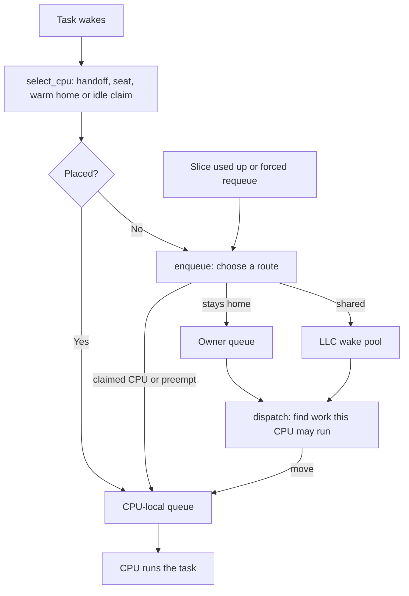
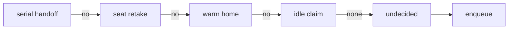
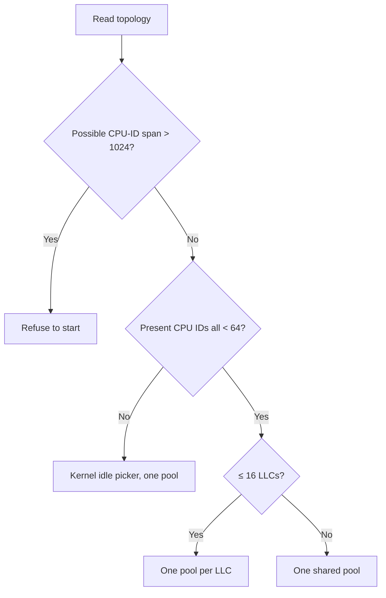
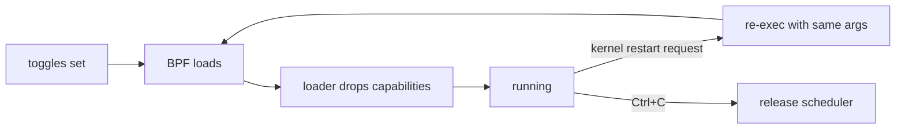

# scx_cake design

The scheduling policy in this checkout · commands and flags: [README.md](./README.md)
· measurements and history: [STATE.md](./STATE.md).

## 💡 Idea

Run waiting tasks quickly **without moving them away from the cache they need**.
Inputs: task behaviour, idle CPUs and topology. Games are never identified by name.

| Term | Meaning |
|---|---|
| CPU | a logical CPU; SMT siblings share one core |
| LLC | last-level cache shared by a group of CPUs (an AMD CCD) |
| One-word host | every present CPU ID is below 64, so one 64-bit word holds a CPU set |
| Handoff floor | 1,464 ns: a run this short "woke someone and got out of the way" |
| Seat | one-word hosts: the CPU a stage task last blocked on. Others avoid it while it sits idle; once something else runs there, the stage may take it back |
| IRQ-busy | an IRQ sink, inside a handler now, or 🧩 IRQ-hot ([signals](#-interrupt-aware-placement)) |

| Queue | Holds |
|---|---|
| 🏠 CPU-local queue | the kernel's per-CPU queue: what that CPU runs next |
| 👤 Owner queue | one per CPU, ordered by virtual runtime; other CPUs may steal from it |
| 🌊 LLC wake pool | one per LLC, ordered by virtual runtime (one shared pool when the layout does not fit) |

Task classes come from the kernel's per-task totals: mean wait = `run_delay / pcount`,
mean burst = `sum_exec_runtime / nvcsw`.

| Class | Rule | Used for |
|---|---|---|
| Starved | mean wait > mean burst | never preempted on wake; deeper wake key |
| Turn-starved | mean wait > 2 × mean burst | takes the wake path; may leave its home |
| Stage | mean burst ≥ 64 µs | earns a seat; keeps its home on SYNC wakes; may move to the preferred LLC |
| Sub-handoff | mean burst < handoff floor | keeps its warm home even when turn-starved |

---

## 🧭 Where work goes



Affinity applies everywhere. A read of the idle word or mask is only a candidate list;
**the atomic idle claim decides**. Kicks and preempt requests only notify a CPU.

### 1️⃣ CPU selection (`select_cpu`)



| Step | Rule |
|---|---|
| 🤝 Serial handoff | queue behind the waker on its CPU, no preempt, when: that CPU's last 3 runs each woke a task and blocked within the handoff floor · the waker is within one handoff of its mean burst end · that CPU's own and local queues are empty · ≥ 3/4 of its LLC is idle · it is not IRQ-busy · the wake is not `WAKE_SYNC` or a 🧩 device wake |
| 💺 Seat retake | a stage task takes its seat back from a queued, unpinned, non-stage task with PREEMPT (enqueue reroutes that task); only once something else ran there, never on an IRQ-busy CPU |
| 🔥 Warm home | the previous CPU, if idle. Skipped for: a SYNC wake that is not a stage · a core not fully idle (one-word hosts) · another task's held seat · turn-starved and not sub-handoff · IRQ-busy · a contended core (wide hosts) |
| 🧊 Idle claim | one-word hosts, inside one LLC: the task's, or the waker's for a non-stage task on a multi-LLC host; a stage off the preferred LLC moves there when a whole core is free. The starting CPU first if it is a whole idle core, no seat and no IRQ sink, then up to `claim_tries` picks by: big cores (hybrid) → whole idle core → not a seat → no IRQ sink on the core, not in deep idle → platform rank → lowest ID |
| ⤵️ Undecided | the previous CPU runs a task that is not starved, and the wakee is neither a kernel thread nor turn-starved: claim a clean idle CPU (below). Otherwise enqueue routes it |

**Clean idle pick** (enqueue uses it too): one-word hosts rank the task's LLC as above
in two passes, first skipping IRQ-busy CPUs and those with a tick due. If
every claim loses, multi-LLC hosts give up (the caller offers the work to another LLC)
and single-LLC hosts walk the idle word again. Wide hosts ask the kernel picker. Both
take a whole idle core, then any idle CPU.

### 2️⃣ Enqueue (selection did not place it)

| Case | Route |
|---|---|
| Kernel-thread wake, unpinned | clean idle CPU, flat 3 ms slice · else the wake path |
| Kernel-thread wake, pinned | its CPU's local queue, flat 3 ms; preempts if its key is more than 3 ms earlier than the occupant's live vtime |
| Turn-starved wake, unpinned | the wake path |
| Wake whose CPU runs a task that is not starved (unpinned) | that task is past its slice, the tick has not stopped it, and it is not a stage on its own seat → preempt it · else pool + idle kick |
| Forced requeue, or seat collision (unpinned) | clean idle CPU · else pool + idle kick |
| Pinned wake, own queue empty | its CPU's local queue at once, no dispatch pass: when that CPU is idle, or to preempt its occupant by the same test, with its own slice |
| Anything else: continuation, pinned wake, other wakes | its CPU's owner queue (a pinned wake may preempt by the same test, with its own slice, sent as a kick), then kick an idle CPU unless the task is still on its CPU with nothing else waiting there or in its pool |

**Wake path**, in order:

1. A wake racing its own switch-out → its owner queue.
2. A clean idle CPU.
3. Preempt the CPU's occupant if the wakee's raw vtime (before the key floor) is
   earlier than the occupant's live vtime and the occupant ran ≥ min(wakee slice,
   187.5 µs). Never a starved task or a stage on its own seat.
4. The same test on up to 3 neighbours in steal order (IDs below 128), with
   min(wakee slice, 750 µs).
5. The pool, one more idle search and kick; if none is free, multi-LLC hosts offer it
   to an idle CPU on another LLC.

### 3️⃣ Dispatch


| Step | Rule |
|---|---|
| Offer | multi-LLC: an idle CPU picked by another LLC serves that LLC's pool at once |
| Own queue or pool | pool first if the own queue is empty, its head's key is more than 3 ms earlier, or it went unserved for 24 ms; then the other |
| Seat stays free | a held seat with an empty own queue claims and kicks a free non-seat CPU on its LLC that can run the work, and stays idle; it serves the pool itself if no claim wins or the pool went unserved for 24 ms |
| Forward | one-word hosts, both moves failed (affinity): kick an idle CPU on this LLC that can run the pool head, non-seat first |
| Steal | other owner queues in steal order, SMT sibling first; another LLC's queue only if its head is a slice behind the frontier |
| Other pools | multi-LLC: only a head a slice behind the frontier, or a pool unserved for 24 ms |
| Nothing | both queues empty: re-pick up to 4 times for a pool insert under way; then `prev`, if still runnable, keeps running with a fresh slice |

✅ Only a successful queue move proves work was taken; counts and marks are hints.

---

## 🔍 Hardware discovery

The loader reads CPU IDs, SMT siblings and LLCs at start; nothing from the build
machine is baked in.



| Detail | |
|---|---|
| ID span | counts sparse and offline IDs, not just online CPUs |
| Steal order | same LLC, then LLCs with the same cache size, then the rest; within each, SMT sibling first, then the following IDs, wrapping. Precomputed below ID 128; wider hosts walk a ring |
| Idle word | one-word hosts: cake keeps its own word of really idle CPUs, changed only by `ops.update_idle` and the dispatch re-arm, and runs without `SCX_OPS_KEEP_BUILTIN_IDLE`, so the kernel stops updating its masks. A claim sets a bit in a second word on the same line, cleared when that CPU next goes idle. Claimable is idle and not claimed; the whole-core read ignores claims, so a claimed core stays whole until that CPU runs. Wide hosts keep the kernel's masks and picker |
| Claim tries | max(4, online CPUs in the widest LLC / 4) |
| Preferred LLC | multi-LLC one-word hosts: the most big cores; on a V-cache pair, the cache LLC in AMD `cache` mode, else the other; otherwise the largest cache (`cache` mode) or highest platform preference. The mode is re-read every second |
| Deep idle | one-word hosts avoid a CPU in an idle state slower to exit than the handoff floor |
| Core ranking | full capacity data, then preferred-core hints; unknown cores never rank below known ones |
| Optional kernel features | detected at start, with fallbacks ([README table](./README.md#-stock-kernel-or--patched-kernel)) |

---

## ⚡ Interrupt-aware placement

| Signal | Source |
|---|---|
| IRQ sink | the loader reads each CPU's handler time every 1–4 s and cuts at the widest gap; 2 windows above the cut mark a sink, 3 below clear it |
| Handler running now | IRQ and softirq entry/exit hooks keep a per-CPU depth |
| Tick about to fire | next tick within one wake hop (startup probe p99; off if that exceeds a quarter tick) |
| 🧩 IRQ-hot | `--kernel-signals on`: more than 1/8 of recent time in handlers |

Hints only: a noisy CPU is still used when nothing cleaner is free.

---

## ⚖️ CPU time and fairness

Virtual runtime charges CPU time scaled by nice weight. A shared frontier, raised in
`ops.running`, bounds how old a key can be (not a strict global order). `ops.running`
also stamps each run with the CPU's rq clock as the kernel last updated it.

| Key floor | |
|---|---|
| Normal | frontier − 3 ms |
| Starved | lower by 3/4 of (3 ms − mean burst) |
| Forced requeue | lower by 2.25 ms |

Slice (ns), with one division:

```text
n     = voluntary switches | 1
slice = max(1464, min(2 * floor(runtime / n), floor(age / (2 * n)), 1500000))
```

Age under 3 ms counts as 3 ms; the low 5 bits are cleared (they tag pooled tasks).
Kernel threads placed directly get a flat 3 ms. A slice is a budget the kernel tick
enforces, not a preemption promise: cake has no `ops.tick`.

A `sched_yield` keeps its slice unless something waits for this CPU: another task on
its run queue, work in its LLC pool, or another LLC's offer. Then the slice drops to 0,
as the kernel does without `ops.yield`.

---

## 🔄 Lifecycle



Cake asks the kernel for a 5 s runnable-stall watchdog.

## ⏳ Starvation fallback (24 ms)

| | |
|---|---|
| Stamp | each pool's served time, refreshed when served or seen empty |
| Past 24 ms (`WAKE_STARVE_WALL_NS`) | dispatch serves that pool first, overrides the seat rule, and lets other LLCs take it |
| Not | per-task timing, nor a 24 ms service promise |
| Value | eight 3 ms slices; not derived from behaviour or hardware |

## ⚠️ Known limits

| Limit |
|---|
| The wait-vs-burst products can overflow for very long-lived, very busy tasks |
| A late queue mark or remote offer can delay cross-LLC service |
| Passing the verifier and the tests does not prove performance |
