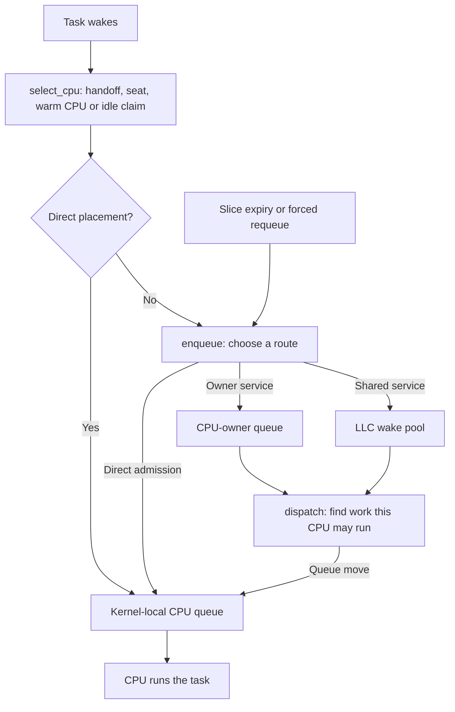
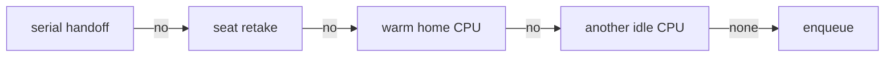
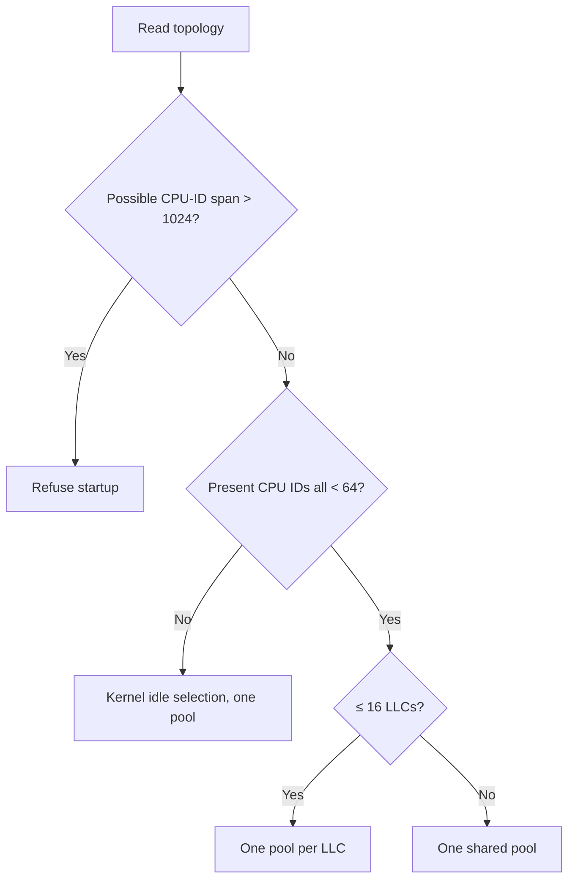
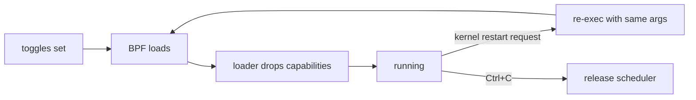

# scx_cake design

The scheduling policy in this checkout · commands and flags: [README.md](./README.md)
· measurements and history: [STATE.md](./STATE.md).

## 💡 Idea

Serve waiting tasks promptly **without moving them away from useful cache data**.
Inputs: task activity, CPU availability, topology — games are never identified by name.

| Term | Meaning |
|---|---|
| CPU | a logical CPU |
| SMT siblings | logical CPUs sharing one core |
| LLC | last-level cache shared by a CPU group |
| DSQ | a `sched_ext` dispatch queue |

| Queue | Holds |
|---|---|
| 🏠 Kernel-local queue | work admitted to one CPU, directly or by dispatch |
| 👤 CPU-owner queue | work tied to one CPU; other eligible CPUs may steal it |
| 🌊 LLC wake pool | shared work for one LLC's CPUs (one shared pool when the topology does not fit) |

---

## 🧭 Where work goes



Affinity applies throughout; the diagram groups decisions, not every condition.

### 1️⃣ CPU selection



| Step | Rule |
|---|---|
| 🤝 Serial handoff | keep communicating tasks together when both queues are empty and the current task is about to yield |
| 💺 Seat retake | a **stage task** (mean burst ≥ 64 µs) holds a seat on a CPU; a returning holder may displace an eligible non-stage occupant · preference, never overrides affinity |
| 🔥 Warm home | reuse the previous CPU when its whole core is idle |
| 🧊 Another idle CPU | prefer whole idle cores, unheld seats, cleaner IRQ targets, platform core ranking |

> [!NOTE]
> An idle-mask snapshot is only a candidate list; **the atomic idle claim decides**.
> With 🧩 lean `lazy` a just-claimed CPU's core still reads as whole-idle until it runs,
> so more wakes keep their warm home ([STATE: why lazy wins](./STATE.md#why-lazy-wins)).

### 2️⃣ Enqueue (selection did not insert)

| Wake kind | Route |
|---|---|
| Kernel thread | idle CPU · else (unpinned) the pool |
| Mean wait > 2× mean burst, unpinned | pool · a wake racing its own switch-out stays in its owner queue |
| Behind a well-served occupant | direct idle admission · else the pool |
| Forced requeue / displaced seat occupant | may enter a pool |
| Continuation | owner queue · pinned tasks stay on their CPU |

Kicks and preemption requests notify CPUs; a kick does not start a task at once.

### 3️⃣ Dispatch


- A held seat with an empty owner queue may defer to another idle, unheld CPU on the same LLC; overdue pool work overrides that.
- ✅ Only a successful queue move proves work was consumed; counts and marks are hints.

---

## 🔍 Hardware discovery

Read at startup (CPU IDs, SMT siblings, LLC membership); nothing from the build host is baked in.



| Detail | |
|---|---|
| ID span | counts sparse and offline IDs, not online CPUs |
| Steal tables | cache-aware below ID 128; wider layouts walk a generic ring |
| Core ranking | complete capacity data, then preferred-core hints; unknown cores never ranked below known |
| Optional kernel features | native CTZ/POPCNT, lean idle claim, wake signals, cached rq clock — detected at startup with fallbacks ([README table](./README.md#-stock-kernel-or--custom-patch)) |

---

## ⚡ Interrupt-aware placement

| Signal | Source |
|---|---|
| Sustained interrupt load | handler-time shares sampled every 1–16 s |
| A handler running now | IRQ/softirq entry and exit hooks track depth |
| An imminent tick | tick deadline vs the startup wake-hop estimate |

Hints only: noisy CPUs stay usable when nothing cleaner is free.

---

## ⚖️ CPU time and fairness

Virtual runtime charges CPU time with reciprocal nice weights; wake keys and a shared
frontier order service (not a strict global order). `ops.running` stamps each run
with the CPU's rq clock as last updated by the kernel.

Adaptive slice (ns), computed with one division:

```text
n     = voluntary switches | 1
slice = max(1464, min(2 * floor(runtime / n), floor(age / (2 * n)), 1500000))
```

| | |
|---|---|
| Fixed **3 ms** slice | some paths, incl. local kernel-thread wake admission |
| A slice is | a budget, not a preemption promise |
| Startup handoff probe | informs tick look-ahead only |

---

## 🔄 Lifecycle



Cake requests a 5 s runnable-stall watchdog.

## ⏳ Starvation fallback (24 ms)

| | |
|---|---|
| Stamp | each wake pool's service stamp, refreshed when served or seen empty |
| Past `WAKE_STARVE_WALL_NS` (24 ms) | dispatch may prioritise the pool, override seat deferral, let another LLC help |
| Not | per-task timing, nor a 24 ms service guarantee |
| Value | eight 3 ms slices — not derived from behaviour or hardware |

## ⚠️ Known limits

| Limit |
|---|
| Lifetime wait/run comparison products can overflow at large counts |
| Late queue-mark or remote-offer publication can delay cross-LLC service |
| Serial-handoff eligibility uses the CPU-ID span, not the online count |
| Verifier acceptance and tests do not establish performance |
