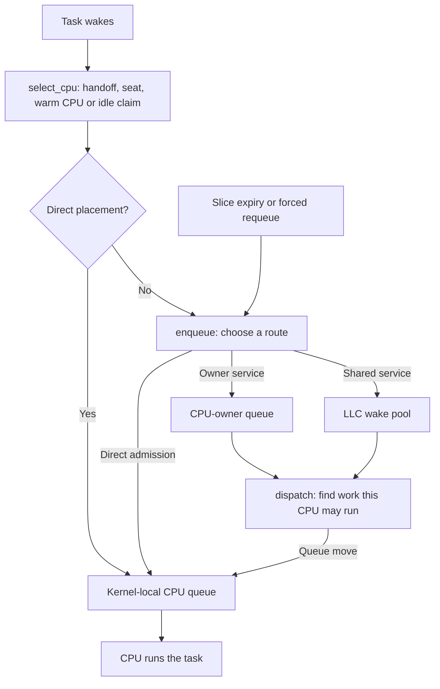
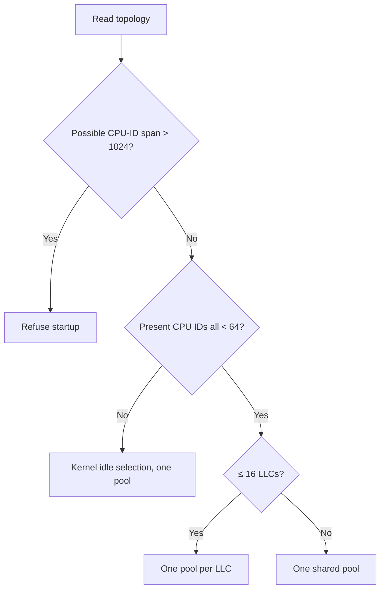

# scx_cake design

The scheduling policy in this checkout. Commands and flags: [README.md](./README.md).
Measurements and history: [STATE.md](./STATE.md).

## Idea

Serve waiting tasks promptly without moving them away from useful cache data.
Inputs are task activity, CPU availability and topology; games are never
identified by name.

A **CPU** is a logical CPU; **SMT siblings** share a core; an **LLC** is a
last-level cache shared by a group of CPUs; a **DSQ** is a `sched_ext` dispatch
queue.

| Queue | Holds |
|---|---|
| Kernel-local queue | Work admitted to one CPU, directly or by dispatch |
| CPU-owner queue | Work tied to one CPU; other eligible CPUs may steal it |
| LLC wake pool | Shared work for the CPUs of one LLC |

There is one wake pool per LLC when the topology fits, otherwise one shared pool.

## Where work goes



Affinity applies throughout; the diagram groups decisions, not every condition.

### CPU selection

In order: serial handoff, seat retake, warm home CPU, then another idle CPU.

- **Serial handoff** keeps communicating tasks together when both queues are
  empty and the current task is about to yield.
- A **seat** links a **stage task** (mean burst ≥ 64 µs) to a CPU. A returning
  holder can displace an eligible non-stage occupant. A seat is a preference,
  not a reservation, and never overrides affinity.
- **Warm placement** reuses the task's previous CPU when its whole core is idle.
- Otherwise Cake prefers whole idle cores, unheld seats, cleaner interrupt
  targets and platform core rankings.

An idle-mask snapshot is only a candidate list; the atomic idle claim decides.

### Enqueue

When selection did not insert the task:

- Kernel-thread wakes try an idle CPU; with none, an unpinned one enters the pool.
- Unpinned wakes whose mean wait exceeds twice their mean burst enter the pool.
  A wake racing its own switch-out stays in its owner queue.
- A wake behind a well-served occupant tries direct idle admission, then the pool.
- Forced requeues and displaced seat occupants can enter a pool.
- Continuations stay in their owner queue; pinned tasks stay on their CPU.

Kicks and preemption requests notify CPUs; a kick does not start a task at once.

### Dispatch

Dispatch tries an offered task from another LLC, then the owner queue and the
local pool, ordered by virtual runtime and how long the pool has gone unserved.
A held seat with an empty owner queue may defer to another idle, unheld CPU on
the same LLC; overdue pool work overrides that. Failing local service, Cake
forwards a kick, steals from other owner queues and checks other pools. Only a
successful queue move proves work was consumed; counts and marks are hints.

## Hardware discovery

The loader reads CPU IDs, SMT siblings and LLC membership at startup; nothing
from the build host is baked in.



The ID span counts sparse and offline IDs, not online CPUs. Cache-aware steal
tables cover IDs below 128; wider layouts walk a generic ring. Core rankings use
complete capacity data, then preferred-core hints; unknown cores are not ranked
below known ones.

Optional kernel features (native CTZ/POPCNT, wake signals, the cached rq clock)
are detected at startup with fallbacks; see the README's kernel table.

## Interrupt-aware placement

| Signal | Source |
|---|---|
| Sustained interrupt load | Handler-time shares sampled every 1–16 s |
| A handler running now | IRQ/softirq entry and exit hooks track depth |
| An imminent tick | Tick deadline against the startup wake-hop estimate |

These are hints: noisy CPUs stay usable when nothing cleaner is free.

## CPU time and fairness

Virtual runtime charges CPU time with reciprocal nice weights; wake keys and a
shared frontier order service (not a strict global order). `ops.running` stamps
each run with the CPU's rq clock as last updated by the kernel.

Adaptive slice, all in nanoseconds:

```text
n     = voluntary switches | 1
slice = max(1464, min(2 * floor(runtime / n), floor(age / (2 * n)), 1500000))
```

The implementation computes this with one division. Some paths, including
local kernel-thread wake admission, use a fixed **3 ms** slice. A slice is a
budget, not a preemption promise. The startup handoff probe only informs tick
look-ahead.

## Lifecycle

Toggles are set before the BPF loads (`probe` only). After setup the loader
drops its thread's capabilities; a kernel-requested restart re-executes the
binary with its arguments; Ctrl+C releases the scheduler. Cake requests a
five-second runnable-stall watchdog.

## Starvation fallback (24 ms)

Each wake pool keeps a service stamp, refreshed when served or seen empty. Past
`WAKE_STARVE_WALL_NS` (24 ms), dispatch can prioritise the pool, override seat
deferral and let another LLC help. It neither times individual tasks nor
guarantees service within 24 ms; the value (eight 3 ms slices) is not derived
from current behaviour or hardware.

## Known limits

- Lifetime wait/run comparison products can overflow at large counts.
- Late queue-mark or remote-offer publication can delay cross-LLC service.
- Serial-handoff eligibility uses the CPU-ID span, not the online count.
- Verifier acceptance and tests do not establish performance.
