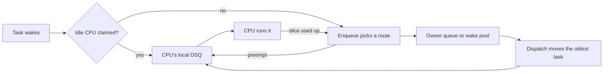

# scx_cake

scx_cake is a Linux sched_ext CPU scheduler tuned for games and fine for
everyday use. It aims for three things: no task waits while a CPU sits
free, tasks stay near their warm cache, and CPU time stays fair. It
decides from how tasks behave and how the CPUs are laid out, never from a
game name or a profile. The name comes from the CAKE network queue
manager.

Cake runs on any kernel with sched_ext and needs no flags: the default is
the policy.

> [!NOTE]
> This README describes this checkout. An installed package may be older
> or newer, so check `scx_cake --version` and `scx_cake --help`.

| To | Read |
|---|---|
| Run cake | [Quick start](#quick-start) |
| Learn how it schedules | [How it works](#how-it-works) |
| Check the results and how they were measured | [Research](#research) |
| Build, test or change cake | [Development](#development) |

## Quick start

With a distribution package, through `scx_loader`:

```sh
scxctl start --sched cake    # start cake
scxctl get                   # show the running scheduler
scxctl stop                  # return to the kernel's default scheduler
```

From this checkout, after a [build](#build):

```sh
./target/release/scx_cake    # run the default policy; Ctrl+C stops it
```

Loading a scheduler needs permission from your scheduler service or an
admin. While cake runs, `cat /sys/kernel/sched_ext/root/ops` starts with
`cake`.

Two flags inspect the host and the binary without attaching:

```sh
scx_cake --version           # version and binary SHA-256
scx_cake --print-topology    # CPU layout and core preferences
```

Unknown options, such as the old `--profile gaming` or `-p powersave`
from `scx_loader`, are skipped with a warning. Cake still starts.

> [!WARNING]
> The kernel removes cake if a runnable task waits 5 s, and the CPUs go
> back to the default scheduler. That watchdog is a safety net, not a
> latency promise.

## Requirements

Cake needs a kernel with `CONFIG_SCHED_CLASS_EXT=y`, BPF and BTF (see
[kernel.config](../../../kernel.config)). Building it needs the
repository's [Rust toolchain](../../../rust-toolchain.toml), Clang with
BPF support and the
[build dependencies](../../../README.md#build--install).

### Kernel features

The [experimental-patches](https://github.com/RitzDaCat/experimental-patches)
kernel adds speedups. Cake checks the running kernel at start, never the
build machine, and falls back when a feature is missing.

| Feature | Needs | Without it |
|---|---|---|
| Cached rq clock in `ops.running` | stock 6.14 or newer | `scx_bpf_now()` |
| Native CTZ/POPCNT | patch 1, and x86 BMI1 and POPCNT | portable bit math |
| Direct DSQ index | patch 3, kernel side only | hash lookup |
| `--kernel-signals` (input and fence wakes, IRQ time) | patch 4 | reports it unavailable and runs normally |

Patch numbers follow the `kernel/sched-ext/cachyos-<ver>/` series in
experimental-patches.

## How it works

### Terms

| Term | Meaning |
|---|---|
| sched_ext | the kernel interface for CPU schedulers written in BPF; cake's policy runs in the kernel, its loader in user space |
| LLC | the last-level cache that a group of CPUs shares |
| DSQ | a sched_ext dispatch queue; each CPU also has a local DSQ that it runs tasks from |
| Owner queue | the DSQ each CPU owns for its own tasks |
| Wake pool | one shared DSQ per LLC for wakes that no CPU took at once |
| Virtual runtime | CPU time scaled by nice weight; queues are ordered by it, oldest first |
| Slice | how long a task may run before the scheduler looks again |
| Seat | a CPU that a pipeline-stage task, one with a mean burst of 64 us or more, returns to; a preference, not a reservation |

### The path of a task



1. When a task wakes, cake tries to claim an idle CPU for it. If it gets
   one, the task runs there next.
2. If not, enqueue preempts a task that used up its turn, or puts the
   task in its LLC's wake pool or its CPU's owner queue. A task pinned to
   one CPU goes straight to that CPU's local DSQ when its owner queue is
   empty and the CPU is idle or the task wins the preempt test.
3. A task that uses up its slice goes back to its CPU's owner queue.
4. A CPU that needs work takes offers from other LLCs first, then its own
   queue or the pool, oldest first, and steals from other CPUs' queues
   last.
5. A task that calls `sched_yield` keeps its slice unless work waits for
   its CPU.

Placement weighs a warm cache, whole idle cores, SMT siblings, big cores
first on hybrid CPUs, the platform core ranking and IRQ load. IRQ load
counts the measured share, a handler running now and the next tick.

The slice comes from the task's own run time, age and voluntary switches.
The floor is 1464 ns and the cap is 1.5 ms. Kernel threads placed
directly get a flat 3 ms.

### Where it is in the source

Each step is a sched_ext callback in
[src/bpf/cake.bpf.c](./src/bpf/cake.bpf.c).

| Callback | The kernel calls it when | Cake |
|---|---|---|
| `cake_select_cpu` | a task that may run on more than one CPU wakes | handoff, seat, warm home or idle claim |
| `cake_enqueue` | a task becomes runnable and was not placed | picks the route in step 2 |
| `cake_dispatch` | a CPU's local DSQ is empty | moves work as in step 4 |
| `cake_yield` | a task calls `sched_yield` | keeps or zeroes the slice |
| `cake_running`, `cake_stopping` | a task starts or stops running | stamps the run, charges its virtual runtime |
| `cake_cpu_release` | a higher scheduling class takes the CPU | re-enqueues the CPU's waiting local tasks so idle CPUs can serve them |
| `cake_update_idle` | a CPU goes idle or wakes | serves pool work that arrived as it went idle; keeps cake's idle word, or tracks idle CPUs past ID 63 on wide hosts |

The full rules, with every route and threshold, are in
[DESIGN.md](./DESIGN.md#-where-work-goes).

## Limits

| Limit | Value | Past it |
|---|---|---|
| Fast idle claim, seats, one pool per LLC | CPU IDs 0 to 63 | kernel idle picker, one shared pool |
| Wake pools | 16 LLCs | one shared pool |
| Cache-aware steal order | CPU IDs 0 to 127 | plain ring walk |
| CPU ID span | 1024, possible CPUs included | refuses to start |
| Starvation fallback | fixed 24 ms | dispatch serves the waiting pool first ([DESIGN.md](./DESIGN.md#-starvation-fallback-24-ms)) |

## Research

Cake changes by measurement: a pattern becomes the default only after an
A/B test against the current default, and rejected patterns leave the
code but keep their record.

| Where | What |
|---|---|
| [STATE.md](./STATE.md) | current state, the [pattern ledger](./STATE.md#pattern-ledger) of every pattern tried with its kernel need, numbers and verdict, and owed work |
| [docs/PERFORMANCE.md](./docs/PERFORMANCE.md) | how results are measured: metric levels, slot order, noise, build identity |
| [docs/research/](https://github.com/RitzDaCat/scx/blob/RitzDaCat/scx_cake-nightly/scheds/rust/scx_cake/docs/research/README.md) | dated investigations, each with its method and tables |
| [DESIGN.md](./DESIGN.md) | the policy as built and its known limits |
| [docs/README.md](./docs/README.md) | documentation map |

Results rank game frame times above synthetic frames, synthetic frames
above per-callback nanoseconds, and those above static instruction
counts. Each result names its build by the binary SHA-256 that
`scx_cake --version` prints. The bench harness and raw run data are kept
outside this repository; the reports above carry the numbers and the
method.

## Development

### Build

```sh
cargo build --locked --release -p scx_cake
```

`./scheds/rust/scx_cake/cake build` builds it too.

### Tests

```sh
cargo test --locked -p scx_cake
```

The tests never attach. The verifier-load test is ignored because it
needs BPF permission.

### Flags

The default needs no flags. Apart from the inspect flags, every flag is
for testing, and a flag leaves once its test ends.

Inspect and diagnose:

| Flag | Does |
|---|---|
| `-h`, `--help` | list flags and toggles, then exit |
| `-V`, `--version` | print the version and binary SHA-256, then exit |
| `--print-topology` | print the CPU layout and core preferences, then exit |
| `--inspect-bpf NEW_DIR` | load the BPF, save its instructions, exit without attaching |
| `-v`, `--verbose` | libbpf output, startup detail, IRQ-sink changes, kernel event counts at exit |

Testing:

| Flag | Default | Does |
|---|---|---|
| `--toggle NAME=0\|1` | | set a toggle; repeatable, the last one wins |
| `--handoff-ns NS` | `1464` | change the handoff floor: the slice floor, serial handoff, sub-handoff and deep-idle cutoffs |
| `--native-bitops` | auto | require native CTZ/POPCNT; fail without them |
| `--portable-bitops` | off | force portable CTZ/POPCNT |
| `--native-ring` | off | native-CTZ queue scan; only for hosts with one LLC and at most 64 CPU IDs |
| `--native-hist` | off | native CLZ for the probe histograms, used only with `probe=1` |
| `--kernel-signals off\|observe\|on` | `off` | patch 4: `observe` counts the signals, `on` also uses them for placement |
| `--signal-report NEW.csv` | off | save the signal counters at exit; needs `observe` or `on` |

The `probe` toggle defaults to `0`. Set to `1`, it prints placement and
delay diagnostics at exit, separate from `-v`. A bad toggle is skipped
with a warning.

### Versions

Versions are `MAJOR.MINOR.PATCH`. The minor number moves when a release
changes what the default scheduler decides, the patch number for fixes
that leave those decisions alone. Tester builds from experimental-patches
end in `-exp`.

### Bug reports

A bug report needs the version or commit, the kernel version, the CPU,
the launch arguments, and the scheduler and kernel logs.

### Source

| File | Purpose |
|---|---|
| [src/main.rs](./src/main.rs) | loader: flags, topology, attach, IRQ-sink monitor |
| [src/core_performance.rs](./src/core_performance.rs) | platform core ranking, read once at start |
| [src/bpf/cake.bpf.c](./src/bpf/cake.bpf.c) | scheduling policy |
| [src/bpf/wake-signals.bpf.h](./src/bpf/wake-signals.bpf.h) | `--kernel-signals` reads |
| [src/bpf/intf.h](./src/bpf/intf.h) | shared constants and limits |
| [bench/README.md](./bench/README.md) | bench tools |

## License

GPL-2.0-only.
