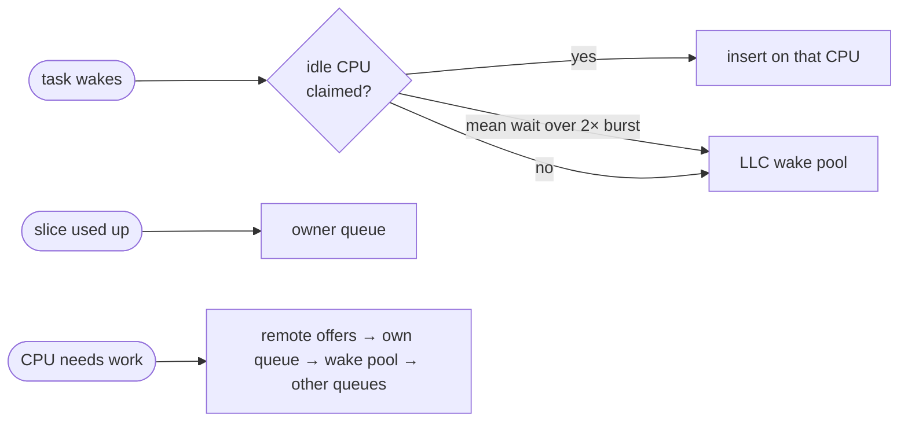

# scx_cake

A Linux `sched_ext` CPU scheduler for gaming responsiveness and general use.

| | |
|---|---|
| 🎯 Goal | runnable tasks never wait needlessly · cache locality kept · fair CPU service |
| 🧠 Decides by | task activity + hardware topology — never game names or profiles |
| 🍰 Name | from the CAKE network queue manager |

> [!NOTE]
> This README describes this checkout; an installed package may differ
> (`scx_cake --version`, `scx_cake --help`).

---

## 🚀 Build and run

| Needs | |
|---|---|
| Kernel | `CONFIG_SCHED_CLASS_EXT=y`, BPF, BTF ([kernel config](../../../kernel.config)) |
| Toolchain | repo [Rust toolchain](../../../rust-toolchain.toml), Clang with BPF, [build deps](../../../README.md#build--install) |
| Permission | to load a scheduler (your scheduler service or administrator) |

```sh
cargo build --locked --release -p scx_cake   # or: ./scheds/rust/scx_cake/cake build
./target/release/scx_cake --version          # inspect, no attach
./target/release/scx_cake --print-topology   # inspect, no attach
./target/release/scx_cake                    # run the default policy
```

| Check | |
|---|---|
| Active? | `cat /sys/kernel/sched_ext/root/ops` → starts with `cake` |
| Stop | Ctrl+C → kernel default scheduler |
| Watchdog | 5 s runnable-stall recovery (not a latency guarantee) |

---

## 🐧 Stock kernel or 🧩 custom patch

Runs on any supported kernel. Custom-patch features
([experimental-patches](https://github.com/RitzDaCat/experimental-patches)) are detected
on the **running** machine at startup, never at build time; without them Cake falls back.

| Feature | Needs | Without it |
|---|---|---|
| Cached rq clock in `ops.running` | 🐧 ≥ 6.14 | `scx_bpf_now()` |
| Native CTZ/POPCNT | 🧩 patch 1 + x86 BMI1/POPCNT | portable builtins |
| Direct DSQ index | 🧩 patch 2 (kernel only) | hash lookup |
| `--kernel-signals` (input/fence wake, IRQ time) | 🧩 patch 3 | reports unavailable, runs normally |
| **Lean idle claim, `lazy` by default** | 🧩 patch 4 | regular idle claim, silently |

Measured results and verdicts: [STATE.md](./STATE.md) pattern ledger.

---

## 🎛️ Flags

The default policy needs **no flags**; everything except inspection is for testing.

| Flag | Default | Behaviour |
|---|---|---|
| `-h` `--help` | — | flags and toggles, exit |
| `-V` `--version` | — | version + binary SHA-256, exit |
| `--print-topology` | — | topology and core preferences, exit |
| `-v` `--verbose` | off | libbpf output, startup detail, IRQ diagnostics, exit counts |
| `--inspect-bpf NEW_DIR` | off | load BPF, dump instructions, exit without attaching |
| `--toggle NAME=0\|1` | — | override a toggle; repeatable, last wins |
| `--handoff-ns NS` | — | override the handoff threshold |
| `--lean-idle off\|on\|lazy` | `lazy` | 🧩 lean idle claim; only an explicit request warns when absent |
| `--native-bitops` | auto | require native CTZ/POPCNT; fail if unavailable |
| `--portable-bitops` | off | force portable CTZ/POPCNT |
| `--native-ring` | off | CTZ queue scan on single-LLC hosts |
| `--native-hist` | off | native CLZ for probe histograms (`probe=1` only) |
| `--kernel-signals off\|observe\|on` | off | `observe` counts; `on` uses them for placement |
| `--signal-report NEW.csv` | off | save signal counters at exit (needs `observe`/`on`) |

> [!TIP]
> Unknown options (old `--profile gaming`, `-p powersave` from `scx_loader`) and invalid
> toggles are ignored with a warning — **Cake still starts**.

| Toggle | Default | Controls |
|---|---|---|
| `probe` | `0` | placement and delay diagnostics, reported at exit (independent of `-v`) |

---

## ⚙️ How scheduling works

**LLC** = last-level cache shared by a CPU group · **DSQ** = `sched_ext` dispatch queue ·
one owner queue per CPU + one wake pool per LLC.



| Weighs | |
|---|---|
| 📍 placement | cache warmth · whole idle cores · SMT interference · capacity hints · IRQ load (sampled share, live handlers, tick look-ahead) |
| 💺 seat | links a CPU to a pipeline-stage task — a preference, not a reservation |
| ⏱️ order | virtual runtime by CPU time and nice weight |
| ✂️ slice | from lifetime runtime, age, voluntary switches · floor **1,464 ns** · cap **1.5 ms** · some paths fixed **3 ms** |

Details: [DESIGN.md](./DESIGN.md).

---

## 📏 Limits

| Limit | Value | Beyond it |
|---|---|---|
| Narrow claim / seat / per-LLC pool paths | CPU IDs 0–63 | kernel idle picker, one pool |
| LLC pools | 16 | collapse to one |
| CPU-ID span | 1,024 (possible CPUs included) | refuses attach |
| Starvation fallback | fixed **24 ms** | dispatch favours an unserved pool ([DESIGN](./DESIGN.md#starvation-fallback-24-ms)) |

---

## 🧪 Tests and bug reports

```sh
cargo test --locked -p scx_cake   # never attaches; the verifier-load test is ignored (needs BPF permission)
```

🐞 Bug report: version or commit · kernel version · CPU · launch arguments · scheduler and kernel logs.

## 🗂️ Source

| File | Purpose |
|---|---|
| [src/main.rs](./src/main.rs) | loader: flags, topology, attach, IRQ monitoring |
| [src/bpf/cake.bpf.c](./src/bpf/cake.bpf.c) | scheduling policy |
| [src/bpf/intf.h](./src/bpf/intf.h) | shared constants and limits |
| [DESIGN.md](./DESIGN.md) | policy and known limits |
| [STATE.md](./STATE.md) | status, pattern ledger, owed work |
| [docs/README.md](./docs/README.md) | documentation map |
| [bench/README.md](./bench/README.md) | bench tools |

License: GPL-2.0-only.
