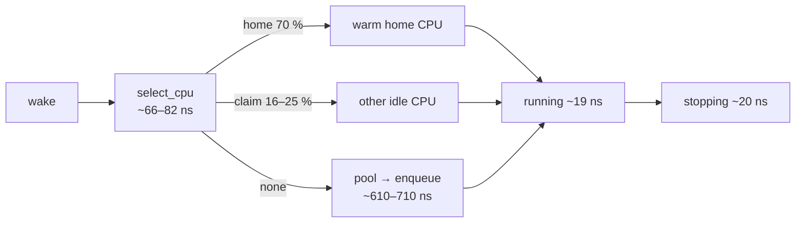
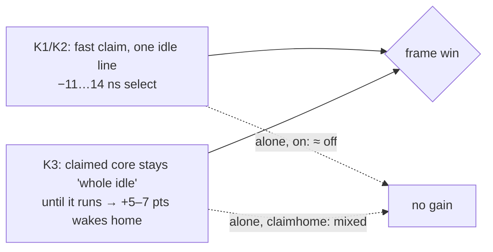

# scx_cake — current state

> [!IMPORTANT]
> Read first, every session. Rules: repository-root `CLAUDE.md` · behaviour: `DESIGN.md`
> · history: `docs/archive/STATE_ARCHIVE.md` (newest first; grep it, never read it whole).
> **Offload:** once nothing in an entry is owed, move it word for word to the archive top;
> owed items move to [Owed](#owed) first.

**Legend** · ✅ default / kept · ❌ rejected · ➖ no effect · 🧪 under test · ⏳ owed
· 🐧 stock kernel · 🧩 custom cake kernel patch

---

## Now (2026-10-20)

| | |
|---|---|
| 🌿 Code | policy since `fe076988f` (lean idle `lazy` default) plus §G100 pinned wake fast lane `26b8f2604` and §G101 `ops.yield` keep `1218ad972`, 2026-10-29 · upstream RCU verifier fix `0e6dee3b7` backported locally as `3f8c3cb0e` · `RitzDaCat/scx_cake-nightly` pushed 2026-10-29 through these and their docs · last upstream merge PR #3797 (`5f5823e2f`) |
| 🖥️ Host | stock `7.2.10-1-cachyos` since 2026-10-15, so **no 🧩 feature is active**: portable bitops, lean `lazy` falls back silently, no DSQ index or signals · `7.2.9-2-cachyos-custom` still installed; experimental-patches carries a `cachyos-7.2.10` series (1 bitops, 2 lean idle, 3 DSQ index, 4 wake signals) · 🧩 results below were measured on 7.2.9-custom with `sched_ext.dsq_direct=Y` · 7.2.9 sets `SCX_RQ_IN_WAKEUP` only on the core wakeup path, so pre-7.2.9 numbers are not comparable |
| ⚙️ Defaults | native CTZ/POPCNT (auto) · E1 cached rq clock in `ops.running` · **lean idle `lazy`** (silent fallback without the kernel flag) · §G100 pinned wake fast lane · §G101 `ops.yield` keep · policy base: 2026-09-28 pool-serving C (archive) |
| 🧪 Test-only flags | `--native-bitops` `--portable-bitops` `--native-ring` `--native-hist` `--kernel-signals` `--signal-report` `--handoff-ns` `--toggle probe=1` `--inspect-bpf` `--lean-idle` — the release is flagless |

---

## 2026-10-20 · RCU backport and upstream stall audit

| | Finding / evidence boundary |
|---|---|
| RCU backport | `3f8c3cb0e` cherry-picks upstream `0e6dee3b7`: `cake_wake_place` stays noinline, becomes static, and drops `curr`'s trusted/nullable annotations so the verifier follows the caller's RCU pointer. No scheduling-policy change. |
| Checks | Package fmt, debug/release Clippy, release build, 45 tests passed; 1 privileged topology-verifier test ignored. Existing unrelated `scx_rustland_core` unused-manifest-key warning remains. No new verifier load, bpf-next test, activation or game capture. Installed cake 1.2.2 remains active. |
| Upstream baseline | Installed `scx-scheds 1.1.4-1` / cake 1.2.2 has the exact Cake `src/` tree of nightly `9db04489e` (September 22). Current upstream additionally has the RCU fix. |
| Unconfirmed report | One upstream user reportedly sees a game stall after about 10 minutes. Kernel/game/logs unknown; source audit only. No cause or ten-minute trigger established. |
| Accumulating virtual-time lead | Upstream retains the uncapped charge and peer-limited frontier behind the archived September 25–26 multi-second runnable-task stalls. Nightly's `99377e26f` bounds both. Historical evidence: archive entry "G98 BOUNDED VTIME LEAD" and `git show 99377e26f:scheds/rust/scx_cake/STATE.md`; not rerun here. |
| Pool counter corruption | Upstream lacks stopping's slice-residue clear, included in nightly `8fc5ec9b1`. An extracted upstream `cake_pool_seen` test turned ordinary charged slice bits into a false pool decrement (0 to -1); the next real insert falsely read empty. Nightly's clear prevented it. Offline arithmetic proof only; no kernel-race or game-stall reproduction. Archive: "POOL TOKEN LEAK FIXED". |
| Memory shape | CPU/pool arrays and diagnostic rings are fixed-size; task-storage records follow live tasks. No obvious ever-growing event history found. No runtime memory-leak measurement. |

## Pattern ledger

Metric levels follow `CLAUDE.md` (1 = game frames … 4 = static counts).

| | Pattern | Kernel | Best evidence | Next |
|---|---|---|---|---|
| ✅ | **Lean idle claim `lazy`** (K1–K4, `SCX_OPS_LEAN_IDLE` + `_LAZY_SMT`) | 🧩 patch 2 · else regular claim | KovaaK's (CPU-limited: uncapped ~770 FPS, GPU ~39 %) quiet: avg FPS **+1.4 %**, p99 **−5.1 %**, 1 % low **+7.5 %**, stddev −18 % (16/16) · 16 hogs: 0.1 % low +6.6 %, max −16 %, nothing worse · `on` ≈ `off` · [why](#why-lazy-wins) | ⏳ GPU-limited check, `cakebench cost` |
| ✅ | E1: `ops.running` reads cached `rq->scx.clock` | 🐧 ≥ 6.14 · else `scx_bpf_now()` | appsim 24 slots: running −3.10 ns [−4.32, −1.91], BPF −1.9 %, frames neutral | ⏳ game A/B |
| ✅ | Native CTZ/POPCNT (auto) | 🧩 patch 1 · else portable builtins | running −2.31 ns, select −4.11 / −0.2 ns · KovaaK's: no frame difference after 2 rounds ([evidence](#evidence)) | — |
| ✅ | D+F: wide-host idle popcount; `update_idle` pool interlock on every host | 🐧 (> 64 CPUs) | forced-wide, 2 rounds: `update_idle` −1.09 / −0.64 ns, running −2.69 / −1.05 ns, 0 stalls | ⏳ real > 64-CPU host |
| ✅ | Exit pool check, census identities, detach-first reports | 🐧 | identities exact in 4 probe slots; pending 0 at every exit | diagnostics only |
| 🧪 | Wake classes by waker context (IRQ / kthread / game / other) | 🐧 | KovaaK's 90 s: `dxvk-queue` IRQ-woken 731k× (GPU completion), mean 0.6 µs, worst 1.08 ms; game↔game worst 4.8 ms | policy under test |
| 🧪 | IRQ-woken wakes run next (idle CPU, else head of prev + PREEMPT) | 🐧 | KovaaK's under 16 hogs paused at slot 5/8; data unread | ⏳ rerun quiet |
| ⏳ | DSQ direct index (kernel) | 🧩 patch 3 · else hash | untested on hardware | reboot A/B |
| ➖ | Kernel wake signals (input/fence tags) | 🧩 patch 4 | KovaaK's 90 s: 0 of 8.4M wakes tagged (input via KWin socket; NVIDIA private waits) | nothing to act on here |
| ➖ | `bpf_fastcall` on scalar kfuncs | 🧩 | select −1.08 then +1.82 | — |
| ➖ | Mask removal via verifier return bounds | 🧩 | enqueue −8.2 did not repeat · stock prunes native path | — |
| ➖ | E2: whole-core word from idle word | 🐧 | select −0.01 ns | — |
| ➖ | Portable vs native bitops in game | 🧩 | round 1 favoured portable, round 2 did not replicate | — |
| ❌ | Block stash (wake class from 1 line) | 🐧 | frames within noise · [report](https://github.com/RitzDaCat/scx/blob/RitzDaCat/scx_cake-nightly/scheds/rust/scx_cake/docs/research/block-stash-20261012/README.md) | — |
| ❌ | claimhome (lazy placement, no patch) | 🐧 | placement reproduced, frame win not · [report](https://github.com/RitzDaCat/scx/blob/RitzDaCat/scx_cake-nightly/scheds/rust/scx_cake/docs/research/claimhome-20261012/README.md) | — |
| ❌ | `--native-ring` | 🧩 | KovaaK's mixed, within noise | — |
| ❌ | burstkey (cosmos requeue key: + runtime since wake) | 🐧 | KovaaK's no gain; worst frame +52 % · [report](https://github.com/RitzDaCat/scx/blob/RitzDaCat/scx_cake-nightly/scheds/rust/scx_cake/docs/research/burstkey-20261012/README.md) | — |
| ❌ | sibwake (same-process wake → waker's SMT sibling) | 🐧 | idle cores: avg −19 %, 1 % low −43 % (0/9) · 16 hogs: 0.1 % low +6 %, p99.9 −9 % (6–7/9) · [report](https://github.com/RitzDaCat/scx/blob/RitzDaCat/scx_cake-nightly/scheds/rust/scx_cake/docs/research/sibwake-20261012/README.md) | 🧪 saturation-only variant |
| 📌 | cosmos vs cake `lazy`, KovaaK's CPU-limited | 🐧 | cake better avg (+0.9 %), p99, 1 % low, jitter (cosmos 0–1/9 pairs); cosmos 0.1 % low +2 %, worst −5 % | ⏳ tail check GPU-limited / loaded |
| 📌 | Wake latency / sleep depth, cake vs cosmos | 🐧 | game threads wake onto CPUs idle 14–22 µs (cosmos 31–59) and run in p99 2–3 µs (cosmos up to 66) · `runs/sleepdepth_20261012/RESULT.md` | cosmos's tail edge is not hardware wake latency |
| 📌 | cosmos tail edge? 4 alternating runs | 🐧 | worst frame cake 3.36 / 4.82 ms, cosmos 2.36 / 4.99 ms; same-scheduler spread > cross-scheduler · `runs/cosmos_edge_20261012/RESULT.md` | noise; compare pooled tails only |
| 📌 | Deadlock 4-way (EEVDF, cake, cosmos, LAVD), GPU-limited 98 % | 🐧 | avg fps equal (±1.6 %); cake best 1 % low both slots (238.8 / 243.3 vs ≤ 238.3), worst frame 4.60 / 4.53 ms (EEVDF 6.18 / 5.21, LAVD 5.57 / 4.76, cosmos 4.38 / 5.36) · `runs/deadlock_4way_20261014/RESULT.md` | ⏳ CPU-limited Deadlock, more slots |
| 📌 | Deadlock repeat + upstream cake (6468d1b3c), GPU-limited 4K high | 🐧 | nightly best tails again: 0.1 % low 228.8 (upstream 224.8, EEVDF 209.9, cosmos 217.4, LAVD 216.5), worst 4.59 ms (4.72 / 5.37 / 4.80 / 6.45); nightly vs upstream within run overlap · `runs/deadlock_4way_20261014/RESULT.md` | ⏳ CPU-limited Deadlock |
| 📌 | Deadlock CPU-limited (GPU 83–87 %), 6 arms | 🐧 | nightly best avg 774.3 (+4.3 % vs EEVDF; upstream 763.6, cosmos 757.3, LAVD 744.0), 1 % low 469.0, p99 2.02 ms; 0.1 % low LAVD 409.1 ≈ upstream 408.7 > nightly 394.0; worst LAVD 2.84, upstream 3.21, nightly 5.14 · `runs/deadlock_4way_20261014/RESULT.md` | ⏳ nightly 0.1 % low vs upstream |
| 📌 | Spin storm vs EEVDF (tester's stress-ng recipe: extreme, high_gaming), HEAD `58601ccdd` | 🐧 7.3.0-5 | with RT stressors: unpinned medians ×1.8–247 EEVDF, same-CPU resume after an RT stop 7–28 % (EEVDF 100 %), BPF 3.51 CPUs (`cake_dispatch` 880 ns/run, 162 without RT) · without RT: sleeper ties, CPU-bound spinners trade median for avg/p99 · max won at nearly every point · [plan](https://github.com/RitzDaCat/scx/blob/RitzDaCat/scx_cake-nightly/scheds/rust/scx_cake/docs/research/spin-storm-20261028/README.md) | ⏳ §G93 gate or a v3 hold (§G99 ❌), rerun |
| ❌ | §G99 release hold: a pick a higher class displaces keeps its local head unless an idle CPU on its die is free (v1 `a408bf70`; v2 `8c3f84de` also carries the protect clock) | 🐧 hold stock · its `ops.stopping` move needs `scx_bpf_dsq_reenq` (7.1+), else `cpu_release` stays | extreme with RT, 6 × 20 s/arm, `noisy`: hog median 486–488 → 34–38 µs, sleeper overshoot 261–276 µs → 46–47 ns, IWI 1.13 M → 69 k/s; but the sleeper wakes 3.7–3.9 ms late at p50 (HEAD 24 µs; spins −66 %) and the pinned median rises 2.2 → 43–48 µs (all p 0.002) · [report](https://github.com/RitzDaCat/scx/blob/RitzDaCat/scx_cake-nightly/scheds/rust/scx_cake/docs/research/spin-storm-20261028/README.md) | ⏳ find the sleeper's wait, then v3 or the §G93 gate |
| 📌 | CPU-to-CPU wake map (c2clat: pinned waker → pinned wakee by futex), EEVDF vs cake `d287e1bb`, idle host | 🐧 7.3.0-5 | screen, one pass each: line one-way equal (SMT 24–27, cross-core 34 ns); wake p50 663 vs 711 ns (cake slower in 227/256 pairs), p90 1,885 vs 3,365 (244/256) · a pinned wake takes the owner vtime DSQ and a `cake_dispatch` pass | §G100 ↓ |
| ✅ | §G100 pinned wake fast lane: a pinned wake onto an empty own queue claims an idle owner (`LOCAL_ON` + IMMED, no dispatch pass) or rides `ENQ_PREEMPT` on that insert instead of a kick | 🐧 stock: `LOCAL_ON`, `ENQ_PREEMPT` 6.12+; IMMED 7.1+ (compat 0) | c2clat A/B, 6 slots/arm, all valid, `noisy` (Blender 3.1–3.5 CPUs), light slots 4 v 4: pinned p50 cross-core 712 → 644 ns (EEVDF 673), SMT 846 → 722 (803), p90 cross 3,548 → 2,240 (1,952), SMT 3,740 → 2,202 (1,442), p99 unchanged, all p 0.029; p50 faster than EEVDF on 223/256 pairs (HEAD 19) · unpinned: cake p50 650 vs 1,000, p99.9 15.6 vs 55.2 µs, p90 2,746 vs 1,980 · [report](https://github.com/RitzDaCat/scx/blob/RitzDaCat/scx_cake-nightly/scheds/rust/scx_cake/docs/research/wake-map-20261029/README.md) | ✅ default `26b8f2604` · ⏳ appsim, a §G100-only ShadowGate arm (the joint build leads in the tail); gaps G1–G5, G7, G8 |
| ✅ | §G101 `ops.yield` keep: a `sched_yield` keeps its slice unless this rq holds another task (`rq->scx.nr_running > 1`: own queue and local DSQ), the die's pool token is set or a remote offer waits; then the slice goes to 0 as the kernel default does | 🐧 stock 6.12+: `ops.yield`, `rq->scx.nr_running` through `bpf_this_cpu_ptr(&runqueues)` | under a 3-thread `sched_yield` spin (`yieldspin 3`) vs §G100, bpf stats on, 4 slots/arm, Blender 0: the per-yield `cake_dispatch` (12.5 ns × 26.2 M/s) becomes `cake_yield` (7.3 ns × 30.5 M/s), BPF 329 → 225 ms/s, IWI 2.7 k → 0.3 k/s; no stats: 35.4 → 39.7 M yields/s (EEVDF 53.9) · c2clat A/B under the spin, 4–5 light slots/arm, `warn`: pinned same-CPU p50 991 → 697 ns (EEVDF 731), over 1 µs 47 → 1.6 %, cross p50 668 → 654 (769), p90 884 → 841 (1,403), unpinned p50 678 → 664 (952), each p 0.029; pinned p99 and p99.9 unchanged (cross p99 3.2 µs vs EEVDF 1.8); IWI 5–7 k → 0.3–0.4 k/s (EEVDF 7) · v1 (own mark + local `nr_queued` kfunc) ❌: 7.42 vs 7.28 ns/run, p 0.029, and it reads the shared mark line per yield · [report](https://github.com/RitzDaCat/scx/blob/RitzDaCat/scx_cake-nightly/scheds/rust/scx_cake/docs/research/wake-map-20261029/README.md#the-yield-storm-and-g101) | ✅ default `1218ad972` · ⏳ appsim, a Proton game (Wine yields on every `Sleep`), saturated host (G8), a Blender yield census · ShadowGate: the game never yields; the joint build leads in the tail |
| 📌 | ShadowGate (maintainer's UE 5 game, native) ProfileMatch: 8 bots, 1,000 Hz SDL mouse, 20 s window · HEAD `d287e1bb` vs §G100 + §G101 v2 `2f86d0cb` | 🐧 7.3.0-5 | yield census (HEAD, Epic): 0 `sched_yield` in 19.5 s over 42 threads, 126 k switches/s, no pinned game thread, so neither change fires for the game · Low 1280×720, uncapped, Reflex on, 6 slots/arm ABBA, all valid · run 1, quiet host, CPU-limited (~485 fps, GPU ~80 %), clean `low` 4 v 3, ns: input p50 1,097,340 vs 1,120,471, p99 2,743,546 vs 2,832,953, frame p50 1,973,154 vs 1,973,501, p99 2,992,996 vs 3,014,920 (each p ≥ 0.86); worst frame 6.86 vs 5.58 ms, lower in 3/3 pairs · run 3, beside a steady Blender playback (2.8 CPUs, GPU shared; all `noisy`, ~395 fps), 6 v 6: fps 393 vs 401, frame p50 2,347,619 vs 2,288,088 ns (both p 0.065), 0.1 % low 119 vs 127 fps (p 0.026), worst frame 9.87 vs 8.56 ms · pooled 9 pairs: worst frame lower in 8/9 (sign 0.039, signed-rank 0.012), 0.1 % low higher in 8/9 · small extra GPU users (8–13 % SM) only in 4 HEAD slots · [report](https://github.com/RitzDaCat/scx/blob/RitzDaCat/scx_cake-nightly/scheds/rust/scx_cake/docs/research/wake-map-20261029/README.md#in-a-game-shadowgate) | 🧪 joint build ahead in the tail (worst frame 8/9 pairs, p 0.039), equal on a quiet host otherwise · ⏳ a §G100-only arm, a Blender yield census, a Proton game |
| ❌ | Spread pick (ties → first CPU above caller) | 🐧 | select +8.1 / +11.7 / +8.3 ns; +130 cyc/run; retakes −42 %; appsim p99 equal | patch in `docs/research/counting-classifiers-20261005/` |
| ❌ | Division-free quotients | 🐧 / 🧩 MULHI/CLZ | BPF +5.8 %, select +11 ns | sources kept |
| ❌ | Per-CPU claim line | 🐧 | select +3.23, enqueue +71.31 ns | — |
| ❌ | vtime setter kfuncs | 🐧 | `stopping` +28–36 % | — |
| 📌 | 7.2.9 `SCX_RQ_IN_WAKEUP` fix | 🐧 7.2.9 | source review | baseline change |
| 📌 | Preferred-core re-read at runtime | — | ranking identical 09-26 and 10-05 (4=5 > 3 > 1 > 2 > 0 > 6 > 7) | dropped: startup read is correct |

---

## Why lazy wins

KovaaK's, 20 s per arm · data `scx_cake_bench/runs/lazy_study_20261012/` (probe census, bpf_stats).

| | off | on | lazy |
|---|---:|---:|---:|
| `select_cpu` ns/run | 81.9 | 71.0 | **68.2** |
| claim time (`t_taci`) | 100 % | 73 % | **65 %** |
| wakes → warm home (`home_warm`) | 62.4 % | 62.5 % | **69.7 %** |
| wakes → other idle CPU (`taci_warm`) | 25.5 % | 25.3 % | **17.3 %** |
| steals (`steal_moved`) | 7.5 % | 10.2 % | 11.9 % |

Both halves are needed: `on` + claimhome ≈ `lazy`, so the win stays a 🧩 kernel-patch feature.

---

## Evidence

<b>2026-10-29 · ShadowGate: §G100 + §G101 in a game</b> (yield census, ProfileMatch A/B ×2, pooled pairs)

Package `ShadowGate/Saved/Package/Development/Linux` (UE 5, native, built 10-23, game sha `1be8e7e1…`) · `-ShadowTest=ProfileMatch`: `GB_PinnacleOffices_Compact`, Attrition, 8 bots, 8 s settle, 20 s window, 1,000 Hz SDL mouse thread · harness `scx_cake_bench/bench/locality/sgprofile.py`, report `sgreport.py`, pooled pairs `sgpool.py` · receipts HEAD `d287e1bb…` (clean `58601ccdd`), v2 `2f86d0cb…` (§G100 + §G101 v2 tree) · runs `scx_cake_bench/runs/shadowgate_20261029/`: `trial3_current_162321` (census), `ab_head_v2_scal0` (run 1; `report_clean.md`, `report_all.md`), `ab2_v2_head_scal0` (aborted at slot 1: MangoHud missed its 2 s accept at 48.7 % outside CPU), `ab3_v2_head_scal0` (run 3, v2 first; `report_all.md`, `pool_run3.md`, `pool_run1clean_run3.md`) · tables in the [wake-map report](https://github.com/RitzDaCat/scx/blob/RitzDaCat/scx_cake-nightly/scheds/rust/scx_cake/docs/research/wake-map-20261029/README.md#in-a-game-shadowgate).

| Census: HEAD, Epic 1280×720 (~205 fps, GPU 86 %), perf per thread, 19.5 s | `sched_yield`/s | switches/s |
|---|---:|---:|
| all 42 threads | 0 | 126,116 |
| Background workers ×10 · `RHIInterrupt` · Foreground workers ×2 | 0 | 30,784 · 28,523 · 17,528 |
| `ShadowGate` threads ×5 · `RHIThread` · `RHISubmission` · `RenderThread` | 0 | 16,965 · 9,276 · 7,985 · 6,801 |

The same perf command counts ~9.4 M yields/s per thread on `yieldspin 2 4`.

| Run 1, quiet host · Low 1280×720, uncapped, Reflex on · clean `low` slots | HEAD (4) | v2 (3) | p |
|---|---:|---:|---:|
| input-to-simulation p50 · p99, ns | 1,097,340 · 2,743,546 | 1,120,471 · 2,832,953 | 1.0 · 1.0 |
| frame p50 · p99, ns (game) | 1,973,154 · 2,992,996 | 1,973,501 · 3,014,920 | 0.86 · 1.0 |
| avg fps · 1 % low · 0.1 % low | 488 · 293 · 211 | 480 · 285 · 218 | 1.0 · 1.0 · 0.40 |
| p99.9 · worst frame, ms | 4.00 · 6.86 | 4.07 · 5.58 | 1.0 · 0.11 |
| GPU · external CPU | 80.0 % · 3.42 % | 81.0 % · 3.35 % | |

Out: slots 1–2 (v2) Blender 3.3 · 7.2 CPUs, `noisy`; slot 3 (HEAD) `warn` 6.6 %; slots 6 (v2) and 7 (HEAD) GPU-contended (GPU 97 % at ~230 fps; `nvidia-smi pmon` showed an outside Chrome capture at 48 % SM; slot 7 snapped back to ~450 fps at second 14). All 12 slots valid (identity, hash, ops before and after). Unfiltered medians favour HEAD (input p99 +24 %) only because three of the four lost slots fell on v2. Game-side and equal in every slot: ProfileMatch FAILs its IO guard (13 blocking game-thread calls, 8 of them PSO misses), input max ~52 ms, 54–55 % of reports while not looking.

| Run 3, beside a steady Blender viewport playback · same settings · all 12 valid, all `noisy`, GPU-contended | HEAD (6) | v2 (6) | p |
|---|---:|---:|---:|
| input-to-simulation p50 · p99, ns | 1,351,147 · 5,539,680 | 1,315,189 · 5,517,218 | 0.065 · 0.70 |
| frame p50 · p99, ns (game) | 2,347,619 · 6,154,812 | 2,288,088 · 6,085,136 | 0.065 · 0.13 |
| avg fps · 1 % low · 0.1 % low | 393 · 149 · 119 | 401 · 152 · 127 | 0.065 · 0.093 · 0.026 |
| p99.9 · worst frame, ms | 7.57 · 9.87 | 7.39 · 8.56 | 0.24 · 0.065 |
| GPU · external CPU · Blender CPUs | 83.4 % · 19.53 % · 2.80 | 82.8 % · 19.52 % · 2.81 | |

| Pooled adjacent pairs, v2 vs HEAD (run 1 clean 3 + run 3 all 6) | v2 better | median | sign p | signed-rank p |
|---|---:|---:|---:|---:|
| worst frame, MangoHud · game | 8/9 · 8/9 | −14.81 % · −8.89 % | 0.039 · 0.039 | 0.012 · 0.039 |
| 0.1 % low fps | 8/9 | +7.38 % | 0.039 | 0.008 |
| avg fps · frame p50 · frame p99 | 7/9 · 7/9 · 6/9 | +1.02 · −1.03 · −0.88 % | 0.18 · 0.18 · 0.51 | 0.16 · 0.16 · 0.098 |
| input p50 · p99 | 7/9 · 5/9 | −1.01 · −0.19 % | 0.18 · 1.0 | 0.20 · 0.82 |

Run 3: Blender held 2.8 CPUs and 17–88 % SM through every slot, matched across arms. Small extra GPU users (two desktop apps, 8–13 % SM) showed in HEAD slots 2, 5, 6 and 9 and in no v2 slot. The worst frame was named the lead before run 3. The build joins §G100 and §G101, and the game neither yields nor pins, so the gain comes through other tasks: kernel threads (§G100) or Blender's yields (§G101, not yet counted).

<b>2026-10-29 · §G101 <code>ops.yield</code> keep</b> (yield spin, storm cost, c2clat under the spin)

Receipts §G100 `d6e175c0…`, §G101 v1 `2676c2af…` ❌, v2 `2f86d0cb…` (dirty tree on `58601ccdd`, committed as `26b8f2604` + `1218ad972`; patches in `runs/locality_20261029/`) · runs `scx_cake_bench/runs/locality_20261029/`: `storm_20261029T204823_ys3` (bpf stats on, ABC/CBA, 4 slots/arm, all valid, Blender 0, busy 19 %), `yieldrate_20261029T205821` (no stats, 2 slots/arm), `ab_20261029T205404_ys3` (EEVDF, §G100, §G101 under `yieldspin 3`, 6 slots/arm, all valid; light slots EEVDF 5 · §G100 4 · §G101 4 at 8–13 % outside CPU, `warn`; slot 10 a node process at 29 %, slots 14–17 Blender 5.6–8.2 CPUs) · probe census `…/probe/` · tables in the [wake-map report](https://github.com/RitzDaCat/scx/blob/RitzDaCat/scx_cake-nightly/scheds/rust/scx_cake/docs/research/wake-map-20261029/README.md#the-yield-storm-and-g101).

| `yieldspin 3` | EEVDF | §G100 | §G101 v1 ❌ | §G101 v2 |
|---|---:|---:|---:|---:|
| per-yield callback, stats on | — | `cake_dispatch` 12.5 ns × 26.2 M/s | `cake_yield` 7.42 ns × 30.3 M/s | `cake_yield` 7.28 ns × 30.5 M/s |
| BPF, stats on | — | 329.4 ms/s | 228.7 | 224.8 |
| IWI, stats on | — | 2,711/s | 276 | 285 |
| yields/s, no stats (2 slots) | 53.7–54.1 M | 34.8–36.1 M | — | 38.2–41.3 M |

| c2clat under the spin, light slots, ns | EEVDF | §G100 | §G101 | p §G101·§G100 |
|---|---:|---:|---:|---:|
| pinned same p50 · over 1 µs | 731 · 14.6 % | 991 · 47.2 % | 697 · 1.6 % | 0.029 · 0.029 |
| pinned cross p50 · p90 · p99 · p99.9 | 769 · 1,403 · 1,769 · 27,665 | 668 · 884 · 2,702 · 74,266 | 654 · 841 · 3,236 · 77,852 | 0.029 · 0.029 · 0.34 · 1.0 |
| pinned SMT p50 · p90 · p99.9 | 808 · 1,395 · 7,837 | 721 · 938 · 72,535 | 721 · 918 · 82,584 | 1.0 · 0.086 · 0.89 |
| unpinned cross p50 · p99 | 952 · 1,885 | 678 · 1,808 | 664 · 1,750 | 0.029 · 0.26 |
| IWI/s | 7 | 5,157–7,144 | 321–433 | |

Probe census, v1, ~2 s beside Blender (`probecheck.py`): kept 28,467,219, gave up 261,921 (0.9 %); against §G100 ring-steal attempts that reached a move 12.8 M → 279 k, kicks 177.6 k → 7.8 k, notify claims 171 k → 4.3 k, time in moves 1.78 → 0.058 s; v1's local `nr_queued` kfunc ran 29.1 M times at 18.3 ns probe-timed (clock pair included). `cake_irq_leave` read 665–1,126 ns/run at 1.5 k/s in the storm slots: the stats-window artifact of Owed #5.

<b>2026-10-29 · §G100 pinned wake fast lane, wake map vs EEVDF</b> (c2clat, Blender QA job running)

Receipts HEAD `ffff4775…`, §G100 `d6e175c0…` (dirty tree on `58601ccdd`, committed as `26b8f2604`) · runs `scx_cake_bench/runs/locality_20261029/ab_20261029T140810` (EEVDF, HEAD, §G100 interleaved ABC/CBA, 6 slots each, all valid, all `noisy`) and `…/trace_20261029T1425` (perf) · tables in the [wake-map report](https://github.com/RitzDaCat/scx/blob/RitzDaCat/scx_cake-nightly/scheds/rust/scx_cake/docs/research/wake-map-20261029/README.md).

| Light slots (4 v 4), ns | EEVDF | HEAD | §G100 |
|---|---|---|---|
| pinned p50 same · SMT · cross | 688 · 803 · 673 | 697 · 846 · 712 | 692 · 722 · 644 |
| pinned p90 same · SMT · cross | 1,004 · 1,442 · 1,952 | 2,014 · 3,740 · 3,548 | 2,000 · 2,202 · 2,240 |
| pinned p99 SMT · cross | 4,458 · 6,096 | 16,558 · 8,976 | 14,660 · 8,140 |
| unpinned cross p50 · p90 · p99.9 | 1,000 · 1,980 · 55,174 | 654 · 2,755 · 14,880 | 650 · 2,746 · 15,616 |

| Heavy slots (Blender 9.1–9.4 CPUs; 2 · 2 · 1) | EEVDF | HEAD | §G100 |
|---|---|---|---|
| p99 pinned cross · unpinned cross | 3.9 · 20.9 µs | 280 · 148 µs | 292 · 142 µs |

Trace (perf on): §G100 is faster than EEVDF on an idle landing beside an idle sibling (pinned p50 635 vs 664, unpinned 635 vs 683) and slower when the wakee must preempt (pinned 2,741 vs 1,770), lands beside a busy sibling (1,971 vs 1,077), or, unpinned with no idle CPU, migrates to a neighbour chosen in enqueue (2,423 vs EEVDF's in-place 1,807; cake's own in-place 1,260). Cake raises 104–109 k IWI/s in these slots, EEVDF 0.1 k: the background Blender job spins on `sched_yield` (8.4 M/s live), cake has no `ops.yield`, so each yield is a full `cake_dispatch` pass with a ring steal, and a yielder displaced by found work claims and kicks an idle CPU (one ~2 s probe pass: 13.4 M steal attempts reached a move, 191,775 kicks, 298,500 continuation inserts of which 309 skipped as alone). Probe census: `pinned_claim` = `taciw_pinned` = 28,116.

<b>2026-10-29 · release hold (§G99), IBS bullseye, CPU-to-CPU map</b> (extreme storm with RT; c2clat on an idle host)

Receipts: HEAD `ffff4775…`, §G99 v1 `a408bf70…`, v2 `8c3f84de…` (dirty tree; v2 diff in `runs/spinstorm_20261029/reflex/hold_v2_8c3f84de.patch`) · runs `scx_cake_bench/runs/spinstorm_20261029/reflex/` (ABBA, 6 × 20 s/arm, all valid, all `noisy`), `…/ibs/extreme_20261029T124900`, `runs/locality_20261029/` · tables in the [spin-storm report](https://github.com/RitzDaCat/scx/blob/RitzDaCat/scx_cake-nightly/scheds/rust/scx_cake/docs/research/spin-storm-20261028/README.md).

| Extreme with RT | HEAD | §G99 v1 · v2 |
|---|---|---|
| hog · sleeper median overshoot | 486–488 µs · 261–276 µs | 34 · 38 µs · 46 · 47 ns |
| sleeper wake delay p50 · p99 | 24 µs · 1.5–1.6 ms | 3.9 · 3.7 ms · 15.3 · 15.0 ms |
| pinned median overshoot | 2.2–2.3 µs | 47.5 · 43.0 µs |
| interrupts/s | 2.60–2.67 M | 1.62–1.73 M |
| IBS slot: `cake_dispatch` ns/run · BPF + core CPUs · ns per switch | 912.7 · 4.65 · 246 | v2: 158.3 · 2.23 · 74 |

| c2clat (screen: one pass each, no noise sample) | EEVDF | cake `d287e1bb` |
|---|---|---|
| wake p50 same CPU · SMT · cross-core | 640 · 798 · 663 ns | 683 · 837 · 711 ns |
| wake p90 same CPU · SMT · cross-core | 952 · 1,385 · 1,909 ns | 1,986 · 4,135 · 3,390 ns |
| line one-way SMT · cross-core | 24.4 · 33.6 ns | 27.1 · 34.2 ns |

Why the map trails: the kernel skips `ops.select_cpu` for a one-CPU task, so cake puts a pinned wake in the owner's vtime DSQ and the idle owner runs `cake_dispatch` to fetch it; EEVDF enqueues it directly. History, no game reason: the owner DSQ is cake-ring `e3154e16c` (07-01, futex wake storms on one global rbtree), the pinned preempt `f30cac430` (07-19, lock-pi), its kick form `ecc608b5d` (09-19: a user DSQ ignores `ENQ_PREEMPT`); §G24 (HD2 + appsim) saw the pinned-wake preempt fire 0 times in five datasets. IBS method: expected samples = ns/run × runs/s ÷ (busy CPUs × 1e9) × total samples.

<b>2026-10-29 · spin storm reproduced</b> (tester's stress-ng recipe, EEVDF vs HEAD, 20 s slots)

Host on `7.3.0-5-cachyos` · clean HEAD `58601ccdd` receipt `ffff4775ba73…`, no args · runs `scx_cake_bench/runs/spinstorm_20261029/` (gitignored), tools `scx_cake_bench/bench/spinlat/` · scored slots all valid, `external_cpu_avg_pct` 3.7–18.9 % · tables and caveats in the [plan](https://github.com/RitzDaCat/scx/blob/RitzDaCat/scx_cake-nightly/scheds/rust/scx_cake/docs/research/spin-storm-20261028/README.md).

| What | Result |
|---|---|
| extreme, high_gaming, RT allowed (6 slots/arm) | unpinned medians ×1.8–247 EEVDF (p ≤ 0.009); the pinned control wins extreme (2.5 vs 9.5 µs, p 0.065) |
| same, `--no-rt` (4 slots/arm) | sleeper ties (38.5 vs 38.7 ns); CPU-bound spinners lose the median, win avg and p99 at most durations (S1 trade) |
| perf `sched_switch` | after an RT stop the unpinned spinner resumes on its CPU 7–28 % of the time (EEVDF 100 %); extreme hog off-CPU p90 1,258 vs 22 µs |
| probe census, extreme | 59.9 M releases, 96 % RT; displacer burst 2–4 µs in 97.9 % of releases with slice left; `release_serve` 64 |
| bpf_stats, extreme | BPF 3.51 CPUs with RT (`cake_dispatch` 879.5 ns/run, `cake_cpu_release` 191.8 at 1.06 M/s) vs 1.53 without (161.8, 212.0 at 38.5 k/s) |
| interrupts, RT | 2.59–2.68 M/s vs 1.39–1.62 M (IWI 1.13 M/s) |

<b>2026-10-12 · flag A/Bs</b> (KovaaK's menu, 6 × 20 s per run)

Runs: `scx_cake_bench/runs/flags_20261012/` (`tools/batch.sh`, `flag_ab.py`) · one HEAD binary, each arm's loader line checked.

| Arm vs default | Quiet | 16 hogs | |
|---|---|---|---|
| `--portable-bitops` vs native | round 1 pooled 12 slots/arm: 1 % low +4.4 % (29/36), stddev −21 % · round 2: p99 +0.4 % worse (0/9) | round 1: p99 −2.7 % · round 2: p99 +1.2 % worse (0/9); pooled 17–21/36 | ➖ variance; JIT inlines native, inputs never 0, ns/run equal |
| `--native-ring` vs off | mixed | mixed | ❌ |

Per-callback cost in game (bpf_stats): `cake_enqueue` 610–710 ns · `cake_cpu_release` 355–399 ns · `select_cpu` ~66–82 · `running` ~19 · `stopping` ~20.

<b>2026-10-12 · cache-line contention</b> (perf c2c, IBS)

KovaaK's + cake (`lazy`), 20 s quiet and loaded · tools `scx_cake_bench/runs/c2c_20261012/` (`capture.sh` starts perf before attach so BPF symbols resolve; `fields.py` names task_struct fields from BTF; `srclines.py` maps JIT IPs to C lines).

| HITM loads (quiet) | Share | |
|---|---:|---|
| Game / Wine userspace | 85.5 % | outside cake |
| Kernel code | 14.0 % | ttwu, rq, task line 0: intrinsic |
| Cake BPF | **0.5 %** | ~110–141 samples; `select_cpu` most |

| Cause | HITMs | Cycles | |
|---|---:|---:|---|
| Wakee classifier reads: `nvcsw`, `sched_info.{pcount,run_delay}`, `se.sum_exec_runtime` (3 remote task lines) | 74 (67 %) | 74–97 | ❌ stash tried |
| Idle-word read `m->bits[0]` in `select_cpu` | 8 | **862** | shared line (lean K2) — floor |
| Direct `p->scx.slice` / `dsq_vtime` stores read by kernel (also a kernel deprecation warning) | ~10 | — | setters cost more |
| Cake globals (queue-signal line) | 7 | 178 (loaded) | true sharing |
| Kernel `__scx_update_idle` | 44 | 94 | kernel side |

<b>2026-10-05 · appsim cost rounds</b>

`cakebench cost`, appsim 20 s slots, all valid. Busy host: round 2 had two outside bursts (enqueue 669k–724k per slot) — compare inside one round only.

| What | Run | Result |
|---|---|---|
| Spread census A vs B (probe, 2 slots/arm) | `cost/20261005T093740_appsim` | warm-claim failures 2.04, 1.93 → 1.70, 1.80 %; retakes ~100k → ~58k; evictee claims ~111k → ~77k |
| Round 1: HEAD / A / B | `cost/20261005T094221_appsim` | select 87.25 / 89.49 / 97.57 ns; enqueue calls −35 % with B; total 26.14 / 27.03 / 27.08 ms/s; p99 0.62 all |
| Round 2: HEAD / A / B2 | `cost/20261005T095506_appsim` | select 91.73 / 90.26 / 102.03 ns; frames unreadable |
| Profile A vs B2 | `cost/20261005T100619_profile` | select 870 → 1000 cycles, 1438.6 → 1469.7 insns/run |
| Wide rounds HEAD / B2 (forced wide) | `cost/20261005T101121_appsim`, `…T101840_appsim` | `update_idle` 11.47 → 10.38, 13.08 → 12.44 ns; running 18.06 → 15.37, 22.03 → 20.98 ns |
| Round 3: HEAD / A′ / B2′ at 42 % busy | `cost/20261005T102722_appsim` | select 108.22 / 108.52 / 116.77 ns; total 40.91 / 41.04 / 42.10 ms/s; p99 0.62 / 0.63 / 0.62 |
| Mask layout | session log | idle `…b1310`, SMT `…b1b00`: 32 lines apart |

<b>2026-10-04 · E1, fastcall, bounds, claim line</b>

Appsim helldivers2-mission-fitted, 20 s, `cakebench cost`, busy 30–31 %, runs under `scx_cake_bench/runs/`.

| What | Run | Result |
|---|---|---|
| E1 vs base, 12 slots/arm | `cost/20261004T133141_appsim` | running −3.10 ns [−4.32, −1.91]; BPF −0.48 ms/s [−0.90, −0.07]; frames equal |
| E1 screens | `cost/20261004T131835_appsim`, `…T132239_appsim` | running −3.55, −3.26 ns |
| Fastcall, bounds, portable | `cost/20261004T101532_appsim`, `…T101959_appsim`, `…T102143_appsim`, `appsim_fast_20261004T111326` | no stable effect; native vs portable select −4.11 / −0.2 |
| Per-CPU claim line | `cost/20261004T125140_appsim` | select +3.23, enqueue +71.31 ns |
| Select census (probe) | `appsim_fast_20261004T111326/probe.log` | warm claim 71.8 %, home 26.5 %, retake 1.5 %, serial 0 % |
| Where select time goes | `perfmap_20261004_base/report.txt`, `cost/20261004T121113_profile` | idle claim ≈ 60 % of select; BPF self ≈ 22 %; running's `scx_bpf_now` ≈ 10 % |

🐧 Kernel facts: `scx_bpf_now()` reads the TSC whenever `SCX_RQ_CLK_VALID` is clear (common at `ops.running`). With NR_CPUS=8192 + CPUMASK_OFFSTACK the idle cpu/smt masks are kmalloc(8) objects that may share a line with others.

---

## Owed

| # | | Item | Detail |
|---|---|---|---|
| 1 | ⏳ | Game A/B for E1 | kept binaries `cost_c1c1e5aad80f` (base), `cost_400e7a766333` (E1) lost when `target/` was wiped 10-05 ~11:26 → rebuild by SHA (`cakebench cost`) |
| 2 | ⏳ | DSQ direct A/B | 🧩 kernel booted, then reboot with `sched_ext.dsq_direct=0` |
| 3 | ⏳ | Lean `lazy`: GPU-limited check (FPS cap or high resolution) + `cakebench cost` | needs the 🧩 kernel · CPU-limited KovaaK's A/B done 10-12 (`runs/kovaaks_leanidle_20261012`) |
| 4 | 🔍 | `cake_enqueue` 610–710 ns, `cake_cpu_release` ~370 ns/run | 10× the other callbacks — next cost target |
| 4b | 🔍 | Tail spikes | KovaaK's CPU-limited: worst frames hold **no** scheduler delay > 50 µs (threads blocked on game sync / GPU) — `scx_cake_bench/runs/tail_20261012/RESULT.md` · capture again where spikes are seen (GPU-limited, loaded, other games) |
| 5 | 🔍 | `irq_leave` 550–1,422 ns/run (bpf_stats) | 09-25 profile: 946 cycles / 600 insns · 10-29 IBS: 0–1 samples where bpf_stats predicts ~80, so the time sits in the stats window, not the program · ⏳ confirm with stats off (#17) |
| 6 | 🧹 | Flagless release | decide or remove each test-only flag |
| 7 | 🧹 | comment density: `cake.bpf.c` 0.25, `intf.h` 0.23 | ceiling 0.20; `bench/comment_lint.py` defaults to 0.30, so pass `--max-ratio 0.20` |
| 8 | ⏳ | Pre-revert carry-overs (archive) | `verifier_load_topologies` multi-LLC / >64 / sparse; HZ 250/300 stalls; WoW GPU-bound A/B; OSLTT vs `9db04489e`; §G93 trace; §G96 tester logs |
| 9 | ⏳ | D+F on a real > 64-CPU host | tester |
| 10 | ⏳ | Spread pick in frames | only if the retake drop is worth it |
| 11 | ⏳ | IRQ-woken wake priority, quiet host | tools `scx_cake_bench/runs/kovaaks_irqwake_20261005/tools/` (`run.sh`, `irq_wake.py`, `diag_wake.py`; set PID/WIN in `kv_ab.py`, `CAKE_DIAG_TGID`); arms `kv-x` / `kv-y`; `run1/` slots 1–5 likely skewed |
| 12 | ⏳ | CPU-bound tail: trace, then 7 guarded ideas | Deadlock CPU-limited: nightly worst 5.14 ms vs LAVD 2.84 · plan + interference check in [cpu-bound-tail-20261014](https://github.com/RitzDaCat/scx/blob/RitzDaCat/scx_cake-nightly/scheds/rust/scx_cake/docs/research/cpu-bound-tail-20261014/README.md) |
| 13 | ⏳ | 7.2.10 kernel review | host on 7.2.10 since 10-15 · the experimental-patches port notes only that `bpf_jit_comp.c` and `ext.c` changed since 7.2.9 · review eBPF, sched_ext and the CachyOS patch set and note what helps or breaks cake here |
| 15 | 🧪 | Spin latency under stress: arm C (§G93 release gate) first | reproduced 10-29 (extreme, high_gaming; EEVDF vs HEAD): with RT stressors the `cpu_release` re-enqueue (S8) moves the spinner after each 2–4 µs RT run (same-CPU resume 7–28 % vs 100 %), which is the median loss, and costs 3.5 CPUs of BPF (`cake_dispatch` 880 ns/run); without RT the sleeper ties and CPU-bound spinners trade median for avg/p99 (S1) · step 0 (tester) and 4 milder situations owed · arm C builds §G93 (#8) · §G99 release hold ❌ 10-29: overshoot medians fixed, but the sleeper wakes 3.7 ms late at p50 and the pinned spinner loses ×20; cause open · plan in [spin-storm-20261028](https://github.com/RitzDaCat/scx/blob/RitzDaCat/scx_cake-nightly/scheds/rust/scx_cake/docs/research/spin-storm-20261028/README.md) |
| 16 | 🧪 | CPU-to-CPU wake gap (c2clat) | §G100 (default `26b8f2604`) built and A/B'd 10-29: pinned p50 now beats EEVDF (cross 644 vs 673 ns, SMT 722 vs 803) and p90 fell ~40 % vs HEAD · §G101 (default `1218ad972`) closed G6, the dispatch pass per background `sched_yield`: under a yield spin same-CPU p50 991 → 697 ns, IWI 5–7 k → 0.3–0.4 k/s · left: pinned p99 and p99.9 trail EEVDF and did not move with §G101 (cross p99 3.2 vs 1.8 µs, SMT p99.9 83 vs 7.8 µs), G1 preempting a busy occupant (+1 µs), G2 a busy SMT sibling (+0.9 µs), G3 unpinned with no idle CPU migrates late (neighbour chosen in enqueue, not `select_cpu`), G4 saturation tail (1.4–1.9 % of wakes over 100 µs vs 0.4–0.5 %), G7 the sched_ext yield path itself (no stats, per yield per thread: EEVDF 55.6 ns, §G101 75.5, §G100 84.7; `cake_yield` is a few ns of it, so 🧩 kernel side), G8 §G101 on a saturated host (a yielder keeps its slice while a busy peer's queue waits, as EEVDF's local yield does; if that costs, give way when the die has no idle CPU and a peer is marked) · owed: appsim for both · game: ShadowGate 10-29, joint build (the game never yields, pins no thread): frames equal on a quiet host; beside a steady Blender fps +2.0 %, 0.1 % low +6.7 %; worst frame lower in 8/9 pairs, p 0.039 · next: a §G100-only arm, a Blender yield census, a Proton game · [wake-map](https://github.com/RitzDaCat/scx/blob/RitzDaCat/scx_cake-nightly/scheds/rust/scx_cake/docs/research/wake-map-20261029/README.md) · games rarely pin: the value is kthreads, pinned workers and audio |
| 17 | ⏳ | 1 µs rule: per-callback duration tripwire | bpf_stats gives means only · a probe-only (`--toggle probe=1`) log2 histogram of each callback's duration flags runs over 1 µs; IBS expected-sample checks (`scx_cake_bench/bench/locality/ibs_bullseye.py`) split stats artifacts from real cost |

---

## Research index

| Doc | Finding |
|---|---|
| [`block-stash-20261012/`](https://github.com/RitzDaCat/scx/blob/RitzDaCat/scx_cake-nightly/scheds/rust/scx_cake/docs/research/block-stash-20261012/README.md) | ❌ wake class from one line: no frame effect |
| [`cpu-bound-tail-20261014/`](https://github.com/RitzDaCat/scx/blob/RitzDaCat/scx_cake-nightly/scheds/rust/scx_cake/docs/research/cpu-bound-tail-20261014/README.md) | ⏳ trace plan + guarded ideas (C5, C2, kthread slice, tick bound, LAVD wake chain, boost) |
| [`claimhome-20261012/`](https://github.com/RitzDaCat/scx/blob/RitzDaCat/scx_cake-nightly/scheds/rust/scx_cake/docs/research/claimhome-20261012/README.md) | ❌ lazy placement without the patch: placement yes, frames no |
| [`burstkey-20261012/`](https://github.com/RitzDaCat/scx/blob/RitzDaCat/scx_cake-nightly/scheds/rust/scx_cake/docs/research/burstkey-20261012/README.md) | ❌ cosmos-style requeue key: no gain; cake beats cosmos here |
| [`counting-classifiers-20261005/`](https://github.com/RitzDaCat/scx/blob/RitzDaCat/scx_cake-nightly/scheds/rust/scx_cake/docs/research/counting-classifiers-20261005/README.md) | spread pick ❌, D+F ✅ |
| [`wake-map-20261029/`](https://github.com/RitzDaCat/scx/blob/RitzDaCat/scx_cake-nightly/scheds/rust/scx_cake/docs/research/wake-map-20261029/README.md) | ✅🧪 §G100 and §G101 default (`26b8f2604`, `1218ad972`) · §G100 pinned fast lane: pinned p50 beats EEVDF, p90 −40 % vs HEAD · §G101 `ops.yield` keep closes G6 (a dispatch pass per background `sched_yield`) · ShadowGate: equal on a quiet host, worst frame lower in 8/9 pairs (p 0.039), fps +2 % beside Blender · gaps G1–G5, G7, G8 |
| [`spin-storm-20261028/`](https://github.com/RitzDaCat/scx/blob/RitzDaCat/scx_cake-nightly/scheds/rust/scx_cake/docs/research/spin-storm-20261028/README.md) | 🧪 reproduced 10-29: the `cpu_release` re-enqueue (S8) is the RT-load loss and costs 3.5 CPUs of BPF; §G99 release hold ❌ (overshoot fixed, sleeper wake delay ×150); IBS puts half of HEAD's dispatch in `move_to_local` lock spin; §G93 gate or a v3 hold next; S1 chops are a trade; chop rule after; `ops.yield` and `__preempt_count` follow |

<b>jit-bitops-prototype/</b> (2026-10-01 … 10-02) · moved to <a href="https://github.com/RitzDaCat/experimental-patches/tree/main/kernel/sched-ext/research/jit-bitops-prototype">experimental-patches</a>

| Doc | Finding |
|---|---|
| `GPU_INPUT_IRQ_SIGNALING_2026-10-02.md` | signals patch + `--kernel-signals`; VM contract passed |
| `SIGNAL_FRESHNESS_CLOCKS_2026-10-02.md` | 33 signals: clocks, staleness, invalidation |
| `GAMING_SIGNAL_PIPELINE_2026-10-02.md` | IRQ/GPU/input wake paths; KWin threads are RR, outside cake |
| `KERNEL_FULL_BUNDLE_2026-10-02.md` | one combined kernel patch for CachyOS 7.2.8 |
| `DSQ_DIRECT_INDEX_2026-10-02.md` | direct DSQ index; VM passed, no hardware speedup shown |
| `CACHE_HOTPATH_REVIEW_2026-10-02.md` | cake/kernel cache inventory and ranking |
| `AUTO_NATIVE_BITOPS_2026-10-02.md` | native CTZ/POPCNT auto-detection |
| `PERFORMANCE_SUMMARY_2026-10-02.md` | charts and data for the scalar experiments |
| `DEEP_RESEARCH_2026-10-02.md` | typed DSQ compare backport; bounds need precision tracking |
| `SCALAR_BOUNDS_REFACTOR_2026-10-02.md` | kernel return bounds; plain mask deletion grows code |
| `INSTRUCTION_PASS_2026-10-02.md` | selective fastcall; ~1 cycle per native CTZ/CLZ/POPCNT |
| `FASTCALL_SIMULATION_2026-10-01.md`, `FASTCALL_KERNEL_REVIEW_2026-10-01.md` | unary fastcall; no speedup |
| `ASSEMBLY_PIPELINE_REVIEW_2026-10-01.md` | JIT confirms scalar ops |
| `RELEASE_CTZ_CLZ_2026-10-01.md`, `INSTRUCTION_USAGE_REVIEW_2026-10-01.md` | CTZ ring / CLZ histograms: faster callbacks, worse tails |
| `REPEAT_5X_2026-10-01.md`, `QUICK_TEST_2026-10-01.md`, `HARDWARE_SMOKE_2026-10-01.md` | bitops small gain; division-free loss |
| `QUOTIENT_IMPLEMENTATION.md`, `quotient/` | exact reciprocal division (removed; sources kept) |
| `README.md` | index |

Documentation map: `docs/README.md` · supported use: `README.md`.
