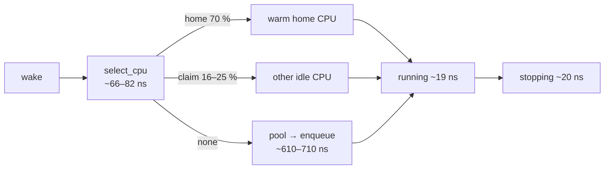
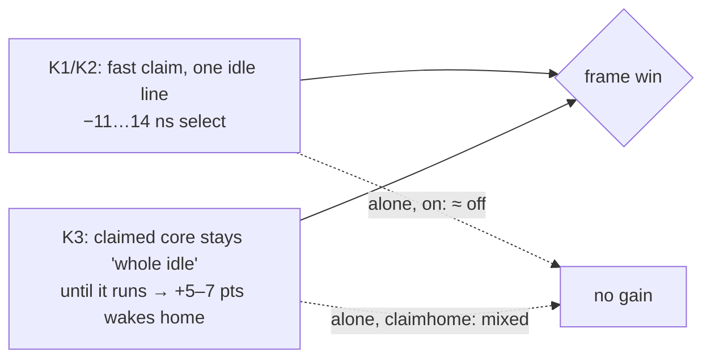

# scx_cake — current state

> [!IMPORTANT]
> Read first, every session. Rules: repository-root `CLAUDE.md` · behaviour: `DESIGN.md`
> · history: `docs/archive/STATE_ARCHIVE.md` (newest first; grep it, never read it whole).
> **Offload:** once nothing in an entry is owed, move it word for word to the archive top;
> owed items move to [Owed](#owed) first.

**Legend** · ✅ default / kept · ❌ rejected · ➖ no effect · 🧪 under test · ⏳ owed
· 🐧 stock kernel · 🧩 custom cake kernel patch

---

## Now (2026-11-07)

| | |
|---|---|
| 🌿 Code | policy since §G103 (private idle word with a claimed word, default on one-word hosts, `ab963f321`, replacing lean idle `lazy`) plus §G100 pinned wake fast lane and §G101 `ops.yield` keep in `151b45e5d` · cake series rebased 2026-11-05 onto upstream `b1c64ecb9` (PR #3965), which includes the RCU verifier fix `0e6dee3b7` · `RitzDaCat/scx_cake-nightly` pushed through `c7a59258b` (1.3.0) · §G102 `SCX_OPS_ENQ_EXITING` `72aac3e55` and the exit warning `05ac76480` committed 2026-11-06 as 1.3.1 · §G103 and §G104 stay 1.3.1 by the maintainer's ruling |
| 🖥️ Host | stock `7.3.1-1-cachyos`, so **no 🧩 feature is active**: portable bitops, no DSQ index or signals · `7.2.9-2-cachyos-custom` still installed; experimental-patches carries a `cachyos-7.3` series (1 bitops, 2 lean idle, 3 DSQ index, 4 wake signals), and cake no longer uses patch 2 · 🧩 results below were measured on 7.2.9-custom with `sched_ext.dsq_direct=Y` · 7.2.9 sets `SCX_RQ_IN_WAKEUP` only on the core wakeup path, so pre-7.2.9 numbers are not comparable |
| ⚙️ Defaults | native CTZ/POPCNT (auto) · E1 cached rq clock in `ops.running` · **private idle word with a claimed word** (§G103, one-word hosts) · no `SCX_OPS_KEEP_BUILTIN_IDLE` on one-word hosts · §G100 pinned wake fast lane · §G101 `ops.yield` keep · §G102 `SCX_OPS_ENQ_EXITING` · policy base: 2026-09-28 pool-serving C (archive) |
| 🧪 Test-only flags | `--native-bitops` `--portable-bitops` `--kernel-signals` `--signal-report` `--handoff-ns` `--toggle probe=1` `--inspect-bpf` — the release is flagless |



---

## 2026-11-20 · Task storage is created in `ops.init_task` (1.4.2, on the nightly)

A user reported four hard lockups on a Ryzen 9 9950X3D under Cake 1.3.0
and 1.4.1, on CachyOS 7.3.1, 7.3.3 and 7.4.0-rc3. Each capture showed one
CPU spinning on its own rq lock inside `ops.stopping`:

```
__schedule
 dequeue_task_scx
  cake_stopping -> cake_home_sample
   bpf_task_storage_get(F_CREATE)
    bpf_selem_alloc -> kmalloc_nolock
     obj_cgroup_uncharge_pages -> refill_stock
      queue_work_on -> try_to_wake_up
       native_queued_spin_lock_slowpath
```

The create charges the map's memcg. That charge can queue work, and the
wakeup takes the rq lock that `__schedule()` already holds. Every other
CPU then hangs on the stuck CPU's TLB-flush IPI. The pool count added
for 1.4.2 created the same record from `ops.enqueue`, also under the rq
lock.

Cake now creates the record in `ops.init_task`, which the kernel calls
with no rq lock at fork and for every existing task at attach. Every
other callback only looks the record up. A task whose create failed
still runs: it has no home or seat, and its pooled wakes go to the
global queue. This needs a stock kernel only. The lockup did not
reproduce on the 9800X3D, so the fix is checked against the reported
path and has no before and after. The desktop freeze of 2026-11-19 left
no record; whether it was this lockup is unknown.

On 1.4.1 a thread create and join took 4,309 and 4,322 ns before the
fix and 4,547 and 4,536 ns after (median of 2,000 pairs, two runs each
in ABBA order, 7.3.5). A thread that blocked fewer than 64 times used to
skip the allocation. The cost on the 1.4.2 source is unmeasured.

ShadowGate at 720p Low, uncapped, four quiet launches per build, each
run against the 1.4.2 work without the fix (`3df00acc05a7`):

| Build | FPS, reference / build | Frame p99, ms | Frame p99.9, ms | Input p99, ms |
|---|---:|---:|---:|---:|
| 1.4.2 work with the fix (`d0a13ad04920`, the nightly) | 603.25 / 604.35 | 1.865 / 1.862 | 2.088 / 2.124 | 1.732 / 1.713 |
| 1.4.1 with the fix (`a176722ae3f3`) | 601.96 / 593.81 | 1.866 / 1.879 | 2.076 / 2.158 | 1.734 / 1.749 |
| 1.4.2 work with the fix and the seat keep (`0f3398f44e76`) | 593.10 / 599.96 | 1.870 / 1.867 | 2.106 / 2.077 | 1.737 / 1.743 |

The same reference averaged 603.25, 601.96 and 593.10 FPS in the three
runs, so one run does not resolve the fix's +1.10 FPS. The paired
changes for the fix were +2.66, -1.79, +5.21 and -1.69 FPS. No build
reached a 605 FPS average.

### Seat keep in `ops.stopping`

A stage thread that blocks on the CPU whose seat record still names it
already holds that acquisition. The experiment marked the seat held
again without the storage lookup, the seat lock, the sequence bump and
three record writes. `ops.stopping` went from 308 to 327 instructions in
the object. In two profile slots per build it retired 842.77 and 835.28
instructions per call and used 490.03 and 487.19 cycles; the per-slot
cycles overlap. A first form also tested the record in `ops.running` and
added 11.7 instructions per run there, from spills in the inlined seat
update. The game run is the third row above. The experiment stays out of
the nightly: the game does not resolve it and the cycle saving did not
separate. Patches, builds and results are in
`scx_cake_bench/runs/shadowgate_init_task_storage_142/`.

## 2026-11-20 · Fixed homes and alternative placements in ShadowGate

On the single-CCD Ryzen 7 9800X3D and stock CachyOS 7.3.5, each policy
ran five quiet matches and two matches alongside four CPU workers. All
35 scored launches passed the external-noise check. None averaged 610
presented FPS. The reference was the current 1.4.2 build `3df00acc05a7`.

| Policy | Quiet FPS | Four-worker FPS |
|---|---:|---:|
| Fixed home (reference) | 602.68 | 541.94 |
| Prefer a wholly idle core for work near an active home | 599.99 | 545.64 |
| Priority kick on eligible pinned wakes | 596.12 | 538.79 |
| Reserve top-ranked homes for higher-share claimants | 598.76 | 542.51 |
| Fold paired SMT idle bits | 601.95 | 540.97 |

FPS is total present intervals divided by their total elapsed time.
Fixed homes led the quiet runs on FPS, p99 frame time and p99 simulated
input latency. With four workers, isolated homes improved FPS and p99
frame time in both blocks. Median worker throughput was 7,980 bogo-ops/s
with isolation and 8,025 with fixed homes. The worker delta changed sign
between the two blocks.

The extra priority-kick counter stayed at zero in all seven scored
play windows for that build. In two pinned synthetic trials it issued
124 and 128 requests per 384 wakes. Mean wake delay fell in both
trials, with mixed p99 results. The boost fixture consistently gave
the top eligible core to the 57%-duty worker after the 29%-duty
worker had claimed a home. A separate instrumented game recorded
1,307 successful isolated-home redirects in 19.3 seconds. In 342 of
those, the protected owner was RenderThread. These counters record
the admission decision. Measuring simultaneous sibling execution
requires a schedule trace.

The SMT fold matched the reference for all 65,536 idle masks on this
topology. Four paired relay runs measured a median change of -32 ps
per `select_cpu` call, ranging from -1,585 to +289 ps. In the separate
handoff arithmetic test, reusing a threshold saved 144 ps per decision
in the wide-count case and cost 29 ps on the mixed input. No candidate
became a release default. The patches, matched-block comparisons,
frame and injected-input tails, and worker throughput are under
`scx_cake_bench/runs/cake_engine_floor_142/home_frontier/`.

In a separate native-scheduler run, pinned threads exchanged one cache
line across all 120 unordered logical CPU pairs. The median effective
half round trip was 27,441 ps for SMT siblings and 43,449 ps for
distinct cores sharing L3. Distinct-core pair medians ranged from
29,150 to 52,476 ps. In 48 alternating comparisons, CPU 0 with CPU 2
was a median 694 ps slower than CPU 0 with CPU 1. The interval for
the median was 481 to 1,886 ps. The difference varied with the cache
line's offset in the page. Dividing each elapsed batch by 40,000 gives
0.025 ps arithmetic granularity. Individual transfer times remain
unresolved at that scale. Load/store, coherence and spin-loop time all
contribute.

For this chip the 28 distinct physical-core pairs and eight SMT costs
fit in 36 bytes at 250 ps per entry. The replay decoded all 120
logical pairs from a table that fits in one aligned cache line. Across
held-out launches its mean absolute error was 890 ps. Among distinct-core
destination comparisons with a predicted gap of at least 2,000 ps, it
ordered 98.2% correctly (67.7% coverage).

In a subsequent ShadowGate A/B, candidate `5371b796ba00` used the
table on synchronous wakes after the fixed and previous home paths.
It could choose a wholly idle core up to five CPPC points below the
ordinary choice for a predicted gain of at least 2,000 ps. Fixed homes
averaged 604.90 FPS and the candidate averaged 597.83. The candidate
lost all four quiet matched pairs and neither build reached 610.
Median launch p99 frame time rose from 1.826 to 1.874 ms and p99
simulated-input latency rose from 1.703 to 1.747 ms. Frame p99.9 fell
from 2.082 to 2.044 ms. Only 13 of 2,172 successful alternate claims
during play targeted the game process. Every alternate cost one CPPC
grade. The score includes the extra selection and counting work.
Keep the release policy. Replay, patch and raw frames are under
`home_frontier/core_pair/`.

An offline model used these handoff times to weight how far the
GameThread, RenderThread and RHIThread ran from their own homes. Adding
the Alcubierre moving-center term increased next-interval runnable-wait
error slightly in both held-out launches. The center moved in only
four of the 96 held-out observations. The transfer map and predictor
replays are in `home_frontier/fabric_latency/` and `home_frontier/alcubierre/`.

## 2026-11-20 · ShadowGate render placement at equal core rank

Five quiet, unpinned launches of the combined 1.4.2 release `3df00acc05a7`
averaged 599.22 presented FPS. None averaged 610. The five tracked game
threads each held a distinct fixed home in all 21 snapshots per match.
The sampler checked each recorded owner against both the per-CPU home
and the PID-indexed table. A persistent hash collision on one of these
threads does not explain the five-launch spread.
In the 592.08 FPS launch RenderThread held CPU 4 while the NVIDIA IRQ
ran on its SMT sibling, CPU 12. In the 603.37 FPS launch the render home
was CPU 2. On aligned measurement windows the slower launch used 27.85
more microseconds of render CPU time per present. Render runnable wait
increased by 1.08 microseconds per present. Render CPU service was higher
in all 16 matched seconds. The main and RHI threads used less CPU per
present in that comparison. These observations do not isolate the IRQ's
effect. The underlying intervals, owner records and capture are in
`scx_cake_bench/runs/cake_engine_floor_142/ordinary_variation/`.

An isolated stock-kernel variant `cfb169a718c8` used Cake's existing
physical-core IRQ mask to break a tie only when acquiring a new home.
It required equal top rank, known ranks, uniform capacity and one cache
domain for the tied choices. It introduced no polling. An eight-launch
comparison scored 601.07 FPS on the reference and 599.21 on the variant.
Each arm reached 610 in zero of four launches. The two blocks changed
by +0.75 and -4.48 FPS. Three pairs passed the strict quietness gate,
averaging 601.59 and 599.38 FPS. Median launch p99.9 rose from 2.131 to
2.292 ms. A tracked game thread still owned the GPU interrupt's sibling
in every scored launch. The renderer held it in two reference launches
and one candidate launch. Keep ordinary acquisition. The isolated patch,
comparison and build receipts are in `cake_engine_floor_142/home_rank_irq/`.

A separate diagnostic counted 67 fixed-home acquisition attempts in one
game launch and 22 successful claims. Only two attempts had an eligible
rank tie. Both came before Cake's IRQ mask was populated. The variant
changed zero placements in that launch. The timing is specific to a fresh
scheduler attachment. The scored launches ran without this instrumentation.

When Cake stayed attached through a warmup match, it already recognized
CPU 12 as an IRQ sink as the next game started. In this separate launch
the rule changed three of 66 acquisition attempts. All three successfully
assigned GameThread to CPU 5 in place of equally ranked CPU 4. RenderThread
had no changed choice. The game committed 22 homes in total. This verifies
that the rule can take effect on an already-running scheduler.

Two opposing pairs then scored the ordinary and experimental releases
after an excluded warmup game on each still-attached scheduler. All four
scored launches began with the IRQ core identified and passed the quiet
gates. Ordinary Cake averaged 599.95 FPS and the candidate 596.84. Both
were 0/2 at 610. The paired changes were +2.52 and -8.74 FPS. In the
592.16 FPS candidate launch, the renderer had no validated fixed home in
any of the 21 samples. Its last scheduled CPU spanned ten logical CPUs.
The samples do not show which acquisition or release condition was
responsible. The results are in `home_rank_irq/warm_shadowgate/`.

The same directory's `historical_audit.json` recomputes complete-present
FPS from older raw records. Three separate builds on kernel 7.3.4 had
qualifying launches at 610.262, 612.595 and 610.409 FPS on the same
ShadowGate executable. Each build crossed the target once, out of three,
eight and two launches respectively. Brief in-match readings have a
different denominator from these full-window launch averages.

## 2026-11-20 · Direct admission latency in local 1.4.2

The [system review and editable models](docs/research/cake-system-review/README.md)
trace an observed ShadowGate wake, show the 9800X3D cache-line layout and
record two subsequent correctness fixes. In a 7.3.5 guest the loader
detected a hotplug during topology discovery and retried with both CPUs.
In a host affinity test a busy worker released an ineligible fixed home at
its next qualifying sample, 64.2 ms after its allowed CPUs changed.
The fixes use the existing attachment and blocking callbacks.

A separate quiet ShadowGate screen compared the same reference build
with a rank shortcut that skips the tier scan when only one CPU remains.
Those cases accounted for 14.91% of tier-word reads in a gameplay census.
Across four scored launches per arm, the normal build averaged 603.11 FPS
and the shortcut 601.48. Neither reached 610. The two blocks disagreed
and median launch p99 moved from 1.848 to 1.867 ms. Keep ordinary ranking.

Reusing an untagged slice in `cake_running` removed three instructions
from its common path. Eight handoff pairs gave a median saving of 1.24 ns
per callback. In a separate four-pair quiet game screen the reference
averaged 602.60 FPS and reuse 595.38. All launches were below 610.
The two blocks changed by -17.23 and +2.81 FPS. Keep this as an experiment.

The slice grant clears its low five bits. Its compute threshold is even,
so adding one to a doubled quotient cannot change the selected cap.
Applying the cap and handoff floor also preserves the final masked grant.
Drop that correction and keep the quotient used for sleeper admission.
Both outputs matched a wide-integer oracle on 272,879 cases. This change
uses the existing stock-kernel path and adds no runtime instrumentation.

On the 9800X3D with stock CachyOS 7.3.5, eight counterbalanced pairs
timed direct admission for two mutex-handoff workers. The interval covers
grant and virtual-time computation through publication of the virtual time.
P10 moved from 10 to 9 ns in every pair. Median launch share at or below
10 ns rose from 17.0% to 27.1%. The empty clock pair measured 9 ns at p10.
P50 and p99 stayed at 19 and 29 ns by median launch. The instrument
resolves a distribution shift at its lower limit.

With both probes off, eight separate pairs showed a median paired change
of -4.5 ns at handoff p10 (four faster, three slower, one tie) and +15 ns
at p99. The handoff did not clear the predeclared improvement threshold.
The tested release is `5f2d179c352d` and the pre-change release was
`cb8630cfb042`. Freeze frequency remains unmeasured.

In uncapped ShadowGate at 720p Low with eight bots, all four quiet
pairs passed the noise checks. Aggregate presented FPS rose from
598.49 to 599.34. The two blocks changed by +2.26 and -0.58 FPS.
Median launch p99 frame time was 1.863 and 1.862 ms respectively.
Neither build reached 610 average FPS in any measured launch. The build
receipts, per-launch results and game settings are in
`scx_cake_bench/runs/cake_engine_floor_142/` and its `shadowgate/` folder.

### Precompute the stopping cap at startup

Each priority's virtual-time cap depends only on its reciprocal and a
tick-derived value set at attach. An experimental build computed all 64
entries once and read the cap by index when a task stopped. All entries
matched the original calculation on the host, including idle and padding.
This uses the same stock-kernel facilities as the local 1.4.2 build.

In a fresh four-pair comparison with that build, ShadowGate averaged
603.13 FPS with the original calculation and 603.79 with the table.
All pairs were quiet. Paired differences ranged from -4.30 to +4.78 FPS,
and the table reached 610 in zero of four launches. Median launch frame
p99 fell from 1.851 to 1.844 ms and p99.9 rose from 2.056 to 2.148 ms.
In eight separate handoff pairs the median paired change in stopping
cost was -0.093 ns/call. Five pairs favored the table and the effect
reversed by test order. Keep the existing calculation in the nightly.
Receipts are in `scx_cake_bench/runs/cake_engine_floor_142/stop_cap/`.

## 2026-11-19 · 1.4.2 nightly candidate for reported system freezes

The local user reports a full system freeze during ordinary desktop use,
including browsing. Audio stopped and SSH from another machine stopped
responding at the same time.
The last scheduler event in the previous boot was Cake 1.4.1 enabling on
CachyOS 7.3.4. The journal ended abruptly at 14:56:10 CST on November 19.
It recorded no sched_ext abort, GPU fault or clean shutdown at that boundary.
The next boot's pstore service found no crash record to archive.
CPU load and wake-to-run latency at the freeze are unknown. The October 20
report of a game stalling after about ten minutes remains open separately.

The 1.4.2 candidate bounds searches of queues at least 64 tasks deep. It can
return control to native scheduling when the same head remains overdue and
the CPU cannot serve the first eight tasks. The handoff worked in guest
tests on stock CachyOS 7.3.4 and 7.3.5. Shallow queues do not trigger this
guard. Recovery still requires kernel progress. [Recovery details](./DESIGN.md#lifecycle)

The idle-wakeup defect reproduced on stock CachyOS 7.3.5 in a four-CPU
QEMU guest. Periodic worker bursts and four freezer tests let sched_ext
enter power-management bypass with tasks in Cake's wake pool. Before the
fix, both pool counters ended at eight with no work left. Cake issued 72
idle self-kicks in the following eight quiet seconds. A kernel probe saw
799 idle self-kicks at a physical pool depth of zero over the full run.
The guest stayed responsive. The desktop incident boot recorded no suspend
or resume, so its cause remains open.

The local fix keeps the pool number in the task's existing BPF storage
and retires it on a temporary dequeue, before a kernel slice refill can
hide it. An empty queue can still have a real insert in flight. Cake keeps
the wakeup for that case. The change requires no kernel patch or timer.
With the fix, six freezer cycles began at measured pool depths of 1, 1,
3, 5, 7 and 22 with the default bypass slice. Both counters returned to
zero after every thaw. The kernel probe and Cake both counted zero idle
self-kicks, including the eight quiet seconds, and Cake served 548 pool
tasks. A separate run with a 1001 us bypass slice also drained the pool.

The stock 7.3.5 host verifier accepted the release. The loaded programs
for CPU selection, dispatch, idle updates and stopping retained the same
instructions. An ordinary sleep now enters one four-instruction callback.
Pooled tasks do additional storage work.

Eight ten-second slots in a four-vCPU software-emulated guest compared
the changes in ABBA and BAAB order with the probe off. In the 120 Hz
appsim workload, the median of the per-slot p99 frame intervals was
8.572 ms before and 8.729 ms after. One candidate slot produced 1055
frames instead of 1200. All four slots in the reverse block reached 1200
with no interval above 16.7 ms.

ShadowGate ProfileMatch on the 9800X3D and RTX 4090 compared the exact
pre-fix and fixed 1.4.2 builds at 1280x720 Low. Ordinary play used four
launches per build in ABBA then BAAB order. Eight background CPU workers
ran in a separate ABBA block with two launches per build. Values are
medians across launches and input ends at game simulation.

| Workload | Average FPS, before / fixed | Frame p99, ms | Frame p99.9, ms | Input p99, ms |
|---|---:|---:|---:|---:|
| Ordinary | 596.97 / 599.17 | 1.895 / 1.875 | 2.567 / 2.120 | 1.737 / 1.735 |
| Eight CPU workers | 464.45 / 462.23 | 2.473 / 2.450 | 2.741 / 2.742 | 2.266 / 2.273 |

One 18.58 ms frame occurred before the fix. The longest fixed-build frame
across both conditions was 5.91 ms. The short runs cannot establish the
frequency of rare stalls. All 12 measured matches completed and restored
native scheduling. Each reported the same five draw-time pipeline-state
misses in the game's I/O guard. No competing GPU work was detected in a
measured match. Full hashes, per-match results and frame intervals are in
`scx_cake_bench/runs/shadowgate_idle_142/`.

The archived 1.4.1 nightly (`4a8850699ff9`) and fixed 1.4.2
(`cb8630cfb042`) also ran head-to-head on the same boot and game build.
The first eight ordinary matches included external CPU or GPU contention.
The table uses the four-match ordinary repeat and a separate four-match
block with eight CPU workers. Each block ran in ABBA order, with two
matches per build. The same five draw-time pipeline misses occurred in
all sixteen matches.

| Workload | Average FPS, 1.4.1 / 1.4.2 | Frame p99, ms | Frame p99.9, ms | Input p99, ms |
|---|---:|---:|---:|---:|
| Ordinary repeat | 598.19 / 596.97 | 1.862 / 1.883 | 2.108 / 2.179 | 1.733 / 1.746 |
| Eight CPU workers | 461.38 / 465.24 | 2.515 / 2.472 | 3.562 / 3.181 | 2.318 / 2.246 |

On fixed 1.4.2 threads named `ShadowGate` accumulated 2.84 ms of
runnable wait per second in the ordinary repeat and 57.30 ms per second
with the workers. The harness sums by thread name. Six TIDs shared that
name in a later match, including the process leader. The `RenderThread 0`
group accumulated 1.98 and 3.70 ms per second respectively.
Four separate matches with kernel BPF accounting enabled measured 64.67
and 66.45 ms of Cake callback time per wall second for 1.4.1 and 1.4.2.
One slot had external GPU activity and one had elevated external CPU
activity. On 1.4.2 dispatch used 19.26 ms/s, CPU selection 19.09 ms/s,
and the new quiescent callback 2.07 ms/s at 9.6 ns per call. Per-match
frames, noise flags, thread waits and callback profiles are in
`scx_cake_bench/runs/shadowgate_141_vs_142/`.

An additional instrumented match kept every work-stealing attempt and
counted its outcome against the preceding queue-depth read. Of 932,416
attempts, 855,240 saw zero depth. Of those, 2,546 still moved a task.
The depth sample and move can straddle an enqueue. In the second-choice
pool path, 23,579 of 23,721 depth reads went unused because the claim
failed (1,208 per second). Moving that read after a successful claim
would retain the physical depth check before a move. The diagnostic
patch and counter deltas accompany the callback profiles.

The delayed-lookup experiment (`4ae3b81da9c5`) eliminated the failed
claim's lookup in the callback fixture. In four ordinary matches per
build, average FPS was 598.68 / 598.08 (fixed 1.4.2 / experiment), but
frame p99.9 was 2.078 / 2.213 ms. One baseline slot had external GPU
activity. Both ordinary blocks had the same tail direction. With eight
CPU workers, two slots per build gave 454.92 / 463.16 FPS and p99.9
3.067 / 2.702 ms. Four separate callback profiles put dispatch at
19.08 / 19.09 ms per wall second. Four six-second spin slots per build
gave 3,464 completed busy bursts per second and sleeper p99 excess over
the requested millisecond of 54.51 / 54.52 us. One reverse spin slot
had high external load. Keep the original fixed 1.4.2 default. The
experiment and measurements are in `scx_cake_bench/runs/shadowgate_pool_depth_142/`.

Across the two baseline game profiles, Cake used 66.21 ms of CPU time
per wall second across the host. CPU selection used 19.10 ms/s,
dispatch 19.08, running 7.99, enqueue 6.97, stopping 4.85, idle
updates 4.10 and quiescent 2.07. The remaining callbacks used about
2.05 ms/s. These rates span all threads and CPUs.

A follow-up on the original fixed 1.4.2 isolated the process leader by
TID. Under eight workers, 98,211 completed runnable waits over 19.52 s
had p99 16.91 us, maximum 490.07 us and 18 waits of at least 250 us.
The corresponding ordinary match had p99 2.96 us and maximum 70.33 us.
The event intervals summed to 12.30 / 4.24 ms per second (loaded /
ordinary), while the leader's schedstat counter measured 7.17 / 0.46.
Each trace had one unmatched event and no reported loss. These are
separate observations from the earlier by-name 57.30 ms/s aggregate.

Unreal Insights identified the engine game thread by OS TID in both
profiled matches. With eight workers, the middle fifth of frames took
2.488 ms at median and the slowest one percent took 3.662 ms at median.
Game-thread work rose from 1.323 to 1.954 ms and game-thread event waits
from 1.159 to 1.633 ms. GPU time was 0.868 / 0.865 ms. Rendering
synchronization averaged 1.174 ms on the game thread. World tick rose
from 0.768 to 1.150 ms in the slow-frame comparison, including more
time waiting on tasks. The worker at the end of that dependency was
unidentified. Stage medians can overlap and need not sum. The counters
cover 7,781 frames under load and 9,915 alone in the instrumented
`ShadowProfile` region. The `wall_cpu8` and `wall_idle` summaries
accompany the uninstrumented results above.

A second experiment (`3a84d0851f8a`) skipped physical LLC comparisons
when the loader found exactly one physical LLC. On the 9800X3D the
verifier removed 24 dispatch instructions and 128 JIT bytes. The first
four callback profiles measured 83.99 / 82.22 ns per dispatch (fixed /
experiment). In reverse order the medians were 83.63 / 83.64 ns.
Across all eight profiles, total callback time was 65.89 / 66.97 ms
per wall second. All profile slots had low external CPU and GPU activity.

| Workload | Average FPS, fixed / experiment | Frame p99, ms | Input-to-simulation p99, ms |
|---|---:|---:|---:|
| Ordinary, four matches per build | 597.37 / 598.89 | 1.986 / 1.909 | 1.759 / 1.806 |
| Eight CPU workers, two matches per build | 463.20 / 467.10 | 2.500 / 2.458 | 2.255 / 2.272 |

Background worker throughput was 19,316 / 19,226 stress-ng operations
per wall second across the full loaded slots. External CPU or GPU
activity affected several game slots. The unpinned spin test held at
47 ns p99 deadline overshoot. On CPU 5 the median slot p99 was 47.5 ns
on the baseline and 19.8 us on the experiment. Two candidate slots
accounted for the increase, and seven of eight spin slots had external
load warnings. The dispatch saving did not repeat and a game-input
benefit was unproven. Keep fixed 1.4.2 for testing. The source patch
and per-slot evidence are in `scx_cake_bench/runs/shadowgate_single_domain_142/`.

A separate stock 7.3.5 guest exposed two L3s on two emulated sockets.
The experimental flag loaded as zero. Both pools were occupied on five
of six freezer entries and both drained after every thaw. Cake served
869 and 806 tasks in the respective pools and issued zero idle-callback
self-kicks. The guest measured queue progress on the generic path.
Physical dual-CCD game performance and the desktop freeze remain open.

Two instrumented ShadowGate matches on fixed 1.4.2 put Unreal tasks,
Linux runnable intervals and Vulkan submissions on the same monotonic
clock. The game kept low-latency mode enabled. Each complete frame had
two frame-fence signals, one from the render thread and one from the
RHI thread. The measurements cover the game's graphics and compute
queues. Another GPU client reached 7% activity in the ordinary match.

| Per complete frame | Game alone | Eight background CPU workers |
|---|---:|---:|
| Frames observed | 9,264 | 7,530 |
| Time both queues had no recorded work outstanding | 47.0% | 52.9% |
| Mean overlap with game thread asleep at its render fence and a foreground worker runnable | 7.9 us | 23.3 us |
| Frames with at least 136 us of that overlap | 8 | 12 |

The eventual render signaler's own runnable time during the matched
sleep and queue gap averaged 2.07 / 4.56 us per frame. The RHI
signaler averaged 0.80 / 1.16 us. Worker readiness alone cannot
identify the task holding up a frame. The render signaler was already
on CPU for 206.49 / 243.18 us per frame in these windows. Allocating
and collecting transient render-graph resources accounted for
30.56 / 37.49 us of that execution in exclusive CPU scopes. No
individual timer dominated. At the earlier uninstrumented
597.4 FPS, reaching 650 FPS requires about 136 us less per frame.
This overlap gives little support for a blanket worker priority
change. Per-frame overlaps and capture details are in
`scx_cake_bench/runs/shadowgate_pipeline_142/`.

A 24-minute light-load desktop test ran native, fixed Cake, fixed Cake
and native on the same boot. Each six-minute block included two quiet
minutes without audio, four minutes of silent USB audio and six browser
input bursts. Cake stayed attached across the middle two blocks. Each
arm delivered all 7,200 deadlines on a 100 ms timer and completed eight
minutes of audio with zero reported stream or sink underruns. The
longest gaps between timer reads were 100.020 ms native and 100.022 ms
on Cake. A separate offscreen browser processed all six matched inputs
per arm. Only one of 24 visible-window frame requests completed with
the displays asleep. Neither arm reproduced the system-wide freeze.
Visible desktop responsiveness and remote SSH were untested. The
per-block results are in `scx_cake_bench/runs/shadowgate_desktop_stability_142/`.

Fixed 1.4.2 and native scheduling then ran the same ShadowGate
ProfileMatch on this boot. Each workload ran in ABBA and BAAB order
after an excluded native warmup. All sixteen scored matches had low
outside CPU activity and clear GPU samples. Each match completed the
scenario and reported the same five draw-time PSO misses. Values are
medians of four launches per arm at 1280x720 Low, uncapped.

| Workload | FPS, native / Cake | 1% low FPS | Frame p99, ms | Frame p99.9, ms | Input-to-simulation p99, ms |
|---|---:|---:|---:|---:|---:|
| Game alone | 547.38 / 597.15 | 448.41 / 502.08 | 2.082 / 1.869 | 2.496 / 2.162 | 1.948 / 1.736 |
| Eight CPU workers | 395.68 / 467.74 | 265.01 / 379.98 | 3.397 / 2.423 | 4.153 / 2.867 | 2.915 / 2.233 |

The loaded FPS gain came with a throughput cost. Eight stress-ng
workers completed 20,673 operations per wall second on native and
18,988 on Cake across the full slots. Both four-match blocks showed
the same tradeoff. The per-launch receipts and 143,586 frame intervals
are in `scx_cake_bench/runs/shadowgate_native_vs_fixed142/`.

The game-alone repeat left all desktop apps open and both displays
asleep. All eight native/Cake pairs passed the quietness checks. Median
FPS rose from 548.36 to 601.65, 1% low FPS from 448.53 to 508.02,
and p99 input-to-simulation fell from 1.935 to 1.725 ms. Frame p99
fell from 2.078 to 1.855 ms and p99.9 from 2.456 to 2.111 ms. Every
metric favored Cake in all eight pairs. Mean outside CPU per launch
ranged from 0.30 to 0.56% of host capacity on native and 1.53 to
2.18% on Cake. No competing process reported a numeric GPU SM sample.
Across sixteen matched 16-second gameplay windows, Steam WebHelper
used a median 0.25% of one logical CPU and Discord used 0.75%.
The data and all 164,959 scored frame intervals are in the run's
`quiet_repeat/` directory.

A separate quiet screen changed fixed-home acquisition and renewal
to prefer a free physical core away from the GPU interrupt. On this
boot IRQ 97 ran on CPU 12, whose SMT sibling was CPU 4. Two of four
scored control matches had a tracked game role homed on CPU 4, each
for all 21 samples. No tracked candidate role owned it. Median FPS
was 598.08 fixed and 601.71 on the candidate. Candidate launches
ranged from 600.21 to 605.47 FPS. Frame p99.9 rose from 2.097 to
2.172 ms and 1% lows fell from 503.82 to 500.57 FPS. This screen
did not establish a Pareto gain. Keep the fixed build. Receipts are
in `scx_cake_bench/runs/shadowgate_candidates_142/home_irq/screen/`.

A three-second fixed-build trace found times when a game thread shared
a core while another allowed, IRQ-clean core in the LLC was fully idle.
Those times covered 5.3% of the game thread's scheduled time, 8.7% of
the render thread's and 5.1% of the RHI thread's. A subsequent candidate
kept the fixed home but allowed one alternate whole-core claim if the
owner woke to its idle home beside a busy sibling. Its probe counted
53,749 successful exceptions across the host in 19.45 seconds of play.
In four quiet launches per build, median FPS went from 599.05 to
595.02 and p99 input-to-simulation from 1.727 to 1.739 ms. All four
candidate runs fell short of 610 FPS. The excluded fixed warmup ran at
611.00 FPS; a scored fixed run reached only 555.08 FPS under the same
settings and quietness checks. That run had longer ordinary frames
and no frame longer than 8.33 ms. Keep the existing owner wake path.
The trace is in `shadowgate_native_vs_fixed142/quiet_smt/` and the
comparison in `shadowgate_candidates_142/home_spare/` under bench runs.

A third screen left the owner's wake path intact. A waking task that
needed a new CPU could borrow a clean, wholly idle, unowned core before
taking another task's fixed home. A separate probe confirmed 197,988
successful changes to the baseline's choice over 19.45 seconds across
all scheduler clients. The four quiet candidate runs averaged 596.55 to
607.95 FPS, with a median of 601.83 versus 601.07 on fixed. The
forward block gained 10.41 FPS and the reverse block lost 2.59. Median
p99.9 was 2.079 versus 2.092 ms. The gain did not repeat across test
orders. None of the three candidates qualified for a loaded test or
a change to the default. Results and probe counts are in
`shadowgate_candidates_142/borrow_core/` under bench runs.

Four separate fixed-build matches counted retired instructions and
cycles on five game threads. They ran at 575.42 to 589.22 FPS with
instrumentation. In the slowest and fastest matches, the game thread
retired 4.013 and 4.016 million user instructions per frame. Its cycles
per instruction were 0.849 and 0.821, and it used 665.75 and 643.37 us
of CPU time per frame. These two runs had the same measured GPU clock.
The slower run had higher game-thread cycles per instruction in all 17
matched full seconds. The 555 FPS run had no hardware counters, so its
cause remains open. Phase data are in `shadowgate_native_vs_fixed142/quiet_pmu/`.

Across the four loaded slots per scheduler, Cake workers received 2.73%
less CPU time per wall second and completed 5.40% fewer operations per
CPU second. In one separate traced pair all eight workers ran at nice
-8 in both arms and recorded zero voluntary context switches. Native
recorded 12,179 involuntary worker switches and 105 migrations. Cake
recorded 95,669 and 62,963 over about 19.3 seconds of play. During a
five-second switch trace, the eight workers spent 0.008% of their CPU
time sharing a physical core with another worker on native and 34.64%
on Cake. This identifies worker placement as a target for a controlled
test. Check which queue serves a displaced, still-runnable worker and
whether its slice had expired. The trace cannot apportion the throughput
cost between migrations and SMT contention. The diagnostic is in the
run's `worker_profile/`.

Four stock-binary diagnostic matches repeated the eight-worker test
with the workers at nice -8 and nice 0. In 19.3 seconds Cake recorded
60,821 and 62,143 worker migrations respectively, versus 323 and 346
on native. Both five-second Cake traces had zero worker wakeups.
Every observed cross-CPU resume followed a runnable switch-out.

Two separate instrumented Cake matches tracked the kernel dispatch
queue and slice at each worker's next run. At nice 0, 56.4% of 73,809
cross-CPU resumes used only a local queue, 36.6% passed through the
previous CPU's Cake queue and 7.1% came through the LLC pool. The last
positive-to-zero slice write was a local-enqueue preemption for 67.4%
of moves and a runtime charge for 17.5%. At nice -8 those figures were
57.9% and 30.1%. The queue observations do not identify the specific
Cake placement branch for the local-only moves or establish that a
move was avoidable. The instrumentation targets this kernel build and
its runs supply attribution only. See `worker_routes/queue_results.json`
and the stock controls in `worker_routes/results.json` in the same run.

An eight-frame render-graph capture found cache hits for all 424 tracked
transient resources with recorded allocation ranges. The deferred renderer
repeated the dummy fog setup for the same view. Reusing it could avoid
four buffer handles and two queued uploads per affected view. Its frame
time cost remains unmeasured. All eight BloomX and BloomY textures per
frame had consumers. The resource counts and engine source references
are in `scx_cake_bench/runs/shadowgate_rdg_142/`.

## 2026-11-17 · Half-length grant for compute tasks (1.4.1, on the nightly)

| | Finding / evidence boundary |
|---|---|
| Design | In `cake_slice_from_service` a grant that wants a whole slice (`want >= SLICE_NS`, a task that never blocks inside 3000 us) is capped at 750 us; every other grant keeps the 1500 us cap. One compare and one shift on the grant path, no timer, no new state. Stock kernel, no new kernel requirement; the same code on every host. This is arm caponly (`home_caponly.patch`) of the ladder in the entry below. |
| ShadowGate beside `stress-ng --cpu N`, clean-slot medians, fps base / caponly | N = 0: 597 / 605 · 2: 567 / 566 · 4: 536 / 537 · 8: 468 / 474 · 12: 396 / 407 · 16: 313 / 327 · 32: 208 / 229. |
| Same, p99.9 ms base / caponly | 2.08 / 2.01 · 2.21 / 2.24 · 2.37 / 2.38 · 2.64 / 2.64 · 3.43 / 3.34 · 6.50 / 5.66 · 13.65 / 11.25. |
| Resolved (ranges do not overlap) | 16 hogs only: frame p99 4.6058-4.7741 against 4.9677-5.4186 ms. No resolved game loss at any level. Hog work under 1 % less. The 0-hog difference is not resolved (592-609 against 602-610 fps, four launches each). |
| Landed | Version 1.4.1 by the maintainer's ruling: a modification of the 1.4.0 grant, not a new construct. First pushed as 1.5.0 (`c663701e6`), corrected the same day. Release build: `scx_cake 1.4.1`, clippy clean in release and debug, comment lint 0.14. |
| Not tested | Any host but the 9800X3D (one CCD, 8 cores); a dual-CCD or hybrid host; a second game; displays on; appsim and `cakebench cost`; pipe, schbench, futex, 7-Zip; a compute task the user wants fast beside an idle game (its grant is now half as long). |

---

## 2026-11-17 · Home fixes under hogs: dead homes, the starved-claimer trap, no timer

| | Finding / evidence boundary |
|---|---|
| Method | ShadowGate ProfileMatch 1280x720 `scal=0`, CPU-limited (GPU 36-55 %), beside `stress-ng --cpu N`, N = 0, 4, 16, one N per run, `gpu_noise` clear in every slot. All arms are dirty diagnostic builds of `211509c26` in `target/cake_receipt_builds/home_*`; patches are kept beside the runs. base = unchanged 1.4.0 code, sha256 `8d5e6e9b…`. Kernel 7.3.4-1-cachyos, stock sched_ext; every arm needs only `bpf_task_from_pid` (6.2). No bump, nothing landed. |
| Arms | reap `5fd69d06…`: at each census rollover, drop a home whose owner ran under 1/10 over 2 s (`bpf_task_from_pid`, `sum_exec_runtime`). reapwait `27c704e8…`: reap, and `run_delay` counts toward the share. reaplow `f0e96425…`: reap, bar 1/12 on, 1/24 off, census kept at 1/5. evict `ef3c5ab9…`: no timer; the owners are checked only when a claim finds every allowed core owned, over a window of at least `HOME_WINDOW_NS`. evictwait `fe1b14d5…`: evict, and `run_delay` counts toward the share in the claim, the owner's own drop and the owner check. |
| Round 1, fps (`homefix.sh N fwd` and `rev`, one slot per arm per run) | 16 hogs: base 293, 292; reap 326, 318; reapwait 324, 316; reaplow 319, 318. 4 hogs: base 537, 530; reap 530, 540; reapwait 534, 511; reaplow 528, 526. 0 hogs: base 607, 599; reap 592, 602; reapwait 595, 572; reaplow 579, 599. |
| Round 2, fps (`homefix2.sh N`, order base, reap, evict, evict, reap, base) | 16 hogs: base 312, 318; reap 321, 319; evict 299, 299. 4 hogs: base 538, 535; reap 522, 528; evict 542, 527. 0 hogs: base 600, 601; reap 591, 605; evict 599, 600. |
| Round 3, base against evictwait (`homefix3.sh N`, order base, ew, ew, base, base, ew) | 16 hogs, two runs, six slots per arm: base 325, 318, 294, 310, 316, 323 (mean 314.2); evictwait 331, 328, 324, 327, 319, 321 (mean 325.1). Frame p99 mean 5,330,430 against 5,191,949 ns; input p99 mean 4,662,672 against 4,567,688 ns; p99.9 mean 6.49 against 6.19 ms, max 6.90 against 6.65; external CPU 83.1-84.2 % against 82.6-83.2 %. 4 hogs, three slots: base 540, 533, 532; evictwait 523, 527, 530; frame p99 mean 2,059,923 against 2,092,426 ns. 0 hogs, three slots: base 605, 600, 597; evictwait 598, 599, 599; frame p99 mean 1,834,222 against 1,839,610 ns. |
| Base is bimodal at 16 hogs | Eleven base slots: 292, 293, 294, 307, 310, 312, 316, 318, 318, 323, 325. The evict build gave 299 and 316 one minute apart. The level is set per launch, not per build, so round 1's +9-11 % for reap was mostly this. |
| Why (claim counters, `home_evict_dbg`, two traces at 16 hogs) | Slow launch (299 fps): `Foregro-rker #0` held a home in 7 of 28 samples, ran 153 ms/s, waited 409 ms/s, migrated 63,974 times. Fast launch (316 fps): home in 26 of 28, 403 run / 90 wait, 5,308 migrations. Claims stop after the first seconds (43 and 46 reached the claim path; none after sample 15). A busy thread that loses its home is pushed off the CPU by the hogs, runs under 1/5, and never reaches the claim path again. In round 2's evict slots the thread without a home was `RenderThread 0` (219 ms/s wait, 77,882 migrations). Other denials: IRQ-bad core 0 and 2, pid-slot collision 1 and 0, core bit already taken 14 and 18 (all at boot). |
| Dead homes | base trace: `PSOPrec-Pool` #3, #5, #6 hold cores 5, 1, 4 in 26 of 28 samples. reap trace: gone, 5 cores owned (median). evict frees them only when every core is owned: 3 and 4 freed at boot in the counter traces; in one evict trace 6-7 cores were owned, the check never ran and two stayed. |
| `RHISubmission` | reapwait and reaplow gave it a home (18 and 5 of 28 samples); its wait fell from 144-171 ms/s to 15-18 (wait) and 3 (low). fps did not move against reap. Its wait is not what bounds the frame; the 11-16 lead is closed. |
| Reading | Queue time in the share closes the trap: no slow launch in six evictwait slots, and the six-slot mean is +3.5 % at 16 hogs. It costs 1.5 % fps at 4 hogs in three slots (ranges do not overlap; reapwait in round 1 was 534, 511 against 537, 530), cause not found: at 4 hogs the game threads wait 1-30 ms/s, so the share barely changes for them. 0 hogs is level. The p99.9 tail at 16 hogs moved little (6.49 to 6.19 ms mean) and still trails lavd's 5.5-5.9 from 11-16. Open: the 4-hog cost (trace the home table at 4 hogs for both arms), and evict's blind spot when a core is free but dead homes remain. Not run: appsim, `cakebench cost`, any other game. |
| Runs | `scx_cake_bench/runs/shadowgate_20261117/`: `hogs{0,4,16}_{fwd,rev}_*`, `evict_hogs{0,4,16}_*`, `evictwait_hogs16_034957`, `evictwait_hogs16_035435`, `evictwait_hogs4_035914`, `evictwait_hogs0_040345`, `hometrace_home_{reap,reap_wait,reap_low,evict,base,evict_dbg}_hogs16_*` with `_watch/homes.json`, `home_*.patch`. `hometrace_home_evict_dbg_hogs16_034402` is a failed load (BTF), not data. |
| 4-hog and churn traces (`home_evict_wait_dbg`, not performance data) | 4 hogs, base (528 fps): 7 cores owned (median), two dead `PSOPrec-Pool` homes on cpus 0 and 2 plus five live owners. 4 hogs, evictwait (521 fps): 8 cores owned, no dead homes, extra owners `Backgro-ker #10` 21 of 32 samples, `Backgro-rker #9` 18, `RHISubmission` 14, `Backgro-rker #2` 9; counters reach_claim 114, no_free_core 82, evict_freed 4, claimed 32, owner_left 15. 16 hogs, evictwait (324 fps): reach_claim 2574, no_free_core 2088, evict_freed 279, core bit taken 1790, slot collision 109, claimed 655, owner_left 338; the five main threads keep homes 26-28 of 28, the Backgro workers rotate. Queue time in the claim bar hands homes to low-duty workers and fills every core. |
| starve arm `b5452b7d…` (`home_evict_starve.patch`) | evictwait, but the claim is earned on run share (1/5); queue time counts only for a thread that queues at least as long as it runs and still runs 1/10. The keep rule and the owner check still count run plus queue time. Stock kernel, `bpf_task_from_pid` (6.2). |
| Round 4, fps (`homefix4.sh N`, order base, ew, starve, starve, ew, base, two slots per arm per run) | 4 hogs: base 530, 524; evictwait 530, 526; starve 543, 540; frame p99 2,081,398, 2,207,219 / 2,071,493, 2,091,743 / 2,027,837, 2,040,963 ns; p99.9 2.42, 2.72 / 2.45, 2.30 / 2.60, 2.21 ms. 16 hogs, two runs: base 314, 308, 324, 308 (mean 313.6); evictwait 313, 316, 320, 320 (317.2); starve 315, 316, 314, 310 (313.6); frame p99 mean 5,382,780 / 5,427,330 / 5,515,986 ns; p99.9 mean 6.55 / 6.54 / 6.64 ms; external CPU 83.4-84.1 / 83.1-83.4 / 83.4-83.7 %. 0 hogs (`noise_class` low, external 1.0-1.7 %): base 601, 606; evictwait 600, 601; starve 608, 596. All 24 slots valid, `gpu_noise` clear; hog slots are `noise_class` noisy by design. |
| Reading, round 4 | starve is +2.8 % over base at 4 hogs in two slots (ranges do not overlap) and level at 0 hogs. At 16 hogs base never fell into its slow state this round (lowest 308), so no arm could show the trap fix; starve equals base, evictwait is +1.2 %. Round 3's 4-hog cost for evictwait did not repeat (530, 526 against 530, 524). Per frame at 16 hogs against 0 hogs (3.06-3.23 ms against 1.65 ms): run time per frame grows 35-50 % (ShadowGate 660 to 920 us, RenderThread 590 to 795, RHIThread 400 to 605), consistent with hogs on the SMT siblings; owners wait 2-27 us per run stint. The home fixes move a few percent; a larger gain needs the sibling or the home CPU kept from hogs, which costs hog throughput and is the maintainer's choice. Owed: more slots for starve at 4 and 16 hogs, a starve trace at 16 hogs, appsim, `cakebench cost`, another game. |
| Runs, round 4 | `starve_hogs4_043105`, `starve_hogs16_043536`, `starve_hogs16_044015`, `starve_hogs0_044454`, `hometrace_home_base_hogs4_042542`, `hometrace_home_evict_wait_dbg_hogs{4,16}_*`. |
| Rounds 5-10, method | Three arms per run, two slots per arm, order A, B, C, C, B, A (`homefix5.sh` to `homefix10.sh N`). Every arm below is built on starve, needs a stock kernel only, and is a dirty diagnostic build. All slots valid, `gpu_noise` clear, hog slots `noise_class` noisy by design, 0-hog slots low. Two slots per arm: a difference under the base's own spread (about 15 fps and 0.4 ms p99.9 at 16 hogs) is not resolved. |
| Per-frame cost at 16 hogs | At 0 hogs the game uses about 7.0 ms of CPU per 1.66 ms frame (4.2 CPUs; 12-15 `Backgro` workers at about 250 us per frame each) and waits 62 us per frame summed over threads. At 16 hogs it runs 8.4 ms and waits 6.4-7.6 ms per frame. A `Backgro` worker waits 48-60 us per 32 us run and is switched out involuntarily about 3 times a frame (0.7 at 0 hogs). Frame times spread evenly from 2 to 6 ms; the tail is not rare spikes. |
| quiet `325b68ea…` (`home_quiet_core.patch`), rejected | The SMT sibling of a home CPU is taken out of the idle word and serves only its own queue (`SCX_OPS_ENQ_LAST`). 16 hogs: base 313, 323 fps, p99.9 6.45, 6.20 ms; starve 316, 300, 6.73, 6.94; quiet 262, 275, 10.63, 8.55, external CPU 58.5, 63.8 % against 83.5. 4 hogs level; 0 hogs quiet 575, 604. Sibling contention is not the main cost; the game needs those CPUs for its workers. |
| prota `c92ef03c…`, protb `ba88f2f4…` (`home_prot_{a,b}.patch`), no effect | Wake-preempt protect window cut from 187 us (own CPU) and 750 us (neighbour) to 47 and 187 us (a), 12 and 47 us (b). 16 hogs: starve 319, 314 (p99.9 6.41, 6.58); prota 321, 323 (6.49, 6.13); protb 318, 320 (6.45, 6.53). 4 hogs: 532, 535 / 537, 532 / 547, 541. 0 hogs: 608, 588 / 602, 607 / 600, 579. `Backgro` wait per run 47-49 us in every arm; `RHISubmission` wait per frame fell from 527 to 23 us with no fps change. |
| Probe census, starve, 16 hogs (`homecensus.sh`, one slot, 316 fps, not performance data) | select 4,253,290; wp_attempt 1,282,262; wp_protect 185,809; wp_vtime 15,188; wp_starved 14,826; wp_fired 1,057,426; pl_local_on 2,340,439; pl_cpuq_wake 137,350; pl_cpuq_cont 1,165,616; pl_global 3,096,022; seat_reroute 1,713,559; taci_warm 1,734,743; probe_fired 160,064; kt_pool 408,266; h300_global 103,775; h1ms_global 3,065; h300_cpuq_cont 51,943; h1ms_cpuq_cont 19,901; expiry_preempt 14,337. The wake preempt fires in 83 % of attempts, so the protect window is not what holds the workers; 1.7 M evictions by a returning home owner go to the pool. |
| evw `07e8c522…` (`home_evw.patch`), kept for the head-to-head | A thread evicted by a returning home owner that blocks before a slice ends on average (`sum_exec_runtime < SLICE_NS * nvcsw`) goes through `cake_wake_place` (preempt a compute occupant nearby) and not to the pool. 16 hogs: starve 315, 311 (p99.9 6.84, 6.56; frame p50 2.93, 2.99 ms); evw 324, 322 (6.60, 6.69; 2.68, 2.71); summed wait per frame 6.4 to 5.3 ms, `Backgro` wait per run 48 to 36 us. 4 hogs: starve 545, 543; evw 537, 531 (one p99.9 of 3.50 ms). 0 hogs level. evwprot `2995cd0d…` (evw with the prota windows): 313, 322, no gain. |
| nh `438b5cc6…`, resv `1e74b0b3…` (`home_evw_nh.patch`, `home_resv.patch`), rejected | nh: a wake never preempts on another task's home CPU. resv: home CPUs leave the idle word and serve only their own queue. 16 hogs: evw 321, 308 (p99.9 6.78, 8.53; frame p99 5.63, 5.96 ms); nh 298, 311 (6.72, 6.73; 6.11, 6.23); resv 365, 308 (8.00, 8.77; 6.06, 7.04; external CPU 50.9, 56.7 %). 4 hogs: 536, 499 / 540, 538 / 531, 526. 0 hogs: 604, 608 / 610, 599 / 590, 568. |
| cap750 `b88d17dd…`, cap375 `8ad1c147…` (`home_cap{750,375}.patch`) | evw, and the longest slice grant in `cake_slice_from_service` falls from 1500 us to 750 or 375 us. 16 hogs (fps / p99.9 ms / frame p99 ns / input p99 ns / external CPU %): evw 312 / 7.05 / 5,759,232 / 5,130,846 / 83.4 and 317 / 7.09 / 5,660,152 / 5,001,274 / 83.3; cap750 331 / 5.59 / 4,800,681 / 4,165,121 / 82.5 and 328 / 5.55 / 4,824,701 / 4,205,171 / 82.6; cap375 332 / 5.51 / 4,646,099 / 4,055,127 / 82.3 and 319 / 5.72 / 4,767,324 / 4,351,060 / 82.8. 4 hogs: evw 540, 535 (p99.9 2.29, 2.23); cap750 538, 534 (2.31, 2.63); cap375 519, 539 (2.34, 2.52). 0 hogs: 596, 596 / 601, 598 / 603, 596. The 16-hog tail follows the hog's longest grant; cap375 adds nothing over cap750, so the 1 ms tick (`CONFIG_HZ=1000`, cake has no `ops.tick`) is the floor. `SLICE_NS` itself cannot move: two static asserts (pool tag mask, `RATE_FLOOR_SHIFT`) tie it to 3000 us. |
| deep `4b9e0123…`, deepfast `2efb29bd…` (`home_deep.patch`, `home_deepfast.patch`), rejected | cap750 with `CAKE_NEIGHBOUR_PROBE_DEPTH` 3 to 15 (deep), and the neighbour protect window 750 to 187 us (deepfast). 16 hogs: cap750 343, 341 (p99.9 5.21, 5.15); deep 337, 331 (5.34, 5.68); deepfast 340, 338 (5.24, 5.44). 4 hogs: 534, 537 (2.73, 2.47) / 530, 531 (2.98, 2.41) / 531, 534 (2.57, 2.48). 0 hogs: 574, 609 / 588, 607 / 603, 603. |
| Reading, rounds 5-10 | cap750 is the only arm that moved the 16-hog tail: p99.9 5.15-5.59 ms in four slots against 6.2-7.1 ms for every arm with the 1500 us grant, fps 328-343 against 308-324, hog share down 0.8-1.2 points. Possible 4-hog tail cost of 0.2 ms, not resolved at two slots. Owed before any landing: base against cap750 with six slots per arm at 0, 4, 8, 16 hogs and hog work counted per slot; evw and starve each alone against base at the same depth; appsim, `cakebench cost`, another game. |
| Head-to-head method (`h2h.sh N OUT BUILD...`, `h2h_report.py`) | One ProfileMatch launch per slot, one build per slot, `stress-ng --cpu N --metrics-brief` started and stopped with the slot so hog bogo ops belong to one build. A slot is clean when valid, `gpu_noise` clear and no key held (`keys_held.py`). Every clean slot of this campaign has the displays in DPMS off and kwin idle; with the displays on kwin takes 7-26 % GPU. Values are medians, percent against base, "resolved" means the min-max ranges do not overlap. |
| Arms of the ladder | caponly `7b4530e8…` (`home_caponly.patch`): 1.4.0 plus a 750 us cap for a grant that wants a whole slice (`want >= SLICE_NS`, a compute task); other tasks keep 1500 us. capstarve `42c72620…`: starve plus that cap. caphog `26a4ad8e…`: starve, evw and that cap. All stock kernel. |
| base against cap750, two builds (`h2h_hogs16` n=8, `h2h_hogs4` slots s00-s12) | 16 hogs: fps 314.19 against 331.35; frame p99 5.4414 against 4.7728 ms; p99.9 6.6756 against 5.5811 ms; input p99 4.7246 against 4.2359 ms; hog ops/s 30686.3 against 30109.9 (-1.9 %). 4 hogs: fps 535.37 against 536.25; p99.9 2.3365 against 2.5825 ms (+10.5 %); low 0.1 % 326.96 against 305.32 fps. `h2h_hogs4` s13-s19 and all of `h2h_hogs8` are suspect (held keys, displays on) and are not data. |
| base, cap750, caphog, n=6 (`h2h3_hogs4`, `h2h3_hogs16`) | 4 hogs: fps 538.22 / 534.98 / 535.04; p99.9 2.2888 / 2.6171 / 2.5055 ms; low 0.1 % 342.27 / 301.68 / 318.57 fps. 16 hogs: fps 313.58 / 338.68 / 337.77; frame p99 5.3583 / 4.6837 / 4.6766 ms; p99.9 6.3374 / 5.5401 / 5.4645 ms; frame max 10.4179 / 7.8194 / 7.1255 ms; hog ops/s 30584.9 / 30037.8 / 30029.4. Sparing the game's long threads from the cap does not remove the 4-hog tail cost. |
| Ladder, base / caponly / capstarve / caphog, n=4, Williams square (`h2h4_hogs{0,2,4,8,12,16,32}`) | fps: 0 hogs 597.41 / 605.18 / 608.16 / 607.32; 2 hogs 567.15 / 565.80 / 564.99 / 567.70; 4 hogs 542.03 / 528.77 / 536.04 / 539.42; 8 hogs 467.64 / 473.60 / 467.62 / 478.69; 12 hogs 392.18 / 389.83 / 417.32 / 424.70; 16 hogs 309.60 / 328.07 / 326.41 / 335.79; 32 hogs 202.80 / 231.91 / 175.27 / 179.54. p99.9 ms: 0 hogs 2.0842 / 2.0078 / 2.0808 / 2.0126; 2 hogs 2.2085 / 2.2373 / 2.1223 / 2.2460; 4 hogs 2.4711 / 2.5180 / 2.3004 / 2.5863; 8 hogs 2.6409 / 2.6443 / 2.7465 / 2.5448; 12 hogs 3.5276 / 3.4757 / 3.1508 / 2.9855; 16 hogs 6.3149 / 5.6573 / 5.5679 / 5.5015; 32 hogs 13.3159 / 11.0194 / 15.6042 / 18.9288. Hog ops/s against base: 2 hogs -0.48 / -1.36 / -0.50 %; 4 hogs +0.42 / +0.04 / -0.14 %; 8 hogs -0.32 / -0.41 / -1.68 %; 12 hogs -0.28 / -2.33 / -3.15 %; 16 hogs -0.62 / -1.34 / -1.98 %; 32 hogs -0.74 / +1.03 / +0.77 %. |
| Resolved effects per layer | Cap: 16 hogs, frame p99 4.6058-4.7741 against 4.9677-5.4186 ms for caponly; no resolved loss at any level. starve: wins at 12 hogs (capstarve fps 414.91-418.01 against 362.07-396.85), loses at 32 hogs (fps 169.60-181.00 against 181.06-233.96, p99.9 14.9135-16.7305 against 10.9171-14.3969 ms). evw: wins at 8, 12 and 16 hogs (8 hogs fps 476.02-480.86 against 463.40-475.86), costs the 4-hog tail (caphog p99.9 2.4855-2.7997 against capstarve 2.2241-2.4757 ms), and deepens the 32-hog loss (p99.9 15.3442-21.5832 ms). Each layer takes hog CPU where it pays. No arm is clean at every level; the 25 % p99.9 target at 16 hogs is not met (best -12.88 %). |
| Launch state | base has two states per launch at 4, 16 and 32 hogs with one binary (32 hogs: 181, 186 against 220, 234 fps). At 4 hogs the hog share moves per launch (hog CPUs 3.858-3.991 across rounds) and the game moves the other way; the cause is not found. At 4 hogs n=4 to 6 does not resolve differences under about 2 % fps or 0.3 ms p99.9. |
| 32-hog home traces (`hometrace.sh 32 BUILD`, one launch each, not performance data) | caponly `_101155` 187 fps, `_101526` 215, `_101626` 249; capstarve `_101305` 172. fps follows the CPU time of the 18 `Backgro` and `Foregro` workers: 1007, 1125, 1285 and 926 ms/s (`Backgro` alone 649, 782, 979, 445). Homes held, samples of 25: caponly slow `Foregro-rker #0` 10, `#1` 3; middle 6 and 4; fast 4 and 0 (plus `FAsyncLoading` 22 on cpu 1); capstarve 19 and 21 of 24. With both `Foregro` workers at home (capstarve) they run 481 ms/s against 306-358, `Backgro` is switched out involuntarily 5267/s against 3281-3541 and `RHIThread` 3092/s against 884-1713. Reading, not proven: at two hogs per CPU a home for a `Foregro` worker is paid for by the `Backgro` workers, and starve keeps those homes. |
| Rule-fix arms (`h2h5_hogs{32,16,12,4}`, base / caponly / capkeep / capspare, n=4, Williams square) | capkeep `626042f9…` (`home_capkeep.patch`): capstarve without the queue-time earn clause; a claim needs the run share as in base. capspare `ce151c2e…` (`home_capspare.patch`): capstarve, and in `cake_select_cpu` an owner whose home runs a movable short-burst occupant (`cake_short_burst`) does not evict it and wakes as a task without a home. Stock kernel. fps: 32 hogs 222.19 / 225.09 / 206.36 / 224.63 (ranges 190-229, 181-253, 183-252, 218-284); 16 hogs 308.41 / 325.70 / 327.18 / 335.45; 12 hogs 397.24 / 408.54 / 408.35 / 422.07; 4 hogs 534.05 / 537.45 / 531.92 / 526.12. p99.9 ms: 32 hogs 12.7254 / 11.2498 / 13.4659 / 15.1082; 16 hogs 6.5215 / 5.7417 / 5.6990 / 5.6243; 12 hogs 3.4257 / 3.3073 / 3.0672 / 3.0583; 4 hogs 2.3390 / 2.3769 / 2.4974 / 2.4445. Hog ops/s against base: 32 hogs -0.45 / -0.16 / -1.05 %; 16 hogs -0.86 / -1.14 / -1.84 %; 12 hogs -0.79 / -0.98 / -2.17 %; 4 hogs -0.35 / +0.10 / -1.27 %. |
| Reading, rule-fix arms | The earn clause is what cost capstarve at 32 hogs and what pays at 12 hogs: capkeep is level with caponly at every level and is dropped. capspare keeps the earn clause without the 32-hog fps loss (no slow launch in four, fastest launch seen at 283.78 fps) and reaches caphog's level at 12 and 16 hogs without evw; resolved against base at 12 hogs on fps, frame p50, frame p99, p99.9 and both input axes, at 16 hogs on fps, frame p99, p99.9, low 0.1 % and input p99. Its costs: 4 hogs fps 523.06-527.81 against 530.68-535.26 (-1.49 %, resolved) and frame p50 +1.59 %; 32-hog p99.9 14.44-15.99 ms in three of four launches against 11.51-14.04 (overlaps); hog work -1.05 to -2.17 % as CPU time moved to the game (work per CPU-second not lower). |
| Gated spare arms (`h2h6_hogs{4,32}`, base / capspare / capspidle / capspwait, n=4; `h2h7_hogs4`, base / caponly / capstarve / capspidle, n=2, screening) | capspidle `9cb83365…`: the spare only when no idle CPU the owner may use (`cake_idle_word() & cpus_ptr`). capspwait `de0111d8…`: same gate, the spared owner queues on its home behind the occupant. 4 hogs fps: base 537.09 (534.84-544.90), capspare 522.04, capspidle 526.70 (524.73-530.14), capspwait 524.81; p99.9 2.3546 / 2.4255 / 2.3509 / 3.4490 ms; capspwait low 0.1 % -22.55 %. 32 hogs fps: 191.66 (179.86-221.10) / 219.55 / 218.24 (215.66-291.79) / 206.33; p99.9 14.2978 / 14.9806 / 15.3617 / 14.8488 ms. `h2h7_hogs4`: base 539.01, caponly 540.26, capstarve 538.12, capspidle 528.29. Pooled 4 hogs (`h2h5` + `h2h6`), base against capspare, n=8: fps 535.05 (530.68-544.90) against 523.79 (518.51-527.81), resolved. Pooled 32 hogs, n=8: fps 207.63 (179.86-229.36) against 220.51 (212.00-283.78); frame p99 10.0901 against 11.7043 ms; p99.9 13.9217 against 15.0672 ms; all overlap. |
| Reading, gated spare | The spare itself is the 4-hog cost: all 18 launches of a spare build are 1.17 % or more under their round's base, capstarve's six sit in base's spread. The idle gate does not remove it (no CPU is idle in the frame's wake burst). Waiting at home is worse (capspwait, dropped). At 32 hogs the spare removes base's slow launch state (never under 212 fps in eight launches) for a longer frame p99: a trade. |
| 0-hog cake cost (`bpfstats_home_base_hogs0`, one launch, diagnostic) | 63.853 ms/s of cake code = 1.54 % of the game's CPU time: `cake_dispatch` 88.7 ns × 225,122/s, `cake_select_cpu` 89.8 ns × 202,148/s, `cake_running` 35.6 ns, `cake_enqueue` 352.8 ns × 19,071/s, `cake_stopping` 22.2 ns, `cake_update_idle` 9.6 ns × 410,843/s. Nearly every run ends with the CPU going idle. The host has no cpuidle driver. Idle desktop load beside the game at 0 hogs is 1.09-1.72 % of the machine. |
| Owed, head-to-head | capsphog `32efa9aa…` (`home_capsphog.patch`: the spared owner preempts a compute occupant among the home's first three steal-order neighbours, else evicts as in base; built, not run); 0, 2 and 8 hogs for the survivor; why evw costs the 4-hog tail; cap750, evw and starve alone at 32 hogs; appsim, `cakebench cost`, another game; displays-on runs. |
| Runs, rounds 5-10 | `quiet_hogs16_050205`, `quiet_hogs4_050646`, `quiet_hogs0_051118`, `prot_hogs16_051743`, `prot_hogs4_052221`, `prot_hogs0_052651`, `census_hogs16_053219`, `evw_hogs16_053457`, `evw_hogs4_053936`, `evw_hogs0_054406`, `resv_hogs16_055058`, `resv_hogs4_055538`, `resv_hogs0_060010`, `cap_hogs16_060610`, `cap_hogs4_061048`, `cap_hogs0_061520`, `deep_hogs16_062059`, `deep_hogs4_062541`, `deep_hogs0_063014`. |

---

## 2026-11-16 · Loaded-host ladder: 1.4.0 against 1.3.1, EEVDF, cosmos and lavd

| | Finding / evidence boundary |
|---|---|
| Method | ShadowGate ProfileMatch 1280x720 `scal=0`, CPU-limited (GPU 32-59 %), beside `stress-ng --cpu N` in a separate process, N = 0, 4, 8, 16, one N per run. `ladder.sh N`: order eevdf, pre, home, home, pre, eevdf; pre = `debbcb2f8` (1.3.1, sha256 `69189e4a…`), home = `027c4d18b` (1.4.0, sha256 `97d93aa1…`), plain `cargo build --release` copies, not receipt builds. cosmos and lavd by `sched_step.sh NAME N`, two slots each, not interleaved: 5 to 35 minutes after the matching ladder step. Kernel `7.3.4-1-cachyos`, stock. Every slot `gpu_noise=contended` from `kwin_wayland` (5-32 % SM); Blender 0. |
| Identity | cosmos `scx_cosmos 1.1.7` sha256 `f675459d…`, `-s 20000 -d -c 0 -p 0` (scxctl Auto). lavd `scx_lavd 1.1.4` sha256 `f7a91275…`, `--autopilot` (scxctl Auto). Both from `scx-scheds 1.1.4-2`. |
| 0 hogs (`noise_class` low, external 0.2-1.8 %), fps / frame p50 / frame p99 / input p99 ns / p99.9 ms | home 594 / 1,676,816 / 1,855,351 / 1,727,962 / 2.13 and 601 / 1,654,536 / 1,823,465 / 1,715,500 / 2.19. pre 556 / 1,763,454 / 2,139,254 / 2,026,116 / 3.10 and 573 / 1,737,029 / 1,914,507 / 1,797,407 / 2.07. EEVDF 539 / 1,840,860 / 2,142,890 / 1,985,144 / 2.49 (other slot invalid, `game_rc` 139). cosmos 552 / 1,805,618 / 2,049,425 / 1,917,026 / 2.26 and 546 / 1,826,830 / 2,075,580 / 1,933,613 / 2.37. lavd 549 / 1,802,244 / 2,104,379 / 1,935,710 / 2.41 and 554 / 1,787,252 / 2,055,676 / 1,900,169 / 2.40. |
| 4 hogs (noisy, external 24.9-26.9 %) | home 537 / 1,852,043 / 2,092,522 / 1,992,731 / 2.59 and 525 / 1,886,842 / 2,179,824 / 2,025,972 / 3.01. pre 525 / 1,893,045 / 2,110,811 / 1,979,778 / 2.33 and 524 / 1,898,814 / 2,122,101 / 1,998,856 / 2.46. EEVDF 487 / 2,026,866 / 2,680,965 / 2,322,992 / 3.63 and 489 / 2,019,232 / 2,662,042 / 2,310,231 / 3.47. cosmos 504 / 1,973,538 / 2,281,634 / 2,161,496 / 2.67 and 502 / 1,979,452 / 2,273,817 / 2,125,572 / 2.53. lavd 486 / 2,037,203 / 2,403,658 / 2,225,556 / 2.81 and 486 / 2,037,252 / 2,409,476 / 2,214,324 / 2.71. Home ties pre; its p99.9 is higher in both slots. |
| 8 hogs (noisy, external 51.2-51.8 %) | home 463 / 2,152,322 / 2,370,993 / 2,231,662 / 2.67 (other slot invalid, `game_rc` 139: 451 / 2,207,209 / 2,485,151 / 2,319,299 / 3.33). pre 448 / 2,221,873 / 2,539,951 / 2,358,858 / 3.04 and 444 / 2,237,508 / 2,560,779 / 2,373,917 / 2.84. EEVDF 390 / 2,526,105 / 3,464,645 / 2,778,151 / 4.20 and 392 / 2,516,440 / 3,172,386 / 2,788,181 / 3.91. cosmos 442 / 2,245,143 / 2,632,252 / 2,461,256 / 2.85 and 445 / 2,228,488 / 2,605,462 / 2,402,552 / 2.86. lavd 421 / 2,354,234 / 2,787,315 / 2,578,346 / 3.01 and 418 / 2,372,465 / 2,811,076 / 2,579,404 / 3.00. |
| 16 hogs (noisy; external: home 83.6-83.8 %, pre 85.7-86.0 %, lavd 87.1-87.2 %, cosmos 90.6 %, EEVDF 92.5 %) | home 314 / 2,960,273 / 5,505,628 / 4,824,297 / 6.85 and 305 / 3,051,151 / 5,233,552 / 4,604,135 / 6.24. pre 275 / 3,438,596 / 5,805,493 / 5,289,265 / 7.00 and 270 / 3,489,829 / 5,954,297 / 5,300,938 / 7.05. EEVDF 126 / 7,690,230 / 12,276,606 / 11,079,951 / 15.66 and 135 / 7,285,986 / 11,124,221 / 9,914,681 / 14.16. cosmos 211 / 4,600,011 / 7,342,431 / 5,146,269 / 8.89 and 213 / 4,603,078 / 7,136,462 / 5,175,713 / 8.85. lavd 269 / 3,674,518 / 5,041,574 / 4,113,754 / 5.85 and 270 / 3,663,585 / 4,984,668 / 4,116,610 / 5.49. Home has the fps and p50; lavd has the lower frame p99, input p99 and p99.9. The hogs' own throughput was not recorded, so the game's gain is partly the hogs' loss. |
| Home table at 16 hogs (`hometrace.sh 16`, 28 samples at 1.5 s of `cake_home` by `bpftool map dump`; a diagnostic slot, 306 fps) | `cake_home_crowded` 0 in every sample: full hogs never block, so the census never counts them. All 8 cores owned from the third sample on. Through the 20 s window the owners are `ShadowGate`, `RenderThread 0`, `RHIThread`, `Foregro-rker #0`, `Foregro-rker #1` and three `PSOPrec-Pool` threads (cores 1, 3, 4) that ran 0 ns in the window: a thread that stops running never samples again, and its home is only reclaimed when a claimer lands on that core. |
| Run and runqueue-wait ms per second at 16 hogs (`/proc` schedstat, per thread) | home: `ShadowGate` 278-290 run / 60-76 wait, `RenderThread 0` 237-245 / 28-38, `RHISubmission` 106-110 / 134-169, `RHIInterrupt` 48-52 / 98-106, `RHIThread` 184 / 24 and 201 / 289. pre: `ShadowGate` 259-263 / 168-174, `RenderThread 0` 214-217 / 146-149, `RHISubmission` 85-87 / 168-172. lavd: `ShadowGate` 248-250 / 916-928, `RHISubmission` 97 / 71, `RHIInterrupt` 35 / 327-339. cosmos: `ShadowGate` 195-196 / 1166-1172, `RHISubmission` 70-71 / 55. |
| Reading | Homes hold under load and cut the owners' wait; the hypothesis that game threads lose their homes at 16 hogs is false. `RHISubmission` runs under 1/5 of a CPU (169-177 ms/s idle, 106-110 ms/s at 16 hogs), never earns a home and waits longer than it runs; lavd and cosmos serve it in 55-71 ms/s. Not tested: whether a home or a wake preference for it lowers the 16-hog tail. |
| Runs | `scx_cake_bench/runs/shadowgate_20261116/`: `hogs0_232515`, `hogs4_231339`, `hogs8_230204`, `hogs16_230831`, `cosmos_hogs{0,4,8,16}_*`, `lavd_hogs{0,4,8,16}_*`, `hometrace_hogs16_234442` and `_watch/homes.json`. |

---

## 2026-11-15 · Fixed homes on the best-ranked free core (1.4.0, on the nightly)

| | Finding / evidence boundary |
|---|---|
| Method | ShadowGate ProfileMatch, 4 slots mirrored per run, idle host; non-game A/B by `scx_cake_bench/runs/home_sources_20261115/abrun.py` (order ABBA) and hand layouts by `layouts.py` (`taskset -c`), per-callback cost under a workload by `wlcost.py`. Arms are detached test commits, built by `cakebench cost`. Receipt builds fail ("full Cargo.lock registry closure is unavailable for 23 package(s)"), so no scored `native-pair` run exists for any arm here. |
| home3 `9eb49c689`, non-game (head, home, home, head) | Losses. pipe 0.74119, 0.74919, 0.74591, 0.739426 usecs/op. schbench `-m 2 -t 8` request p99 7336, 9008, 8976, 7432 us. schbench `-m 4 -t 16` rps 2188, 1718, 1762, 2220; request p99 111744, 122496, 125056, 107392 us. |
| home4 `6397c8498` (go home only when idle, no preempt) | Rejected: ShadowGate 587 and 567 fps against head 579 and home3 605. The preempt at home carries the gain. |
| home5 `c8da476a0` (homes off when a claim is denied with every core owned; home branch after the serial handoff) | schbench `-m 4 -t 16` rps 2252, 2196 against 2188, 2204; request p99 123008, 107392, 111488, 112256 against 108416, 104832, 104064, 105088. futex six runs each 1894162-1920504 against 1901424-1923837. ShadowGate 598 (valid=False), 604 against 578. |
| home6 `380f81ee9` (no burst minimum; no owner immunity while crowded) | pipe `-l 4000000` 0.617761, 0.632382 against 0.645077, 0.652624 usecs/op. schbench `-m 4 -t 16` request p99 102528, 107136 against 114816, 109440. futex 1899680, 1864087, 1875447, 1886226, 1894073, 1668709 against 1916768, 1920466, 1908102, 1909034, 1904020, 1926588 bogo ops/s. ShadowGate ten launches: 598, 610, 606, 606, 603, 604, 598, 581, 602, 545. |
| Layout study, pipe, head (usecs/op, two runs) | free 0.730776 / 0.633964; one CPU 0.974856 / 0.993134; siblings 4,12 1.226862 / 1.249176; cores 4,5 0.612906 / 0.613406; cores 0,7 0.648356 / 0.649138. EEVDF free 0.6946, 0.612106, 0.621732, 0.619792. The pair wants two fixed fast cores. |
| Layout study, futex 16, head (bogo ops/s, two runs) | free 1915100 / 1941725; 0-7 535089 / 561510; 2-5,10-13 691266 / 708836; 0-5,8-13 895168 / 892019. 32 threads at 24 % and 75 % of a CPU each: wants every CPU and free spreading. |
| Single-core boost, native scheduler, 15 s busy loop per core | `scaling_cur_freq` MHz cpu0..7: 5380-5388, 5389-5396, 5388-5397, 5403-5410, 5433-5443, 5440-5459, 5368-5373, 5365-5375. Flat from the first second to the last. |
| Merged, `21870557d` (test commit `921cb58dc`) | home6 plus: crowded is a census (busy share samples per four 64 ms windows above four per core); owners drop and nobody claims while crowded; a claim takes the best platform-ranked core no thread owns, the current core when it is among them. |
| Merged arm, ShadowGate idle, fps / frame p50 / frame p99 / input p99 ns / p99.9 ms | Ten launches: 600, 600, 601, 606, 607, 601, 607, 604, 594, 600. Against EEVDF in one run (`home9f`): 603 / 1,651,094 / 1,800,426 / 1,697,702 / 2.11 and 603 / 1,651,613 / 1,805,320 / 1,696,355 / 2.00 against 549 / 1,811,840 / 2,057,925 / 1,921,680 / 2.40 and 547 / 1,817,753 / 2,072,926 / 1,925,325 / 2.50. Head `a2c2efeef` in `home9a`: 577 / 1,724,548 / 1,894,497 / 1,773,271 / 2.08. |
| Open: futex | Census arm `9931d3281` 1886145, 1882234, 1872787, 1880650 against 1919801, 1926347, 1914155, 1907480; drop-while-crowded arm `82ca0b2d5` 1891694, 1884774, 1899559, 1886920 against 1932103, 1923027, 1903611, 1912017. Switch trace identical (2.24 M switches/s, 7.1 us bursts, no idle); BPF callbacks 677-684 ms/s against 663-679 ms/s. Cause not found. |
| Not tested on the merged arm | Loaded host (8 hogs), two apps, pipe, messaging, schbench, 7-Zip, a second game, game swap inside one scheduler run. home6's 581 and 545 launches are not explained (545 matches EEVDF's 549 / 547; the slot log is unread). |
| Runs | `scx_cake_bench/runs/shadowgate_20261114/`: `home4a`, `home5a`, `home6a`, `home9a`-`home9f` · `scx_cake_bench/runs/home_sources_20261115/` (`rows.jsonl`, `home5`, `home5r2`, `home6`, `home7`, `home8`, `layouts`) · `runs/cost/20261115T164202_appsim`, `20261115T170637_appsim` (attach failed: verifier bound) and the one after it. |

---

## 2026-11-15 · Fixed home per busy thread, built in cake (first test arms)

| | Finding / evidence boundary |
|---|---|
| Method | ShadowGate ProfileMatch, HEAD `a2c2efeef35a` against detached test commits (not kept; the final diff is saved as `scx_cake_bench/runs/shadowgate_20261114/home3a/home3_7e2bf88de812.patch`). Each run 4 slots, mirrored. Load: `stress-ng --cpu 8` (slots `noisy`, ext about 51 %). Two-app: `stress-ng --cpu 8 --cpu-load 40` (ext about 21 %). perf `sched_waking` / `sched_switch`, 5-6 s. Level 1, screen. Numbers: fps / frame p50 / frame p99 / input p99 (ns) / p99.9 (ms). |
| Pin tests on the always-preempt binary `990e4e33f` (`rule1a`, one slot each) | No pins 573 fps. Six heavy threads pinned, the rest free: 608 / p99 1,833,359 / 1,724,548 / 2.31. Five pinned (no RHISubmission): 609 / 1,825,975 / 1,686,432 / 2.29. Prefcore order: 607 / 1,809,801 / 1,681,989 / 2.12. Others may borrow a home, five homes are enough, core choice matters little. |
| Design under test | A thread that runs 1/5 of a CPU over a 64 ms window (sampled at its sleep, every 64th voluntary switch) claims one core as its home; one home per core; dropped below 1/10, on exit, or taken over after 2 s without a refresh. `select_cpu` sends the owner home on every wake: idle claim, else head insert with preempt and `retake` on a movable occupant. No names, no pinning. |
| home1 `653476d68`, idle host (`home1a`, `home1b`) | 597, 610, 609, 602 (last slot valid=False) against HEAD 577, 578, 575, 580. Frame p99 1,831,687 / 1,801,964 / 1,809,696 / 1,853,399 against 1,895,026 / 1,900,776 / 1,894,949 / 1,882,938. p99.9 2.19, 2.34, 2.32, 1.98 against 2.17, 2.30, 2.21, 2.07. appsim: total +24.0 %, running +71.2 %, enqueue -15.3 %, 0.1 % low 1,528.34 against 1,516.73. |
| home1 and home2 `14169d597`, loaded host (`homeload1`, `homeload2`, `homeloadtrace4`, `homeloadtrace5`) | Tail regression. Frame p99 2,542,970, 4,167,612 (home1), 4,175,083, 2,479,997, 4,132,485, 3,528,282 (home2) against HEAD 2,501,767-2,559,163; p99.9 4.22-4.94 against 2.63-2.98; fps 433-460 against 442-450. Frames over 3.2 ms in `homeload2`: HEAD 5 and 2, home2 296 and 55. home2 (owner immune to the expiry preempt at home, release on exit) did not change it. |
| Cause of the loaded tail (`homeloadtrace5`, 6 s) | 42 owner wake waits of 700 us or more, nearly all 1.5-2.3 ms behind one `stress-ng` run on the home CPU. Sequence in the raw trace: home CPU idle, an evicted hog claims it (`cake_pick_idle_clean`), the owner wakes 1 us later, its own claim fails, the occupant read returns the idle task (one-CPU), so the owner was inserted with no preempt behind the hog and waited one full slice. |
| Repair, home3 `7e2bf88de` | A lost claim under the idle task takes the same head insert with preempt. Loaded trace: 9 long waits in 6 s (6 listed, 2 at trace start), none behind a hog slice. |
| home3, loaded host (`homeload3`, `homeload3b`) | 435 / 2,292,183 / 2,570,471 / 2,436,092 / 3.64; 456 / 2,187,035 / 2,426,630 / 2,282,433 / 2.64 (valid=False, exit 2.3 s); 464 / 2,143,563 / 2,413,581 / 2,270,980 / 2.69; 465 / 2,143,274 / 2,381,783 / 2,230,883 / 2.59. HEAD: 449 / 2,217,920 / 2,507,835 / 2,338,934 / 2.78; 447 / 2,227,095 / 2,518,816 / 2,381,907 / 2.79; 448 / 2,218,825 / 2,508,450 / 2,339,146 / 2.77; 447 / 2,226,845 / 2,509,373 / 2,339,242 / 2.70. Three slots ahead on every axis, one slot behind on every axis (435 fps, p99.9 3.64): not resolved. Owners run beside a busy SMT sibling 75-97 % of their run time under this load (HEAD 67-82 %); which core a home lands on is the open suspect. |
| home3, idle host (`home3a`) | 603 / 1,648,142 / 1,843,639 / 1,716,683 / 2.04; 599 / 1,661,480 / 1,824,340 / 1,712,741 / 1.95. HEAD 579 / 1,719,231 / 1,895,949 / 1,775,685 / 2.16; 580 / 1,715,202 / 1,876,939 / 1,767,626 / 2.02. appsim: total +13.7 %, enqueue -21.7 %, running +35.0 %, stopping +18.7 %, 0.1 % low 1,529.75 against 1,527.79, busy -4.2 %. |
| home3, two apps (`hometwoapp1`) | 546 / 1,820,533 / 2,093,291 / 1,959,258 / 2.28; 556 / 1,784,676 / 2,080,820 / 1,928,661 / 2.26. HEAD 535 / 1,856,851 / 2,118,091 / 1,971,220 / 2.35; 538 / 1,848,139 / 2,108,110 / 1,965,307 / 2.25. Trace: the game held five homes, two `stress-ng` threads held homes on other cores (cpu2 82 %, cpu4 87 %). |
| Not tested | Game swap inside one scheduler run (home release on quiet or exit is in the code, not measured). 16 hogs (two spoiled traces showed one or two homes held and other game threads crowding onto them). Other games. The 1/5 and 1/10 shares, the 64 ms window and the 2 s takeover are first guesses, not tuned. Multi-word CPU masks get no homes (`cake_one_word` only). |
| Verdict | Superseded by the entry above (merged as `9eb49c689`, then `21870557d`). At the time: idle and two-app: ahead on every axis in every slot. Loaded: one of four slots behind on every axis, so not yet on the frontier under an 8-hog load. |
| Runs | `scx_cake_bench/runs/shadowgate_20261114/`: `rule1a`, `home1a`, `home1b`, `homeload1`, `homeload2`, `homeloadtrace4`, `homeloadtrace5`, `homeload3`, `homeload3b`, `home3a`, `hometwoapp1` (`homeloadtrace`, `homeloadtrace3` spoiled: 16 hogs) · `runs/cost/20261115T142304_appsim`, `20261115T143949_appsim`, `20261115T145627_appsim`. |

---

## 2026-11-15 · Seats do not copy the pinned layout: the home drifts

| | Finding / evidence boundary |
|---|---|
| Method | ShadowGate ProfileMatch on HEAD `a2c2efeef35a`, host idle, slots `low`, one run per arm. perf `sched_waking` / `sched_switch`, 3 s. Test arms were detached commits, not kept. Level 1, screen only. |
| Seat threshold 32, 16, 8 us (`534a5a3ef`, `65c79154d`, `4959520b8`) | 575, 573, 576 fps against HEAD 581; frame p50 1,729,769, 1,734,625, 1,726,433 against 1,713,183; frame p99 1,913,151, 1,918,593, 1,916,834 against 1,889,371. Rejected: the 12 background workers (burst 35-58 us) qualify too, and each seat also closes its SMT sibling. |
| Seats for the six pinned-layout threads only, chosen by name (`2b92b3acf`, test only) | 579 fps, frame p50 1,719,568, p99 1,895,996, input p99 1,768,050, p99.9 2.26 against HEAD 579 / 1,720,615 / 1,891,093 / 1,769,531 / 2.07 and 578 / 1,719,875 / 1,893,180 / 1,783,916 / 2.17. No gain. The same with the sibling left open (`4787d5f32`, which also removes the sibling expansion at every other seat-mask site): 567 fps, frame p99 1,977,654. |
| Why seats do not copy it | Same CPU as the last run: unpinned HEAD 70-82 %, named seats 88-90 % (main thread 75.6 %), pinned 100 %. Over 3 s a seated thread still spreads its run time over every core, 10-14 % on each of its top four CPUs, as on unpinned HEAD; a pinned thread spends 100 % on one. The seat follows the thread when it moves, so the home drifts. Pinned, the render chain does more frames with less CPU: `RHIThread` 29.30 to 27.04 % of a CPU, `RHISubmission` 18.28 to 15.47, `RenderThread 0` 36.73 to 35.67, at 602 fps against about 580, although the pinned threads' SMT siblings are busy more of the time (11.7-28.9 % against 8.7-20.1 %). |
| Reading | The gain needs a home that stays on one core over seconds, with the owner taking it back on every wake (the pinned preempt rule above). Hypothesis, not yet separated: per-core L2 contents. Owed: a cake-side fixed home (how threads are chosen, which cores, when a home is given up) and its test against the pinned numbers 602-604 fps, frame p99 1,830,888-1,854,341. |
| Runs | `scx_cake_bench/runs/shadowgate_20261114/`: `seat1a`, `seatname1a`, `seatnametrace` · `runs/cost/20261115T131408_appsim`, `20261115T133951_appsim`. |

---

## 2026-11-15 · Pinned-layout screen: +4 % fps, and why its tail was worse

| | Finding / evidence boundary |
|---|---|
| Method | ShadowGate ProfileMatch, host idle, slots `low`, one 20 s slot per arm per run, each pair run in both orders. The layout is set from user space with `sched_setaffinity` as the window opens. Test arms were detached commits, not kept. Level 1, screen only; no default changed. |
| Layout B2 | Main thread on cpu4, `RenderThread 0` cpu3, `RHIThread` cpu1, `Foregro-rker #0` cpu2, `Foregro-rker #1` cpu0, `RHISubmission` cpu6; every other game thread allowed on 5, 7 and 8-15. The six pinned threads' SMT siblings stay open to the rest. |
| Pinned on HEAD `a2c2efeef35a` | fps / frame p50 / frame p99 / input p50 / input p99 (ns) / p99.9 (ms). Unpinned: 575 / 1,728,020 / 1,907,141 / 882,193 / 1,800,628 / 2.19 and 580 / 1,713,009 / 1,892,121 / 871,828 / 1,789,012 / 2.14. B2: 605 / 1,627,997 / 2,123,475 / 832,471 / 2,050,059 / 4.08. Six pinned, rest free (A): 595 / 1,639,757 / 2,552,413 / 852,442 / 2,738,188 / 4.95 and 591 / 1,656,335 / 2,549,807 / 858,086 / 2,355,714 / 3.88. A plus rest on 5,7,8,13,14,15 (B): 588 / 1,666,614 / 3,017,063 / 869,712 / 2,933,406 / 4.68. Render threads only (R): 589 / 1,680,825 / 2,298,750 / 860,173 / 1,889,410 / 2.86. Every thread on cpu0-7, no SMT (C): 555 / 1,794,849 / 1,977,951 / 905,002 / 1,859,072 / 2.15. Median frame falls about 5 % in every one-thread-per-core layout; p99 and p99.9 rise in all of them. |
| Cause of the tail | perf `sched_waking` / `sched_switch`, 5 s of a B2 slot on HEAD (602 fps, frame p99 2,069,099, p99.9 3.69). Wake-to-run waits of 100 us or more: `RHIThread` 25 (max 1,005 us), `RenderThread 0` 25 (942), `Foregro-rker #0` 22 (2,322), `Foregro-rker #1` 13 (1,940), `RHISubmission` 13 (1,068), second `ShadowGate` thread 9 (558); unpinned trace: 1 or 2 each. The CPU was held by a task from outside the game each time: `nvidia-smi`, `claude`, `mi-scavenger`, `pipewire`, `plasmashell`. Such a task takes the pinned thread's CPU while it sleeps; the pinned thread cannot go elsewhere and waits out the occupant's slice. `cake_pinned_wake_preempt` preempts only when the wakee's key plus its slice is before the occupant's live key, and a thread that runs 30-55 % of a CPU never has the earlier key against a fresh sleeper. |
| Test: a one-CPU wake always preempts a live occupant | `990e4e33f` (`cake_pinned_wake_preempt` returns true whenever the occupant is live). appsim (no pinned tasks in it): total +1.7 %, running +12.1 %, 0.1 % low 1,526.70 against 1,530.83. ShadowGate, run 1 then run 2: B2 on the arm 604 / 1,642,065 / 1,830,888 / 840,423 / 1,714,674 / 2.17 and 602 / 1,647,748 / 1,854,341 / 839,884 / 1,733,453 / 2.21; B2 on HEAD 599 / 1,640,613 / 2,209,546 / 839,682 / 2,386,696 / 4.45 and 596 / 1,643,468 / 2,386,907 / 844,644 / 2,534,624 / 5.29 (second slot flagged invalid, exit 2.5 s); unpinned HEAD 580 / 1,714,029 / 1,893,776 / 869,520 / 1,796,281 / 2.03 and 579 / 1,719,491 / 1,900,997 / 870,510 / 1,784,089 / 2.15; unpinned arm 579 / 1,719,529 / 1,896,468 / 875,549 / 1,778,348 / 2.12 and 578 / 1,719,981 / 1,900,516 / 872,760 / 1,778,915 / 2.15. |
| Reading | With the rule, the pinned layout beats unpinned HEAD on fps (+23, +24), frame p50 (-4.2 %), frame p99 (-3.3 %, -2.5 %), input p50 and input p99 (-4.5 %, -2.8 %); p99.9 is 2.17 and 2.21 against 2.03 and 2.15. Unpinned, the rule changes nothing measured. Owed before any default: cake choosing such a layout without user-space pins, the rule's cost when many one-CPU user tasks wake (it can preempt on every wake), a loaded host, other games. |
| Other screens, one run each | Wakee onto the waker's idle SMT sibling (`8557b0684`): 540 fps against 583, frame p50 1,841,524 against 1,706,500, appsim enqueue +29.2 %; rejected. No ring steal (`1b3d4b38c`): 582, frame p99 1,886,688 against 1,876,919, appsim dispatch -13.6 %. No prefcore rank tier (`9498b9fad`): 581, frame p99 1,881,861, appsim select -13.1 %, total -6.7 %. Seat threshold 32, 16, 8 us in place of 64 (`534a5a3ef`, `65c79154d`, `4959520b8`): appsim total +36.0, +39.7, +38.7 %, running +142 to +151 %; not run in ShadowGate. |
| Runs | `scx_cake_bench/runs/shadowgate_20261114/`: `scan1a`, `pin1a`, `pin1b`, `pintrace`, `pinpre1a`, `pinpre1b` · `runs/cost/20261115T125643_appsim`, `20261115T131408_appsim`, `20261115T132513_appsim`. |

---

## 2026-11-15 · GPU interrupt map and tiny-thread home screen (no lever)

| | Finding / evidence boundary |
|---|---|
| Method | ShadowGate ProfileMatch on HEAD `a2c2efeef35a`, host idle, slots `low`. `/proc/stat` and `/proc/interrupts` over 15.000 s of match; perf `sched_waking`, `sched_switch`, `irq_handler_entry/exit` over 3.001 s. Test arms were detached commits, not kept. Level 1, screen only. |
| Interrupt map | The NVIDIA line (IRQ 115, allowed 0-15, effective 13) fires 13,287/s on cpu13 without perf and 22,678/s under perf; handler mean 14,499 ns, p50 15,000, p99 23,000 (perf resolution 1,000 ns). `/proc/stat`: cpu13 264 irq ticks of 1,500 (17.6 %), every other CPU 1-8. xhci 1,190/s on cpu9, handler mean 4,268 ns. The loader's sink set is `[13]`. Spread lines: timer 16,974/s, IRQ work 6,246/s, function call 5,052/s, reschedule 1,158/s. |
| What the handler wakes | Per second, from inside the NVIDIA handler: `cuda-EvtHandlr` 19,937, a `ShadowGate` helper thread 19,848, `nvidia-modeset` 19,351, `RHIInterrupt` 15,842: about 75,000 of the 200,000 wakes per second. Wake-to-run mean 874-1,427 ns, p99 4,000-24,000. The handler interrupts idle on cpu13 60,083 times and `RHIInterrupt` 3,267 times in the window. |
| Hypothesis | These threads run longer after a move: `RHIInterrupt` 1,801 ns on the same CPU against 5,244 moved (62.0 % same), `cuda-EvtHandlr` 1,748 against 3,695 (60.4 %), the helper 911 against 2,034 (54.6 %), `nvidia-modeset` 688 against 1,412 (55.3 %). If the move caused it, keeping them home would save about 80 ms/s of CPU. |
| Rejected: tiny home | A task whose mean burst is under 4, 8 or 32 us skips the core-busy decline and takes an idle home beside a busy sibling (`a471e9268`, `a40aa2b5b`, `61ea9b39e`). appsim total +2.0, +0.9, +1.1 %. ShadowGate fps: 580 / 579, 579 / 581, 581 / 578 against HEAD 579 / 582; frame p50 1,716,500 / 1,718,481, 1,718,933 / 1,712,778, 1,714,625 / 1,721,462 against 1,719,164 / 1,708,894; frame p99 1,888,304 / 1,888,967, 1,891,938 / 1,887,718, 1,880,976 / 1,887,131 against 1,890,564 / 1,881,429. |
| Why it failed | Traced on the 8 us arm: same-CPU share rose to 79.0, 82.8, 81.1, 80.8 %, but the threads' CPU did not fall: `RHIInterrupt` 11.44 to 11.68 % of a CPU, `cuda-EvtHandlr` 5.04 to 4.64, the helper 2.82 to 2.62, `nvidia-modeset` 2.01 to 2.21; sum 21.31 to 21.15. Moved runs got longer instead (5,244 to 7,162 ns for `RHIInterrupt`). A moved run is long because of when it happens, not because it moved: the same-against-moved split is selection, not a cost. |
| Runs | `scx_cake_bench/runs/shadowgate_20261114/`: `irqmap`, `irqwake`, `tiny1a`, `tiny1b`, `tinytrace` · `runs/cost/20261115T060039_appsim`. |

---

## 2026-11-15 · Static-entry screens: one formula replaced by a constant per arm

| | Finding / evidence boundary |
|---|---|
| Method | Each arm replaces one per-wake formula in HEAD `a2c2efeef35a` with a constant, to learn what the formula is worth. Arms were detached commits, not kept; the tip is given per row. appsim: `cakebench cost`, 2 slots per arm, total is the BPF callback sum in ms/s. ShadowGate: `sgprofile.py rounds=1 scal=0`, 4 arms per run, order mirrored in a second run, every slot `low`, load 19.5-20.1 s, exit 1.5 s. Two slots per arm unless said: level 1, screen only. Stock kernel; kernel signals off on this host, so `cake_cpu_irq_bad` is the loader mask or the live handler depth. |
| HEAD in these runs | fps 578, 580, 578, 579, 580, 582, 583. Frame p50 1,707,673-1,723,049 ns, p99 1,876,111-1,893,400; input p50 863,269-873,520, p99 1,753,491-1,782,156. appsim total 23.91-25.11 ms/s, select 75.20-78.41 ns. |
| Static 1000 ms grant | `60d7f0129`: every grant 1000 ms, no clock read, no divide. appsim: select 77.12 to 70.67 ns, enqueue 157.55 to 146.16, total 24.57 to 23.75 ms/s. ShadowGate 4 slots per arm: 583, 577, 580, 577 against HEAD 578, 580, 577, 579; frame p50 mean 1,718,825 against 1,719,796, p99 mean 1,884,400 against 1,887,412; input p50 865,683 / 874,250 / 872,529 / 870,760 against 877,386 / 875,030 / 876,068 / 876,395; input p99 mean 1,777,486 against 1,780,366. No fps gain shown. A loaded host is not tested: a CPU-bound thread could hold a CPU for the whole grant. |
| Static 1.5 ms grant | `865e608a9`: every grant the cap. appsim: select 78.41 to 68.29 ns, enqueue 165.63 to 145.29, running 25.55 to 22.30, total 25.11 to 23.03 ms/s (-8.3 %). ShadowGate 4 slots: 561, 582, 583, 580 fps; frame p50 1,734,904 / 1,710,663 / 1,709,048 / 1,717,462; frame p99 2,247,287 / 1,887,006 / 1,874,477 / 1,886,987; input p99 2,158,775 / 1,773,637 / 1,759,588 / 1,781,695. The 561 slot (p99.9 3.29 ms) has no found cause. No fps gain over HEAD in the other three. |
| Starved always false | `74dc19ee8`: `cake_starved` and `cake_starved_turn` return false. appsim: select 78.41 to 71.29 ns, dispatch 15.90 to 14.20, running 25.55 to 20.50, total 25.11 to 22.69 ms/s (-9.6 %), 0.1 % low 1,528.44 to 1,474.87 fps. ShadowGate: 579, 579 fps; frame p50 1,717,212 / 1,717,817, p99 1,885,208 / 1,889,083; input p99 1,772,416 / 1,768,656. |
| Starved always true | `9cc68803f`. appsim total 23.91 to 23.28 ms/s. ShadowGate 3 slots: 582, 580, 580 fps; frame p50 1,708,616 / 1,716,683 / 1,713,318, p99 1,886,602 / 1,891,141 / 1,887,833; input p99 1,752,097 / 1,772,099 / 1,768,511. Neither constant moves ShadowGate: the starved test decides little in this workload. |
| Stage always false | `820057297`: no stage class, so no seats. appsim: enqueue 165.63 to 245.69 ns, running 25.55 to 15.40, stopping 17.10 to 13.75, total 25.11 to 21.44 ms/s (-14.6 %), 0.1 % low 1,528.44 to 1,493.50. ShadowGate: 579, 577 fps; frame p50 1,717,798 / 1,723,212, p99 1,886,938 / 1,893,545; input p99 1,790,109 / 1,803,801. |
| Flat key | `1d3761174`: the wake key is the floor, the task's own vtime is not read. appsim: dispatch 15.51 to 18.35 ns, total 23.91 to 24.97 ms/s (+4.4 %). ShadowGate: 578, 580 fps; frame p50 1,722,193 / 1,716,750, p99 1,884,986 / 1,885,294. |
| IRQ check off | `8dd247971`: `cake_cpu_irq_bad` returns false (the warm claim still prefers quiet cores). appsim total 23.91 to 23.90 ms/s. ShadowGate: 567, 567 fps against HEAD 578, 579 in the same runs; frame p50 1,754,117 / 1,754,127 against 1,721,635 / 1,718,788; frame p99 1,959,412 / 1,959,633 against 1,887,285 / 1,893,400; input p99 1,857,072 / 1,829,350 against 1,772,694 / 1,769,444. The check is worth about 11 fps and 35,000 ns of median frame here. |
| IRQ check split | Mask only (`e267f9e44`): 581, 580 fps, frame p50 1,713,961 / 1,715,616, p99 1,888,843 / 1,886,948; appsim total 24.73 to 23.76 ms/s. Live depth only (`be30dc653`): 573, 577 fps, frame p50 1,733,452 / 1,720,674, p99 1,934,845 / 1,921,363. Mask widened to the whole core (`e2000addc`): 578, 579 fps, frame p50 1,720,115 / 1,719,106; appsim total +3.3 %. HEAD in these two runs: 580, 582. The loader's mask carries the gain; the live depth adds none that two slots show; avoiding the sibling too adds none. |
| Reading | A cut of 8-15 % in callback time (2-3.7 ms/s in appsim) did not move ShadowGate fps in any arm. The one arm that moved fps changed where a thread lands relative to interrupts. Nothing here is a default change. |
| Runs | `scx_cake_bench/runs/shadowgate_20261114/`: `static1`-`static3` (`_scal0`), `exp1a`, `exp1b`, `exp2a`, `exp2b`, `exp3a`, `exp3b`, `exp4a` · `runs/cost/20261115T041720_appsim`, `20261115T043050_appsim`, `20261115T044508_appsim`. |

---

## 2026-11-15 · ShadowGate placement and cost screens (all rejected or no lever)

| | Finding / evidence boundary |
|---|---|
| Method | ShadowGate ProfileMatch, `sgprofile.py rounds=1 scal=0`, one 20 s window per slot, arms mirrored across two runs, host idle, every slot `low`. HEAD `a2c2efeef35a`. Test arms were branches from HEAD, now deleted; the tip is given per row. Load 19.5-20.1 s and exit 1.5 s in every slot of every arm. Two slots per arm: level 1, screen only. |
| Baseline | HEAD 576-579 fps in 6 slots without bpf_stats, frame p50 1,720,693-1,726,452 ns, p99 1,881,650-1,903,718, input p99 1,779,454-1,787,541. EEVDF one slot: frame p50 1,817,408, p99 2,096,080, input p99 1,960,874 (553 fps). Per frame, HEAD against EEVDF: thread CPU 6,991.9 against 7,109.8 us, wait 47.8 against 190.7 us. |
| Where BPF time goes | bpf_stats, HEAD, 580 fps: dispatch 90.03 ns x 220,342/s = 19.84 ms/s, select 91.00 x 197,556 = 17.98, running 34.87 x 208,993 = 7.29, enqueue 427.67 x 13,601 = 5.82, stopping 18.82 x 208,993 = 3.93, update_idle 9.59 x 402,924 = 3.86; about 60 ms/s, 103 us of CPU per frame, about 340 selects per frame. |
| Rejected: recent averages | Stage and starved tests from a two-window recent average instead of lifetime sums (`be46069f2`; lookup rework `1c38d881b`, `9a30c00cc`, `e095d5239`: edges in the groove, one peek per callback). appsim extra over HEAD: select+stopping 18.6 to 11.6 ns, total 2.49 to 1.10 ms/s. ShadowGate, final arm: 576 against 578 fps, frame p50 1,728,789 against 1,722,587, p99 1,890,313 against 1,888,583, input p99 1,778,493 against 1,787,541. First arm, 2 runs x 2 slots: frame p50 1,774,916 / 1,789,849 / 1,775,800 / 1,720,558 against HEAD 1,770,320 / 1,775,579 / 1,784,002 / 1,732,972. No gain for the added lookup. |
| Rejected: no serial handoff | Serial handoff route removed (`2c92de042`). 2 runs x 2 slots, frame p50: 1,730,280 / 1,735,347 / 1,716,798 / 1,727,126 against HEAD 1,728,664 / 1,715,933 / 1,736,597 / 1,724,423. Frame p99 3,036,362 and 3,284,428 in run 1 (HEAD 1,930,546, 1,889,131); run 2 1,943,709 and 1,894,708 (HEAD 2,912,214, 1,962,297). No median gain; the p99 spikes sit on both arms. Removing the route would change a default and was not done. |
| Migration census | perf `sched_migrate_task`, 10.001 s of match, HEAD: 74,752 cross-core and 3,595 sibling moves per second, about 129 cross-core per frame. A moved thread returns to its previous core 14-24 % of the time (7 other cores at random: 14 %). |
| Home census | Probe build (`aca173289`), 3,836,443 selects: home 59.90 %; core-busy decline 37.54 %, of which another task running on the home 21.94 %, home idle with a busy sibling 14.58 %, home vacant but not idle yet 1.01 %; not idle 1.09 %, SYNC 0.42 %, IRQ 0.38 %. Stage tasks are 1.79 % of selects. |
| Rejected: stay | An idle home is taken with a busy sibling (`f42402de0`, the 11-10 `exp/home-v1` idea, now in a game). Migrations per frame 99.0 / 100.0 to 48.2 / 49.9, wait 51.53 / 51.76 to 45.39 / 44.52 us, thread CPU 6,966.14 / 6,936.65 to 6,994.35 / 6,970.07 us. 576 / 576 against 578 / 577 fps; frame p50 1,728,798 / 1,727,433 against 1,720,693 / 1,725,308. Sharing a core costs more CPU than the cold core saves: a migration count is not a cost here. |
| Rejected: ring | A displaced task takes the next preferred core after its own, not the rank order (`c6c2da924`). Migrations 95.7 / 96.4 per frame. 571 / 567 fps; frame p50 1,735,251 / 1,745,309, p99 1,964,181 / 1,960,163, input p99 1,831,148 / 1,856,082. Cause not found. |
| No lever: core frequency | `msr/aperf/`, `msr/mperf/` over 10 s of match, `amd-pstate-epp` powersave, EPP balance_performance: every CPU runs at 5,504.5-5,508.3 MHz while busy. Rank order cannot buy frequency on this host. |
| No lever: SMT overlap | perf `sched_switch`, 4.000 s, HEAD: 28.80 % of busy CPU time has a busy sibling; 10.72 % while a whole core is idle. 4.39 % of runs start beside a busy sibling with a whole core idle (0.778 of 17.956 CPU-s). With wakeups, 3 s, 622,502 runs: 2.55 % are a waker's hand-off onto its own CPU, 1.35 % a sibling that got busy between wake and run, 0.46 % pulled in dispatch. |
| Rejected: steal peek | Probe (`2ecdd065b`): 1,129,882 ring-steal attempts reached a move, 79,737 moved a task (92.94 % empty). Reading the queue count before the move (`78e42dfc1`): dispatch 83.29 / 87.71 ns against 87.16 / 87.39; 575 / 578 against 578 / 579 fps. An empty move costs about what the count costs; the probe's 172 ns per move is a mean that the real moves carry. |
| No lever: queued wakes | perf, 3 s, 621,107 wakes: 1.98 % target a busy CPU that is not the waker's. Game threads then wait 1.97-6.87 us. The long waits are `tokio-runtime-w` (276 wakes, mean 5,156 us) and `threaded-ml` (120, mean 4,992 us), not the game. |
| Runs | `scx_cake_bench/runs/shadowgate_20261114/`: `fix3_native`, `noserial1`, `noserial2`, `recent1`, `recent2`, `fast1`, `bpfstats1`, `migr1`, `homecensus1`, `homecensus2`, `warm1`, `warm2`, `freq_head`, `smt_head`, `smt2_head`, `stealcensus1`, `peek1`, `peek2`, `queued_head` (each `_scal0`) · `runs/cost/20261115T020802_appsim`, `20261115T021439_appsim`. |

---

## 2026-11-10 · Release and placement shadow census (probe only)

| | Finding / evidence boundary |
|---|---|
| Method | Test branch `exp/flow-shadow` (`28cd2028d`, not for merge). Under `--toggle probe=1` each release tags the displaced task with its class, and the hold the higher class took meets the move the task took in a per-CPU slot, whichever comes second. A flow census counts wakes that repeat their CPU, waker, sleep and period; a burst table sets each completed burst against the task's mean by placement. The policy is unchanged. |
| Release, appsim quiet | 71,947 releases in 180 s, all RT. An idle CPU was free in 99.6 %: the move cost 1.46 us, the hold would have cost 22.0 us. Always move 1.48 us per displaced task against an oracle of 1.46. `cake_cpu_release` is at the floor when a CPU is free. |
| Release, `high_gaming` with RT | 55.5 M releases in two 20 s slots, no idle CPU. A waiter with an earlier key in 77.3 %: move 8.28 us, hold 4.55. A waiter with a later key in 22.7 %: move 3.50, hold 4.84. Per displaced task: always move 7.19 us, always hold 4.61, oracle 3.77; "hold unless a waiter has an earlier key" 7.50, worse than today. The table prices the displaced task only, not the waiter a hold would pass, which is how §G99 failed. |
| Predictor | The displacer's mean run, `sum_exec_runtime / (nvcsw + nivcsw)`, lands within one log2 band of the real hold in 81.7 % (appsim) and 83.0 % (stress). The displaced task's lifetime mean wait does not predict its move: it read 1,794 us where the move cost 1.48 us. |
| Placement, appsim quiet | Home 29.8 % of selects, another idle CPU 68.4 %; same CPU as the last wake 31.7 %. 90.3 % of wakes come from hardirq (timers), 60.1 % with the idle task current. |
| Rejected | Always take an idle home, sibling busy or not (`exp/home-v1` `551a122c9`; with the probe `exp/flow-shadow-v1` `98b7d93d0`). Home 29.8 to 57.5 %, runs on another core with a busy sibling 22.8 to 10.5 %, waits over 300 us 0.173 to 0.072 % of selects. Frames no better: p99 0.619 to 0.620-0.633 ms; 0.1 % low 1,470-1,529 fps in 7 of 7 baseline slots against 1,130-1,165 in 3 of 5 variant slots, and those three had outside CPU of 21-26 % against 20-21 %. `exp/home-v2` `969550fdd`, home only when the wake arrives on its own CPU: one clean slot, 0.1 % low 1,165. |
| Bug found, fixed | v7.3.3 keeps the hardirq count of `preempt_count` in bits 24-27; bits 16-23 are now a hardirq-disable count (v7.2 has the old layout; no tag between was checked). `CAKE_IRQ_CONTEXT_MASK` 0x00ffff00 in `wake-signals.bpf.h` missed hardirq there: it read 0.0 % of appsim wakes as hardirq, where 0x0f000000 reads 90.3 %. Only the `--kernel-signals` path uses it. Fixed in `6ea25c9f2`: the mask follows the layout, marked by the per-CPU `local_interrupt_disable_state`; on `7.3.3-1-cachyos` the symbol resolves and 0x1f00ff00 is used; with signals off the loaded programs are unchanged. `scheds/include/bpf_experimental.h` still carries the old layout (Owed #21). |
| Limits | appsim only, and its work tops up to the target time, so a warm cache cannot shorten a frame there. Every slot is `noisy` (probe on, and another job on the host); slots over 30 % outside CPU were dropped. No game run. Level 2 at most. |
| Runs | `scx_cake_bench/runs/cost/20261110T075817_appsim` (release), `20261110T080938_appsim`, `20261110T082621_appsim`, `20261110T083340_appsim`, `20261110T081502_appsim` (placement) · `runs/flow_shadow_20261110/` holds the stress run and the report scripts. |

---

## 2026-11-10 · Complexity cleanup

| | Change / evidence boundary |
|---|---|
| Removed | `--native-ring` (rejected in the ledger) · `--native-hist` (never measured; it only changed how the probe histograms find a band) · `CCD_STEAL_POLICY` (only value 2 was ever built) · the toggle table behind `--toggle probe=0\|1`, whose spelling stays · `scalar-experiments.bpf.h` · `HOME_PREEMPT_RAN_CREDIT_SHIFT`, `WAKE_DSQ` · the probe field `thread_free`, a copy of `idle_word` |
| Reshaped | `Scheduler::init` 620 lines to 125: the machine description is `HostShape`, and the load test calls its `publish()` in place of a hand copy · `Scheduler::run` 380 lines to 30: the reports after detach are `exit_report.rs` · census names are bound to `enum cake_stat`, now in `intf.h` · helpers `cake_delta_clamp`, `cake_seat_owner`, `cake_pool_served`, `cake_claim_ranked`, `cake_log2_band` · names for the probe kinds, the signal counters and `CPU_WORD_BITS` |
| Policy | No default decision changes. Object instructions, `101f10de2` to `963574100`: 74 of 81 programs are identical. `cake_ring_walk` 450 to 243 (the native-ring arm). Six probe programs shrank: `cake_probe_acquire` 101 to 45, `cake_probe_hop` 109 to 57, `cake_probe_place` 146 to 131, `cake_probe_quantum` 208 to 95, `cake_probe_release` 124 to 62, `cake_probe_run` 86 to 84. Total 10,151 to 9,644. |
| Kernel | Stock, any kernel cake supports. No kernel feature. |
| Checks | fmt; debug and release Clippy with no `scx_cake` warnings; 45 tests passed; comment lint clean at 0.20; on `7.3.3-1-cachyos` the release build loads with `--inspect-bpf` and `verifier_load_topologies` loads all 31 layouts. Rodata and the rank table printed before and after the loader split: identical on this host; the test layouts gained the loader's vtime cap unit and steal order and changed nowhere else. |
| Loaded code | Old `101f10de2` and new `963574100` loaded with `--inspect-bpf` on `7.3.3-1-cachyos`: after the verifier, 17 of 18 programs are instruction-identical with addresses masked, and their JIT sizes match. `cake_dispatch` is 1,182 to 1,178 slots, JIT 5,768 to 5,750 bytes: the entry of `cake_ring_walk` lost the read of the native-ring gate and one stack reload. The BSS slots did not move. Rodata lost three bytes, so 71 of 125 data symbols sit at another offset in their cache line. |
| Cost | `cakebench cost --slots 6 101f10de2 963574100`, appsim, two runs of 12 slots, `ABBABAABABBA`, every slot valid with ops and sha checked, no stalls. Another session's job took 98 to 1,108 % of a CPU in 9 slots; those are void. The 15 slots under 6 % outside CPU (8 old, 7 new; `noise_class` 10 `low`, 3 `warn`, 2 `noisy`), ns/run new - old: select -0.36, enqueue -1.73, dispatch +0.84, running +1.62, stopping -0.32, update_idle -0.25, cpu_release +0.84; BPF 25.69 to 25.78 ms/s. `cake_running` is the same code in both arms and reads +1.62 ns, so these runs resolve no less than that; `cake_dispatch`, the one program that differs, reads +0.84. |
| Levels | 2: frame p99 0.62 ms in all 15 slots. 3: inside the noise. 1: not run. |
| Runs | `scx_cake_bench/runs/cost/20261110T005516_appsim`, `20261110T010651_appsim`. Sha256: old `c6673bf178ad`, new `ce98cfe8cb3b`. |
| Not covered | No game run. Two callbacks lean the same way (dispatch above in 40 of 56 slot pairs, running in 43), and the rodata shift is a possible cause that these runs cannot price: more `low` slots or `bpftool prog profile` would. `cake_offer_remote` keeps its own claim loop: sharing it moved one instruction. `cake_sleeper_dose()` stays beside its macro for the same reason. The kernel-signals code and flags stay. No version bump taken. |

---

## 2026-11-09 · Starved test overflow (§G105)

| | Finding / evidence boundary |
|---|---|
| Bug | `cake_starved` and `cake_starved_turn` compare `(run_delay >> 16) * (nvcsw \| 1)` with `(sum_exec_runtime >> 16) * (pcount \| 1)` in u64. For a thread that uses a fraction u of one CPU and switches r times a second, the run product passes 2^64 after sqrt(1.2e15 / (u r)) seconds: about 9 days at u 0.5 and r 4,000. The product then wraps, so a well-served thread can read as starved: a deeper wake key, no wake preemption, the wake path in place of its home. `cake_stage` and `cake_subhandoff` already guard their products. The lines date from `b65bba3bd` (2026-08-18) and are in upstream `main` (1.3.0) and in the installed 1.2.2. Found by reading. No wrapped thread was observed: uptime was 19 h, and a projection from 6-minute-old threads gave 8 days for `wineserver` and 57 for `kwin_wayland`. |
| Fix | `cake_cross_gt`: when all four operands are under 32 bits it does the old multiply, so the result is unchanged. Otherwise `cake_cross_gt_wide` (cold, noinline) compares the 128-bit products exactly, with the high words built from 32-bit limbs in `cake_mul_hi`. The cross terms pass through `barrier_var`, because clang 23 folds the limbs into a 128-bit multiply and emits `__multi3`, which the BPF linker rejects. Decisions for every thread whose products fit are the same, so no version bump was taken; a patch bump is the maintainer's call. |
| Where | Wake path only: `ops.select_cpu` and `ops.enqueue`, through `cake_admit_frame`, `cake_wake_preempt`, `cake_select_undecided`, the home test and the turn-starved and anti-collision routes. `dispatch`, `running`, `stopping` and `update_idle` do not call it. |
| Kernel | Stock, any kernel cake supports. No kernel feature. |
| Proof | Offline model of both forms against big-integer arithmetic, 404,096 cases (a boundary grid at 2^32 and 2^64 plus random operands of 1 to 64 bits): the old form is wrong in 52,982, the new form in none, and no limb product leaves u64. The new build loads on this host (`--inspect-bpf`, `7.3.3-1-cachyos`). The wide path has not run in a live scheduler: it needs 78 h of CPU time or 2^32 switches on one thread. |
| Size | Object instructions, HEAD `c602c2652` to the fix: `cake_select_cpu` 866 to 900, `cake_enqueue` 821 to 839, `cake_admit_direct` 90 to 112, `cake_wake_admit` 92 to 114, `cake_select_undecided` 76 to 105, `cake_wake_preempt` 200 to 217, new `cake_cross_gt_wide` 81. |
| Validity | `cakebench cost HEAD .`, 4 slots per arm, `ABBABAAB`, appsim `helldivers2-mission-fitted`, every slot valid with ops and sha checked. Runs 1 and 2 are void: every slot `noisy`, outside CPU 34 to 57 %, and the unchanged `cake_running` moved +11.9 % and +15.6 %. Run 3: 3 slots `warn`, 5 `noisy`, outside CPU 5.4 to 28.7 %, none `low`. `cake_running` is the same code in both arms and reads -3.28 ns in the matched slots, so this run resolves about 3 ns. |
| Levels | 2: frame p99 0.62 ms in all 8 slots. 3: inside the noise, table below. 1: not run. |
| Checks | fmt; debug and release Clippy with no `scx_cake` warnings; 47 tests passed, 1 privileged test ignored; comment lint clean. |
| Runs | `scx_cake_bench/runs/cost/20261109T135624_appsim` (run 3), `20261109T132139_appsim` and `20261109T132911_appsim` (void). Sha256: HEAD `a51c54a2599608bc`, fix `c6673bf178ad0188`. |
| Not covered | Owed #20. |

| Run 3, ns/run | Slots | ext % | select | enqueue | dispatch | running | stopping | update_idle | BPF ms/s |
|---|---|---:|---:|---:|---:|---:|---:|---:|---:|
| HEAD | s1 | 28.7 | 83.63 | 154.24 | 20.19 | 29.78 | 17.83 | 10.44 | 30.05 |
| HEAD | s4 | 19.6 | 84.06 | 169.27 | 20.58 | 26.16 | 18.07 | 10.44 | 28.48 |
| HEAD | s6 | 7.4 | 78.74 | 168.88 | 16.55 | 27.54 | 16.58 | 10.02 | 25.70 |
| HEAD | s7 | 7.8 | 79.42 | 167.54 | 16.83 | 27.19 | 16.95 | 10.05 | 26.02 |
| Fix | s2 | 6.2 | 82.55 | 169.09 | 16.96 | 23.25 | 16.63 | 10.63 | 25.77 |
| Fix | s3 | 12.2 | 79.83 | 159.92 | 16.69 | 23.45 | 16.37 | 10.28 | 25.72 |
| Fix | s5 | 10.1 | 82.98 | 177.16 | 17.65 | 26.89 | 17.53 | 10.67 | 27.10 |
| Fix | s8 | 5.4 | 78.04 | 175.33 | 14.90 | 22.15 | 16.36 | 10.14 | 24.46 |
| Fix - HEAD, all | 4 v 4 | | -0.61 | +5.39 | -1.99 | -3.74 | -0.63 | +0.19 | -1.80 |
| Fix - HEAD, ext under 11 % | 3 v 2 | | +2.11 | +5.65 | -0.18 | -3.28 | +0.08 | +0.45 | -0.08 |

## 2026-11-07 · Private idle word and claimed word land (§G103, §G104)

| | Finding / evidence boundary |
|---|---|
| Verdict | Arm K3 is the default on one-word hosts. The tables measure `867e5a8c1` and the final code `4b51cd91b` ties it. Against nightly `c98fe0e31`, KovaaK's wins on average and tail frames, ShadowGate Low ties, and ShadowGate Epic ties with a lean against at the last few frames that is not significant. Game, appsim and load tables are in [PERFORMANCE.md](docs/PERFORMANCE.md#private-idle-word). Levels: 1 measured with the session locked and monitors off, on-screen owed; 2 flat; 3 faster on the wake path, higher in `dispatch`, `stopping` and `update_idle`. A new default is a minor bump under the version rule, and it stays 1.3.1 by the maintainer's ruling, so builds are told apart by commit and sha256. |
| Design | `cake_own_idle.word` holds really idle CPUs and `.claimed` holds taken ones, on one line. Claimable is `word & ~claimed`. The whole-core read uses `word`, so a claimed core stays whole until that CPU runs and a failed claim changes nothing. A claim is two reads and a `fetch_or`, so a lost claim costs no locked operation. Idle entry ends the claim (a read, then `fetch_and` only after a claim) and sets `word` fully ordered before the pool read. Idle exit reads, then clears. `ops.dispatch` re-arms an idle-to-idle re-pick, reading the target CPU's current task because a sibling's pick can take `rq->core_pick` with no dispatch of its own, and clears a queued prev's bit at slice end because bypass hides idle exits. Whole-core reads fold the word with the loader's SMT displacement or walk `cake_core_mates`. `SCX_OPS_KEEP_BUILTIN_IDLE` is dropped, so the kernel stops `update_builtin_idle`. A CPU id past 64 has no bit. Locked operations per idle cycle, with a claim and without: word alone 2 and 2, claimed word 4 and 2. |
| Built-in idle guard | With the flag dropped, a builtin idle kfunc raises "built-in idle tracking is disabled" and ejects cake. Every call site sits behind rodata `cake_one_word`. The load test reads the verifier's walked calls: one-word layouts walk none of the kfuncs and a wide layout walks all four. A planted call made it fail, as it should. |
| Relation to lean `lazy` | K3 is new code that gives `lazy`'s behaviour on stock kernels; `lazy` (`e3ea58cff`) needed patch 2. A failed claim here does not clear the whole-core read, and K3 uses atomics where the kernel used plain stores. `--lean-idle` left in `26c7c4037`, because the kernel honours `SCX_OPS_LEAN_IDLE` only with `KEEP_BUILTIN_IDLE` and `nr_cpu_ids` at most 64: wide hosts never had it and one-word hosts drop the flag. So a patched kernel now runs K3 too, and K3 against `lazy` is Owed #3. |
| Kernel | Stock, any kernel cake supports, one-word hosts (`NR_CPU_IDS <= 64`, counting present ids). Wide hosts keep the kernel's masks and picker, and a claim there still drops the core from the kernel's smt mask. Run only on stock 7.3.1. Off x86 both RMWs take the fetching, fully ordered form (`CAKE_RMW_FULL`), kept live with `barrier_var` because clang 18 and 19 drop an unused fetch (LLVM source, not built); arm64 compiled on clang 22 and 23, not run. |
| Validity | The session has been locked since 15:49:59 on 11-06 (`kscreenlocker_greet`), both displays `dpms=Off`, `nvidia-smi` `display_active` Disabled, so every game number here ran with no display on. Final build (`kv5`-`kv8`, `sg1`-`sg6`): other chats held, commands only between runs, ops and loader sha checked per slot, `noise_class` low, `gpu_noise` clear, external at most 1.08 % in KovaaK's, 0.62 % in Low, 0.26 % in Epic. ProfileMatch fails its own IO guard in every slot, as it always has on this package. Earlier arm runs overlapped another chat's reads in `kv1` slots 0-3, `kv2` slot 7, `kv4` slots 1, 3, 4, 5 and `gpu1` slots 0, 1, 3, 4, 5, so arm numbers use clean pairs and `gpu1` is not counted. |
| Thread wait, nightly to landing | KovaaK's (n=8): all game threads 33 to 30 ns/run (-9.0 %), 1.73 to 1.60 ms/s, migrations 8,101 to 6,800 /s (-16.1 %), RenderThread 58 to 44 (-24.0 %), its migrations -30.3 %, dxvk-cs 40 to 28, dxvk-submit 34 to 24, **GameThread 193 to 199 (+3.4 %), 0.52 to 0.55 ms/s**. Low (n=6): all 113 to 109 (-3.2 %), 20.91 to 20.46 ms/s, migrations 65,155 to 63,125 /s. Epic (n=12): all 182 to 177 (-2.6 %), 23.77 to 23.29 ms/s, Background 359 to 346, Foreground 179 to 175, RHIThread 127 to 123, **RenderThread 94 to 97 (+3.3 %)**, its migrations 700 to 556 /s. From `/proc/<pid>/task/<tid>/schedstat` at window edges. |
| Arms against base `d950f906a` | KovaaK's K3, 6 clean pairs (`kv1` slots 4-7, `kv3`): avg fps +1.13 % (5), p99 -2.04 % (6, p 0.031), p99.9 -7.61 % (6, p 0.031), 0.1 % low +3.36 % (4), max -14.71 % (4). KovaaK's word alone, 3 clean pairs (`kv2` slots 0-5): avg fps +0.51 % (2), p99 -0.68 % (3), p99.9 +11.66 % (0), 0.1 % low -5.82 % (0), max +27.90 % (1). ShadowGate Low, 9 pairs each. Word alone: avg fps +0.55 % (5), frame p99 +3.27 % (4), worst frame +37.68 % (2), p99.9 +5.27 % (3), 0.1 % low -10.78 % (2). K3: avg fps -0.38 % (3), frame p99 +0.71 % (3), worst frame -4.80 % (8, sign p 0.039), p99.9 -0.67 % (5), 0.1 % low +1.82 % (5), input p50 +2.32 % (2). That worst-frame gain did not repeat on the final build (+2.41 %, 2 of 6). Headless browser game, K3, 4 pairs (CPU-limited, 535 fps, GPU 38 %, no display path, page clock in 100 us steps): avg fps +2.70 %, p99 -3.85 %, p99.9 -1.91 %, 0.1 % low +30.90 %, max -29.53 %, each 3 of 4, none significant. |
| In-game ns/run, arms | base / word / K3, bpfstats on, frames not pooled with other runs. ShadowGate Low, n=2: select 92.94 / 76.68 / 77.55, enqueue 415.53 / 401.60 / 411.87, dispatch 67.59 / 69.53 / 70.34, running 32.89 / 33.02 / 35.62, stopping 16.42 / 16.68 / 16.79, update_idle 8.40 / 8.32 / 8.67, all callbacks 59.36 / 57.02 / 57.68 ms/s. KovaaK's, clean slots 0 and 2: select 77.40 / 64.21 / 64.48, all callbacks 16.27 / 15.40 / 15.09 ms/s. |
| Appsim attribution | `cake_running` (tag `3033edeb4bcd214c`) and `cake_stopping` (tag `e97e812f0cea9dbd`) are the same programs in every build. Nightly to landing, 4 slots each: stopping 14.20, 13.86, 14.91, 14.03 to 16.06, 16.05, 16.38, 16.19; update_idle 8.82, 8.64, 9.16, 8.70 to 9.70, 9.86, 9.86, 9.92; running 21.32, 23.51, 20.79, 23.22 to 24.12, 22.42, 29.29, 23.89, which overlap. Word to K3, same code and data layout (`cake` 0xe0c80, `cake_own_idle` 0x104600): stopping 14.45, 15.38, 13.87, 14.65 to 15.95, 15.71, 15.97, 15.58, so its rise follows K3's placement, by elimination, since placement was not measured directly; running 24.83, 27.10, 23.69, 22.30 to 23.00, 24.08, 25.77, 23.11, which overlap. K3 to landing changes nothing measurable, though the rank table move shifts `cake` to 0x80. Word to K3 also moves select +3.20, enqueue +13.62, dispatch +1.88, update_idle +0.94 ns and BPF +0.71 ms/s. |
| Code size | BPF insns then JIT bytes, nightly to landing: select_cpu 1355 to 1537, 6575 to 7364; enqueue 1838 to 1989, 8676 to 9344; dispatch 1010 to 1177, 5013 to 5724; update_idle 45 to 69, 227 to 327; cpu_release 191 to 229, 934 to 1066; init 185 to 168, 801 to 726. Same tags: running (404, 1979), stopping (275, 1285), yield, enable, disable, exit, exit_task and the irq and softirq programs. |
| §G104 load budget | Nightly broke "only `MAX_CPUS` may refuse attach". Two causes. Rank tiers in `select_cpu` and `enqueue`: when every tier is one bit (no SMT, every core its own rank), `best = w & tier` becomes an exact constant in the verifier, so `cake_ctz64` and `w &= ~(1ULL << c)` split each claim try per core with no pruning; 7 ranks on 8 no-SMT cores needs 25k and 8 ranks over 1M. The rank table moved out of rodata (`.data.cake_ranks`, `103aba702`), so tiers stay unknown. Ring walk in `dispatch`: `cake_ring_walk` was re-verified per caller state, with a loop bound up to `nr_steal_cpus`; it is now global and verified once (`61d2ebfd1`). Trap: a NULL test on `prev` before `cake_dispatch_search` splits state around the whole search (64 at +32, 16 LLCs, 32 ranks went 228,641 to 681,320), so test after the search. The load test now fills rodata as the loader does (`fill_shape_rodata`) and reads `verified_insns` and walked calls. Committed: 31 layouts, 6.15 s, 162 MB. One-off: the 115 in PERFORMANCE.md, 12.27 s, largest 391,310. An earlier native table used K3's BPF in both columns through a shared `CARGO_TARGET_DIR` and is void: touch `src/bpf/cake.bpf.c` and check `strings` on the binary. |
| Review of the diff | A read-only review found: a busy CPU's bit left set after bypass (s2idle, PM), confirmed in `kernel/sched/ext/idle.c` since `scx_idle_notify` skips bypass and renotify only reports idle, fixed by the slice-end clear in `296edb23d`; under a forced fault hiding CPU 3's idle exits with a spinner pinned there, the stale bit showed in 111 of 111 samples before and 0 of 111 after. A higher-class task running through the end of bypass, or a chain of tasks that each block before their slice ends, stays stale until that CPU idles. No `cpu < 64` guard, fixed in `545555f0c`, read not run. Clang 18 and 19 dropping `CAKE_RMW_FULL`'s fetch, fixed in `3e691e2fe`. A walker mask and hotplug headroom in the test, fixed in `867e5a8c1`. It called the kfunc gating, lost wakeups, stuck bits and whole-core reads for no SMT, adjacent, split-half, over two threads, irregular, hybrid singles and offline siblings sound. |
| Second review | A read-only review of those fixes found: a prev that a sibling's core pick left queued on another CPU (`dispatch_core_pick` needs `PR_SCHED_CORE` cookies) gets a false clear, and the refill at the same spot overwrites a pooled task's slice tag, fixed in `02e568262`, read not run, since a live cookie test risks a crash while the maintainer is remote. Clang 18 and 19 dropping the pool give-backs' fetch off x86, fixed in `d126af794`, read from source. A headroom shape with no ranks in the test, fixed in `4b51cd91b`: with ranks it loads at 351,071, below its 520k estimate. A non-empty local DSQ at slice end also skips `ops.dispatch` (`ext.c`, `balance_one`), which delays the clear. No retained test pins the slice-end clear. It called prev handling without core scheduling, bypass, who sets bits, the fixed RMW sites, ids past 63, the walker mask and hot path cost sound. |
| Final code | `4b51cd91b` (sha256 `f3d2cd8997d859ca`) against `867e5a8c1`, noise low. KovaaK's 4 pairs: avg fps -0.09 %, p99 -0.07 %, p99.9 +0.22 %, 0.1 % low -0.74 %, max +13.25 %, no p below 0.6, table in PERFORMANCE.md. Appsim 4 slots each: select -1.80, enqueue -0.84, dispatch -0.25, running +0.33, stopping +0.00, update_idle -0.11, cpu_release +3.05 ns/run, BPF -0.31 ms/s. Level 1 has KovaaK's only here; ShadowGate did not re-run. |
| Not covered | Owed #3 and #19. |
| Runs | `scx_cake_bench/runs/idleword_20261106/`: final build `kv5`-`kv8`, `sg1`-`sg6`; arms `ab1`-`ab8`, `cost1_3arm_scal0`, `kv1`-`kv4`, `cp1_base_k3`. Appsim `runs/cost/20261106T235609_appsim` (nightly, landing), `20261107T000636_appsim` (K3, landing; s4_A dropped, `updatedb` at 24.36 % external), `20261107T005021_appsim` (word, K3), `20261107T014724_appsim` (landing, final). KovaaK's `kv9_prev_final`. Tools `bench/locality/{kvprofile,sgprofile,cpprofile,sgpool,sgthreads}.py`. Sha256: nightly `c78c1d5e09825e18`, landing `fd8fc7a5697c2ef6`, final `f3d2cd8997d859ca`. |

## 2026-11-06 · CID topology against cake's CPU ids (§G103)

| | Finding / evidence boundary |
|---|---|
| Verdict | Cids gain cake nothing on this host in appsim. Reading a CPU id through them costs more, numbering cake's words by cid neither costs nor gains, and frames separate no arm. The gain found here is the private idle word, which cid-form schedulers have to build anyway and which needs no cids. The word landed on 2026-11-07 with a claimed word beside it ([entry](#2026-11-07--private-idle-word-and-claimed-word-land-g103-g104)), and the other arms stay out. |
| What cids are | Dense CPU numbers ordered by core, LLC and node, built at root enable for every scheduler and read through `scx_bpf_this_cid`, `scx_bpf_task_cid`, `scx_bpf_cpu_to_cid`, `scx_bpf_cid_to_cpu` and `scx_bpf_cid_topo`. Stock 7.2 or newer. The kernel publishes them before `ops.init` but after load, so a table filled from the kernel sits in BSS and rodata gates cannot fold it. Cid-form (`SCX_OPS_CID_DEFINE`) needs an arena and clang 22, rejects the CPU idle kfuncs and direct slice and vtime writes, has no `cpu_release`, and cannot load before 7.2. A cpu-form scheduler may call the kfuncs, and on older kernels `bpf_ksym_exists` is false for them. |
| Who uses them | Cid-form: scx_eevdf, scx_mavd, scx_nitosis, scx_reevdf, scx_rburst, scx_rlocal, scx_rvtime and the kernel's scx_qmap, for idle search, per-cid context, DSQs and masks. `lib/arena.bpf.c` sets up a cmask rotor. Every other scheduler, cake included, uses CPU ids. No cpu-form scheduler calls a cid kfunc on a scheduling path, and the mavd and nitosis conversion notes record no ns/run. |
| Arms | One commit each on `d950f906a`, on local test branches `cid-arm-*`, so no flag entered the tree. **L1:** this-CPU and task-CPU reads through `scx_bpf_this_cid` and `scx_bpf_task_cid` plus a BSS back-translation, decisions unchanged. **L2:** the same reads through two BSS tables and no kfunc. **I:** a private idle word in CPU ids. **I2:** I without `SCX_OPS_KEEP_BUILTIN_IDLE`, so the kernel stops updating its masks per transition. **C:** I with the idle, seat and pick words in cid numbering, translated for affinity, kicks and DSQ ids, with the tables in BSS. A full cid-form port was worth building only if C beat I, and it did not. |
| Private idle word | Arm I as measured; the landed form is in the 11-07 entry. One line-aligned u64 in BSS on one-word hosts. A claim reads, then does `fetch_and`, so a lost claim costs a read and no locked operation. `update_idle` sets the bit before the pool read, which keeps the interlock, and clears it if no claim did. `update_idle` does not report an idle-to-idle re-pick, the reason for the comment at `cake.bpf.c:1167`. So dispatch restores the bit when current has `PF_IDLE`, the bit is clear and the local queue is empty, then runs the interlock. The word starts all busy, as the kernel's masks do, and fills through the forced re-pick. The whole-core word is `w & swap(w)`. One-LLC claims lost past the tries retry on the word. |
| Census | Arm I with `--toggle probe=1` compared the kernel's `bits[0]` with the word at each dispatch, 3.1 M samples in each of 2 slots. 0.116 kernel-idle CPUs per sample were missing from the word (claims in flight). The longest any CPU stayed missing was 92,733 and 179,100 ns. Bits the kernel lacked totalled 411 and 135. So no bit stuck in 20 s of appsim on 7.3.1. It compares against the kernel's mask, so I2 cannot run it. |
| Kernel | L1 and L2: stock 7.2 or newer, and older kernels keep the CPU-id reads through `bpf_ksym_exists`. I: stock, any kernel cake supports, one-word hosts (`NR_CPU_IDS <= 64`), and wide hosts keep today's path. 7.3 re-notifies idle CPUs after bypass (`unbypass_renotify_idle`), and older kernels fill the word only through the dispatch re-arm. I2: as I, and builtin idle off makes the idle kfuncs call `scx_error` (`check_builtin_idle_enabled`), so the mask stash and those calls are gated off. C: stock 7.2 or newer for the kernel's table, and older kernels build cake's own sibling-adjacent map and run the same hot paths. Everything ran on `7.3.1-1-cachyos` only. No fallback has run on an older kernel. |
| Reading | Select and enqueue are the wake path, and I's ranges there separate from baseline. C and I2 read the same as I within slot ranges. C's enqueue lead may come from its full-affinity shortcut, which skips reading `p->cpus_ptr` and which I could also take (untested). `update_idle` -0.57 ns is the one separated number in the direct I2 run. |
| Instrument limits | `update_idle` +0.46 ns/run on I is less than the `lock or` it adds on half the runs, about +2 ns/run at 20.3 cycles. bpf_stats reads a plain `rdtsc` (`native_sched_clock`), which does not wait for a locked operation near the exit of a short program. That reading is an inference, so BPF ms/s on the word arms is a lower bound until `bpftool prog profile` prices it. Host busy resolves about 0.1 point, or 16 ms/s, more than the whole 25 ms/s of BPF, so it cannot price the word or the kernel upkeep I2 removes. `irq_leave` swung -36 to +81 ns with no code change, the stats-window artifact in Owed #5, so no arm is judged on it. L2's dispatch read +3.29 ns with no dispatch change, so a few ns can be layout or attach variation. |
| Frames | Every arm: p99 0.618 to 0.621 ms, p99.9 about 0.648 ms, chain p50 391 us, chain p99 598 to 602 us, appsim CPU 32.8 %. 0.1 % low about 1,527 fps, with 5 single slots between 1,233 and 1,514 on HEAD (1,233 and 1,493), I (1,478) and I2 (1,495 and 1,514), so no arm stands out. Levels: 3 measured, 2 measured and flat, 1 measured on 2026-11-07. |
| Runs | `cakebench cost` at `scx_cake_bench` `66aa2a8`, spec `helldivers2-mission-fitted.conf` at 20 s, mirrored slots, one condition per run, `runs/cost/20261106T17*`. 9800X3D, portable bitops, Brave, Discord and Steam closed, tick predictor on in every slot. Rates: select 150 k/s, dispatch 151 k/s, running and stopping 152 k/s, update_idle 300 k/s, enqueue 2.4 k/s, irq_leave 1.2 k/s. A slot counts when valid and not `noisy`; 7 of 60 arm slots dropped, each with outside load, all in the runs against baseline. |
| Not covered | Appsim tasks are full-affinity on one LLC, so C's translation for partial affinity never ran. Multi-LLC and over 64 CPUs, where numbering could matter, stay unmeasured. |
| Other hosts, read not run | C refuses to load when possible CPUs exceed 64 but present ids do not, while I loads there. With `PR_SCHED_CORE` cookies `balance_scx` runs `ops.dispatch` for a sibling's rq, so the `PF_IDLE` test on I and C can read the wrong task (`CONFIG_SCHED_CORE=y` here, 0 of 8,066 tasks with a cookie). C before 6.14 may claim a remote CPU for a migration-disabled task in `ops.enqueue`, unsettled. |
| Deprecations | None applies to a cpu-form arm. Direct slice and vtime writes and `cpu_release` only block the cid-form port. |

| Run | Arm | Binary sha256 | Slots | ext % | select | enqueue | dispatch | running | stopping | update_idle | irq_leave | BPF ms/s | p99 ms | 0.1 % low | busy % |
|---|---|---|---|---:|---:|---:|---:|---:|---:|---:|---:|---:|---:|---:|---:|
| `170407`, `170925` | HEAD | `0e53f04beb17` | 2 warn, 1 low | 4.9 | 87.28 | 171.42 | 16.05 | 23.91 | 14.73 | 8.75 | 904.64 | 25.67 | 0.6194 | 1515 | 31.50 |
| | L1 | `7c6e352f75e1` | 3 warn, 2 low | 5.7 | 95.92 | 187.22 | 17.29 | 29.34 | 23.49 | 8.83 | 920.15 | 29.39 | 0.6189 | 1528 | 31.48 |
| `171154` | HEAD | `0e53f04beb17` | 1 warn, 3 low | 5.0 | 87.70 | 171.95 | 15.00 | 24.47 | 14.55 | 8.77 | 906.36 | 25.55 | 0.6187 | 1527 | 31.35 |
| | L2 | `788ecb9ef9bd` | 2 warn, 2 low | 4.6 | 91.38 | 172.86 | 18.29 | 27.65 | 19.28 | 8.81 | 869.93 | 27.78 | 0.6182 | 1527 | 31.22 |
| `171543` | HEAD | `0e53f04beb17` | 1 warn, 2 low | 4.3 | 86.53 | 169.20 | 14.66 | 25.34 | 14.38 | 8.80 | 919.03 | 25.43 | 0.6197 | 1528 | 31.17 |
| | I | `d5c5856e3c8b` | 4 low | 4.3 | 76.90 | 153.81 | 15.48 | 26.79 | 15.05 | 9.26 | 977.77 | 24.62 | 0.6186 | 1529 | 31.28 |
| `171931` | HEAD | `0e53f04beb17` | 2 warn, 2 low | 5.4 | 88.59 | 173.26 | 14.47 | 24.73 | 14.65 | 8.87 | 906.15 | 25.72 | 0.6206 | 1455 | 31.35 |
| | I2 | `52c6c0f795a4` | 1 warn, 2 low | 6.2 | 75.07 | 160.43 | 15.14 | 25.59 | 14.52 | 8.65 | 907.83 | 24.43 | 0.6195 | 1518 | 31.47 |
| `172321` | HEAD | `0e53f04beb17` | 1 warn, 2 low | 4.8 | 88.85 | 169.42 | 16.28 | 26.43 | 14.97 | 8.81 | 893.98 | 26.31 | 0.6198 | 1525 | 31.37 |
| | C | `810fa3afcdf6` | 1 warn, 3 low | 4.5 | 76.37 | 150.64 | 16.20 | 25.71 | 14.80 | 9.24 | 963.88 | 24.44 | 0.6187 | 1526 | 31.55 |
| `173636` | I | `d5c5856e3c8b` | 1 warn, 3 low | 4.5 | 74.05 | 149.98 | 15.09 | 26.50 | 14.92 | 9.20 | 886.24 | 23.94 | 0.6198 | 1515 | 31.40 |
| | C | `810fa3afcdf6` | 4 low | 4.2 | 74.46 | 144.40 | 15.14 | 25.25 | 14.44 | 9.16 | 967.67 | 23.83 | 0.6194 | 1526 | 31.38 |
| `174025` | I | `d5c5856e3c8b` | 1 warn, 3 low | 4.6 | 76.00 | 154.04 | 14.86 | 26.31 | 14.91 | 9.29 | 971.13 | 24.31 | 0.6186 | 1526 | 31.33 |
| | I2 | `52c6c0f795a4` | 4 low | 3.9 | 74.28 | 149.19 | 14.91 | 25.50 | 14.81 | 8.72 | 975.73 | 23.74 | 0.6187 | 1522 | 31.25 |

| ns/run delta, same run | select | enqueue | dispatch | running | stopping | update_idle | irq_leave | BPF ms/s | busy points |
|---|---:|---:|---:|---:|---:|---:|---:|---:|---:|
| L1 - HEAD | +8.64 | +15.80 | +1.24 | +5.43 | +8.76 | +0.08 | +15.51 | +3.72 | -0.02 |
| L2 - HEAD | +3.68 | +0.91 | +3.29 | +3.19 | +4.73 | +0.04 | -36.44 | +2.23 | -0.13 |
| I - HEAD | -9.63 | -15.39 | +0.82 | +1.45 | +0.67 | +0.46 | +58.74 | -0.81 | +0.10 |
| I2 - HEAD | -13.52 | -12.83 | +0.67 | +0.86 | -0.13 | -0.23 | +1.68 | -1.29 | +0.12 |
| C - HEAD | -12.48 | -18.77 | -0.09 | -0.72 | -0.17 | +0.44 | +69.90 | -1.87 | +0.19 |
| C - I | +0.40 | -5.58 | +0.04 | -1.25 | -0.48 | -0.04 | +81.43 | -0.11 | -0.02 |
| I2 - I | -1.72 | -4.84 | +0.05 | -0.81 | -0.10 | -0.57 | +4.61 | -0.57 | -0.09 |

L1 and L2 each add exactly one read to `running` and one to `stopping`. L1's `stopping` +8.76 is the cleanest price of one read: running swings 5 to 10 ns between runs, while select and stopping held across L1's two runs.

| BPF insns, JIT bytes | HEAD | L1 | L2 | I | I2 | C |
|---|---:|---:|---:|---:|---:|---:|
| `cake_select_cpu` | 1355, 6575 | +30, +127 | +43, +203 | +149, +676 | +149, +676 | +210, +915 |
| `cake_enqueue` | 1838, 8676 | +15, +66 | +32, +139 | +114, +525 | +114, +525 | +183, +826 |
| `cake_dispatch` | 1010, 5013 | 0, 0 | 0, 0 | +106, +421 | +106, +421 | +142, +608 |
| `cake_running` | 404, 1979 | +9, +37 | +12, +55 | 0, 0 | 0, 0 | +11, +53 |
| `cake_stopping` | 275, 1285 | +9, +37 | +12, +54 | 0, 0 | 0, 0 | +12, +58 |
| `cake_update_idle` | 45, 227 | 0, 0 | 0, 0 | +15, +65 | +15, +65 | +20, +87 |
| `cake_irq_leave` | 14, 79 | 0, 0 | 0, 0 | 0, 0 | 0, 0 | 0, 0 |
| `cake_init` | 185, 801 | +81, +342 | +148, +592 | 0, 0 | -17, -75 | +376, +1586 |
| `cake_yield` | 39, 253 | +4, +8 | +12, +54 | 0, 0 | 0, 0 | 0, 0 |

## 2026-11-06 · Reenqueue limit eject on 7.3 (§G102)

| | Finding / evidence boundary |
|---|---|
| Eject | Cake exited on `7.3.1-1-cachyos` with `reenqueue limit` when Steam app 553850 closed: an exiting thread passed `SCX_REENQ_MAX_REPEAT` (256) with 93 tasks runnable on CPU 2. At the RT switch rates in the next row, 256 reenqueues take under half a second. The dump was truncated, so what kept that CPU from running the thread for that long is inferred. |
| Cause | Without `SCX_OPS_ENQ_EXITING` the kernel places an exiting task on the local DSQ and skips `ops.enqueue`. `cake_cpu_release` reenqueues the local DSQ on every RT preemption, and 7.3 counts each reenqueue above its `PF_EXITING` test, so the task stays where it is while its count climbs. RT switch rates in WoW were 1,520/s for `DP-2` and 1,623/s for `kwin_wayland`. Neither the upstream merge nor 1.3.0 caused this: long-standing cake behaviour met a limit new in 7.3. |
| Fix | `72aac3e55` (1.3.1) sets `SCX_OPS_ENQ_EXITING`, so exiting tasks take `ops.enqueue`, whose reenqueue arm sends them to an idle CPU or the die's pool, and a pinned task to its own queue, instead of back to the local DSQ. Cake does no pid lookups, the condition the kernel states for the flag. BPF program text is unchanged; the ops flags go from 0x21 to 0x25. `SCX_OPS_ENQ_MIGRATION_DISABLED` stays unset: those tasks were rarer (445 against 4,409 exiting in about 10 minutes of WoW) and the flag would need a migration-disabled gate in the reenqueue arm, so a migration-disabled task on a held CPU can still reach the limit. |
| Exit warning | `05ac76480` warns only on negative pending. Scheduler exit enters bypass before `ops.disable`, and bypass refills a pooled task's slice, which wipes the pool tag, so that token stays counted. Positive pending at exit is normal; negative still proves a defect. The archive's tag note said bypass needs a hotplug or a PM notifier and now carries the correction. |
| VM test | The installed `7.3.1-1-cachyos` image under QEMU TCG, 4 vCPUs, nice 19, an x86-64-v3 build of this source. The control is the same binary with only the flag byte cleared. Threads exit in a pile while a `CLONE_VM` writer forks across about 51,200 VMAs (233 to 614 ms per fork, which holds `mmap_lock` for the copy), under FIFO wakes. Cake then stops with 16 spinners and 64 sleepers running, which leaves tokens in the pool. TCG delivered 5 to 7 wakes per ms per CPU whether the harness asked for 100 µs or 50 µs (last row), so thread count is the only load that rose. The control ejected in its one pinned run and stayed attached through two unpinned storms, so an eject with unpinned threads was not reproduced. This tests the eject only; TCG gives no performance numbers. |
| Checks | Package fmt, debug and release Clippy with no `scx_cake` warnings (the rest are in `scx_utils`, `scx_cargo`, `scx_stats`), 46 tests passed and 1 privileged test ignored. Owed: a real game close, `cakebench cost` and a game A/B. WoW was running, so none ran. |

| Build | Threads | RT wakes per ms | Storms | Result | `ENQ_SKIP_EXITING` | `REENQ_REPEAT` |
|---|---|---|---:|---|---:|---:|
| Control | 2,000 pinned | 5.8 on one CPU | 1 | ejected: `init[425] reenqueued 257 times without running` | 420,757 | not read |
| Control | 2,000 unpinned | 27.8 across four CPUs | 2 | stayed attached, exit pending 61 | 225,327 | 245,089 |
| 1.3.1 | 2,000 pinned, then unpinned, twice | 5.0 and 6.4 on one CPU; 27.6 and 27.8 across four | 4 | stayed attached, exit pending 59, no pool warning | 0 | 32,532 |
| 1.3.1 | 3,000 pinned | 6.1 on one CPU | 2 | stayed attached, exit pending 61, no pool warning | 0 | 1 |

## 2026-10-20 · RCU backport and upstream stall audit

| | Finding / evidence boundary |
|---|---|
| RCU backport | `3f8c3cb0e` cherry-picks upstream `0e6dee3b7`: `cake_wake_place` stays noinline, becomes static, and drops `curr`'s trusted/nullable annotations so the verifier follows the caller's RCU pointer. No scheduling-policy change. |
| Checks | Package fmt, debug/release Clippy, release build, 45 tests passed; 1 privileged topology-verifier test ignored. Existing unrelated `scx_rustland_core` unused-manifest-key warning remains. No new verifier load, bpf-next test, activation or game capture. Installed cake 1.2.2 remains active. |
| Upstream baseline | Installed `scx-scheds 1.1.4-1` / cake 1.2.2 has the exact Cake `src/` tree of nightly `9db04489e` (September 22). Current upstream additionally has the RCU fix. |
| Unconfirmed report | One upstream user reportedly sees a game stall after about 10 minutes. Kernel/game/logs unknown; source audit only. No cause or ten-minute trigger established. |
| Accumulating virtual-time lead | Upstream retains the uncapped charge and peer-limited frontier behind the archived September 25–26 multi-second runnable-task stalls. Nightly's `99377e26f` bounds both. Historical evidence: archive entry "G98 BOUNDED VTIME LEAD" and `git show 99377e26f:scheds/rust/scx_cake/STATE.md`; not rerun here. |
| Pool counter corruption | Upstream lacks stopping's slice-residue clear, included in nightly `8fc5ec9b1`. An extracted upstream `cake_pool_seen` test turned ordinary charged slice bits into a false pool decrement (0 to -1); the next real insert falsely read empty. Nightly's clear prevented it. Offline arithmetic proof only; no kernel-race or game-stall reproduction. Archive: "POOL TOKEN LEAK FIXED". |
| Memory shape | CPU/pool arrays and diagnostic rings are fixed-size; task-storage records follow live tasks. No obvious ever-growing event history found. No runtime memory-leak measurement. |

## Pattern ledger

Metric levels follow `CLAUDE.md` (1 = game frames … 4 = static counts).

| | Pattern | Kernel | Best evidence | Next |
|---|---|---|---|---|
| Kept locally | Drop the low-bit correction in the slice grant | Stock, existing Cake requirements | Direct admission p10 10 to 9 ns in 8/8 pairs, empty-clock p10 9 ns in both arms | ShadowGate +0.84 aggregate FPS across four pairs. The two blocks disagreed. [Measurements](#2026-11-20--direct-admission-latency-in-local-142) |
| Screened | Precompute the stopping cap by priority | Stock, existing Cake requirements | ShadowGate +0.66 aggregate FPS, median launch p99.9 +0.092 ms | Keep the existing formula. [Measurements](#precompute-the-stopping-cap-at-startup) |
| Default | Create task storage in `ops.init_task`, lookup only elsewhere | Stock, existing Cake requirements | Removes the create under the rq lock from a reported hard lockup. ShadowGate 603.25 to 604.35 FPS, unresolved. Thread create and join +214 and +238 ns on 1.4.1 | Reporter's test on the 9950X3D. Create cost on 1.4.2. [Measurements](#2026-11-20--task-storage-is-created-in-opsinit_task-142-on-the-nightly) |
| Screened | Seat keep: a stage thread blocking on the seat it still owns skips the lookup and the seat lock | Stock, existing Cake requirements | `ops.stopping` 842.77 to 835.28 instructions per call, 490.03 to 487.19 cycles with overlapping slots. ShadowGate 593.10 to 599.96 FPS in one run | Out of the nightly. [Measurements](#seat-keep-in-opsstopping) |
| Replaced | **Lean idle claim `lazy`** (K1–K4, `SCX_OPS_LEAN_IDLE` + `_LAZY_SMT`), replaced by §G103 | 🧩 patch 2, which cake no longer uses | KovaaK's (CPU-limited: uncapped ~770 FPS, GPU ~39 %) quiet: avg FPS **+1.4 %**, p99 **−5.1 %**, 1 % low **+7.5 %**, stddev −18 % (16/16) · 16 hogs: 0.1 % low +6.6 %, max −16 %, nothing worse · `on` ≈ `off` · [why](#why-lazy-wins) | §G103 against `lazy` on the 🧩 kernel (Owed #3) |
| ✅ | E1: `ops.running` reads cached `rq->scx.clock` | 🐧 ≥ 6.14 · else `scx_bpf_now()` | appsim 24 slots: running −3.10 ns [−4.32, −1.91], BPF −1.9 %, frames neutral | ⏳ game A/B |
| ✅ | Native CTZ/POPCNT (auto) | 🧩 patch 1 · else portable builtins | running −2.31 ns, select −4.11 / −0.2 ns · KovaaK's: no frame difference after 2 rounds ([evidence](#evidence)) | — |
| ✅ | D+F: wide-host idle popcount; `update_idle` pool interlock on every host | 🐧 (> 64 CPUs) | forced-wide, 2 rounds: `update_idle` −1.09 / −0.64 ns, running −2.69 / −1.05 ns, 0 stalls | ⏳ real > 64-CPU host |
| ✅ | Exit pool check, census identities, detach-first reports | 🐧 | identities exact in 4 probe slots; pending 0 at every exit of those slots; positive pending after a loaded exit is normal (§G102) | diagnostics only |
| Inconclusive | Superoptimized `cake_vtime_ceil` | stock 7.3.0-2 tested | exact proof; one fewer loaded conditional branch; matched appsim `stopping` 17.075 to 16.941 ns (-0.135 ns, -0.79%), 95% interval [-0.586, +0.317]; total BPF +0.46%; [report](docs/research/superoptimization/README.md) | tools retained; production source unchanged; no game result |
| Needs clean rerun | Superoptimized slice grant; admission/IRQ screens | stock 7.3.0-2 loaded | exact slice proof; 16 fewer BPF operations and two fewer branches in each of three callers; loaded select JIT 6,576 to 6,514 bytes; eight-slot timing screen excluded (outside-app CPU 21-25% in two A slots). Admission floor removes a branch; IRQ alternative adds operations. [Report](docs/research/superoptimization/README.md) | exact recipes/tools retained; quiet slice A/B and game result owed; production unchanged |
| 🧪 | Wake classes by waker context (IRQ / kthread / game / other) | 🐧 | KovaaK's 90 s: `dxvk-queue` IRQ-woken 731k× (GPU completion), mean 0.6 µs, worst 1.08 ms; game↔game worst 4.8 ms | policy under test |
| 🧪 | IRQ-woken wakes run next (idle CPU, else head of prev + PREEMPT) | 🐧 | KovaaK's under 16 hogs paused at slot 5/8; data unread | ⏳ rerun quiet |
| ⏳ | DSQ direct index (kernel) | 🧩 patch 3 · else hash | untested on hardware | reboot A/B |
| ➖ | Kernel wake signals (input/fence tags) | 🧩 patch 4 | KovaaK's 90 s: 0 of 8.4M wakes tagged (input via KWin socket; NVIDIA private waits) | nothing to act on here |
| ➖ | `bpf_fastcall` on scalar kfuncs | 🧩 | select −1.08 then +1.82 | — |
| ➖ | Mask removal via verifier return bounds | 🧩 | enqueue −8.2 did not repeat · stock prunes native path | — |
| ➖ | E2: whole-core word from idle word | 🐧 | select −0.01 ns | — |
| ➖ | Portable vs native bitops in game | 🧩 | round 1 favoured portable, round 2 did not replicate | — |
| ❌ | Block stash (wake class from 1 line) | 🐧 | frames within noise · [report](docs/research/block-stash-20261012/README.md) | — |
| ❌ | claimhome (lazy placement, no patch) | 🐧 | placement reproduced, frame win not · [report](docs/research/claimhome-20261012/README.md) · the same placement with the private word's fast claim is §G103, which wins | — |
| ❌ | `--native-ring` | 🧩 | KovaaK's mixed, within noise | — |
| ❌ | burstkey (cosmos requeue key: + runtime since wake) | 🐧 | KovaaK's no gain; worst frame +52 % · [report](docs/research/burstkey-20261012/README.md) | — |
| ❌ | sibwake (same-process wake → waker's SMT sibling) | 🐧 | idle cores: avg −19 %, 1 % low −43 % (0/9) · 16 hogs: 0.1 % low +6 %, p99.9 −9 % (6–7/9) · [report](docs/research/sibwake-20261012/README.md) | 🧪 saturation-only variant |
| 📌 | cosmos vs cake `lazy`, KovaaK's CPU-limited | 🐧 | cake better avg (+0.9 %), p99, 1 % low, jitter (cosmos 0–1/9 pairs); cosmos 0.1 % low +2 %, worst −5 % | ⏳ tail check GPU-limited / loaded |
| 📌 | Wake latency / sleep depth, cake vs cosmos | 🐧 | game threads wake onto CPUs idle 14–22 µs (cosmos 31–59) and run in p99 2–3 µs (cosmos up to 66) · `runs/sleepdepth_20261012/RESULT.md` | cosmos's tail edge is not hardware wake latency |
| 📌 | cosmos tail edge? 4 alternating runs | 🐧 | worst frame cake 3.36 / 4.82 ms, cosmos 2.36 / 4.99 ms; same-scheduler spread > cross-scheduler · `runs/cosmos_edge_20261012/RESULT.md` | noise; compare pooled tails only |
| 📌 | Deadlock 4-way (EEVDF, cake, cosmos, LAVD), GPU-limited 98 % | 🐧 | avg fps equal (±1.6 %); cake best 1 % low both slots (238.8 / 243.3 vs ≤ 238.3), worst frame 4.60 / 4.53 ms (EEVDF 6.18 / 5.21, LAVD 5.57 / 4.76, cosmos 4.38 / 5.36) · `runs/deadlock_4way_20261014/RESULT.md` | ⏳ CPU-limited Deadlock, more slots |
| 📌 | Deadlock repeat + upstream cake (6468d1b3c), GPU-limited 4K high | 🐧 | nightly best tails again: 0.1 % low 228.8 (upstream 224.8, EEVDF 209.9, cosmos 217.4, LAVD 216.5), worst 4.59 ms (4.72 / 5.37 / 4.80 / 6.45); nightly vs upstream within run overlap · `runs/deadlock_4way_20261014/RESULT.md` | ⏳ CPU-limited Deadlock |
| 📌 | Deadlock CPU-limited (GPU 83–87 %), 6 arms | 🐧 | nightly best avg 774.3 (+4.3 % vs EEVDF; upstream 763.6, cosmos 757.3, LAVD 744.0), 1 % low 469.0, p99 2.02 ms; 0.1 % low LAVD 409.1 ≈ upstream 408.7 > nightly 394.0; worst LAVD 2.84, upstream 3.21, nightly 5.14 · `runs/deadlock_4way_20261014/RESULT.md` | ⏳ nightly 0.1 % low vs upstream |
| 📌 | Spin storm vs EEVDF (tester's stress-ng recipe: extreme, high_gaming), HEAD `58601ccdd` | 🐧 7.3.0-5 | with RT stressors: unpinned medians ×1.8–247 EEVDF, same-CPU resume after an RT stop 7–28 % (EEVDF 100 %), BPF 3.51 CPUs (`cake_dispatch` 880 ns/run, 162 without RT) · without RT: sleeper ties, CPU-bound spinners trade median for avg/p99 · max won at nearly every point · [plan](docs/research/spin-storm-20261028/README.md) | ⏳ §G93 gate or a v3 hold (§G99 ❌), rerun |
| ❌ | §G99 release hold: a pick a higher class displaces keeps its local head unless an idle CPU on its die is free (v1 `a408bf70`; v2 `8c3f84de` also carries the protect clock) | 🐧 hold stock · its `ops.stopping` move needs `scx_bpf_dsq_reenq` (7.1+), else `cpu_release` stays | extreme with RT, 6 × 20 s/arm, `noisy`: hog median 486–488 → 34–38 µs, sleeper overshoot 261–276 µs → 46–47 ns, IWI 1.13 M → 69 k/s; but the sleeper wakes 3.7–3.9 ms late at p50 (HEAD 24 µs; spins −66 %) and the pinned median rises 2.2 → 43–48 µs (all p 0.002) · [report](docs/research/spin-storm-20261028/README.md) | ⏳ find the sleeper's wait, then v3 or the §G93 gate |
| 📌 | CPU-to-CPU wake map (c2clat: pinned waker → pinned wakee by futex), EEVDF vs cake `d287e1bb`, idle host | 🐧 7.3.0-5 | screen, one pass each: line one-way equal (SMT 24–27, cross-core 34 ns); wake p50 663 vs 711 ns (cake slower in 227/256 pairs), p90 1,885 vs 3,365 (244/256) · a pinned wake takes the owner vtime DSQ and a `cake_dispatch` pass | §G100 ↓ |
| ✅ | §G100 pinned wake fast lane: a pinned wake onto an empty own queue claims an idle owner (`LOCAL_ON` + IMMED, no dispatch pass) or rides `ENQ_PREEMPT` on that insert instead of a kick | 🐧 stock: `LOCAL_ON`, `ENQ_PREEMPT` 6.12+; IMMED 7.1+ (compat 0) | c2clat A/B, 6 slots/arm, all valid, `noisy` (Blender 3.1–3.5 CPUs), light slots 4 v 4: pinned p50 cross-core 712 → 644 ns (EEVDF 673), SMT 846 → 722 (803), p90 cross 3,548 → 2,240 (1,952), SMT 3,740 → 2,202 (1,442), p99 unchanged, all p 0.029; p50 faster than EEVDF on 223/256 pairs (HEAD 19) · unpinned: cake p50 650 vs 1,000, p99.9 15.6 vs 55.2 µs, p90 2,746 vs 1,980 · [report](docs/research/wake-map-20261029/README.md) | ✅ default `26b8f2604` · ⏳ appsim, a §G100-only ShadowGate arm (the joint build leads in the tail); gaps G1–G5, G7, G8 |
| ✅ | §G101 `ops.yield` keep: a `sched_yield` keeps its slice unless this rq holds another task (`rq->scx.nr_running > 1`: own queue and local DSQ), the die's pool token is set or a remote offer waits; then the slice goes to 0 as the kernel default does | 🐧 stock 6.12+: `ops.yield`, `rq->scx.nr_running` through `bpf_this_cpu_ptr(&runqueues)` | under a 3-thread `sched_yield` spin (`yieldspin 3`) vs §G100, bpf stats on, 4 slots/arm, Blender 0: the per-yield `cake_dispatch` (12.5 ns × 26.2 M/s) becomes `cake_yield` (7.3 ns × 30.5 M/s), BPF 329 → 225 ms/s, IWI 2.7 k → 0.3 k/s; no stats: 35.4 → 39.7 M yields/s (EEVDF 53.9) · c2clat A/B under the spin, 4–5 light slots/arm, `warn`: pinned same-CPU p50 991 → 697 ns (EEVDF 731), over 1 µs 47 → 1.6 %, cross p50 668 → 654 (769), p90 884 → 841 (1,403), unpinned p50 678 → 664 (952), each p 0.029; pinned p99 and p99.9 unchanged (cross p99 3.2 µs vs EEVDF 1.8); IWI 5–7 k → 0.3–0.4 k/s (EEVDF 7) · v1 (own mark + local `nr_queued` kfunc) ❌: 7.42 vs 7.28 ns/run, p 0.029, and it reads the shared mark line per yield · [report](docs/research/wake-map-20261029/README.md#the-yield-storm-and-g101) | ✅ default `1218ad972` · ⏳ appsim, a Proton game (Wine yields on every `Sleep`), saturated host (G8), a Blender yield census · ShadowGate: the game never yields; the joint build leads in the tail |
| 📌 | ShadowGate (maintainer's UE 5 game, native) ProfileMatch: 8 bots, 1,000 Hz SDL mouse, 20 s window · HEAD `d287e1bb` vs §G100 + §G101 v2 `2f86d0cb` | 🐧 7.3.0-5 | yield census (HEAD, Epic): 0 `sched_yield` in 19.5 s over 42 threads, 126 k switches/s, no pinned game thread, so neither change fires for the game · Low 1280×720, uncapped, Reflex on, 6 slots/arm ABBA, all valid · run 1, quiet host, CPU-limited (~485 fps, GPU ~80 %), clean `low` 4 v 3, ns: input p50 1,097,340 vs 1,120,471, p99 2,743,546 vs 2,832,953, frame p50 1,973,154 vs 1,973,501, p99 2,992,996 vs 3,014,920 (each p ≥ 0.86); worst frame 6.86 vs 5.58 ms, lower in 3/3 pairs · run 3, beside a steady Blender playback (2.8 CPUs, GPU shared; all `noisy`, ~395 fps), 6 v 6: fps 393 vs 401, frame p50 2,347,619 vs 2,288,088 ns (both p 0.065), 0.1 % low 119 vs 127 fps (p 0.026), worst frame 9.87 vs 8.56 ms · pooled 9 pairs: worst frame lower in 8/9 (sign 0.039, signed-rank 0.012), 0.1 % low higher in 8/9 · small extra GPU users (8–13 % SM) only in 4 HEAD slots · [report](docs/research/wake-map-20261029/README.md#in-a-game-shadowgate) | 🧪 joint build ahead in the tail (worst frame 8/9 pairs, p 0.039), equal on a quiet host otherwise · ⏳ a §G100-only arm, a Blender yield census, a Proton game |
| Kept | §G102 `SCX_OPS_ENQ_EXITING`: exiting tasks take `ops.enqueue`, so `cpu_release` reenqueues move them off the local DSQ | stock 6.12+ for the flag; 7.3 added the limit, and without the flag 7.3 can eject cake | VM on 7.3.1: control ejected at 257 reenqueues, 1.3.1 stayed attached through the same storms and with 3,000 threads ([entry](#2026-11-06--reenqueue-limit-eject-on-73-g102)); BPF text unchanged; no ns/run or frame results | Owed: real game close, `cakebench cost`, game A/B |
| Kept | §G103 private idle word with a claimed word (arm K3): a BSS word of really idle CPUs, an inline claim into a second word on its line, and a claimed core that stays whole until that CPU runs, no cids | stock, any kernel cake supports, one-word hosts; wide hosts keep the kernel's masks and picker; on the 🧩 kernel it replaces `lazy`; run only on 7.3.1 | against nightly, KovaaK's 8 pairs: avg fps +1.29 %, p99 -1.44 % (both 8/8, p 0.008), p99.9 -12.47 % (7/8, p 0.016) · ShadowGate low 6 pairs and Epic 12 pairs: tie, Epic worst frame +11.54 % (better in 3/12, p 0.151) · appsim: select -9.31, enqueue -10.72, dispatch +2.12, stopping +1.92, BPF -0.52 ms/s ([entry](#2026-11-07--private-idle-word-and-claimed-word-land-g103-g104)) | Owed #3, #19 |
| Rejected | §G103 private idle word alone (arm I2, no claimed word) | as above | KovaaK's 3 clean pairs: p99.9 +11.66 %, 0.1 % low -5.82 % (both 0/3) · ShadowGate low 9 pairs: worst frame +37.68 % (2/9), 0.1 % low -10.78 % (2/9) · BPF 0.71 ms/s below K3 | — |
| Kept | §G104 verifier budget: rank table out of rodata, ring walk verified once | stock, any kernel cake supports | 7.3.1 load test: nightly refused 28 of 112 layouts, the landing refuses none of 115 · appsim against K3: select -1.04, enqueue -2.53, dispatch -0.24, stopping -0.47, update_idle +0.11, BPF -0.24 ms/s | load on other kernels (Owed #19) |
| Kept | §G105 starved test overflow guard: `cake_cross_gt` keeps the u64 multiply under 32-bit operands and compares 128-bit products exactly past them | stock, any kernel cake supports | exact in 404,096 offline cases where the old form is wrong in 52,982 · appsim p99 0.62 ms in all 8 slots; select +2.11, enqueue +5.65 ns in matched slots, inside a 3 ns noise floor with no `low` slot ([entry](#2026-11-09--starved-test-overflow-g105)) | Owed #20 |
| Rejected | §G103 cid lookups: L1 through `scx_bpf_this_cid` and `scx_bpf_task_cid`, L2 through cached tables | stock 7.2+; older kernels keep the CPU-id reads | L1 select +8.64, stopping +8.76 ns; L2 select +3.68, stopping +4.73 ns; frames flat | — |
| No effect | §G103 cid-numbered words (arm C) | stock 7.2+ for the kernel's table; cake's own map before that (not run) | against I: select +0.40, enqueue -5.58 ns, frames flat, +376 init insns | only on a multi-LLC or over-64-CPU host |
| Kept | §G103 no kernel idle masks (from arm I2) | as arm K3, with builtin idle off | against I: select -1.72, enqueue -4.84, update_idle -0.57 ns, frames flat; kernel upkeep below what busy resolves | landed with the word |
| ❌ | Spread pick (ties → first CPU above caller) | 🐧 | select +8.1 / +11.7 / +8.3 ns; +130 cyc/run; retakes −42 %; appsim p99 equal | patch in `docs/research/counting-classifiers-20261005/` |
| ❌ | Division-free quotients | 🐧 / 🧩 MULHI/CLZ | BPF +5.8 %, select +11 ns | sources kept |
| ❌ | Per-CPU claim line | 🐧 | select +3.23, enqueue +71.31 ns | — |
| ❌ | vtime setter kfuncs | 🐧 | `stopping` +28–36 % | — |
| 📌 | 7.2.9 `SCX_RQ_IN_WAKEUP` fix | 🐧 7.2.9 | source review | baseline change |
| 📌 | Preferred-core re-read at runtime | — | ranking identical 09-26 and 10-05 (4=5 > 3 > 1 > 2 > 0 > 6 > 7) | dropped: startup read is correct |

---

## Why lazy wins

KovaaK's, 20 s per arm · data `scx_cake_bench/runs/lazy_study_20261012/` (probe census, bpf_stats).

| | off | on | lazy |
|---|---:|---:|---:|
| `select_cpu` ns/run | 81.9 | 71.0 | **68.2** |
| claim time (`t_taci`) | 100 % | 73 % | **65 %** |
| wakes → warm home (`home_warm`) | 62.4 % | 62.5 % | **69.7 %** |
| wakes → other idle CPU (`taci_warm`) | 25.5 % | 25.3 % | **17.3 %** |
| steals (`steal_moved`) | 7.5 % | 10.2 % | 11.9 % |



Both halves are needed: `on` + claimhome ≈ `lazy`. Stock kernels now have both: §G103's private word gives K1/K2's fast claim and single idle line, and its claimed word gives K3 ([entry](#2026-11-07--private-idle-word-and-claimed-word-land-g103-g104)).

---

## Evidence

<details>
<summary><b>2026-10-29 · ShadowGate: §G100 + §G101 in a game</b> (yield census, ProfileMatch A/B ×2, pooled pairs)</summary>

Package `ShadowGate/Saved/Package/Development/Linux` (UE 5, native, built 10-23, game sha `1be8e7e1…`) · `-ShadowTest=ProfileMatch`: `GB_PinnacleOffices_Compact`, Attrition, 8 bots, 8 s settle, 20 s window, 1,000 Hz SDL mouse thread · harness `scx_cake_bench/bench/locality/sgprofile.py`, report `sgreport.py`, pooled pairs `sgpool.py` · receipts HEAD `d287e1bb…` (clean `58601ccdd`), v2 `2f86d0cb…` (§G100 + §G101 v2 tree) · runs `scx_cake_bench/runs/shadowgate_20261029/`: `trial3_current_162321` (census), `ab_head_v2_scal0` (run 1; `report_clean.md`, `report_all.md`), `ab2_v2_head_scal0` (aborted at slot 1: MangoHud missed its 2 s accept at 48.7 % outside CPU), `ab3_v2_head_scal0` (run 3, v2 first; `report_all.md`, `pool_run3.md`, `pool_run1clean_run3.md`) · tables in the [wake-map report](docs/research/wake-map-20261029/README.md#in-a-game-shadowgate).

| Census: HEAD, Epic 1280×720 (~205 fps, GPU 86 %), perf per thread, 19.5 s | `sched_yield`/s | switches/s |
|---|---:|---:|
| all 42 threads | 0 | 126,116 |
| Background workers ×10 · `RHIInterrupt` · Foreground workers ×2 | 0 | 30,784 · 28,523 · 17,528 |
| `ShadowGate` threads ×5 · `RHIThread` · `RHISubmission` · `RenderThread` | 0 | 16,965 · 9,276 · 7,985 · 6,801 |

The same perf command counts ~9.4 M yields/s per thread on `yieldspin 2 4`.

| Run 1, quiet host · Low 1280×720, uncapped, Reflex on · clean `low` slots | HEAD (4) | v2 (3) | p |
|---|---:|---:|---:|
| input-to-simulation p50 · p99, ns | 1,097,340 · 2,743,546 | 1,120,471 · 2,832,953 | 1.0 · 1.0 |
| frame p50 · p99, ns (game) | 1,973,154 · 2,992,996 | 1,973,501 · 3,014,920 | 0.86 · 1.0 |
| avg fps · 1 % low · 0.1 % low | 488 · 293 · 211 | 480 · 285 · 218 | 1.0 · 1.0 · 0.40 |
| p99.9 · worst frame, ms | 4.00 · 6.86 | 4.07 · 5.58 | 1.0 · 0.11 |
| GPU · external CPU | 80.0 % · 3.42 % | 81.0 % · 3.35 % | |

Out: slots 1–2 (v2) Blender 3.3 · 7.2 CPUs, `noisy`; slot 3 (HEAD) `warn` 6.6 %; slots 6 (v2) and 7 (HEAD) GPU-contended (GPU 97 % at ~230 fps; `nvidia-smi pmon` showed an outside Chrome capture at 48 % SM; slot 7 snapped back to ~450 fps at second 14). All 12 slots valid (identity, hash, ops before and after). Unfiltered medians favour HEAD (input p99 +24 %) only because three of the four lost slots fell on v2. Game-side and equal in every slot: ProfileMatch FAILs its IO guard (13 blocking game-thread calls, 8 of them PSO misses), input max ~52 ms, 54–55 % of reports while not looking.

| Run 3, beside a steady Blender viewport playback · same settings · all 12 valid, all `noisy`, GPU-contended | HEAD (6) | v2 (6) | p |
|---|---:|---:|---:|
| input-to-simulation p50 · p99, ns | 1,351,147 · 5,539,680 | 1,315,189 · 5,517,218 | 0.065 · 0.70 |
| frame p50 · p99, ns (game) | 2,347,619 · 6,154,812 | 2,288,088 · 6,085,136 | 0.065 · 0.13 |
| avg fps · 1 % low · 0.1 % low | 393 · 149 · 119 | 401 · 152 · 127 | 0.065 · 0.093 · 0.026 |
| p99.9 · worst frame, ms | 7.57 · 9.87 | 7.39 · 8.56 | 0.24 · 0.065 |
| GPU · external CPU · Blender CPUs | 83.4 % · 19.53 % · 2.80 | 82.8 % · 19.52 % · 2.81 | |

| Pooled adjacent pairs, v2 vs HEAD (run 1 clean 3 + run 3 all 6) | v2 better | median | sign p | signed-rank p |
|---|---:|---:|---:|---:|
| worst frame, MangoHud · game | 8/9 · 8/9 | −14.81 % · −8.89 % | 0.039 · 0.039 | 0.012 · 0.039 |
| 0.1 % low fps | 8/9 | +7.38 % | 0.039 | 0.008 |
| avg fps · frame p50 · frame p99 | 7/9 · 7/9 · 6/9 | +1.02 · −1.03 · −0.88 % | 0.18 · 0.18 · 0.51 | 0.16 · 0.16 · 0.098 |
| input p50 · p99 | 7/9 · 5/9 | −1.01 · −0.19 % | 0.18 · 1.0 | 0.20 · 0.82 |

Run 3: Blender held 2.8 CPUs and 17–88 % SM through every slot, matched across arms. Small extra GPU users (two desktop apps, 8–13 % SM) showed in HEAD slots 2, 5, 6 and 9 and in no v2 slot. The worst frame was named the lead before run 3. The build joins §G100 and §G101, and the game neither yields nor pins, so the gain comes through other tasks: kernel threads (§G100) or Blender's yields (§G101, not yet counted).
</details>

<details>
<summary><b>2026-10-29 · §G101 <code>ops.yield</code> keep</b> (yield spin, storm cost, c2clat under the spin)</summary>

Receipts §G100 `d6e175c0…`, §G101 v1 `2676c2af…` ❌, v2 `2f86d0cb…` (dirty tree on `58601ccdd`, committed as `26b8f2604` + `1218ad972`; patches in `runs/locality_20261029/`) · runs `scx_cake_bench/runs/locality_20261029/`: `storm_20261029T204823_ys3` (bpf stats on, ABC/CBA, 4 slots/arm, all valid, Blender 0, busy 19 %), `yieldrate_20261029T205821` (no stats, 2 slots/arm), `ab_20261029T205404_ys3` (EEVDF, §G100, §G101 under `yieldspin 3`, 6 slots/arm, all valid; light slots EEVDF 5 · §G100 4 · §G101 4 at 8–13 % outside CPU, `warn`; slot 10 a node process at 29 %, slots 14–17 Blender 5.6–8.2 CPUs) · probe census `…/probe/` · tables in the [wake-map report](docs/research/wake-map-20261029/README.md#the-yield-storm-and-g101).

| `yieldspin 3` | EEVDF | §G100 | §G101 v1 ❌ | §G101 v2 |
|---|---:|---:|---:|---:|
| per-yield callback, stats on | — | `cake_dispatch` 12.5 ns × 26.2 M/s | `cake_yield` 7.42 ns × 30.3 M/s | `cake_yield` 7.28 ns × 30.5 M/s |
| BPF, stats on | — | 329.4 ms/s | 228.7 | 224.8 |
| IWI, stats on | — | 2,711/s | 276 | 285 |
| yields/s, no stats (2 slots) | 53.7–54.1 M | 34.8–36.1 M | — | 38.2–41.3 M |

| c2clat under the spin, light slots, ns | EEVDF | §G100 | §G101 | p §G101·§G100 |
|---|---:|---:|---:|---:|
| pinned same p50 · over 1 µs | 731 · 14.6 % | 991 · 47.2 % | 697 · 1.6 % | 0.029 · 0.029 |
| pinned cross p50 · p90 · p99 · p99.9 | 769 · 1,403 · 1,769 · 27,665 | 668 · 884 · 2,702 · 74,266 | 654 · 841 · 3,236 · 77,852 | 0.029 · 0.029 · 0.34 · 1.0 |
| pinned SMT p50 · p90 · p99.9 | 808 · 1,395 · 7,837 | 721 · 938 · 72,535 | 721 · 918 · 82,584 | 1.0 · 0.086 · 0.89 |
| unpinned cross p50 · p99 | 952 · 1,885 | 678 · 1,808 | 664 · 1,750 | 0.029 · 0.26 |
| IWI/s | 7 | 5,157–7,144 | 321–433 | |

Probe census, v1, ~2 s beside Blender (`probecheck.py`): kept 28,467,219, gave up 261,921 (0.9 %); against §G100 ring-steal attempts that reached a move 12.8 M → 279 k, kicks 177.6 k → 7.8 k, notify claims 171 k → 4.3 k, time in moves 1.78 → 0.058 s; v1's local `nr_queued` kfunc ran 29.1 M times at 18.3 ns probe-timed (clock pair included). `cake_irq_leave` read 665–1,126 ns/run at 1.5 k/s in the storm slots: the stats-window artifact of Owed #5.
</details>

<details>
<summary><b>2026-10-29 · §G100 pinned wake fast lane, wake map vs EEVDF</b> (c2clat, Blender QA job running)</summary>

Receipts HEAD `ffff4775…`, §G100 `d6e175c0…` (dirty tree on `58601ccdd`, committed as `26b8f2604`) · runs `scx_cake_bench/runs/locality_20261029/ab_20261029T140810` (EEVDF, HEAD, §G100 interleaved ABC/CBA, 6 slots each, all valid, all `noisy`) and `…/trace_20261029T1425` (perf) · tables in the [wake-map report](docs/research/wake-map-20261029/README.md).

| Light slots (4 v 4), ns | EEVDF | HEAD | §G100 |
|---|---|---|---|
| pinned p50 same · SMT · cross | 688 · 803 · 673 | 697 · 846 · 712 | 692 · 722 · 644 |
| pinned p90 same · SMT · cross | 1,004 · 1,442 · 1,952 | 2,014 · 3,740 · 3,548 | 2,000 · 2,202 · 2,240 |
| pinned p99 SMT · cross | 4,458 · 6,096 | 16,558 · 8,976 | 14,660 · 8,140 |
| unpinned cross p50 · p90 · p99.9 | 1,000 · 1,980 · 55,174 | 654 · 2,755 · 14,880 | 650 · 2,746 · 15,616 |

| Heavy slots (Blender 9.1–9.4 CPUs; 2 · 2 · 1) | EEVDF | HEAD | §G100 |
|---|---|---|---|
| p99 pinned cross · unpinned cross | 3.9 · 20.9 µs | 280 · 148 µs | 292 · 142 µs |

Trace (perf on): §G100 is faster than EEVDF on an idle landing beside an idle sibling (pinned p50 635 vs 664, unpinned 635 vs 683) and slower when the wakee must preempt (pinned 2,741 vs 1,770), lands beside a busy sibling (1,971 vs 1,077), or, unpinned with no idle CPU, migrates to a neighbour chosen in enqueue (2,423 vs EEVDF's in-place 1,807; cake's own in-place 1,260). Cake raises 104–109 k IWI/s in these slots, EEVDF 0.1 k: the background Blender job spins on `sched_yield` (8.4 M/s live), cake has no `ops.yield`, so each yield is a full `cake_dispatch` pass with a ring steal, and a yielder displaced by found work claims and kicks an idle CPU (one ~2 s probe pass: 13.4 M steal attempts reached a move, 191,775 kicks, 298,500 continuation inserts of which 309 skipped as alone). Probe census: `pinned_claim` = `taciw_pinned` = 28,116.
</details>

<details>
<summary><b>2026-10-29 · release hold (§G99), IBS bullseye, CPU-to-CPU map</b> (extreme storm with RT; c2clat on an idle host)</summary>

Receipts: HEAD `ffff4775…`, §G99 v1 `a408bf70…`, v2 `8c3f84de…` (dirty tree; v2 diff in `runs/spinstorm_20261029/reflex/hold_v2_8c3f84de.patch`) · runs `scx_cake_bench/runs/spinstorm_20261029/reflex/` (ABBA, 6 × 20 s/arm, all valid, all `noisy`), `…/ibs/extreme_20261029T124900`, `runs/locality_20261029/` · tables in the [spin-storm report](docs/research/spin-storm-20261028/README.md).

| Extreme with RT | HEAD | §G99 v1 · v2 |
|---|---|---|
| hog · sleeper median overshoot | 486–488 µs · 261–276 µs | 34 · 38 µs · 46 · 47 ns |
| sleeper wake delay p50 · p99 | 24 µs · 1.5–1.6 ms | 3.9 · 3.7 ms · 15.3 · 15.0 ms |
| pinned median overshoot | 2.2–2.3 µs | 47.5 · 43.0 µs |
| interrupts/s | 2.60–2.67 M | 1.62–1.73 M |
| IBS slot: `cake_dispatch` ns/run · BPF + core CPUs · ns per switch | 912.7 · 4.65 · 246 | v2: 158.3 · 2.23 · 74 |

| c2clat (screen: one pass each, no noise sample) | EEVDF | cake `d287e1bb` |
|---|---|---|
| wake p50 same CPU · SMT · cross-core | 640 · 798 · 663 ns | 683 · 837 · 711 ns |
| wake p90 same CPU · SMT · cross-core | 952 · 1,385 · 1,909 ns | 1,986 · 4,135 · 3,390 ns |
| line one-way SMT · cross-core | 24.4 · 33.6 ns | 27.1 · 34.2 ns |

Why the map trails: the kernel skips `ops.select_cpu` for a one-CPU task, so cake puts a pinned wake in the owner's vtime DSQ and the idle owner runs `cake_dispatch` to fetch it; EEVDF enqueues it directly. History, no game reason: the owner DSQ is cake-ring `e3154e16c` (07-01, futex wake storms on one global rbtree), the pinned preempt `f30cac430` (07-19, lock-pi), its kick form `ecc608b5d` (09-19: a user DSQ ignores `ENQ_PREEMPT`); §G24 (HD2 + appsim) saw the pinned-wake preempt fire 0 times in five datasets. IBS method: expected samples = ns/run × runs/s ÷ (busy CPUs × 1e9) × total samples.
</details>

<details>
<summary><b>2026-10-29 · spin storm reproduced</b> (tester's stress-ng recipe, EEVDF vs HEAD, 20 s slots)</summary>

Host on `7.3.0-5-cachyos` · clean HEAD `58601ccdd` receipt `ffff4775ba73…`, no args · runs `scx_cake_bench/runs/spinstorm_20261029/` (gitignored), tools `scx_cake_bench/bench/spinlat/` · scored slots all valid, `external_cpu_avg_pct` 3.7–18.9 % · tables and caveats in the [plan](docs/research/spin-storm-20261028/README.md).

| What | Result |
|---|---|
| extreme, high_gaming, RT allowed (6 slots/arm) | unpinned medians ×1.8–247 EEVDF (p ≤ 0.009); the pinned control wins extreme (2.5 vs 9.5 µs, p 0.065) |
| same, `--no-rt` (4 slots/arm) | sleeper ties (38.5 vs 38.7 ns); CPU-bound spinners lose the median, win avg and p99 at most durations (S1 trade) |
| perf `sched_switch` | after an RT stop the unpinned spinner resumes on its CPU 7–28 % of the time (EEVDF 100 %); extreme hog off-CPU p90 1,258 vs 22 µs |
| probe census, extreme | 59.9 M releases, 96 % RT; displacer burst 2–4 µs in 97.9 % of releases with slice left; `release_serve` 64 |
| bpf_stats, extreme | BPF 3.51 CPUs with RT (`cake_dispatch` 879.5 ns/run, `cake_cpu_release` 191.8 at 1.06 M/s) vs 1.53 without (161.8, 212.0 at 38.5 k/s) |
| interrupts, RT | 2.59–2.68 M/s vs 1.39–1.62 M (IWI 1.13 M/s) |
</details>

<details>
<summary><b>2026-10-12 · flag A/Bs</b> (KovaaK's menu, 6 × 20 s per run)</summary>

Runs: `scx_cake_bench/runs/flags_20261012/` (`tools/batch.sh`, `flag_ab.py`) · one HEAD binary, each arm's loader line checked.

| Arm vs default | Quiet | 16 hogs | |
|---|---|---|---|
| `--portable-bitops` vs native | round 1 pooled 12 slots/arm: 1 % low +4.4 % (29/36), stddev −21 % · round 2: p99 +0.4 % worse (0/9) | round 1: p99 −2.7 % · round 2: p99 +1.2 % worse (0/9); pooled 17–21/36 | ➖ variance; JIT inlines native, inputs never 0, ns/run equal |
| `--native-ring` vs off | mixed | mixed | ❌ |

Per-callback cost in game (bpf_stats): `cake_enqueue` 610–710 ns · `cake_cpu_release` 355–399 ns · `select_cpu` ~66–82 · `running` ~19 · `stopping` ~20.
</details>

<details>
<summary><b>2026-10-12 · cache-line contention</b> (perf c2c, IBS)</summary>

KovaaK's + cake (`lazy`), 20 s quiet and loaded · tools `scx_cake_bench/runs/c2c_20261012/` (`capture.sh` starts perf before attach so BPF symbols resolve; `fields.py` names task_struct fields from BTF; `srclines.py` maps JIT IPs to C lines).

| HITM loads (quiet) | Share | |
|---|---:|---|
| Game / Wine userspace | 85.5 % | outside cake |
| Kernel code | 14.0 % | ttwu, rq, task line 0: intrinsic |
| Cake BPF | **0.5 %** | ~110–141 samples; `select_cpu` most |

| Cause | HITMs | Cycles | |
|---|---:|---:|---|
| Wakee classifier reads: `nvcsw`, `sched_info.{pcount,run_delay}`, `se.sum_exec_runtime` (3 remote task lines) | 74 (67 %) | 74–97 | ❌ stash tried |
| Idle-word read `m->bits[0]` in `select_cpu` | 8 | **862** | shared line (lean K2) — floor |
| Direct `p->scx.slice` / `dsq_vtime` stores read by kernel (also a kernel deprecation warning) | ~10 | — | setters cost more |
| Cake globals (queue-signal line) | 7 | 178 (loaded) | true sharing |
| Kernel `__scx_update_idle` | 44 | 94 | kernel side |
</details>

<details>
<summary><b>2026-10-05 · appsim cost rounds</b></summary>

`cakebench cost`, appsim 20 s slots, all valid. Busy host: round 2 had two outside bursts (enqueue 669k–724k per slot) — compare inside one round only.

| What | Run | Result |
|---|---|---|
| Spread census A vs B (probe, 2 slots/arm) | `cost/20261005T093740_appsim` | warm-claim failures 2.04, 1.93 → 1.70, 1.80 %; retakes ~100k → ~58k; evictee claims ~111k → ~77k |
| Round 1: HEAD / A / B | `cost/20261005T094221_appsim` | select 87.25 / 89.49 / 97.57 ns; enqueue calls −35 % with B; total 26.14 / 27.03 / 27.08 ms/s; p99 0.62 all |
| Round 2: HEAD / A / B2 | `cost/20261005T095506_appsim` | select 91.73 / 90.26 / 102.03 ns; frames unreadable |
| Profile A vs B2 | `cost/20261005T100619_profile` | select 870 → 1000 cycles, 1438.6 → 1469.7 insns/run |
| Wide rounds HEAD / B2 (forced wide) | `cost/20261005T101121_appsim`, `…T101840_appsim` | `update_idle` 11.47 → 10.38, 13.08 → 12.44 ns; running 18.06 → 15.37, 22.03 → 20.98 ns |
| Round 3: HEAD / A′ / B2′ at 42 % busy | `cost/20261005T102722_appsim` | select 108.22 / 108.52 / 116.77 ns; total 40.91 / 41.04 / 42.10 ms/s; p99 0.62 / 0.63 / 0.62 |
| Mask layout | session log | idle `…b1310`, SMT `…b1b00`: 32 lines apart |
</details>

<details>
<summary><b>2026-10-04 · E1, fastcall, bounds, claim line</b></summary>

Appsim helldivers2-mission-fitted, 20 s, `cakebench cost`, busy 30–31 %, runs under `scx_cake_bench/runs/`.

| What | Run | Result |
|---|---|---|
| E1 vs base, 12 slots/arm | `cost/20261004T133141_appsim` | running −3.10 ns [−4.32, −1.91]; BPF −0.48 ms/s [−0.90, −0.07]; frames equal |
| E1 screens | `cost/20261004T131835_appsim`, `…T132239_appsim` | running −3.55, −3.26 ns |
| Fastcall, bounds, portable | `cost/20261004T101532_appsim`, `…T101959_appsim`, `…T102143_appsim`, `appsim_fast_20261004T111326` | no stable effect; native vs portable select −4.11 / −0.2 |
| Per-CPU claim line | `cost/20261004T125140_appsim` | select +3.23, enqueue +71.31 ns |
| Select census (probe) | `appsim_fast_20261004T111326/probe.log` | warm claim 71.8 %, home 26.5 %, retake 1.5 %, serial 0 % |
| Where select time goes | `perfmap_20261004_base/report.txt`, `cost/20261004T121113_profile` | idle claim ≈ 60 % of select; BPF self ≈ 22 %; running's `scx_bpf_now` ≈ 10 % |

🐧 Kernel facts: `scx_bpf_now()` reads the TSC whenever `SCX_RQ_CLK_VALID` is clear (common at `ops.running`). With NR_CPUS=8192 + CPUMASK_OFFSTACK the idle cpu/smt masks are kmalloc(8) objects that may share a line with others.
</details>

---

## Owed

| # | | Item | Detail |
|---|---|---|---|
| 1 | ⏳ | Game A/B for E1 | kept binaries `cost_c1c1e5aad80f` (base), `cost_400e7a766333` (E1) lost when `target/` was wiped 10-05 ~11:26 → rebuild by SHA (`cakebench cost`) |
| 2 | ⏳ | DSQ direct A/B | 🧩 kernel booted, then reboot with `sched_ext.dsq_direct=0` |
| 3 | ⏳ | §G103 against lean `lazy` on the 🧩 kernel; §G103 GPU-limited check (FPS cap or high resolution) | the comparison needs a reboot into the 🧩 kernel and a test build that keeps `lazy` · CPU-limited lean A/B done 10-12 (`runs/kovaaks_leanidle_20261012`) · ShadowGate Epic (GPU 85 %) tied 11-07, which is not fully GPU-limited |
| 4 | 🔍 | `cake_enqueue` 610–710 ns, `cake_cpu_release` ~370 ns/run | 10× the other callbacks — next cost target |
| 4b | 🔍 | Tail spikes | KovaaK's CPU-limited: worst frames hold **no** scheduler delay > 50 µs (threads blocked on game sync / GPU) — `scx_cake_bench/runs/tail_20261012/RESULT.md` · capture again where spikes are seen (GPU-limited, loaded, other games) |
| 5 | 🔍 | `irq_leave` 550–1,422 ns/run (bpf_stats) | 09-25 profile: 946 cycles / 600 insns · 10-29 IBS: 0–1 samples where bpf_stats predicts ~80, so the time sits in the stats window, not the program · ⏳ confirm with stats off (#17) |
| 6 | 🧹 | Flagless release | decide or remove each test-only flag · `--native-ring` and `--native-hist` removed 2026-11-10 · left: `--native-bitops`, `--portable-bitops`, `--kernel-signals`, `--signal-report`, `--handoff-ns`, `--toggle probe=1`, `--inspect-bpf` |
| 7 | Done | comment density | 2026-11-10: `cake.bpf.c` 0.14, `intf.h` 0.12, clean at the 0.20 ceiling, which is now the default of `bench/comment_lint.py` |
| 8 | ⏳ | Pre-revert carry-overs (archive) | HZ 250/300 stalls; WoW GPU-bound A/B; OSLTT vs `9db04489e`; §G93 trace; §G96 tester logs |
| 9 | ⏳ | D+F on a real > 64-CPU host | tester |
| 10 | ⏳ | Spread pick in frames | only if the retake drop is worth it |
| 11 | ⏳ | IRQ-woken wake priority, quiet host | tools `scx_cake_bench/runs/kovaaks_irqwake_20261005/tools/` (`run.sh`, `irq_wake.py`, `diag_wake.py`; set PID/WIN in `kv_ab.py`, `CAKE_DIAG_TGID`); arms `kv-x` / `kv-y`; `run1/` slots 1–5 likely skewed |
| 12 | ⏳ | CPU-bound tail: trace, then 7 guarded ideas | Deadlock CPU-limited: nightly worst 5.14 ms vs LAVD 2.84 · plan + interference check in [cpu-bound-tail-20261014](docs/research/cpu-bound-tail-20261014/README.md) |
| 13 | ⏳ | Kernel review: 7.2.10 and current 7.3 | current host observed on `7.3.0-2-cachyos` 10-22; prior 7.2.10 review also unfinished · review eBPF, sched_ext and the CachyOS patch set and note what helps or breaks cake here |
| 14 | Open | Superoptimization clean slice confirmation | [Three-target extension](docs/research/superoptimization/README.md) complete: slice proof/compiler/verifier pass; eight-slot performance screen excluded for host noise. Freeze recipe `8a6982aaa`, rerun at matched low outside-app CPU; ceil's -0.135 ns mean remains inconclusive. No game/default-promotion evidence. |
| 15 | 🧪 | Spin latency under stress: arm C (§G93 release gate) first | reproduced 10-29 (extreme, high_gaming; EEVDF vs HEAD): with RT stressors the `cpu_release` re-enqueue (S8) moves the spinner after each 2–4 µs RT run (same-CPU resume 7–28 % vs 100 %), which is the median loss, and costs 3.5 CPUs of BPF (`cake_dispatch` 880 ns/run); without RT the sleeper ties and CPU-bound spinners trade median for avg/p99 (S1) · step 0 (tester) and 4 milder situations owed · arm C builds §G93 (#8) · §G99 release hold ❌ 10-29: overshoot medians fixed, but the sleeper wakes 3.7 ms late at p50 and the pinned spinner loses ×20; cause open · plan in [spin-storm-20261028](docs/research/spin-storm-20261028/README.md) |
| 16 | 🧪 | CPU-to-CPU wake gap (c2clat) | §G100 (default `26b8f2604`) built and A/B'd 10-29: pinned p50 now beats EEVDF (cross 644 vs 673 ns, SMT 722 vs 803) and p90 fell ~40 % vs HEAD · §G101 (default `1218ad972`) closed G6, the dispatch pass per background `sched_yield`: under a yield spin same-CPU p50 991 → 697 ns, IWI 5–7 k → 0.3–0.4 k/s · left: pinned p99 and p99.9 trail EEVDF and did not move with §G101 (cross p99 3.2 vs 1.8 µs, SMT p99.9 83 vs 7.8 µs), G1 preempting a busy occupant (+1 µs), G2 a busy SMT sibling (+0.9 µs), G3 unpinned with no idle CPU migrates late (neighbour chosen in enqueue, not `select_cpu`), G4 saturation tail (1.4–1.9 % of wakes over 100 µs vs 0.4–0.5 %), G7 the sched_ext yield path itself (no stats, per yield per thread: EEVDF 55.6 ns, §G101 75.5, §G100 84.7; `cake_yield` is a few ns of it, so 🧩 kernel side), G8 §G101 on a saturated host (a yielder keeps its slice while a busy peer's queue waits, as EEVDF's local yield does; if that costs, give way when the die has no idle CPU and a peer is marked) · owed: appsim for both · game: ShadowGate 10-29, joint build (the game never yields, pins no thread): frames equal on a quiet host; beside a steady Blender fps +2.0 %, 0.1 % low +6.7 %; worst frame lower in 8/9 pairs, p 0.039 · next: a §G100-only arm, a Blender yield census, a Proton game · [wake-map](docs/research/wake-map-20261029/README.md) · games rarely pin: the value is kthreads, pinned workers and audio |
| 17 | ⏳ | 1 µs rule: per-callback duration tripwire | bpf_stats gives means only · a probe-only (`--toggle probe=1`) log2 histogram of each callback's duration flags runs over 1 µs; IBS expected-sample checks (`scx_cake_bench/bench/locality/ibs_bullseye.py`) split stats artifacts from real cost |
| 18 | Owed | §G102 field check | after restarting on 1.3.1, close a large game with cake attached and confirm cake stays attached with `SCX_EV_ENQ_SKIP_EXITING` at 0 in `/sys/kernel/sched_ext/root/events`; then `cakebench cost` and a game A/B on an idle machine |
| 19 | Owed | §G103 landed word | Game frames with the session unlocked and a monitor on, since every number so far ran locked with monitors off. `bpftool prog profile` on `cake_update_idle` to price the atomics bpf_stats may not see. A real suspend and resume for the slice-end clear, since only a forced fault ran. Not run: hot-add, clang 18 and 19, the core-scheduling cookie path in `ops.dispatch`, the older-kernel fill through the re-arm, and load on any kernel but 7.3.1. arm64, multi-CCD and hybrid hosts have load or compile checks only. |
| 20 | Owed | §G105 starved overflow guard | `cakebench cost` with every slot `low` (session locked, as on 11-07), then a game A/B. The load test over all layouts (`verifier_load_topologies`) has not run on the fix. The wide path has not run live. Upstream `main` and the installed release still carry the overflow: send the fix upstream. |
| 21 | Owed | `preempt_count` layout upstream | cake's own mask is fixed; `scheds/include/bpf_experimental.h` still has hardirq in bits 16-19, so `bpf_in_hardirq()` and its siblings misread on v7.3.3: report it upstream. The fix has not run with `--kernel-signals` on a patched kernel. |
| 22 | Owed | Release under saturation | a hold would save about 2.6 us per displaced task (7.19 to 4.61) but passes waiters: test a hold that re-orders when the CPU comes back, with the sleeper wake delay as the guard |
| 23 | Owed | Price cache warmth | appsim needs a fixed-work mode; then rerun `exp/home-v1` and `exp/home-v2`, and a game |

---

## Research index

| Doc | Finding |
|---|---|
| [`block-stash-20261012/`](docs/research/block-stash-20261012/README.md) | ❌ wake class from one line: no frame effect |
| [`cpu-bound-tail-20261014/`](docs/research/cpu-bound-tail-20261014/README.md) | ⏳ trace plan + guarded ideas (C5, C2, kthread slice, tick bound, LAVD wake chain, boost) |
| [`claimhome-20261012/`](docs/research/claimhome-20261012/README.md) | ❌ lazy placement without the patch: placement yes, frames no |
| [`burstkey-20261012/`](docs/research/burstkey-20261012/README.md) | ❌ cosmos-style requeue key: no gain; cake beats cosmos here |
| [`counting-classifiers-20261005/`](docs/research/counting-classifiers-20261005/README.md) | spread pick ❌, D+F ✅ |
| [`superoptimization/`](docs/research/superoptimization/README.md) | Three-target extension: slice removes 16 BPF ops / two branches per caller, exact proof + stock load pass; runtime screen noisy. Earlier ceil -0.135 ns mean inconclusive; default unchanged. |
| [`wake-map-20261029/`](docs/research/wake-map-20261029/README.md) | ✅🧪 §G100 and §G101 default (`26b8f2604`, `1218ad972`) · §G100 pinned fast lane: pinned p50 beats EEVDF, p90 −40 % vs HEAD · §G101 `ops.yield` keep closes G6 (a dispatch pass per background `sched_yield`) · ShadowGate: equal on a quiet host, worst frame lower in 8/9 pairs (p 0.039), fps +2 % beside Blender · gaps G1–G5, G7, G8 |
| [`spin-storm-20261028/`](docs/research/spin-storm-20261028/README.md) | 🧪 reproduced 10-29: the `cpu_release` re-enqueue (S8) is the RT-load loss and costs 3.5 CPUs of BPF; §G99 release hold ❌ (overshoot fixed, sleeper wake delay ×150); IBS puts half of HEAD's dispatch in `move_to_local` lock spin; §G93 gate or a v3 hold next; S1 chops are a trade; chop rule after; `ops.yield` and `__preempt_count` follow |

<details>
<summary><b>jit-bitops-prototype/</b> (2026-10-01 … 10-02) · moved to <a href="https://github.com/RitzDaCat/experimental-patches/tree/main/kernel/sched-ext/research/jit-bitops-prototype">experimental-patches</a></summary>

| Doc | Finding |
|---|---|
| `GPU_INPUT_IRQ_SIGNALING_2026-10-02.md` | signals patch + `--kernel-signals`; VM contract passed |
| `SIGNAL_FRESHNESS_CLOCKS_2026-10-02.md` | 33 signals: clocks, staleness, invalidation |
| `GAMING_SIGNAL_PIPELINE_2026-10-02.md` | IRQ/GPU/input wake paths; KWin threads are RR, outside cake |
| `KERNEL_FULL_BUNDLE_2026-10-02.md` | one combined kernel patch for CachyOS 7.2.8 |
| `DSQ_DIRECT_INDEX_2026-10-02.md` | direct DSQ index; VM passed, no hardware speedup shown |
| `CACHE_HOTPATH_REVIEW_2026-10-02.md` | cake/kernel cache inventory and ranking |
| `AUTO_NATIVE_BITOPS_2026-10-02.md` | native CTZ/POPCNT auto-detection |
| `PERFORMANCE_SUMMARY_2026-10-02.md` | charts and data for the scalar experiments |
| `DEEP_RESEARCH_2026-10-02.md` | typed DSQ compare backport; bounds need precision tracking |
| `SCALAR_BOUNDS_REFACTOR_2026-10-02.md` | kernel return bounds; plain mask deletion grows code |
| `INSTRUCTION_PASS_2026-10-02.md` | selective fastcall; ~1 cycle per native CTZ/CLZ/POPCNT |
| `FASTCALL_SIMULATION_2026-10-01.md`, `FASTCALL_KERNEL_REVIEW_2026-10-01.md` | unary fastcall; no speedup |
| `ASSEMBLY_PIPELINE_REVIEW_2026-10-01.md` | JIT confirms scalar ops |
| `RELEASE_CTZ_CLZ_2026-10-01.md`, `INSTRUCTION_USAGE_REVIEW_2026-10-01.md` | CTZ ring / CLZ histograms: faster callbacks, worse tails |
| `REPEAT_5X_2026-10-01.md`, `QUICK_TEST_2026-10-01.md`, `HARDWARE_SMOKE_2026-10-01.md` | bitops small gain; division-free loss |
| `QUOTIENT_IMPLEMENTATION.md`, `quotient/` | exact reciprocal division (removed; sources kept) |
| `README.md` | index |
</details>

Documentation map: `docs/README.md` · supported use: `README.md`.
