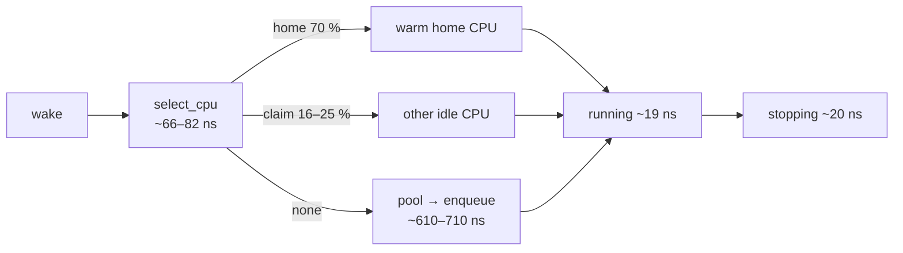
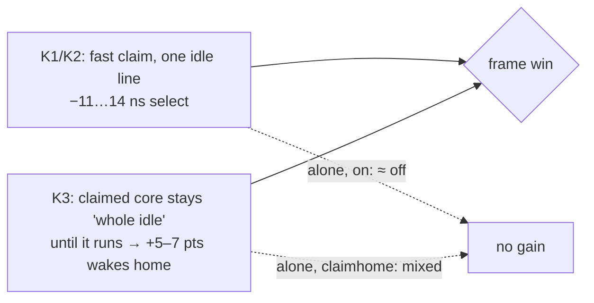

# scx_cake — current state

> [!IMPORTANT]
> Read first, every session. Rules: repository-root `CLAUDE.md` · behaviour: `DESIGN.md`
> · history: `docs/archive/STATE_ARCHIVE.md` (newest first; grep it, never read it whole).
> **Offload:** once nothing in an entry is owed, move it word for word to the archive top;
> owed items move to [Owed](#owed) first.

**Legend** · ✅ default / kept · ❌ rejected · ➖ no effect · 🧪 under test · ⏳ owed
· 🐧 stock kernel · 🧩 custom cake kernel patch

---

## Now (2026-10-12)

| | |
|---|---|
| 🌿 Code | local `d295e8bb8` on `RitzDaCat/scx_cake-nightly` · pushed `fe076988f` · last upstream merge PR #3786 (`c410fcbd7`) |
| 🖥️ Host | `7.2.9-2-cachyos-custom`: experimental-patches 1–4 (patch 3 without its warning fix) · `sched_ext.dsq_direct=Y` covers every cake DSQ ID · 7.2.9 sets `SCX_RQ_IN_WAKEUP` only on the core wakeup path, so pre-7.2.9 numbers are not comparable |
| ⚙️ Defaults | native CTZ/POPCNT (auto) · E1 cached rq clock in `ops.running` · **lean idle `lazy`** (silent fallback without the kernel flag) · policy base: 2026-09-28 pool-serving C (archive) |
| 🧪 Test-only flags | `--native-bitops` `--portable-bitops` `--native-ring` `--native-hist` `--kernel-signals` `--signal-report` `--handoff-ns` `--toggle probe=1` `--inspect-bpf` `--lean-idle` — the release is flagless |
| 📦 10-05 arm A′ | wide-host idle popcount (D), `update_idle` pool interlock (F), exit pool check, census identities, `PEND_HEAL`: committed in `758e2e841`, pushed |
| ⚠️ Lost binaries | `cost_c1c1e5aad80f` (base), `cost_400e7a766333` (E1): `target/` wiped 10-05 ~11:26; rebuild by SHA (`cakebench cost`) |

---

## Pattern ledger

Metric levels follow `CLAUDE.md` (1 = game frames … 4 = static counts).

| | Pattern | Kernel | Best evidence | Next |
|---|---|---|---|---|
| ✅ | **Lean idle claim `lazy`** (K1–K4, `SCX_OPS_LEAN_IDLE` + `_LAZY_SMT`) | 🧩 patch 4 · else regular claim | KovaaK's (CPU-limited: uncapped ~770 FPS, GPU ~39 %) quiet: avg FPS **+1.4 %**, p99 **−5.1 %**, 1 % low **+7.5 %**, stddev −18 % (16/16) · 16 hogs: 0.1 % low +6.6 %, max −16 %, nothing worse · `on` ≈ `off` · [why](#why-lazy-wins) | ⏳ GPU-limited check, `cakebench cost` |
| ✅ | E1: `ops.running` reads cached `rq->scx.clock` | 🐧 ≥ 6.14 · else `scx_bpf_now()` | appsim 24 slots: running −3.10 ns [−4.32, −1.91], BPF −1.9 %, frames neutral | ⏳ game A/B |
| ✅ | Native CTZ/POPCNT (auto) | 🧩 patch 1 · else portable builtins | running −2.31 ns, select −4.11 / −0.2 ns · KovaaK's: no frame difference after 2 rounds ([evidence](#evidence)) | — |
| ✅ | D+F: wide-host idle popcount; `update_idle` pool interlock on every host | 🐧 (> 64 CPUs) | forced-wide, 2 rounds: `update_idle` −1.09 / −0.64 ns, running −2.69 / −1.05 ns, 0 stalls | ⏳ real > 64-CPU host |
| ✅ | Exit pool check, census identities, detach-first reports | 🐧 | identities exact in 4 probe slots; pending 0 at every exit | diagnostics only |
| 🧪 | Wake classes by waker context (IRQ / kthread / game / other) | 🐧 | KovaaK's 90 s: `dxvk-queue` IRQ-woken 731k× (GPU completion), mean 0.6 µs, worst 1.08 ms; game↔game worst 4.8 ms | policy under test |
| 🧪 | IRQ-woken wakes run next (idle CPU, else head of prev + PREEMPT) | 🐧 | KovaaK's under 16 hogs paused at slot 5/8; data unread | ⏳ rerun quiet |
| ⏳ | DSQ direct index (kernel) | 🧩 patch 2 · else hash | untested on hardware | reboot A/B |
| ➖ | Kernel wake signals (input/fence tags) | 🧩 patch 3 | KovaaK's 90 s: 0 of 8.4M wakes tagged (input via KWin socket; NVIDIA private waits) | nothing to act on here |
| ➖ | `bpf_fastcall` on scalar kfuncs | 🧩 | select −1.08 then +1.82 | — |
| ➖ | Mask removal via verifier return bounds | 🧩 | enqueue −8.2 did not repeat · stock prunes native path | — |
| ➖ | E2: whole-core word from idle word | 🐧 | select −0.01 ns | — |
| ➖ | Portable vs native bitops in game | 🧩 | round 1 favoured portable, round 2 did not replicate | — |
| ❌ | Block stash (wake class from 1 line) | 🐧 | frames within noise · [report](docs/research/block-stash-20261012/README.md) | — |
| ❌ | claimhome (lazy placement, no patch) | 🐧 | placement reproduced, frame win not · [report](docs/research/claimhome-20261012/README.md) | — |
| ❌ | `--native-ring` | 🧩 | KovaaK's mixed, within noise | — |
| ❌ | Spread pick (ties → first CPU above caller) | 🐧 | select +8.1 / +11.7 / +8.3 ns; +130 cyc/run; retakes −42 %; appsim p99 equal | patch in `docs/research/counting-classifiers-20261005/` |
| ❌ | Division-free quotients | 🐧 / 🧩 MULHI/CLZ | BPF +5.8 %, select +11 ns | sources kept |
| ❌ | Per-CPU claim line | 🐧 | select +3.23, enqueue +71.31 ns | — |
| ❌ | vtime setter kfuncs | 🐧 | `stopping` +28–36 % | — |
| 📌 | 7.2.9 `SCX_RQ_IN_WAKEUP` fix | 🐧 7.2.9 | source review | baseline change |
| 📌 | Preferred-core re-read at runtime | — | ranking identical 09-26 and 10-05 (4=5 > 3 > 1 > 2 > 0 > 6 > 7) | dropped: startup read is correct |

---

## Why lazy wins

KovaaK's, 20 s per arm · data `scx_cake_bench/runs/lazy_study_20261012/` (probe census, bpf_stats).

| | off | on | lazy |
|---|---:|---:|---:|
| `select_cpu` ns/run | 81.9 | 71.0 | **68.2** |
| claim time (`t_taci`) | 100 % | 73 % | **65 %** |
| wakes → warm home (`home_warm`) | 62.4 % | 62.5 % | **69.7 %** |
| wakes → other idle CPU (`taci_warm`) | 25.5 % | 25.3 % | **17.3 %** |
| steals (`steal_moved`) | 7.5 % | 10.2 % | 11.9 % |

Both halves are needed: `on` + claimhome ≈ `lazy`, so the win stays a 🧩 kernel-patch feature.

---

## Evidence

<b>2026-10-12 · flag A/Bs</b> (KovaaK's menu, 6 × 20 s per run)

Runs: `scx_cake_bench/runs/flags_20261012/` (`tools/batch.sh`, `flag_ab.py`) · one HEAD binary, each arm's loader line checked.

| Arm vs default | Quiet | 16 hogs | |
|---|---|---|---|
| `--portable-bitops` vs native | round 1 pooled 12 slots/arm: 1 % low +4.4 % (29/36), stddev −21 % · round 2: p99 +0.4 % worse (0/9) | round 1: p99 −2.7 % · round 2: p99 +1.2 % worse (0/9); pooled 17–21/36 | ➖ variance; JIT inlines native, inputs never 0, ns/run equal |
| `--native-ring` vs off | mixed | mixed | ❌ |

Per-callback cost in game (bpf_stats): `cake_enqueue` 610–710 ns · `cake_cpu_release` 355–399 ns · `select_cpu` ~66–82 · `running` ~19 · `stopping` ~20.

<b>2026-10-12 · cache-line contention</b> (perf c2c, IBS)

KovaaK's + cake (`lazy`), 20 s quiet and loaded · tools `scx_cake_bench/runs/c2c_20261012/` (`capture.sh` starts perf before attach so BPF symbols resolve; `fields.py` names task_struct fields from BTF; `srclines.py` maps JIT IPs to C lines).

| HITM loads (quiet) | Share | |
|---|---:|---|
| Game / Wine userspace | 85.5 % | outside cake |
| Kernel code | 14.0 % | ttwu, rq, task line 0: intrinsic |
| Cake BPF | **0.5 %** | ~110–141 samples; `select_cpu` most |

| Cause | HITMs | Cycles | |
|---|---:|---:|---|
| Wakee classifier reads: `nvcsw`, `sched_info.{pcount,run_delay}`, `se.sum_exec_runtime` (3 remote task lines) | 74 (67 %) | 74–97 | ❌ stash tried |
| Idle-word read `m->bits[0]` in `select_cpu` | 8 | **862** | shared line (lean K2) — floor |
| Direct `p->scx.slice` / `dsq_vtime` stores read by kernel (also a kernel deprecation warning) | ~10 | — | setters cost more |
| Cake globals (queue-signal line) | 7 | 178 (loaded) | true sharing |
| Kernel `__scx_update_idle` | 44 | 94 | kernel side |

<b>2026-10-05 · appsim cost rounds</b>

`cakebench cost`, appsim 20 s slots, all valid. Busy host: round 2 had two outside bursts (enqueue 669k–724k per slot) — compare inside one round only.

| What | Run | Result |
|---|---|---|
| Spread census A vs B (probe, 2 slots/arm) | `cost/20261005T093740_appsim` | warm-claim failures 2.04, 1.93 → 1.70, 1.80 %; retakes ~100k → ~58k; evictee claims ~111k → ~77k |
| Round 1: HEAD / A / B | `cost/20261005T094221_appsim` | select 87.25 / 89.49 / 97.57 ns; enqueue calls −35 % with B; total 26.14 / 27.03 / 27.08 ms/s; p99 0.62 all |
| Round 2: HEAD / A / B2 | `cost/20261005T095506_appsim` | select 91.73 / 90.26 / 102.03 ns; frames unreadable |
| Profile A vs B2 | `cost/20261005T100619_profile` | select 870 → 1000 cycles, 1438.6 → 1469.7 insns/run |
| Wide rounds HEAD / B2 (forced wide) | `cost/20261005T101121_appsim`, `…T101840_appsim` | `update_idle` 11.47 → 10.38, 13.08 → 12.44 ns; running 18.06 → 15.37, 22.03 → 20.98 ns |
| Round 3: HEAD / A′ / B2′ at 42 % busy | `cost/20261005T102722_appsim` | select 108.22 / 108.52 / 116.77 ns; total 40.91 / 41.04 / 42.10 ms/s; p99 0.62 / 0.63 / 0.62 |
| Mask layout | session log | idle `…b1310`, SMT `…b1b00`: 32 lines apart |

<b>2026-10-04 · E1, fastcall, bounds, claim line</b>

Appsim helldivers2-mission-fitted, 20 s, `cakebench cost`, busy 30–31 %, runs under `scx_cake_bench/runs/`.

| What | Run | Result |
|---|---|---|
| E1 vs base, 12 slots/arm | `cost/20261004T133141_appsim` | running −3.10 ns [−4.32, −1.91]; BPF −0.48 ms/s [−0.90, −0.07]; frames equal |
| E1 screens | `cost/20261004T131835_appsim`, `…T132239_appsim` | running −3.55, −3.26 ns |
| Fastcall, bounds, portable | `cost/20261004T101532_appsim`, `…T101959_appsim`, `…T102143_appsim`, `appsim_fast_20261004T111326` | no stable effect; native vs portable select −4.11 / −0.2 |
| Per-CPU claim line | `cost/20261004T125140_appsim` | select +3.23, enqueue +71.31 ns |
| Select census (probe) | `appsim_fast_20261004T111326/probe.log` | warm claim 71.8 %, home 26.5 %, retake 1.5 %, serial 0 % |
| Where select time goes | `perfmap_20261004_base/report.txt`, `cost/20261004T121113_profile` | idle claim ≈ 60 % of select; BPF self ≈ 22 %; running's `scx_bpf_now` ≈ 10 % |

🐧 Kernel facts: `scx_bpf_now()` reads the TSC whenever `SCX_RQ_CLK_VALID` is clear (common at `ops.running`). With NR_CPUS=8192 + CPUMASK_OFFSTACK the idle cpu/smt masks are kmalloc(8) objects that may share a line with others.

---

## Owed

| # | | Item | Detail |
|---|---|---|---|
| 1 | ⏳ | Game A/B for E1 | kept binaries lost → rebuild by SHA |
| 2 | ⏳ | DSQ direct A/B | reboot with `sched_ext.dsq_direct=0` |
| 3 | ⏳ | Lean `lazy`: GPU-limited check (FPS cap or high resolution) + `cakebench cost` | CPU-limited KovaaK's A/B done 10-12 (`runs/kovaaks_leanidle_20261012`) |
| 4 | 🔍 | `cake_enqueue` 610–710 ns, `cake_cpu_release` ~370 ns/run | 10× the other callbacks — next cost target |
| 5 | 🔍 | `irq_leave` 550–1,010 ns/run | 09-25 profile: 946 cycles / 600 insns; cause open |
| 6 | 🧹 | Flagless release | decide or remove each test-only flag |
| 7 | 🧹 | `cake.bpf.c` comment density 0.25 | ceiling 0.20 |
| 8 | ⏳ | Pre-revert carry-overs (archive) | `verifier_load_topologies` multi-LLC / >64 / sparse; HZ 250/300 stalls; WoW GPU-bound A/B; OSLTT vs `9db04489e`; §G93 trace; §G96 tester logs |
| 9 | ⏳ | D+F on a real > 64-CPU host | tester |
| 10 | ⏳ | Spread pick in frames | only if the retake drop is worth it |
| 11 | ⏳ | IRQ-woken wake priority, quiet host | tools `scx_cake_bench/runs/kovaaks_irqwake_20261005/tools/` (`run.sh`, `irq_wake.py`, `diag_wake.py`; set PID/WIN in `kv_ab.py`, `CAKE_DIAG_TGID`); arms `kv-x` / `kv-y`; `run1/` slots 1–5 likely skewed |

---

## Research index

| Doc | Finding |
|---|---|
| [`block-stash-20261012/`](docs/research/block-stash-20261012/README.md) | ❌ wake class from one line: no frame effect |
| [`claimhome-20261012/`](docs/research/claimhome-20261012/README.md) | ❌ lazy placement without the patch: placement yes, frames no |
| [`counting-classifiers-20261005/`](docs/research/counting-classifiers-20261005/README.md) | spread pick ❌, D+F ✅ |

<b>jit-bitops-prototype/</b> (2026-10-01 … 10-02)

| Doc | Finding |
|---|---|
| `GPU_INPUT_IRQ_SIGNALING_2026-10-02.md` | signals patch + `--kernel-signals`; VM contract passed |
| `SIGNAL_FRESHNESS_CLOCKS_2026-10-02.md` | 33 signals: clocks, staleness, invalidation |
| `GAMING_SIGNAL_PIPELINE_2026-10-02.md` | IRQ/GPU/input wake paths; KWin threads are RR, outside cake |
| `KERNEL_FULL_BUNDLE_2026-10-02.md` | one combined kernel patch for CachyOS 7.2.8 |
| `DSQ_DIRECT_INDEX_2026-10-02.md` | direct DSQ index; VM passed, no hardware speedup shown |
| `CACHE_HOTPATH_REVIEW_2026-10-02.md` | cake/kernel cache inventory and ranking |
| `AUTO_NATIVE_BITOPS_2026-10-02.md` | native CTZ/POPCNT auto-detection |
| `PERFORMANCE_SUMMARY_2026-10-02.md` | charts and data for the scalar experiments |
| `DEEP_RESEARCH_2026-10-02.md` | typed DSQ compare backport; bounds need precision tracking |
| `SCALAR_BOUNDS_REFACTOR_2026-10-02.md` | kernel return bounds; plain mask deletion grows code |
| `INSTRUCTION_PASS_2026-10-02.md` | selective fastcall; ~1 cycle per native CTZ/CLZ/POPCNT |
| `FASTCALL_SIMULATION_2026-10-01.md`, `FASTCALL_KERNEL_REVIEW_2026-10-01.md` | unary fastcall; no speedup |
| `ASSEMBLY_PIPELINE_REVIEW_2026-10-01.md` | JIT confirms scalar ops |
| `RELEASE_CTZ_CLZ_2026-10-01.md`, `INSTRUCTION_USAGE_REVIEW_2026-10-01.md` | CTZ ring / CLZ histograms: faster callbacks, worse tails |
| `REPEAT_5X_2026-10-01.md`, `QUICK_TEST_2026-10-01.md`, `HARDWARE_SMOKE_2026-10-01.md` | bitops small gain; division-free loss |
| `QUOTIENT_IMPLEMENTATION.md`, `quotient/` | exact reciprocal division (removed; sources kept) |
| `README.md` | index |

Documentation map: `docs/README.md` · supported use: `README.md`.
