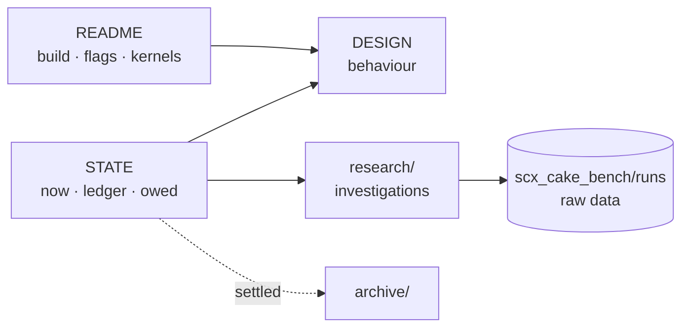

# Cake documentation map

Current source and STATE come first; dated documents describe the builds they examined.
Paths stay stable for existing citations.

## 🚩 Start here

| Need | Document |
|---|---|
| 🚀 Build, flags, stock vs custom kernel, limits | [README](../README.md) |
| ⚙️ Current scheduling behaviour | [DESIGN](../DESIGN.md) |
| 📌 Status, pattern ledger, owed work | [STATE](../STATE.md) |
| 📜 Rules | repository-root `CLAUDE.md` (local) |
| 📏 Measurement method and limits | [PERFORMANCE](PERFORMANCE.md) |
| 💲 Instruction and kernel-call costs | [cost audit](AUDIT_OPERATION_COST_2026-09-15.md) |
| 🧩 Kernel patch research | [research index](research/README.md) |
| 🎮 Sep 28 nightly game evidence | [KovaaK's A/B](KOVAAKS_KICK_ABBA_2026-09-28.md) |
| 🛠️ Tools | [bench](../bench/README.md) · [TOOLING](TOOLING.md) |
| 🗂️ File inventory and layout | [STRUCTURE](STRUCTURE.md) |
| 📊 Meeting page | [meeting/index.html](meeting/index.html) |
| 🗄️ History, rejected ideas | [archive](archive/README.md) · `archive/STATE_ARCHIVE.md` |

## 📁 Folders

| Location | Holds |
|---|---|
| `src/` · `src/bpf/` | loader and BPF scheduler source |
| `tests/` | CLI tests (unit tests live in the Rust source) |
| `bench/` | offline models and diagnostics |
| `veristat/` | verifier fixture (`9950x.json`) — not a topology certification |
| `docs/` | standing references and dated evidence |
| `docs/research/<topic>/` | investigations and patch bundles, each README states its limits |
| `docs/archive/` | settled reviews, plans, STATE archive |
| `../../../target/` | builds and test arms (`cake_receipt_builds/`) |
| `scx_cake_bench/` (sibling repo) | measurement tools and run outputs (`runs/`) |

<b>📅 Dated references</b>

| Document | Role |
|---|---|
| [Kernel tool inventory](KERNEL_TOOL_INVENTORY_2026-08-23.md) | kernel capability survey — verify against the target kernel |
| [RT placement](RT_PLACEMENT_LOGIC_2026-07-24.md) | placement rationale |
| [Predict/verify audit](AUDIT_PREDICT_VERIFY_2026-08-22.md) | cost and design reasoning |
| [ADPF/LLF](RESEARCH_ADPF_LLF_2026-08-09.md) · [new constructs](RESEARCH_NEW_CONSTRUCTS_2026-08-17.md) · [construct theory](THEORY_CONSTRUCTS_ABC_2026-08-17.md) | candidate mechanisms, not defaults |
| [Signals audit](SIGNALS_AUDIT_2026-08-17.md) | signal inventory |
| [G21/G23 review](REVIEW_G21_G23_2026-08-02.md) · [Diablo analysis](ANALYSIS_DIABLO_CHOP_2026-08-02.md) | construct review, workload diagnosis |

## 🧹 Keeping it tidy

| Rule |
|---|
| New investigation → `docs/research/<topic>/README.md`: verdict row, question, patch, evidence table, kernel requirement, open gates |
| Bulk measurement output stays in `scx_cake_bench/runs/` — link it, don't copy it |
| STATE carries conclusions; README and DESIGN change only with behaviour |
| Archive a finished investigation after fixing inbound links |
| Style: tables, status symbols (✅ ❌ ➖ 🧪 ⏳ · 🐧 🧩), mermaid flows, `
` for evidence; prose only for what a table cannot hold |

♻️ Older bulk scratch: `scx_cake_bench/history/imported_from_scx_repo/` (restore with
`zstd -dc <tarball> | tar -xf -`) · deleted docs: `git log --diff-filter=D --name-only -- scheds/rust/scx_cake/docs/`.
