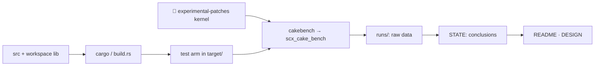

# Cake layout

Where things live (checked 2026-10-20). Tracked files: `git ls-files scheds/rust/scx_cake`.

| Location | Holds |
|---|---|
| `src/main.rs` | loader: flags, topology, attach, IRQ-sink monitor |
| `src/core_performance.rs` · `build_identity.rs` · `inspect_bpf.rs` | platform core ranking · binary hash for `--version` · `--inspect-bpf` |
| `src/bpf/` | `cake.bpf.c` policy · `intf.h` shared constants · 🧩 `wake-signals.bpf.h` · `scalar-experiments.bpf.h` ring helpers · `lib` → workspace `lib/` |
| `tests/` | CLI tests (unit tests live in the Rust source) |
| `bench/` | offline models and diagnostics ([bench README](../bench/README.md)) |
| `veristat/` | verifier fixture (`9950x.json`), not a topology certification |
| `docs/` | references and dated evidence · `research/<topic>/` investigations · `archive/` settled history · `meeting/` HTML page |
| `cake` | `cake build`: locked release build into the workspace `target/` |
| `../../../cakebench` | benchmark entry point; runs the sibling `scx_cake_bench` repo |
| `../../../target/` | builds and test arms (`cake_receipt_builds/`) |
| `scx_cake_bench/` (sibling repo) | measurement tools, `runs/` raw data, `history/` |

**Local only** (ignored, a clone lacks them): `.codegraph/` (generated source index) ·
`bench/PROFILING.md`, `cake-bpfstats`, `gameprobe.py`, `percpu_wake.py`,
`scx_cake_corun.py`, `scx_cake_smt_residency.py`, `smt_control.py`, `wake_maxdecomp.py`.
Check what they expect before relying on them.
