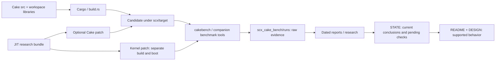

# Cake structure map

Snapshot: 2026-09-29. This maps the current disk layout, including ignored local
files. It does not certify that every historical tool still works.

## Current structure

```text
scx/                                  Workspace
├── cakebench                         Entry point to companion benchmark tooling
├── lib/                              Shared BPF library
├── rust/                             Shared Rust crates
├── target/                           Builds and isolated candidate worktrees
└── scheds/rust/scx_cake/              Cake package
    ├── README.md                     User-facing build, flags and limits
    ├── DESIGN.md                     Current scheduling policy
    ├── STATE.md                      Current status plus dated rounds
    ├── Cargo.toml, build.rs           Package and BPF build integration
    ├── .cargo/                       Package-local Cargo configuration
    ├── .codegraph/                   Local generated source index
    ├── src/                          Rust loader and build identity
    │   └── bpf/                      BPF policy and shared interface
    │       └── lib -> scx/lib/        Shared library symlink, not a Cake copy
    ├── tests/                        CLI integration tests
    ├── veristat/                     Retained verifier input fixture
    ├── bench/                        Models, probes, trace tools, retired stubs
    └── docs/
        ├── README.md                 Documentation entry point
        ├── STRUCTURE.md              This map and inventory
        ├── PERFORMANCE.md            Measurement guidance and status links
        ├── TOOLING.md                Dated tool inventory
        ├── dated audits/reports      Costs, mechanisms and game evidence
        ├── meeting/                  HTML presentation
        ├── research/
        │   ├── jit-20260929/         Investigation, probes and disassembly
        │   └── jit-bitops-prototype/ Kernel/Cake patches, tests and runner
        └── archive/                  Historical reviews and state ledger

scx_cake_bench/                        Sibling repository
├── maintained benchmark tooling      Actual measurement orchestration
├── runs/                             Captures and measurement outputs
└── history/                          Historical evidence/vault
```

## How the parts connect



## Is this optimal?

The source/build boundary is sensible. Keep `src/`, `tests/`, shared library
links, and raw measurement storage where they are. Moving files alone would
not justify disturbing build assumptions or evidence paths.

The documentation is now navigable, but four areas still deserve improvement:

| Area | Current issue | Recommended next structure |
|---|---|---|
| STATE | 493 lines mixing current obligations with dated/reverted rounds | Keep current policy, active experiments and next gates in STATE; migrate settled rounds to linked dated history after checking every carried obligation |
| bench | Flat mixture of offline models, diagnostics, retired stubs and ignored local tools | Classify ownership first, then group reusable tools under `models/`, `diagnostics/`, and `microbench/`; keep old refusing stubs as redirects until callers are accounted for |
| docs root | Standing guidance mixed with dated reports | Eventually group maintained guidance under `reference/` and dated outcomes under `reports/`, updating inbound links together |
| local configuration/tools | A clone does not include ignored profiling tools; package-local Cargo flags can affect subdirectory builds | Audit which tools should be versioned or owned by the companion repo; document one canonical build entry point |

Do not move JIT artifacts now: their manifests and documentation record paths,
and the patch bundle is already a useful self-contained unit. If more kernel
experiments arrive, give each its own similarly structured bundle.

The runtime source is concentrated in `main.rs` (2,236 lines) and `cake.bpf.c`
(3,421 lines). That is a separate code-architecture question. BPF extraction can
change inlining and register allocation, so a code split needs build/JIT/runtime
validation rather than being bundled into a folder cleanup.

Suggested priority: shorten STATE first, audit ignored bench tools second,
then consider physical tool/report moves. Preserve filenames or redirects where
existing scripts, documents or manifests depend on them. This map proposes those
moves; it does not perform them.

## Full package file inventory

`tracked` means present in the Git index; `new` means visible but not staged;
`local/ignored` means a normal clone will not contain it. Python caches are
omitted. Shared symlink targets are not recursively listed as Cake-owned files.

### Package root

- `.gitignore` — tracked
- `Cargo.toml` — tracked
- `DESIGN.md` — tracked
- `README.md` — tracked
- `STATE.md` — tracked
- `build.rs` — tracked

### .cargo/

- `config.toml` — tracked

### .codegraph/

- `.gitignore` — local/ignored
- `codegraph.db` — local/ignored

### bench/

- `.gitignore` — tracked
- `PROFILING.md` — local/ignored
- `README.md` — new
- `arith_price.c` — tracked
- `cake-bpfstats` — local/ignored
- `cakeload.c` — tracked
- `capture_preflight.py` — tracked
- `comment_lint.py` — tracked
- `decomp.c` — tracked
- `enq_kick_idle_ab.sh` — tracked
- `enq_kick_idle_schbench_ab.sh` — tracked
- `floor_ladder.c` — tracked
- `fnspills.py` — tracked
- `frame_attrib.py` — tracked
- `gameprobe.py` — local/ignored
- `handoff_shape.c` — tracked
- `migrate_cause.py` — tracked
- `percpu_wake.py` — local/ignored
- `pool_mark_ordering.py` — tracked
- `qmark_price.c` — tracked
- `review_regressions.c` — tracked
- `review_regressions.py` — tracked
- `rt_displace.py` — tracked
- `rt_displace_capture.sh` — tracked
- `scx_cake_bench_capture.sh` — tracked
- `scx_cake_bench_report.sh` — tracked
- `scx_cake_bench_suite.sh` — tracked
- `scx_cake_config_audit.sh` — tracked
- `scx_cake_corun.py` — local/ignored
- `scx_cake_full_bench.sh` — tracked
- `scx_cake_game_diag_extract.py` — tracked
- `scx_cake_policy_bench.sh` — tracked
- `scx_cake_scheduler_matrix.sh` — tracked
- `scx_cake_simple_bench.sh` — tracked
- `scx_cake_smt_residency.py` — local/ignored
- `scx_cake_thread_profile.py` — tracked
- `smt_control.py` — local/ignored
- `storage_price.c` — tracked
- `topology_regressions.c` — tracked
- `topology_regressions.py` — tracked
- `wake_maxdecomp.py` — local/ignored
- `wake_migsplit.py` — tracked
- `wake_occupant.py` — tracked
- `wakecost.c` — tracked

### docs/

- `ANALYSIS_DIABLO_CHOP_2026-08-02.md` — tracked
- `AUDIT_OPERATION_COST_2026-09-15.md` — tracked
- `AUDIT_PREDICT_VERIFY_2026-08-22.md` — tracked
- `KERNEL_TOOL_INVENTORY_2026-08-23.md` — tracked
- `KOVAAKS_KICK_ABBA_2026-09-28.md` — tracked
- `PERFORMANCE.md` — tracked
- `README.md` — tracked
- `RESEARCH_ADPF_LLF_2026-08-09.md` — tracked
- `RESEARCH_NEW_CONSTRUCTS_2026-08-17.md` — tracked
- `REVIEW_G21_G23_2026-08-02.md` — tracked
- `RT_PLACEMENT_LOGIC_2026-07-24.md` — tracked
- `SIGNALS_AUDIT_2026-08-17.md` — tracked
- `THEORY_CONSTRUCTS_ABC_2026-08-17.md` — tracked
- `TOOLING.md` — tracked

### docs/archive/

- `ANALYSIS_2026-08-29.md` — tracked
- `AUDIT_COMPONENT_COST_2026-08-23.md` — tracked
- `BRANCH_THESIS_2026-08-07.md` — tracked
- `CAKE_113_VS_120_DELTA_2026-07-27.md` — tracked
- `DESIGN_KERNEL_PATCH_PROPOSALS_2026-08-25.md` — tracked
- `EEVDF_GATE_2026-07-04.md` — tracked
- `GAME_PERF_CAKE_VS_LAVD_2026-08-06.md` — tracked
- `PERF_PLAN_2026-08-29.md` — tracked
- `README.md` — new
- `RESEARCH_KERNEL_PATCH_SWEEP_2026-08-25.md` — tracked
- `REVIEW_CODEBASE_2026-08-29.md` — tracked
- `REVIEW_DUPE_STALE_2026-08-27.md` — tracked
- `REVIEW_OX_ALPHA_2026-08-23.md` — tracked
- `REVIEW_PANDEMONIUM_VS_CAKE_2026-08-25.md` — tracked
- `STATE_ARCHIVE.md` — tracked
- `SWEEP_ARITH_2026-08-03.md` — tracked

### docs/meeting/

- `index.html` — new

### docs/research/

- `README.md` — new

### docs/research/jit-20260929/

- `README.md` — new
- `bitops.bpf.asm` — new
- `bitops.bpf.o` — new
- `bitops.c` — new
- `bitops.x86.asm` — new
- `bitops.x86.o` — new
- `counts.json` — new
- `installed-jit.asm` — new
- `provenance.json` — new
- `sha256.json` — new
- `toolchain.txt` — new

### docs/research/jit-bitops-prototype/

- `0001-bpf-x86-inline-scalar-bitops.patch` — new
- `0002-scx-cake-opt-in-native-bitops.patch` — new
- `EXPERIMENT.md` — new
- `Makefile` — new
- `README.md` — new
- `analyze.py` — new
- `bitops-run.c` — new
- `bitops.bpf.c` — new
- `checkpatch.txt` — new
- `run.py` — new
- `selftest-run.c` — new
- `test_analyze.py` — new
- `validation.json` — new
- `vm-check.sh` — new
- `vm.config` — new

### src/

- `bpf_intf.rs` — tracked
- `bpf_skel.rs` — tracked
- `build_identity.rs` — tracked
- `core_performance.rs` — tracked
- `main.rs` — tracked

### src/bpf/

- `cake.bpf.c` — tracked
- `intf.h` — tracked
- `lib` → ../../../../../lib — tracked

### tests/

- `cli.rs` — tracked

### veristat/

- `9950x.json` — tracked

