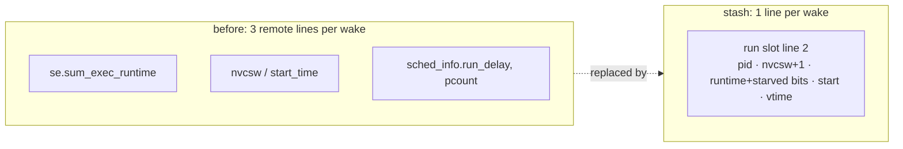

# Block stash: wake classification from one line (2026-10-12)

| Verdict | Kernel | Evidence level | Patch | Data |
|---|---|---|---|---|
| ❌ rejected, reverted | 🐧 any sched_ext | hardware, game | [block-stash.patch](block-stash.patch) (vs `11744c11b`) | `scx_cake_bench/runs/kovaaks_blkstash_20261012/` |

## ❓ Why

perf c2c (`runs/c2c_20261012/`, source-line attribution): **67 %** of cake's cross-core
HITM loads sit at four classifier lines in `select_cpu`, reading three wakee task_struct
lines last written by the CPU the task ran on.

## 🔧 What the patch does

| Step | |
|---|---|
| ✍️ Write | `ops.stopping(!runnable)`, on the task's own CPU (its lines local), seqlock-style: id 0 → fields → id |
| 📖 Read | `select_cpu`, `claim_warm`, `select_undecided`, admit, task slice, enqueue wake route |
| ✅ Valid when | pid matches · id stable across the read · `p->scx.dsq_vtime` unchanged · `!p->on_cpu` · else read the task lines |
| ⚠️ Trap | `__schedule` counts the switch in `nvcsw` after `pick_next_task`, i.e. after `ops.stopping` → stash `nvcsw + 1` |

Verifier accepts it.

## 📊 Evidence

| | Result |
|---|---|
| Hit rate (probe) | KovaaK's ~1 hit per `select_cpu` (49 % of loads) · `perf bench sched messaging`, 320 tasks: 23 % (other blockers overwrite the stash) |
| A/B quiet, `base` (`fe076988f`) vs `blk`, 6 × 20 s | avg FPS −0.03 % · p99 −0.3 % · 1 % low +0.9 % |
| A/B 16 nice-10 hogs | avg −0.3 % · p99.9 +3.5 % |
| Reading | all within slot-to-slot noise: ~2 HITMs (~30 ns) per cross-CPU wake are too small next to a frame; a miss also pays one extra line |
