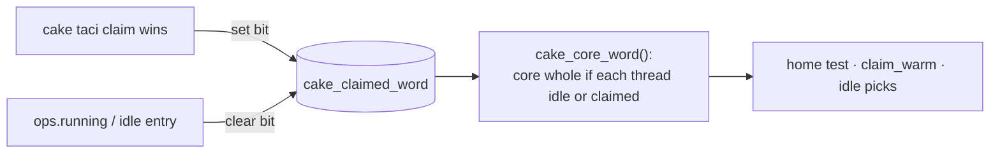
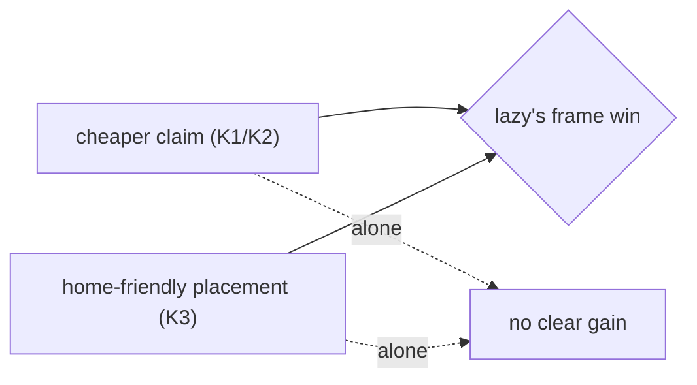

# claimhome: lean `lazy`'s placement without the kernel patch (2026-10-12)

| Verdict | Kernel | Evidence level | Patch | Data |
|---|---|---|---|---|
| ❌ not shipped, reverted | 🐧 any sched_ext | hardware, game | [claimhome.patch](claimhome.patch) (`--toggle claimhome=1`) | `scx_cake_bench/runs/claimhome_20261012/` |

## ❓ Question

🧩 Lean `lazy` (patch 4, K3) beats `off`; `on` (K1/K2/K4) alone does not. Under `lazy` a
claimed CPU's core keeps its whole-idle bit until that CPU runs, and **+5.5–7 pts** of
wakes go to their warm home (`home_warm` ~70 % vs ~64.6 %, replicated twice).
**Can cake get that alone?**

## 🔧 Patch

Shift-pair SMT maps only. A first version that relaxed only the home core-busy test fired
on 0.1 % of wakes and moved nothing.

## 📊 Evidence (KovaaK's menu, ≤5 min runs)

| Placement | home | other idle CPU |
|---|---:|---:|
| `off` | 65.5 % | 21.4 % |
| `off` + claimhome | **71.7 %** | **15.0 %** |
| `lazy` | 70.7 % | 15.9 % |

| Frames (6 × 20 s) | avg FPS | p99 | 1 % low | 0.1 % low |
|---|---|---|---|---|
| `off`+claimhome vs `off`, quiet | +0.45 % (9/9) | −1.0 % | −1.6 % (0/9) | −2.6 % |
| same, 16 hogs | +0.15 % | ≈ | +1.3 % (7/9) | +8.4 % (7/9) |
| `on`+claimhome vs `lazy`, quiet | −0.04 % | +0.7 % | −2.0 % (1/9) | −0.7 % |

| Cost (bpf_stats) | |
|---|---|
| `select_cpu` | 79 ns either way (lean claim: 68) |
| `running` | +0–6 ns |

## 🧩 Reading

`on` + claimhome nearly matches `lazy`, slightly worse — consistent with claimhome's two
atomics per wake on a shared word. The win stays a kernel-patch feature.
