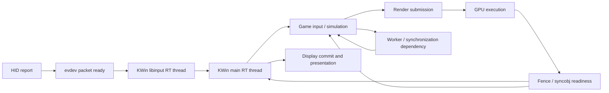

# Earlier signals and cheaper state for low-latency gaming

Research date: 2026-10-02. Scope: Cake release policy, sched_ext, IRQs,
NVIDIA GPU/fence paths, synchronization, KWin, mouse and keyboard input.

Follow-up: [exact signal locations, update rules and clock accuracy](SIGNAL_FRESHNESS_CLOCKS_2026-10-02.md)
adds live timing/protocol capability checks and a small GPU/CPU clock observation.
Its evidence supersedes this report's unqueried-capability status where noted.

**Finding:** the useful kernel extension is small, attributed readiness and
interference information delivered to existing scheduling decisions. The
largest opportunities concern which dependency becomes runnable, when it must
finish, and which CPU can actually serve it. Faster scalar instructions help
process these hints, but cannot supply missing device or frame semantics.

This report contains source findings, a live read-only capability inventory,
and proposed experiments. **No new latency measurements, signal patches,
tracing attachments, input capture, scheduler activation, or kernel installation
were performed for this investigation.** Proposed API names below do not exist.
The [existing complete kernel bundle](KERNEL_FULL_BUNDLE_2026-10-02.md) contains
the scalar/fastcall/bounds/DSQ work; it does not contain these new proposals.

## 1. Findings that change the design

| Finding | Consequence |
|---|---|
| KWin main, libinput and both display threads currently use `SCHED_RR`, priority 1 | Cake cannot directly schedule these RT threads. Measure RT interference and the ordinary threads around them; compositor changes are a separate component. |
| `sched_waking` precedes normal CPU selection; `sched_wakeup` is in the later wake-completion path | Publish the reason for a wake before placement. A `sched_wakeup` observer is too late for that first choice. |
| Cake already tracks live generic IRQ/softirq handler depth | A new generic “IRQ happened” hook duplicates existing work. Improve coverage, information quality, or cost. |
| Cake's chronic IRQ detector reads `/proc/stat` on 1–4 second windows | An internal nanosecond counter can improve resolution and adaptation. This does not mean every current IRQ hint is seconds old: the live depth path is separate. |
| NVIDIA already processes completed semaphore-surface fences directly in its callback | Removing a supposed mandatory worker hop would target a hop that this completion path already avoids. Other deferred paths remain worth measuring. |
| The generic fence-signaled tracepoint precedes publication of the fence timestamp | Reading `fence->timestamp` there can read the wrong union state. Use the function's timestamp argument or separately label observation time. |
| KWin coalesces consecutive pointer-motion events and retains the latest timestamp | Latest sample age alone can conceal older queued work; measure both backlog age and freshest input. |
| NTSYNC owner IDs are opaque userspace values | They cannot be interpreted as trusted Linux TIDs for priority propagation. |
| KWin adds 1 ms to its render estimate for timer/scheduler uncertainty | This is an existing planning allowance, not evidence of a removable 1 ms delay. |

These are current-source or host-state findings, not measured performance wins.

### Verified host and source boundary

- Running kernel: `7.2.8-1-cachyos-custom`; sched_ext was disabled during the audit.
- GPU: RTX 4090, NVIDIA `615.71.09`, IRQ 97, module license `Dual MIT/GPL`.
- KWin `6.7.5-1.1`, Wayland session; libinput `1.32.0-1.1`;
  wayland-protocols `1.49-1`.
- `CONFIG_IRQ_TIME_ACCOUNTING`, `CONFIG_SCHED_CLASS_EXT`, `CONFIG_BPF_JIT`,
  `CONFIG_DEBUG_INFO_BTF`, `CONFIG_SCHEDSTATS`, and `CONFIG_IRQ_WORK` are enabled.
- NVIDIA module BTF is present. Generic IRQ, architecture IRQ-vector, scheduler,
  DMA-fence and DRM-vblank trace events are available. NVIDIA's listed trace
  event is an Xid/error event, not a job-completion stream.
- Several relevant NVIDIA fence functions appear in
  `available_filter_functions`. Neither that listing nor BTF proves a particular
  BPF program attaches successfully, or that a game uses the function.
- `/dev/ntsync` exists. Whether a particular Proton title uses it was not measured.
- Repo release SHA256 remained
  `059f78b352ef5c796754691ecd38dbbf0c896b10c2d0a85a383f1609fed94fef`.

Kernel code below comes from the retained CachyOS 7.2.8 candidate used for the
previous DSQ work. It is a reference tree, not an assertion that every byte
matches the running kernel. NVIDIA and KWin sources were fetched from exact
upstream version tags matching the installed version numbers; distro patches
and build flags can differ. Installed Wayland protocol XML is a specification,
not proof of what this running compositor advertises. Vulkan extension support
and versions have not been queried on this device.

Evidence and file hashes: [research manifest](GAMING_SIGNAL_EVIDENCE_2026-10-02.json).
Retained raw inventory and downloads are under
`target/cake_signal_research_20261002T213213Z/` in the repository.

## 2. Follow readiness through the pipeline



This is a representative composed Wayland path, not a measured trace. Direct
scanout, Xwayland, raw-input integrations, multi-output presentation and hardware
cursor updates have different branches. A fence may release a CPU waiter, make
a GPU submission possible, or release a reusable buffer. Those actions need
different scheduling responses.

Separate four improvements:

1. **Cheaper query:** consume already available state with less work.
2. **Earlier notification:** remove an actual deferred stage or poll interval.
3. **Better attribution:** identify the runnable consumer or blocking producer.
4. **Better policy:** use that information to reduce the relevant deadline miss
   or input age without excessive migration, preemption or lost throughput.

Earlier observation does not make an incomplete GPU operation or unfinished
input packet ready. A blocked task cannot perform its dependent work just
because Cake knows about it sooner.

### 2.1 How direct can GPU → CPU scheduling be?

For an already-registered **direct CPU fence waiter**, the source-level route
can be:

```text
RM notification reaches SemaphoreSurfaceKapiCallback
  -> registered NVIDIA DRM completion callback
  -> process completed fences
  -> dma_fence_signal
  -> registered default CPU-wait callback
  -> wake_up_state(actual_task)
  -> try_to_wake_up
  -> CPU selection / enqueue, when those paths apply
  -> local reschedule or remote CPU notification
  -> task scheduled
```

The KAPI callback directly invokes the registered callback. Combined with the
NVIDIA DRM immediate-completion path, **this subpath needs no userspace
notification broker and no mandatory worker queue between that RM callback
and the CPU waiter wake**. These are source-level edges, not an assertion that
the game uses this waiter, that RM/GSP delivery before this point has no queue,
or that every step costs a context switch. [N2, N3, K4, K5]

The most direct new scheduler signal can ride that same wake operation:

```text
wait satisfied + known task
  -> carry {cause, dependency generation, event time} with existing wake
  -> core accepts wake and publishes task metadata
  -> Cake reads it during the existing placement/enqueue decision
```

That design adds **zero required userspace round trips and zero required extra
work queues for the hint itself**. It still adds metadata work and synchronization;
its measured cost may be positive or negative relative to a tracing/map design.
The CPU cannot context-switch in the middle of arbitrary hard-IRQ/fence-lock
execution. For a remote target, a notification/IPI or deferred wake-list path
may be necessary. Eliminating it by always using the interrupt CPU can be worse
when that CPU is busy or has poor cache/SMT placement.

GPU→GPU semaphore handoffs have a different objective: they may have no CPU
waiter at all. In the reviewed NVIDIA sync-FD path, a worker is needed for an RM
operation that cannot run in the completion context. If that worker is the
critical dependency, scheduling the game earlier does not remove the stall.
Associate urgency with the required worker or remove the deferral only after
proving the driver operation is safe in a different context. [N2]

### 2.2 Mouse/keyboard → CPU: find actual queue boundaries

For a conventional USB HID report delivered through KWin, the representative
source path is:

```text
USB host-controller completion
  -> hid_irq_in -> hid_safe_input_report -> HID parsing
  -> input events / SYN_REPORT
  -> evdev client packet ready -> poll/epoll waiter wake
  -> KWin libinput thread drains reports
  -> queued Qt handoff
  -> KWin main thread routes input to the correct client
  -> client socket/input thread readiness
  -> game samples input / performs dependent work
```

HID driver quirks and non-USB devices may take other paths. The HID→input→evdev
calls are not individually userspace round trips. The **queued Qt handoff and
client delivery are actual potential queue boundaries**; each may need CPU
service, although an already-running consumer need not incur another context
switch. The two KWin stages are RT on this host. [K9, K10, W4, W5, H1]

The shortest general improvement is to preserve “input pending for this
consumer” across those existing handoffs, and reduce their measured queue age.
Directly waking the game on the USB IRQ would frequently be wrong: the packet
may be incomplete, focus/routing unknown, or the game intentionally waiting to
sample closer to presentation. Bypassing KWin would require a different input
ownership/routing design and application support, not just a Cake instruction.

### 2.3 Exact states: what can be known immediately?

| Requested fact | Earliest useful truth | Caveat / required extension |
|---|---|---|
| Needs a CPU | A dependency is satisfied and a specific consumer has ready work | The producer can know this before a generic wake event; distinguish readiness from intentional timer/pacing eligibility. |
| Runnable / queued | Core accepts the wake; sched_ext runnable/enqueue state | A task can be runnable without being the critical dependency. Some paths skip select_cpu or enqueue. |
| Selected for a CPU | Core `set_next_task_scx` / Cake `running` | This is scheduler bookkeeping, not proof that the first application instruction already executed. |
| Actually resumed | Context-switch completion or an explicit application resume marker | `sched_switch` is emitted before the low-level switch; label it as a scheduling boundary. Application markers include return-to-userspace cost. |
| Waiting | Task blocks and the relevant wait implementation registers its dependency | `stopping` alone includes preemption. An ordinary `S`/sleep state does not identify what will release it. |
| CPU work done | Explicit phase end or completion object published by the producer | Going to sleep, yielding, or using up a slice does not mean the frame/phase finished. |
| GPU work done | Relevant GPU timeline/fence completion | The software callback is later than hardware completion by an unmeasured amount; device timestamps need clock conversion. |
| Frame visible | Presentation feedback/scanout evidence; physical measurement for light output | GPU completion, buffer release and CPU “done” are not the same event. |

Cake already receives running/stopping transitions for its tasks; do not add a
second tracing round trip to tell it what its callback already knows. Use
all-class scheduler observation to cover RT threads that Cake does not own.
Associate dependency generations with these states so a late “done” from frame
N cannot clear pending work for frame N+1. For multiple producers, define fan-in
readiness; for multiple waiters, define fan-out consumption. [K3–K5]

### 2.4 Count expensive handoffs, not just function names

For each observed path, collect:

| Boundary | Record | Optimization question |
|---|---|---|
| Event enters observable software | Event/dependency generation and monotonic timestamp | Is firmware/controller/driver notification already late? |
| Work is queued | Queue identity, producer/consumer identity, enqueue time | Is a deferral required by context/locking, or avoidable? |
| Consumer gets CPU | Wake acceptance, selected CPU, switch and resume times | Was the delay CPU queueing, an IRQ, an RT task, migration or idle exit? |
| Consumer publishes next dependency | Output generation, timestamp, required successor | Is an extra thread/process round trip useful? Can existing readiness carry the metadata? |
| Frame completes/presents | Frame identity and final timestamp | Did shorter upstream service improve the displayed result or just move waiting elsewhere? |

Use a small record such as `{clock_id, time, cpu, task_cookie,
dependency_cookie, generation, stage, flags}` for research, with bounded
sampling/histograms in sustained runs. A task/object pointer is not a durable
cookie. Record trace loss. Compare stage durations and counts of worker queues,
wakeup IPIs, migrations, user/kernel transitions and map lookups. A full CPU call
graph can then target the particular stage; tracing every function throughout
a game would distort the path we are trying to shorten.

Fast-path patterns to evaluate: prepare dependency identity at wait registration;
reuse the actual waiter/task reference on completion; inline a static-key-gated
metadata handoff; reuse an existing valid timestamp; publish before CPU
selection; consume one task-local snapshot; coalesce hints when already runnable;
avoid allocation, global hash lookup, ring-buffer delivery or daemon RPC to make
the scheduling decision. Keep complete diagnostic event streams off the normal
release path. Each removed queue or lookup still needs before/after validation.

This handoff audit is the primary gaming-latency investigation. The smaller IRQ
reader remains a useful independently testable kernel change, rather than a
substitute for finding the critical GPU/input dependency path.

## 3. IRQs and CPU interference

### What Cake already does

`cake.bpf.c:904–1005` has a userspace-maintained chronic IRQ mask, per-CPU
live handler depth from four BTF tracepoint programs, and an optional
`tick_cpu_device` next-event check. CPU selection combines these hints with
normal candidate selection and idle claiming. `main.rs:1249` parses IRQ plus
softirq time from `/proc/stat`; `SinkMonitor` samples on a one-second run loop,
adapts its interval up to four seconds, and requires repeated evidence before
changing its mask. `CLK_TCK=100` means these exported time counters have 10 ms
units, even though internal accounting has finer resolution. [K1, C1, C2]

Generic handler tracepoints surround registered IRQ actions. They do not cover
every architecture-local timer/IPI entry path. The host separately exposes
local-timer, reschedule and call-function vector events. Merely appending every
event to the existing depth counter risks overlapping intervals and more BPF
work; characterize coverage with distinct counters first. Nested handling,
threaded IRQs, ksoftirqd and PREEMPT_RT require explicit semantics. [K1, K2]

### Most useful patch

Expose the existing per-CPU accounted IRQ-time total through a bounded,
non-sleeping sched_ext query. Start with the counter, availability and a CPU
lifecycle generation. Use it to build a short-window interference estimate;
retain the current slow detector for chronic behavior. This avoids text parsing
and exported tick quantization. It does **not** automatically produce an exact
current in-IRQ flag or predict the duration of the next interrupt. [K1]

`irqtime_account_irq()` already maintains totals. `irq_time_read()` uses
`u64_stats` synchronization; the reader contract must be checked per
architecture rather than copied into a new unbounded hot-path loop. For a
multi-field snapshot, permit bounded attempts and return unavailable on an
inconsistent read. Accounted totals can lag work currently in progress.

A broader live occupancy signal is a separate extension at correctly matched
IRQ entry/exit boundaries. It costs writes and possibly timestamp reads on
interrupt paths. Gate it when unused and benchmark its writer overhead. Avoid
adding a BPF policy callback for every interrupt when an existing callback can
read a small summary. Do not lock a remote runqueue to obtain a “perfect” sample.

### The invisible work that remains

- CPU time in ksoftirqd is scheduled task runtime; kernel IRQ accounting
  deliberately excludes that execution from its IRQ-time total. Do not add it
  twice. Cake's `sum_exec_runtime` accounting must not subtract IRQ time again.
- RT/DL work is another source of interference. KWin's verified RT threads make
  this relevant on this host. Cake already wraps `scx_bpf_cpu_curr()`; use its
  RCU lifetime rules and check existing visibility before adding another API.
  Current-task observation is a hint, not a reservation of the CPU. [K3, C1]
- NMI and firmware SMI stalls are not fully represented by these generic IRQ
  counters. Nor does an IRQ counter identify all preemption-disabled regions,
  idle-state exit latency, CPU frequency ramping or memory contention.
- The kernel already exposes `scx_bpf_cpuperf_cap/cur/set`; a new device-query
  API should not duplicate them. They do not promise instantaneous hardware
  frequency or predict C-state exit time. [K3]

**Smallest experiment:** compare current depth-only visibility with accounted
time and separately observed architecture vectors. Measure missed interference,
false avoidance, migration/cache cost and wake-to-run tails. Only then change
placement. Read candidate CPUs, not every CPU on every wake. Cache-line padding
separates writers on different CPUs; it does not eliminate coherence traffic
between a CPU's writer and readers of that same slot.

## 4. GPU status: expose the relevant dependency

Device-wide utilization is a poor per-wake scheduling input. NVIDIA documents
its ordinary utilization metric as activity over a sampling interval, commonly
between 1/6 and 1 second depending on product. That specification does not
establish this GPU's exact interval. Faster polling does not turn the value into
a frame-ready signal. DRM fdinfo engine counters are cumulative client activity,
not an instantaneous frame deadline or queue-depth contract. NVIDIA support for
particular fdinfo fields must be discovered. [N1, D1]

The useful information is closer to:

- a known submission or timeline point is pending;
- its completion makes this consumer runnable;
- a producer is runnable but has not submitted the next required work;
- the CPU producer is already too far ahead of a presentation target;
- device reset/error invalidated a dependency.

Cache immutable device identity and topology outside the hot path. For dynamic
state, prefer driver-published progress generations or task dependency tokens.
Do not read MMIO, call NVML, walk driver objects, wait for GSP/RM responses or
acquire driver locks from `select_cpu`/`enqueue`. A cheap stale global “GPU busy”
bit can make scheduling less accurate despite being cheap to load.

For this NVIDIA version, investigate semaphore-surface fence progress and its
actual consumers first. The open kernel module source and module BTF provide
concrete hooks, but do not expose a universal “next game frame will finish at
time T” interface. CPU scheduler policy also cannot directly reorder all GPU
work or overcome firmware execution limits. [N2]

**Smallest experiment:** correlate the known NVIDIA completion hooks with
generic fence signals, waiter wakeups and frame markers. Establish coverage and
latency before designing a generic GPU snapshot. Driver-specific instrumentation
can be temporary; the long-lived policy input should describe readiness,
progress and deadline, rather than vendor names.

## 5. Fences and GPU-to-CPU / GPU-to-GPU handoffs

### An existing fast path and a remaining deferred path

In NVIDIA `615.71.09`, `__nv_drm_semsurf_ctx_callback()` directly invokes
`__nv_drm_semsurf_ctx_process_completed()`, then queues work that re-registers
callbacks. Completed fences are removed under the context lock and signaled
after releasing that lock. This already lets some waiters proceed before the
worker runs. Measure callback re-arming separately from completion delivery.
[N2, lines 825–940]

A different path, `__nv_drm_semsurf_wait_fence_cb()`, queues work to register a
semaphore update with RM. The source explicitly requires deferral because the
callback may run in interrupt context. An already-signaled fence can take the
immediate path from the ioctl. This creates a concrete hypothesis: queue-to-run
delay of the required worker may postpone dependent GPU work. It does not
justify moving a potentially unsafe RM operation into the interrupt callback.
Measure the actual worker's scheduling class, dependency and queue delay first.
[N2, lines 1574–1640, 1718–1733]

### Publish valid completion information

In the reference kernel, `dma_fence_signal_timestamp_locked()` sets the signaled
bit and emits `trace_dma_fence_signaled()` **before** replacing the callback-list
union with the completion timestamp. The event is useful as a software
notification point, but an observer must not assume the timestamp field is
already valid. A typed event carrying the supplied timestamp, or a separately
defined event after its publication, would make measurements less ambiguous.
Preserve existing tracing semantics when considering such a patch. [K4]

For direct CPU waits, `dma_fence_default_wait_cb()` has a real task pointer and
calls `wake_up_state()`. That is a useful place to carry a completion cause into
the ordinary wakeup path. It does not cover every custom wait, sync_file poll,
syncobj wait or driver-private semaphore. Map these paths separately. A global
fence observer cannot infer every consumer from the submitting PID. [K4]

Callbacks may run with a fence spinlock held in atomic context. Publish only
bounded metadata; no allocation, sleeping or extra runqueue/driver lock chain.
Carry cause information through the existing wake operation. A new observer
callback can also enable signaling that was previously lazy, changing the cost
of the workload being measured. Prefer observation of existing paths initially.
[K4, D2]

Fence identity requires context, sequence and lifetime handling; include chains,
arrays, errors, timeout, object reuse and reset. A signaled error is not successful
rendering. `dma_fence_set_deadline()` is an advisory driver facility; the two
fence-op tables reviewed in this NVIDIA DRM file have no `set_deadline` handler.
That is not a claim about every NVIDIA fence type. [N2, K4, D2]

**Smallest experiment:** measure completion observation → successful task wake
→ first CPU service, plus callback → worker service → RM registration on the
deferred path. Improve the stage that actually consumes time.

## 6. Thread waits, futexes, epoll and Proton

`try_to_wake_up()` emits `sched_waking` before normal CPU selection, while
`sched_wakeup` is emitted during later completion. A generic early hook knows
the wakee but not necessarily the reason. In interrupt context, `current` can
be the interrupted task, not the work's producer. Classifying a wake by that
PID would create false dependencies. [K5]

A new typed cause should originate where the wait is satisfied and the actual
task is known, and be serialized with the wakeup before Cake reads it. This
requires a core wakeup contract, not merely a field written from any callback.
Multiple racing causes, unsuccessful wakes, wake queues and already-runnable
tasks must all have defined behavior. Some wakes never call `select_cpu`
(single-CPU affinity, migration disabled, on-rq/other fast paths); the metadata
must also be usable at enqueue/runnable or subsequent service decisions. [K3, K5]

**Futex:** `futex_wake_mark()` transfers a task to a wake queue, and later code
wakes it after the hash lock. Preserve that ordering, references and successful
wake semantics. Ordinary futexes do not offer a trustworthy generic owner.
PI-futex/rtmutex owner knowledge is more specific; any extra dependency policy
must preserve existing priority-inheritance semantics. An arbitrary futex word
is not a safe task identifier. [K6]

**NTSYNC:** the driver knows the actual waiting task and whether ANY/ALL
conditions succeeded. That is a better readiness source than interpreting an
ioctl name. Its mutex `owner` is explicitly not validated or interpreted as a
Linux task. WAIT_ALL must remain atomic: boosting a waiter before all required
objects are acquired cannot resolve the wait. Existing driver locking also
makes arbitrary extra scheduler callbacks undesirable. [K7, D3]

**Epoll/eventfd/socket/timer waits:** epoll can combine readiness from many
sources and wake different consumers. Store bounded pending readiness on the
appropriate object/handoff, not just “last source on this CPU.” Already-ready
fds and already-running consumers need no new wake transition. Distinguish
timer expiry and deliberately paced waits from input/completion readiness.
Avoid making every eventfd a “game-critical” event. [K8]

**Smallest experiment:** instrument successful readiness-to-wake transitions
for one verified wait family used by a workload. Track cause coverage, duplicate
and missing association, queue age and thread service. Try bounded urgency on
the real runnable dependency, including an upstream producer if its identity
is proven. Cap propagation depth, duration and service; expire on completion,
cancellation or generation change. Do not build an unbounded dependency graph
inside a scheduling callback.

## 7. Game phases, frame targets and pacing

The kernel can see runnable tasks, runtime, sleeps and selected synchronization
objects. It generally cannot infer which simulation step, render submission or
input sample belongs to the next displayed frame. Process names and bursts are
not sufficient to reconstruct that relationship.

The smallest useful cooperation is an optional producer of frame/phase metadata:
an opaque frame generation, a monotonic target, a readiness/phase flag, and the
registered task or dependency. Start with userspace/BPF-map instrumentation and
measure its update cost. A shared publisher or userspace syscall per phase is
not free; one coherent publication per meaningful phase is preferable to
unconditional updates from every worker. The interface should serve interactive
applications generally, not hard-code game or executable identities.

Known input sampling and submission markers let us distinguish CPU starvation,
render backlog and intentional pacing. `VK_NV_low_latency2` explicitly supports
pacing CPU work before input sampling. `vkLatencySleepNV` returns immediately;
the application waits on the supplied semaphore. A scheduler should service the
thread promptly once the wait legitimately completes, not defeat this pacing by
forcing premature work. Query actual device extension support/version first.
[V1, V2]

Presentation timing APIs can report or request presentation-related timing, but
do not automatically provide a scheduler-ready CPU deadline. Convert clock
domains explicitly and distinguish a target from measured completion. A useful
CPU latest-start estimate is:

`target latch time − estimated remaining CPU/GPU work − uncertainty allowance`

This is a prediction, not a real-time guarantee. Reject stale generations and
implausible targets, and measure calibration error. Making a producer run
earlier can increase input age if it just builds a deeper render queue.

**Smallest experiment:** correlate frame IDs, input sample time, CPU readiness,
submission and actual presentation for a controlled application. Add advisory
urgency only when the data identifies avoidable CPU queueing on that path.

## 8. Compositor and display handoff

The installed-version KWin render loop computes a target presentation time and
an expected compositing duration, with VRR/tearing and buffering-specific logic.
Its estimate includes an additional 1 ms timer/scheduler allowance. It then
starts a `Qt::PreciseTimer` using a duration cast to milliseconds. Timer
quantization, callback service delay, actual rendering and the safety estimate
are distinct terms; blindly deleting the allowance cannot establish a win.
[W1, lines 44–112]

KWin has information the kernel lacks: which surface/output matters, when a
frame is eligible, which buffer/fence it needs, and whether it can use direct
scanout. Exporting a bounded target/dependency hint from that location is more
accurate than reconstructing a game frame from generic vblank events. Multi-output
and VRR require per-output generations; the next periodic vblank is not always
the relevant presentation opportunity. [W1, W2]

Wayland synchronization has several different meanings:

| Signal | Meaning for orchestration |
|---|---|
| Surface frame callback | Pacing opportunity; not proof a frame appeared. |
| Presentation feedback | Presented/discarded result and presentation clock; use for outcome attribution. |
| Explicit acquire point | Buffer may be sampled after the dependency completes. |
| Explicit release point | Buffer reuse becomes safe; not proof it was displayed. Release may occur without sampling. |
| FIFO barrier | An eligibility/pacing constraint that must retain its protocol semantics. |
| Commit timing | Desired presentation no earlier than a timestamp; not an instruction to immediately preempt CPU work. |

These contracts are in the installed XML and official protocol repository.
Do not infer presentation from a released buffer or treat every completed fence
as a compositor deadline. [P1–P5]

**Host-specific constraint:** the main KWin, libinput and display threads are
already RT. Increasing their Cake rank cannot help because they do not run
under Cake. RT tasks still encounter hard IRQs, locks, CPU affinity, throttling
and hardware limits. Keep their class unchanged for the first experiment.
Measure queueing and interference rather than assuming RT implies zero delay.
KWin's `gainRealTime()` source requests RR at minimum priority. [H1, W3]

**Smallest experiment:** instrument KWin target/timer-fire/render-start/commit/
presentation and the dependency's readiness, alongside scheduler events for RT
and ordinary tasks. If uncertainty is demonstrably reduced, separately test
timer precision or a smaller margin. Treat KWin and kernel/Cake patches as
separate factors in the experiment.

## 9. Mouse movement, buttons and input wakeups

The earliest generic input hook knows a report arrived, but often does not know
the consuming game. In evdev, `evdev_pass_values()` finishes a nonempty
`SYN_REPORT` packet and invokes `wake_up_interruptible_poll()` after releasing
the client buffer lock. `evdev_events()` respects grabs and the actual client
list. This is a useful readiness boundary; arbitrary early `input_event()`
observation can precede packet completion and include filtered data. [K9]

On this KWin version, libinput dispatch fills an event queue. The empty→nonempty
transition emits `eventsRead`; `libinputbackend.cpp` connects this to processing
through a queued Qt connection. Processing combines consecutive motion events,
sums motion deltas and retains the newest event timestamp. Thus, USB arrival,
libinput service, KWin main-thread service and delivery to the game are separate
intervals. A kernel-only token does not automatically survive that userspace
handoff; cooperative forwarding or measured inference is required. [W4, W5]

For a scheduler hint, retain an input class, pending generation, oldest pending
time and newest sample time. Raw coordinates and button identities are
unnecessary for CPU placement. Coalesce scheduling hints when the consumer is
already runnable; do not coalesce away application input or generate an IPI for
each motion sample. A newest-timestamp-only metric can report fresh input while
old processing remains backed up.

The kernel input timestamp may be driver-supplied or sampled at receipt; it is
not automatically the physical sensor timestamp. USB polling/report cadence,
device firmware and controller interrupt moderation occur before Cake can
schedule the consumer. At an assumed 1 kHz, the nominal report interval is 1 ms;
at 8 kHz it is 125 µs. These are arithmetic examples, not a measurement of this
mouse. Globally changing a shared xHCI controller's interrupt behavior can
increase overhead and affect other USB devices. [K9, D4]

**Smallest experiment:** timestamp packet readiness, both KWin thread stages,
game input receipt/sample and the corresponding presented frame. Separate
hardware cursor motion from the rendered game-camera response. Use actual
presentation feedback for software latency and a physical input-to-light setup
for a photon-latency claim. A scheduler wake histogram alone proves neither.

## 10. Keyboard press, release and repeat

Keyboard data shares the input/evdev readiness path but has different semantics.
`EV_KEY` values distinguish release, press and autorepeat. Releases are as
important as presses for gameplay; accelerating only presses can leave movement
feeling delayed on stop. Repeat may be generated above the physical device
path, so it cannot simply be counted as another hardware IRQ. [K9, D5]

KWin's libinput processing checks seat key counts before forwarding state
changes. Focus, grabs and application routing determine which client receives
them. A kernel-wide “keyboard active” flag cannot identify that client or its
critical thread. Press/release ordering and focus loss must remain correct.
Report grouping must also remain intact. [W4]

Use a generic discrete-input pending hint for the actual consumer. Preserve
the earliest outstanding edge until processed; continuous fresh repeat events
must not erase older pending releases or continually renew unlimited urgency.
The scheduler does not need the keycode or text. On `SYN_DROPPED`, clear
unsupported attribution and resynchronize state instead of trusting an
incomplete event sequence. [D5]

**Smallest experiment:** measure press and release delivery independently under
CPU/GPU load, with a controlled input source. Include auto-repeat, focus change,
held key during application stall and disconnect/reconnect. Record timestamps
and event classes needed for latency analysis, not typed content. The same
kernel mechanism can handle mouse buttons; it need not add separate kfuncs for
each device or button.

## 11. A small kernel interface, with explicit ownership

This is a design proposal, not an ABI or implemented patch.

### A. CPU interference query

Start with a scalar query for accounted IRQ time and availability, keeping its
verifier/return-value semantics explicit. If more fields are justified, use a
bounded snapshot such as accounted time, sample time, CPU generation and flags.
Keep completed accounting separate from optional live-depth coverage.

Draft name: `scx_bpf_cpu_interference(cpu, out, size)`.

- Validate CPU ID and scheduler CPU scope; reject offline/unsupported state.
- No allocation, sleeping, remote runqueue locking or device operations.
- Timestamp denotes a defined observation/publication instant; counters are
  durations, not a cross-CPU wall-clock origin.
- Unsupported or inconsistent data means **unknown**, never “zero interference.”
- Use bounded coherence checks and a documented fallback. A 64-bit x86 scalar
  load and a portable coherent multi-field snapshot are different contracts.
- Stage dynamic writer changes separately from a reader over existing state.

### B. Task readiness metadata

Draft name: `scx_bpf_task_wake_info(task, out, size)`.

Candidate fields: generation, cause bits, oldest pending time, latest event
time, optional target/expiry, opaque dependency cookie and validity/error flags.
Keep hot fields together; do not promise a one-load coherent record.

The difficult work is **publication**, not writing this reader:

1. Wait implementation determines actual readiness and holds a valid task/object
   reference under its existing lifetime contract.
2. A typed internal wake operation carries the cause; wake-queue paths preserve
   it until the real wake attempt. No raw kernel pointer escapes as a reusable ID.
3. Core wakeup code serializes accepted metadata before placement using its
   established task synchronization. Multiple causes merge by documented rules;
   failed wakes cannot leave a false successful-readiness token.
4. Already-runnable targets update bounded pending state without requiring a
   new context switch. Consumption/acknowledgment and expiry are explicit.
5. Cake reads once for its decision and uses normal queueing/idle-claim rules.

A per-task writer raced from arbitrary IRQ probes is not an adequate production
implementation. Direct trusted/RCU task pointers and caller contexts need
verifier rules; support is probed at startup with normal Cake fallback. [D6]

### C. Optional frame/dependency publisher

Prototype metadata from a controlled compositor/app in existing BPF maps first.
Register task lifetime and clock domain, bound requested urgency, and invalidate
on exit, exec, reset or display-generation change. A production ABI should
define who may annotate which task and how it composes with CPU/cgroup budgets.
It must remain useful without application support. sched_ext does not provide
all cgroup policy automatically; Cake must preserve the policy it implements.

### How Cake would use these inputs

Prefer existing locality and a genuinely available CPU, then use measured
interference and valid near-term urgency as bounded refinements. Account for
SMT sibling competition and higher-class work; “same CPU as GPU IRQ” is not a
universal win. Limit extra reads to candidates worth considering. Deadline
expiry or service completion removes the preference. Keep service/fairness
accounting and authoritative idle claiming intact.

CTZ/POPCNT can efficiently traverse eligible CPU masks or count candidates.
They do not justify replacing small constant-time operations with large masks
or querying every device per wake. A kfunc returning a large structure can add
calls, spills and copies; inspect the ordinary optimized release JIT before
assuming it is cheaper than existing loads. No division-free conversion is
needed for this design.

## 12. Cost, freshness and the experiment order

| State | Producer and frequency | Reader and invalidation | Main cost/risk |
|---|---|---|---|
| Device/topology identity | Setup, hotplug, affinity/configuration change | Cold cache with generation | Neglecting hotplug; usually not a per-wake query |
| IRQ accounting | Existing per-CPU accounting boundaries | Candidate query/window sampling; CPU lifecycle | Remote coherence, incomplete current interval |
| Extra live IRQ state | Potentially every entry/exit | Candidate query; coverage/config flags | New writer work and nested/architecture correctness |
| Task wake cause | Successful readiness transitions; merged pending events | One snapshot per decision; consume/expiry | Competing producers, extra task cache-line traffic |
| Fence progress | Submission/completion/error/reset | Actual dependent waiters; context lifetime | Callback/driver locking and coverage |
| Input hint | Completed packet/edge; coalesced scheduler notification | Actual consumer and explicit acknowledgment | High event rate, fan-out, oldest/latest ambiguity |
| Frame target | Meaningful phase/output target change | Relevant ready task; frame/output generation | Userspace publication overhead, stale prediction |

These dynamic caches have no measured hit rate yet. A valid, frequently hit
cache can still worsen placement if its information is too stale. Report both
snapshot availability and the rate at which a hint correctly identifies the
actual dependency/interference. “Fewer loads” alone is not success.

For cost planning only: at 8,000 events/s, an assumed 100 ns extra work per event
costs 0.8 ms CPU/s, or 0.08% of one core. Two such hooks cost 0.16%. Neither
100 ns nor this event rate is a measured property of the proposed implementation;
multiple input events per report, tracing, cache traffic and wakeups add costs.
At 240 Hz a refresh interval is approximately 4,166,667 ns. A tiny CPU improvement
can matter if it prevents a deadline miss, but cannot be credited with an entire
refresh-period saving unless observed on actual presentation data.

### Recommended sequence

| Order | Experiment | Required changes | Keep criterion |
|---|---|---|---|
| 0 | Attribute existing ready→wake→run→present delays | Observation only; release hashes and clocks recorded | Known coverage and bounded observer overhead |
| 1 | IRQ counter query; then separately improved live coverage | Kernel reader + Cake fallback | Less callback/writer cost or better placement and tails; no ghost “quiet” CPUs |
| 2 | Fence timestamp/cause instrumentation on a path actually used | Generic event or selected driver probe | Valid timestamps and actual consumer attribution |
| 3 | One typed readiness path: direct fence waiter or verified NTSYNC/futex path | Core wake metadata + wait implementation + Cake reader | Fewer critical runnable delays with bounded service/fairness impact |
| 4 | Input consumer handoff through KWin to game | Input/consumer metadata; optional userspace cooperation | Better press/release/motion-to-present age, not just cursor smoothness |
| 5 | Compositor target publication and calibrated deadline preference | KWin/app + Cake; optional later ABI | Fewer measured presentation misses without deeper buffering |
| 6 | NVIDIA deferred-worker optimization if identified as a bottleneck | Driver/work dependency integration | Shorter measured dependent-work handoff; preserved atomic-context and teardown rules |

Run each with a no-policy observation stage, then a single policy change. Use
trace counters/histograms or bounded sampling instead of a full ring-buffer event
stream on every IRQ. Record dropped events and account for the observer itself.
No zero-cost tracing assumption and no nanosecond cost estimate from VM wall time.

### Validation and performance gates

- Correctness: nested IRQs, remote wake, concurrent causes, already-runnable
  tasks, single-CPU affinity, migration disabled, wake-queue duplication,
  timeout/cancel, PI interactions, NTSYNC WAIT_ALL, epoll fan-in, fence errors/
  chains, PID/object reuse, task exit, CPU hotplug, suspend/resume and GPU reset.
- Configuration: features absent, IRQ accounting disabled, different module
  BTF, unpatched kernel, direct scanout, VRR/tearing, multi-output and Xwayland.
  Unknown signals retain ordinary scheduling. Verify release and portable paths.
- Latency decomposition: source observation → readiness; readiness → accepted
  wake; wake → first run; actual CPU service; worker handoff; GPU queue/execution;
  input sampling → actual presentation. Include unsuccessful/duplicate wakes
  and already-running consumers separately.
- Performance: callback ns/call and total CPU cost, migrations/coherence,
  fixed-work wall time, wake p50/p95/p99/p99.9, mean/max frame time and 1%/0.1%
  lows, frame variance, adjacent-frame jitter, input age, missed targets and
  discarded frames. Do not combine these into an unexplained “latency” score.
- Compare counter-only, observer-only and policy-enabled builds to expose
  instrumentation perturbation. Use paired randomized/ABBA blocks through the
  maintained `cakebench` routes, report ns deltas and uncertainty, and retain
  all valid slots. Five repeated runs are a screen, not an automatic keep.
- Compare ordinary release Cake with/without the new kernel feature and with
  EEVDF under the same kernel where appropriate. Keep RT class, power, display,
  frame limit, driver and background workload attributable. No RT priority
  change is bundled into a Cake policy result.

The first code-shaped candidate is the **small read-only IRQ accounting query**.
The first dependency experiment should be chosen by measured path coverage.
For gaming latency, typed readiness and an accurate presentation target have
more potential policy value than a fast global GPU-utilization query; the size
and even the sign of that benefit remain unmeasured.

## Source trail

All sources reviewed 2026-10-02. Live evidence is a dated snapshot. Upstream
documentation may advance independently of the local kernel candidate.

### Local code and evidence

The manifest records absolute paths and SHA256 hashes. `K` means
`target/cake_dsq_index_20261002T201929Z/linux/` in this repository.

| ID | Retained source | What it establishes |
|---|---|---|
| C1 | `scheds/rust/scx_cake/src/bpf/cake.bpf.c` | Current IRQ hints, tick predictor, task/runtime and CPU-current helpers |
| C2 | `scheds/rust/scx_cake/src/main.rs` | Tracepoint attachment and slow IRQ sampling/hysteresis |
| K1 | `K/kernel/sched/cputime.c`, `K/kernel/sched/sched.h`, `K/kernel/sched/core.c` | IRQ accounting, read synchronization, task-clock subtraction |
| K2 | `K/kernel/irq/handle.c`, `K/kernel/softirq.c`, `K/arch/x86/include/asm/idtentry.h` | Generic handler versus architecture entry coverage |
| K3 | `K/kernel/sched/ext/internal.h`, `K/kernel/sched/ext/ext.c` | select_cpu exclusions, current-task RCU query, existing CPU-performance helpers |
| K4 | `K/drivers/dma-buf/dma-fence.c` | Signal/timestamp/callback ordering, default CPU waiter, deadline delegation |
| K5 | `K/kernel/sched/core.c` | Waking/selection/wakeup order and fast paths |
| K6 | `K/kernel/futex/waitwake.c` | Futex wake-queue lifetime and locking |
| K7 | `K/drivers/misc/ntsync.c`, `K/Documentation/userspace-api/ntsync.rst` | Real waiter pointers, WAIT_ALL readiness, opaque owner IDs |
| K8 | `K/fs/eventpoll.c` | Readiness aggregation and epoll waiter wake |
| K9 | `K/drivers/input/input.c`, `K/drivers/input/evdev.c` | Timestamp origin, completed-packet publication, clients/grabs |
| K10 | `K/drivers/hid/usbhid/hid-core.c`, `K/drivers/hid/hid-core.c`, `K/drivers/hid/hid-input.c` | USB HID completion, report parsing and input synchronization |
| H1 | Research workspace `host.json`, `thread-policy.json` | Available hooks, versions, current KWin per-thread scheduling classes |

### Official external code, specifications and documentation

- **N1 — NVIDIA, current nvidia-smi documentation:** [utilization semantics](https://docs.nvidia.com/deploy/nvidia-smi/index.html#utilization).
- **N2 — NVIDIA, open GPU kernel modules 615.71.09:** [fence implementation](https://github.com/NVIDIA/open-gpu-kernel-modules/blob/615.71.09/kernel-open/nvidia-drm/nvidia-drm-fence.c), [module/firmware context](https://github.com/NVIDIA/open-gpu-kernel-modules/blob/615.71.09/README.md).
- **N3 — NVIDIA, open GPU kernel modules 615.71.09:** [KAPI semaphore callback registration and direct invocation](https://github.com/NVIDIA/open-gpu-kernel-modules/blob/615.71.09/src/nvidia-modeset/kapi/src/nvkms-kapi-sync.c).
- **W1 — KDE, KWin v6.7.5:** [render loop](https://github.com/KDE/kwin/blob/v6.7.5/src/core/renderloop.cpp).
- **W2 — KDE, KWin v6.7.5:** [compositor](https://github.com/KDE/kwin/blob/v6.7.5/src/compositor.cpp), [explicit-sync integration](https://github.com/KDE/kwin/blob/v6.7.5/src/wayland/linux_drm_syncobj_v1.cpp).
- **W3 — KDE, KWin v6.7.5:** [real-time class request](https://github.com/KDE/kwin/blob/v6.7.5/src/utils/realtime.cpp).
- **W4 — KDE, KWin v6.7.5:** [libinput event queue, keyboard and pointer processing](https://github.com/KDE/kwin/blob/v6.7.5/src/backends/libinput/connection.cpp).
- **W5 — KDE, KWin v6.7.5:** [queued thread handoff](https://github.com/KDE/kwin/blob/v6.7.5/src/backends/libinput/libinputbackend.cpp).
- **P1 — Wayland:** [core surface/seat protocol](https://wayland.freedesktop.org/docs/html/apa.html).
- **P2 — Wayland protocols 1.49:** [presentation feedback](https://gitlab.freedesktop.org/wayland/wayland-protocols/-/blob/1.49/stable/presentation-time/presentation-time.xml).
- **P3 — Wayland protocols 1.49:** [DRM syncobj acquire/release](https://gitlab.freedesktop.org/wayland/wayland-protocols/-/blob/1.49/staging/linux-drm-syncobj/linux-drm-syncobj-v1.xml).
- **P4 — Wayland protocols 1.49:** [FIFO](https://gitlab.freedesktop.org/wayland/wayland-protocols/-/blob/1.49/staging/fifo/fifo-v1.xml), [commit timing](https://gitlab.freedesktop.org/wayland/wayland-protocols/-/blob/1.49/staging/commit-timing/commit-timing-v1.xml).
- **P5 — Wayland protocols 1.49:** [input timestamps and their clock relation](https://gitlab.freedesktop.org/wayland/wayland-protocols/-/blob/1.49/unstable/input-timestamps/input-timestamps-unstable-v1.xml).
- **D1 — Linux documentation:** [DRM client engine statistics](https://docs.kernel.org/gpu/drm-usage-stats.html).
- **D2 — Linux documentation:** [DMA fences and deadline/locking contracts](https://docs.kernel.org/driver-api/dma-buf.html).
- **D3 — Linux documentation:** [NTSYNC ABI](https://docs.kernel.org/userspace-api/ntsync.html).
- **D4 — Linux documentation:** [USB URB interval and completion context](https://docs.kernel.org/driver-api/usb/URB.html).
- **D5 — Linux documentation:** [input event types and synchronization loss](https://docs.kernel.org/input/event-codes.html).
- **D6 — Linux documentation:** [BPF kfunc lifetime/verifier contracts](https://docs.kernel.org/bpf/kfuncs.html), [sched_ext callbacks and policy scope](https://docs.kernel.org/scheduler/sched-ext.html).
- **V1 — Khronos, Vulkan:** [VK_NV_low_latency2](https://docs.vulkan.org/refpages/latest/refpages/source/VK_NV_low_latency2.html).
- **V2 — Khronos, Vulkan:** [vkLatencySleepNV and semaphore wait behavior](https://docs.vulkan.org/refpages/latest/refpages/source/vkLatencySleepNV.html).

Historical Cake measurements remain in the
[performance summary](PERFORMANCE_SUMMARY_2026-10-02.md). They must not be used
as performance evidence for the new mechanisms proposed here.
