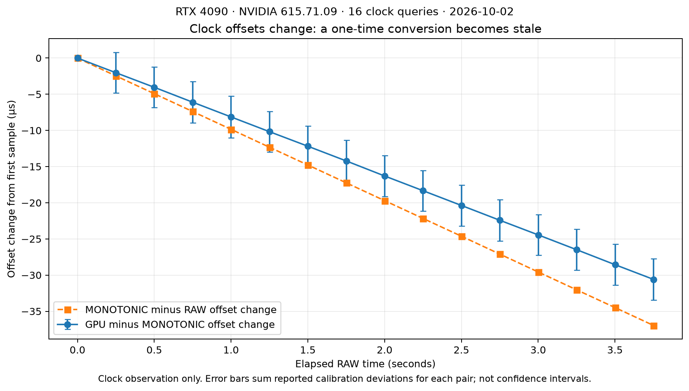

# Signal locations, update latency, freshness and clock accuracy

Research date: 2026-10-02. Follow-up to the
[GPU/input pipeline investigation](GAMING_SIGNAL_PIPELINE_2026-10-02.md).

**The opportunities are credible, but freshness and attribution determine whether
the hints help.** This pass maps **33 signals to 35 hashed source files**, checks
live driver/compositor capabilities, and records a small GPU/CPU clock-calibration
observation. It does not establish a scheduler or game performance improvement.

Read the [source-location catalog](signal-atlas/CATALOG.md) for every signal's
exact files, symbol locations, update trigger, clock, accuracy limits, access
path, Cake use and invalidation rules. The [CSV](signal-atlas/catalog.csv) and
[JSON](signal-atlas/catalog.json) contain the same inventory for sorting and
later instrumentation. Unmeasured timing fields are null, never zero.

## 1. New findings on this host

| Finding | Scheduling / measurement implication |
|---|---|
| Cake uses both `bpf_ktime_get_ns()` and `scx_bpf_now()` | Their timestamps are not interchangeable. External input/fence joins need a declared common clock. |
| `scx_bpf_now()` can return a cached rq timestamp repeatedly | A zero delta can mean a reused timestamp, not zero elapsed work. Cross-CPU monotonicity is not guaranteed. |
| Host tracefs clock is `[local]` | Existing ftrace timestamps must not be blindly compared across CPUs or with MONOTONIC data. Nothing was changed in tracefs. |
| CPU is Ryzen 7 9800X3D; clocksource is TSC; kernel HZ is 1000 | Coarse clock resolution is 1 ms, while `/proc/stat` exports 10 ms units (`CLK_TCK=100`). These are different tick concepts. |
| KWin advertises presentation feedback v2 with `CLOCK_MONOTONIC` | Presentation event timestamps have a confirmed domain on this session; feedback delivery time remains separate. |
| KWin advertises DRM syncobj v1 and FIFO v1 | These paths can be negotiated; a particular game's use has not been traced. |
| Input-timestamps and commit-timing protocols were absent from the live registry listing | Installed protocol XML is not evidence of available runtime support. |
| NVIDIA `nvidia_drm.vblank=N` | The optional callback/cache investigated previously is disabled. This does not mean pageflip/presentation feedback is unavailable. |
| RTX 4090 advertises calibrated timestamps, present-timing rev3, low-latency2 rev2 | Timing APIs exist, but low-latency2's revision-3 explicit submission attribution cannot be assumed. |
| DRM syncobj can notify availability or completion | A fence being installed is not evidence its GPU work completed. Preserve the wait mode with the signal. |

Read-only evidence: `target/cake_signal_atlas_20261002T220459Z/` in this repo;
[manifest](signal-atlas/evidence.json). Exact-version source is a reference:
distro patches/build options can differ. The live API/parameter queries verify
the stated capabilities, not all execution paths or their coverage.

## 2. What “how fast is it updated?” must specify

For each transition, distinguish:

```text
physical event / GPU operation finishes
    -> driver observes it
    -> dependency is ready
    -> metadata is published
    -> CPU consumer reads it
    -> consumer runs
    -> dependent work finishes / presents
```

- **Update trigger:** an IRQ boundary, a fence signal, a CPU switch, or a timer.
- **Publication delay:** time between the real event and the visible field.
- **Read cost:** time to access that field, including lookup/coherence work.
- **Age:** time since the represented observation or state transition.
- **Accuracy:** how closely a timestamp/state describes the event it claims to.
- **Drift:** change in the relation between two clocks over elapsed time.

Source inspection establishes ordering and trigger conditions. It usually does
**not** establish a maximum ns publication delay: interrupt delivery, masked
interrupts, firmware, lock contention and runnable queueing vary. “Updated on
every event” means no periodic polling interval; it does not mean zero latency.
A nanosecond field describes units, not nanosecond accuracy.

## 3. Where to read the signals, and when they change

The linked catalog entries provide clickable source lines and complete caveats.

| Signal family | Location / update rule | Freshness and Cake use |
|---|---|---|
| [Live IRQ depth](signal-atlas/CATALOG.md#irq_depth-cake-live-handler-depth) | Cake entry/exit BTF programs update own-CPU slot for generic IRQ actions and softirq handlers | Existing cheap candidate hint; remote read races and architecture coverage is incomplete. |
| [IRQ accumulated time](signal-atlas/CATALOG.md#irq_total-accounted-irq-duration) | `irqtime_account_irq()` updates per-CPU total at accounting boundaries | Finer counter than proc ticks; currently running interval can remain uncharged. Candidate for bounded kernel query. |
| [Timer/IPI interference](signal-atlas/CATALOG.md#irq_vectors-architecture-timeripi-interference) | Architecture entry/exit events | Separate coverage from generic device IRQ actions; avoid nested double counting. |
| [Chronic IRQ mask](signal-atlas/CATALOG.md#irq_proc-cake-chronic-irq-mask) | Loader reads `/proc/stat` on adaptive 1–4 second windows, with hysteresis | Intentionally slow trend; not frame-scale readiness. A delayed loader can make it older still. |
| [Current CPU occupant](signal-atlas/CATALOG.md#cpu_current-current-task-on-a-cpu) | `scx_bpf_cpu_curr()` reads core's RCU-protected `rq->curr` | Lifetime-safe advisory view, not an atomic CPU reservation. The occupant remains named while interrupted. |
| [Accepted wake](signal-atlas/CATALOG.md#wake-task-accepted-wakeplacement) | `try_to_wake_up()`, early `sched_waking`, existing select/enqueue callbacks | Carry typed cause before placement; successful wake, queued and already-running cases differ. |
| [Running/blocking](signal-atlas/CATALOG.md#run_stop-task-selected-running-preempted-or-blocked) | Core scheduling transitions and Cake callbacks | Already available for Cake tasks. Running callback/sched_switch precedes application resume; stopping does not mean done. |
| [Service consumed](signal-atlas/CATALOG.md#task_runtime-task-cpu-service-consumed) | Scheduler updates `sum_exec_runtime` | Accumulated service, with current segment possibly pending; not wall time or a frame completion signal. |
| [CPU capacity estimate](signal-atlas/CATALOG.md#cpuperf-cpu-performance-estimate) | Existing cpuperf kfunc reads architecture scale; x86 APERF/MPERF tick update path | Interval estimate, not instantaneous GHz. HZ=1000 does not guarantee a fresh sample every ms under NO_HZ/idle. |
| [Next timer](signal-atlas/CATALOG.md#clockevent-next-programmed-cpu-timer) | `tick_cpu_device` → `clock_event_device.next_event` | Current programmed event deadline; may be reprogrammed and does not predict every interrupt. |
| [GPU progress](signal-atlas/CATALOG.md#gpu_semaphore-nvidia-timeline-progress) | NVIDIA semaphore surface and RM/KAPI callbacks | Real timeline progress, but hardware→callback delay is unmeasured and driver memory is not an arbitrary BPF pointer. |
| [Fence signaled](signal-atlas/CATALOG.md#fence_signal-generic-fence-signaled-and-timestamp) | `dma_fence_signal_timestamp_locked()` publishes once | Ordinary signal timestamps software notification. Signaled tracepoint precedes timestamp-field publication. |
| [Direct CPU fence waiter](signal-atlas/CATALOG.md#fence_cpu_wait-direct-fence-cpu-waiter) | Fence/syncobj callback has actual task and invokes ordinary wake | Strong origin for typed readiness metadata, without a new userspace round trip. |
| [Syncobj availability](signal-atlas/CATALOG.md#syncobj_available-syncobj-point-materialized-versus-complete) | A submitted fence is associated with a timeline point | Earlier dependency knowledge, not GPU completion. `WAIT_AVAILABLE` explicitly differs. |
| [Eventfd/sync_file route](signal-atlas/CATALOG.md#syncobj_eventfd-fence-completion-through-eventfdepoll) | Completion/availability callback → eventfd or waitqueue → epoll | Existing notification aggregation can hide cause. Preserve point, wait mode and actual consumer. |
| [Driver worker](signal-atlas/CATALOG.md#nvidia_worker-nvidia-deferred-dependency-worker) | NVIDIA queues an RM operation that needs process context | Measure enqueue→service. Prioritizing an unrelated game thread cannot service this dependency. |
| [Futex / NTSYNC](signal-atlas/CATALOG.md#futex_wait-futex-release-to-task-wake) | Actual satisfied wait → task wake, with existing lock/queue ordering | Correct source for CPU dependency; neither ordinary futex word nor NTSYNC owner is a generic trusted Linux task identity. |
| [Input timestamp](signal-atlas/CATALOG.md#input_origin-kernel-input-timestamp) | Driver-provided MONOTONIC timestamp or input-core fallback sample | May represent receipt rather than sensor time. Record quality/origin, not just ns value. |
| [Input packet ready](signal-atlas/CATALOG.md#evdev_ready-mousekey-packet-ready-for-client) | Completed nonempty `SYN_REPORT` → evdev client wake | Better readiness boundary than first input field. Serialized evdev timestamps have microsecond precision. |
| [KWin input handoff](signal-atlas/CATALOG.md#kwin_input_queue-kwin-input-thread-to-main-handoff) | libinput queue → queued Qt connection → main thread | Keep enqueue/dequeue times and oldest/newest event times. Host input/main threads are RT. |
| [Keyboard edges](signal-atlas/CATALOG.md#keyboard_edges-keyboard-pressreleaserepeat-delivery) | Accepted press/release/repeat routed by seat/focus | Preserve edge ordering and measure release latency; repeat need not be a physical device report. |
| [KWin acquire dependency](signal-atlas/CATALOG.md#kwin_fence_queue-kwin-acquire-fence-to-transaction-readiness) | `Transaction::watchSyncObj()` requests point eventfd with flags=0 | Concrete completion→event-loop route. Separate from `isMaterialized()` availability-only check. |
| [Planned frame](signal-atlas/CATALOG.md#frame_target-kwin-planned-frame-and-render-start) | KWin repaint scheduling and render-estimate feedback | Prediction whose generation/age matters; not a guaranteed future event. |
| [Vblank](signal-atlas/CATALOG.md#vblank-nvidia-last-vblank-timestamp) | Optional per-output callback stores driver timestamp for locked DRM readers | Disabled optional path here; never treat an old/absent sample as current phase. |
| [Presented/discarded](signal-atlas/CATALOG.md#presentation-actual-presentationdiscard-feedback) | Wayland feedback for requested content update | Exact reported clock plus quality flags; feedback arrival is later than presentation timestamp. |

Two particularly useful patterns are already present in source: NVIDIA caches a
vblank timestamp to avoid a sleeping query under DRM locks, and existing fence
callbacks wake known tasks. Both support the same design direction: publish
bounded state where it becomes true; consume it at an existing decision point.
Their existence does not prove each proposed additional cache pays for itself.

## 4. Clock domains and accuracy limits

| Clock or timestamp | Update/read semantics | Safe interpretation |
|---|---|---|
| Cake `cake_now()` → `bpf_ktime_get_ns()` | Uses the kernel fast MONOTONIC accessor | Suitable common software-event domain; host resolution 1 ns is not a measured accuracy bound. |
| Cake `cake_now_rq()` → `scx_bpf_now()` | Reuses rq timestamp while valid, otherwise reads scheduler clock | Internal scheduler timing. Same-CPU non-decreasing, repeated identical values allowed; cross-CPU ordering not guaranteed. |
| `sched_clock_cpu()` / IRQ totals | Scheduler clock and accumulated durations | Keep epochs and durations separate. Do not subtract an IRQ total from an absolute input timestamp. |
| Cake jiffies-derived age | One-time attach offset plus nominal tick conversion | Existing lifetime approximation; host tick 1 ms. Not an external deadline clock; long-term conversion error not measured here. |
| `CLOCK_MONOTONIC` | Excludes suspend; rate can be disciplined | Preferred shared CPU-side event domain for this pipeline. |
| `CLOCK_MONOTONIC_RAW` | Hardware clocksource rate without NTP rate adjustment | Useful for studying rate relations; fixed offset to MONOTONIC goes stale. |
| BOOTTIME / REALTIME | BOOTTIME includes suspend; REALTIME can be stepped | Convert deliberately. Suspend/step behavior differs even when values look similar. |
| Tracefs `[local]` | Fast local scheduler-derived clock | Current trace configuration is not a global MONOTONIC promise. Select a common clock in a future isolated capture or timestamp explicitly in BPF. |
| Kernel input timestamp | Driver gives MONOTONIC or core synthesizes receipt time | Timestamp origin uncertainty remains even before serialization. |
| evdev / libinput / KWin input | evdev truncates ns to µs; KWin reads libinput µs | Representation adds less than 1 µs truncation at evdev. Driver/delivery uncertainty is separate. |
| Wayland presentation | This live server advertises clock ID 1, MONOTONIC | Same domain does not mean zero driver timestamp error; inspect hardware/quality flags per frame. |
| GPU timestamp | Device time domain with period/valid-bit rules | Requires a calibrated mapping to host time; query support and refresh mapping. |

The kernel documents the fast accessors' exceptional timekeeping caveats;
MONOTONIC itself avoids ordinary wall-clock steps but still has rate adjustments.
This is a reason to label clocks and reject anomalous joins, not a claim of a
fault observed on this machine. [Kernel timekeeping](https://docs.kernel.org/core-api/timekeeping.html)

libinput explicitly allows delivered events with timestamps older than a
previously delivered event, such as delayed synthesized touchpad events. This
is **event reordering**, not necessarily a broken clock. A “last timestamp wins”
cache can lose the oldest outstanding work. [libinput timestamp contract](https://wayland.freedesktop.org/libinput/doc/latest/timestamps.html)

Core Wayland input timestamps may have only millisecond representation and
32-bit wrap semantics. Preserve the original clock/width when converting.
The optional input-timestamps extension would add a higher-resolution event
representation; it cannot reconstruct precision absent in its source. That
extension was not advertised in this registry observation. [Wayland core protocol](https://wayland.freedesktop.org/docs/html/apa.html)

## 5. Live GPU/CPU timing capability and small clock observation

The helper created a Vulkan device for timestamp queries, submitted no GPU work,
and made 16 calibration queries approximately 250 ms apart. It read `adjtimex`
with `modes=0`, which changes no clock settings. The elapsed observation was
3.750923362 seconds. This is clock characterization, **not a scheduler A/B or
game latency test**.

| Observation | Value |
|---|---:|
| GPU timestamp period advertised | 1 ns per tick |
| Selected graphics queue timestamp valid bits | 64 |
| Calibrated domains successfully queried | DEVICE, MONOTONIC, MONOTONIC_RAW |
| Driver-reported maximum calibration deviation, min / median / max | 1,376 / 1,408 / 1,472 ns |
| Query wall time, min / median / max | 3,423 / 4,057.5 / 4,202 ns |
| GPU minus MONOTONIC offset change | −30,594 ns over the observation |
| Apparent GPU-to-MONOTONIC endpoint rate difference | −8.156 ppm |
| MONOTONIC minus RAW offset change | −36,960 ns |
| Apparent MONOTONIC-to-RAW rate difference | −9.854 ppm |
| `adjtimex` frequency correction at query | −9.989 ppm |

The GPU-to-host offset change exceeds the endpoint reported calibration
uncertainty allowance: the endpoint deviation sum is 2,848 ns, corresponding
to about 0.759 ppm over this interval. **A single constant-offset mapping would
already become materially stale in this observation.** This is a short observed
mapping change, not a guaranteed long-term hardware oscillator drift bound.
Driver clock conversion, power state and the surrounding system can matter.

The query wall times include the userspace API, driver work and interruptions.
They are not kernel kfunc costs. `pMaxDeviation` is the implementation's stated
calibration uncertainty, not an independently measured confidence interval or
a bound on input-to-display latency. Similarly, the time-discipline `maxerror`
and `esterror` fields are not sub-microsecond error bars for device events.



[PNG to share](signal-atlas/clock-offset-drift.png),
[raw samples](signal-atlas/calibrated-clocks.json),
[computed values](signal-atlas/clock-analysis.json),
[analysis script](signal-atlas/analyze_clocks.py).

Use periodic/rate-aware calibration outside the scheduling hot path. For a
policy decision that only needs to know when software readiness became visible,
stamp that event in the same CPU MONOTONIC domain used by Cake. Reserve
cross-device calibration for estimating hardware/driver delivery delay and
joining GPU execution timestamps. Khronos explicitly requires recalibration
when extrapolated mappings become insufficiently accurate.
[Calibrated timestamps contract](https://docs.vulkan.org/refpages/latest/refpages/source/vkGetCalibratedTimestampsKHR.html)

### Additional GPU APIs: where they fit

| API | Availability / update semantics | Appropriate use |
|---|---|---|
| NVML / `nvidia-smi` utilization | Averaged sampling; NVIDIA documents 1/6–1 s depending on product, not this GPU's measured interval | Cold workload classification. A high polling rate does not produce per-frame readiness. |
| DRM fdinfo engine counters | Cumulative client activity, fields depend on driver | Attribution/trends; not a task's fence completion deadline. |
| `vkGetCalibratedTimestampsKHR` | Verified usable; query-specific deviation and changing clock relation | Calibration outside BPF hot path. |
| `VK_NV_low_latency2` | Host advertises revision 2 | Cooperative pacing/markers; do not rely on explicit submission attribution requiring rev3. |
| `VK_EXT_present_timing` | Host advertises revision 3 | Candidate per-present timing; surface/swapchain support and actual app use still need validation. |

Sources: [NVIDIA utilization](https://docs.nvidia.com/deploy/nvidia-smi/index.html#utilization),
[DRM client statistics](https://docs.kernel.org/gpu/drm-usage-stats.html),
[low-latency revision requirements](https://docs.vulkan.org/refpages/latest/refpages/source/VK_NV_low_latency2.html),
[presentation timing](https://docs.vulkan.org/refpages/latest/refpages/source/VK_EXT_present_timing.html).

The first calibration-helper prototype incorrectly included advertised
swapchain/stage-local time domains without the required swapchain context and
crashed in userspace. The retained final helper explicitly filters to DEVICE,
MONOTONIC and RAW; its completed run supplies the results above. The failure is
not evidence of a kernel or Cake regression. New presentation domains require
the proper object, stage and generation context.
[Swapchain calibration requirements](https://docs.vulkan.org/refpages/latest/refpages/source/VkSwapchainCalibratedTimestampInfoEXT.html)

## 6. Freshness and error contracts for a future Cake signal

An immutable completion fact and a changing CPU occupant should not share one
arbitrary TTL. Use validity appropriate to the information:

| State | Validity rule |
|---|---|
| Fence completion | Remains true for that fence generation; scheduling urgency expires when relevant work is consumed or obsolete. |
| Timeline availability | Valid for its point/context but not evidence of completion; preserve the mode. |
| CPU occupant / live IRQ depth | Advisory at the instant read; revalidate with normal scheduling/idle-claim authority. |
| IRQ/capacity sample | Carry sample time and coverage; reject unavailable/too-old values instead of calling them zero load. |
| Input pending | Keep oldest pending event, newest useful sample and acknowledgment generation; no unlimited renewal by new motion/repeat. |
| Frame target | Carry frame/output generation, clock and estimate age; clear on new target, mode change, discard or suspend. |
| Device-to-CPU clock map | Carry calibration age, offset/rate, domain generation and error budget. Recalibrate before accuracy is exhausted. |

For a mapped timestamp, a planning error budget can be written as:

```text
join uncertainty = source timestamp uncertainty
                 + conversion/calibration uncertainty
                 + possible rate error × calibration age
                 + serialization/quantization uncertainty
```

Unknown terms remain unknown; the equation does not manufacture a confidence
interval. Queueing is usually actual delay to measure, not clock uncertainty
to subtract away. Publication age is a separate policy input.

At an assumed persistent 8.156 ppm mapping-rate difference, retaining only an
offset for 100 ms adds about 816 ns error; for 1 s, about 8,156 ns. These are
arithmetic extrapolations from this short observation, **not a safe fixed
recalibration schedule**. A rate-aware fit also needs a bound on rate changes
and new samples. For a 5 µs total budget, a 1.4 µs calibration uncertainty has
already spent a substantial part before source timestamp error is considered.

A minimal proposed readiness record should distinguish:

```text
object/task lifetime generation
dependency kind and phase (available / complete / error)
event_time + clock identity + source quality
publication_time (if different)
oldest_pending_time / newest_sample_time when aggregation matters
optional target_time + expiry + frame/output generation
consumed/acknowledged generation
```

This is a semantic checklist, not a requirement to copy a large structure on
every wake. Keep only proven useful hot fields together, register dependency
identity in the slow wait/setup path, and carry bounded metadata through the
existing successful wake. A compact hot record can refer to cold metadata.
New access needs verifier/lifetime/context rules and fallback on older kernels.

No shared mutable global “last GPU/input event” is sufficient: unrelated
contexts, concurrent producers and already-runnable consumers make it ambiguous.
RCU protects object lifetime, not a coherent snapshot of every field. Padding
per-CPU slots avoids false sharing across writers but not true sharing with
remote readers. A cache must beat both lookup cost and wrong-decision cost.

## 7. What can produce an actual win next

1. **Preserve typed readiness before CPU selection.** The direct fence waiter,
   syncobj CPU waiter, and verified futex/NTSYNC paths already know a real task.
   Measure cause→wake→CPU service in a common clock. This is the strongest
   general mechanism for better first placement with no extra broker round trip.
2. **Follow the compositor's actual completion path.** KWin's `watchSyncObj()`
   uses a completion eventfd with flags=0; its `isMaterialized()` helper uses
   availability-only waiting. Track the path a workload uses and the event-loop
   queue age. KWin's important threads remain RT, outside Cake's class.
3. **Expose fine IRQ accounting cheaply.** A bounded read of existing state can
   replace coarse sampling for short-window estimates. Separately measure any
   new live-coverage writer cost. Do not scan every CPU on every wake.
4. **Carry input age and consumer association.** Start at completed evdev packets
   and preserve meaning through KWin's queued handoff. Measure motion, press and
   release separately. Application input payload is unnecessary for scheduling.
5. **Use frame targets only with calibrated semantics.** Publish an advisory
   target from where KWin/app knows it. A past presentation result trains the
   prediction; it is not a new frame-ready notification.

For each prototype, first record coverage, timestamp anomalies, stale reads,
observer overhead and real queue delays. Then compare policy-off with policy-on
in the ordinary release through the maintained benchmark routes. Retain
fixed-work wall time, total CPU cost, wake tails, presentation misses and input
age alongside frame metrics. Tiny ns gains count when supported by the data;
neither added information nor a faster scalar operation guarantees better
end-to-end scheduling.

## Reproduction and evidence

The [catalog builder](signal-atlas/build_catalog.py) resolves symbols against
retained source files and records all matching line numbers and hashes.
The [clock helper](signal-atlas/clock_inventory.c) performs clock reads and
Vulkan calibration queries; it changes no scheduler, trace clock or system time.

```bash
python3 scheds/rust/scx_cake/docs/research/jit-bitops-prototype/signal-atlas/build_catalog.py
cc -std=c11 -O2 -Wall -Wextra -Werror \
  scheds/rust/scx_cake/docs/research/jit-bitops-prototype/signal-atlas/clock_inventory.c \
  -lvulkan -o target/cake_signal_atlas_20261002T220459Z/clock_inventory
# Use a new output filename to preserve the retained dated sample.
target/cake_signal_atlas_20261002T220459Z/clock_inventory \
  > target/cake_signal_atlas_20261002T220459Z/calibrated-clocks-new.json
```

The final helper compiled with warnings treated as errors and completed all
16 queries. The catalog, links, input hashes, analysis and PNG were checked.
No new BPF program was attached, no raw input was captured, and the kernel,
tracefs settings, scheduler state and repo release binary were unchanged.
Historical performance results remain separate in the
[performance summary](PERFORMANCE_SUMMARY_2026-10-02.md).
