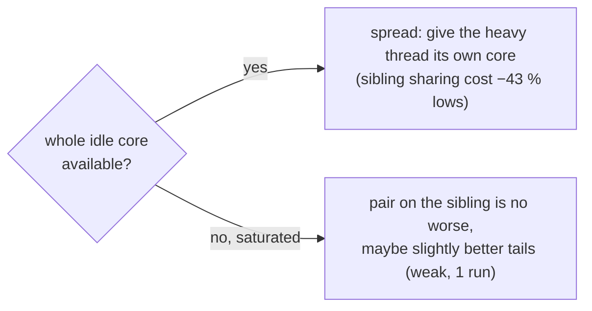

# sibwake: same-process wake → the waker's SMT sibling (2026-10-12)

| Verdict | Kernel | Evidence level | Patch | Data |
|---|---|---|---|---|
| ❌ rejected as a default · 🧪 saturation-only variant open | 🐧 any sched_ext | game (KovaaK's) | [sibwake.patch](sibwake.patch) (`--toggle sibwake=1`) | `scx_cake_bench/runs/sibwake_20261012/` |

## ❓ Question

When a thread wakes another thread of the same process (shared memory: game → render,
DXVK submit → queue), does placing the wakee on the waker's idle SMT sibling (shared L1/L2)
beat cake's normal warm-home / whole-core placement?

## 🔧 Patch

In `select_cpu`, after seat retake: waker = current task, same `mm`, not in an IRQ handler,
sibling idle, allowed and not IRQ-bad → claim the sibling, insert with IMMED. Fired on
**31 %** of KovaaK's wakes.

## 📊 Evidence (6 × 20 s per run)

| sibwake vs default | avg FPS | p99 | p99.9 | 1 % low | 0.1 % low | jitter |
|---|---|---|---|---|---|---|
| idle cores free (one outside process ~1 core, equal in both arms) | **−19 %** (0/9) | **+42 %** (0/9) | +79 % | **−43 %** (0/9) | −43 % | +209 % |
| all cores busy (16 hogs) | −0.2 % | −2.1 % | −8.8 % (7/9) | +3.9 % (6/9) | +6.3 % (6/9) | −3.1 % |

## 🧩 Pattern

Universal rule from this: **never put a same-process partner on the sibling while a whole
idle core exists.** Open: a saturation-only variant (fire only when no whole idle core
exists) — the loaded gain is small and from one run.
